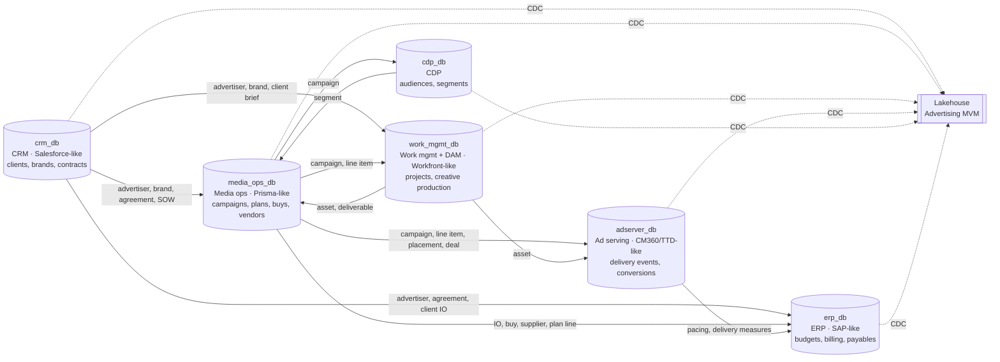
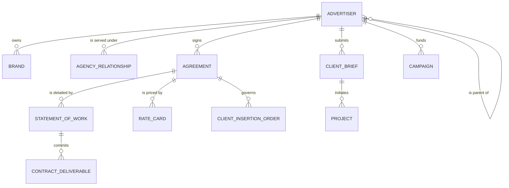
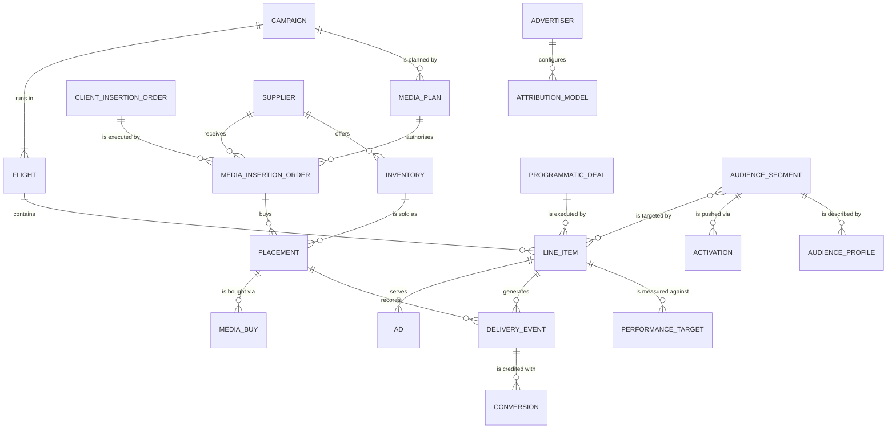
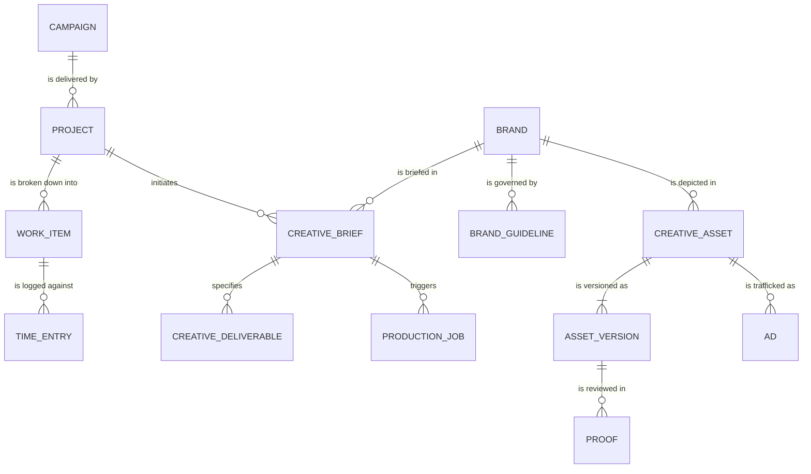
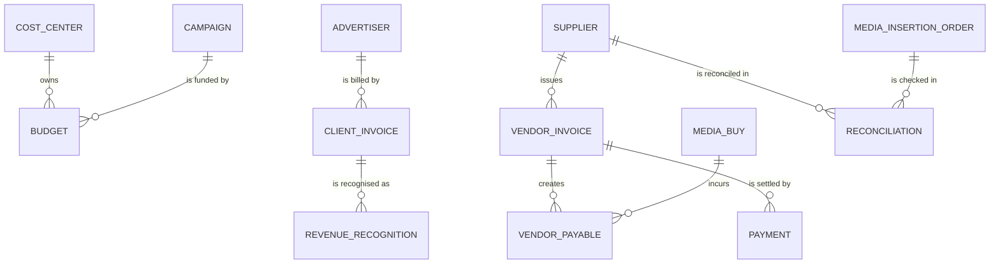

# Conceptual model: Advertising source systems

**Scope:** the operational (OLTP) source systems of an advertising and marketing agency. Together
they produce the data that feeds the Databricks Advertising lakehouse MVM
(`source/mvm`, 10 domains, 95 products).
**Audience:** business stakeholders, architects and data engineers.
**Level:** business concepts and their relationships only. Attributes and keys are covered in the
[logical models](../logical/), and tables, types and constraints in the [physical models](../physical/).

## 1. System landscape

The agency runs six operational systems. Each one is the **system of record** for a set of business
concepts. The others refer to those concepts by identifier (soft references), and all six feed the
lakehouse through change data capture.

Arrows point from the **owning** system to the systems that **reference** its concepts. The
heaviest reference flows are ad serving → media ops (62 references), ERP → media ops (55) and
work management → CRM (43); see [cross_system_refs.csv](../../mapping/cross_system_refs.csv).

## 2. Business concepts

| Concept | Definition | System of record | Realised by (MVM products) |
|---|---|---|---|
| **Advertiser** | A client organisation the agency serves, within its corporate hierarchy. | crm_db | advertiser, advertiser_hierarchy |
| **Brand** | A brand or sub-brand owned by an advertiser. | crm_db | brand |
| **Agency relationship** | The engagement between the agency and an advertiser (AOR, retainer, project), with its account team and revenue targets. | crm_db | agency_relationship, account_team, revenue_target |
| **Client brief** | A client's request that starts a campaign, project or creative work. | crm_db | client_brief |
| **Agreement** | A commercial contract (MSA, vendor contract), with its terms, SLAs, amendments and renewals. | crm_db | agreement, term, sla, amendment, renewal |
| **Statement of work** | The scoped, priced engagement under an agreement, with its contractual deliverables. | crm_db | sow, contract_deliverable |
| **Rate card** | The negotiated price list attached to an agreement. | crm_db | contract_rate_card, rate_card_line |
| **Client insertion order** | The client-side authorisation of media spend. | crm_db | contract_insertion_order |
| **Campaign** | The advertising initiative: objectives, KPIs, budget and dates. | media_ops_db | campaign, campaign_kpi_target |
| **Flight** | A time-boxed burst within a campaign. | media_ops_db | flight |
| **Line item** | The atomic buyable unit within a flight, with its budget, pacing and targeting rules. | media_ops_db | line_item, budget_allocation, pacing_rule, targeting_rule |
| **Ad** | A creative trafficked under a line item, and the trafficking orders that activate it. | media_ops_db | ad, creative_assignment, trafficking_order, trafficking_instruction |
| **Media plan** | The planned channel and vehicle mix and its schedule. | media_ops_db | plan, plan_line, schedule |
| **Media insertion order** | The vendor-facing IO that commits spend with a supplier. | media_ops_db | media_insertion_order |
| **Placement** | A purchased ad position on a publisher property. | media_ops_db | media_placement, placement |
| **Media buy** | The event of committing spend against an IO and a plan line. | media_ops_db | buy |
| **Programmatic deal** | A PMP, preferred or guaranteed deal on a DSP/SSP. | media_ops_db | programmatic_deal |
| **Inventory** | The channels, ad formats and publisher properties available to buy. | media_ops_db | ad_channel, ad_format, publisher_property |
| **Supplier** | A third-party vendor (publisher, tech partner or production supplier) with its accreditations and rate cards. | media_ops_db | supplier, publisher, tech_partner, accreditation, vendor_rate_card |
| **Project** | An agency engagement or initiative, with its brief, budget and resource plan. | work_mgmt_db | initiative, project_brief, project_budget, resource_plan |
| **Work item** | A WBS node, milestone, task or assignment, plus the time logged against it. | work_mgmt_db | work_package, milestone, task, assignment, time_entry, deliverable_tracker |
| **Creative brief** | The brief, with its brand guidelines, specs and concepts, that drives creative production. | work_mgmt_db | creative_brief, brand_guideline, spec, concept |
| **Creative asset** | A managed digital asset, with its versions and proofing rounds. | work_mgmt_db | asset, asset_version, proof |
| **Creative deliverable** | A committed creative output and the production job that produces it. | work_mgmt_db | creative_deliverable, production_job |
| **Delivery event** | A served impression, click, video quartile or viewability measurement. | adserver_db | impression_event, click_event, video_completion_event, viewability_measurement |
| **Conversion** | A post-click or post-view action, attributed under an attribution model and captured by a pixel. | adserver_db | conversion_event, attribution_model, tracking_pixel |
| **Performance target & pacing** | Planned KPI benchmarks and actual versus planned delivery. | adserver_db | performance_kpi_target, delivery_pacing |
| **Audience segment** | A targetable audience: its taxonomy, members, suppressions and lookalikes. | cdp_db | segment, taxonomy, segment_membership, suppression_list, lookalike_model |
| **Audience profile** | A behavioural or demographic profile, or a persona, that describes an audience. | cdp_db | behavioral_profile, demographic_profile, persona |
| **Activation** | Pushing a segment to a buying platform for a campaign. | cdp_db | activation |
| **Cost center & GL account** | The internal accounting structure. | erp_db | cost_center, gl_account |
| **Budget** | An approved financial envelope and its lines. | erp_db | finance_budget, budget_line |
| **Client invoice** | Billing to the advertiser, with lines and revenue recognition. | erp_db | client_invoice, invoice_line, revenue_recognition |
| **Vendor invoice & payable** | A supplier's invoice, its IO lines, the payable and the payment. | erp_db | invoice, io_line, vendor_payable, payment |
| **Reconciliation** | IO versus invoice versus delivered actuals, and vendor scorecards. | erp_db | reconciliation, media_cost_reconciliation, performance_evaluation |

## 3. Concept relationships

The model is split into four views. Concepts that appear in more than one view are the joints between
them: Advertiser, Campaign, Supplier and Creative asset. The verb phrases read from left to right.

### 3.1 Client and commercial

### 3.2 Plan, buy, deliver, measure

### 3.3 Create and produce

### 3.4 Money flow

## 4. Key business rules

1. An **advertiser** owns one or more **brands**. Advertisers form a hierarchy: holding company →
   subsidiary → brand owner.
2. Every **campaign** belongs to one advertiser and runs in one or more **flights**. A **line item**
   always sits in exactly one flight and serves zero or more **ads**.
3. Media spend is authorised twice: on the client side by a **client insertion order** (CRM,
   governed by an agreement), and on the vendor side by a **media insertion order** (media ops,
   issued to a supplier). The vendor IO executes the client IO.
4. A **placement** is bought under a media insertion order. **Delivery events** are recorded against
   placements and line items, and **conversions** are credited to delivery events under the
   advertiser's **attribution model**.
5. A **supplier** is mastered once, in media ops. The ERP refers to it for vendor invoices, payables
   and reconciliation.
6. **Reconciliation** compares IO-authorised spend, supplier-invoiced amounts and ad-server-delivered
   actuals.
7. Creative work flows from client brief → project → creative brief → production job → asset →
   asset version → proof → approved asset. The approved asset is then trafficked as an ad.
8. **Audience segments** are mastered in the CDP. Line items target them through targeting rules,
   and **activations** push them to buying platforms.

## 5. Traceability

| Layer | Artifact |
|---|---|
| Conceptual | This document |
| Logical | [models/logical/](../logical/): one model per system, with entities, attributes, domains, optionality and relationships |
| Physical | [models/physical/](../physical/): PostgreSQL DDL, DBML and physical ERDs per database |
| Dictionary | [dictionary/](../../dictionary/): every column, with type, constraints and MVM lineage |
| Lineage | [mapping/mvm_to_oltp_mapping.csv](../../mapping/mvm_to_oltp_mapping.csv): each of the 3,760 MVM attributes → its OLTP column |
