# Logical model: adserver_db

Generated by advgen from the pinned Advertising MVM; do not edit by hand. Regenerate with `uv run advgen build`.

**Source system role:** Google CM360 / The Trade Desk (ad serving and measurement). Raw delivery events (impressions, clicks, video quartiles, viewability, conversions), pacing snapshots, tracking pixels, attribution models and performance KPI targets.

The logical model is technology-neutral: entities, business attributes with logical domains, optionality, keys and every business relationship, **including relationships to entities owned by other systems** (marked *owned by …*). How each relationship is physically implemented (enforced FK vs soft reference) is decided in the physical model.

## Contents

- [performance.attribution_measurement](#performanceattribution_measurement)
- [performance.delivery_tracking](#performancedelivery_tracking)
- [Code sets](#code-sets)
- [Normalization notes](#normalization-notes)

## performance.attribution_measurement

| Entity | Kind | Definition |
|---|---|---|
| [attribution_model](#attribution_model) | master | Configuration master defining conversion attribution models, rules, and parameters for each advertiser and campaign. |
| [conversion_event](#conversion_event) | transactional | Conversion attribution event record capturing post-click and post-view conversion actions (purchases, sign-ups, form fills, app installs) tied to a specific campaign, line item, and creative. |
| [performance_kpi_target](#performance_kpi_target) | master | Operational KPI target record defining the planned performance benchmarks for each campaign, line item, or placement. |
| [tracking_pixel](#tracking_pixel) | master | Master record and complete operational event log for each tracking pixel or conversion tag deployed on advertiser web properties, app environments, or landing pages. |

```mermaid
erDiagram
    attribution_model {
        Identifier attribution_model_id PK
        Identifier advertiser_id FK "owned by crm_db"
        Identifier agency_relationship_id FK "owned by crm_db"
        Identifier brand_id FK "owned by crm_db"
        Identifier supplier_id FK "owned by media_ops_db"
    }
    conversion_event {
        Identifier conversion_event_id PK
        Identifier advertiser_id FK "owned by crm_db"
        Identifier asset_id FK "owned by work_mgmt_db"
        Identifier attribution_model_id FK
        Identifier brand_id FK "owned by crm_db"
        Identifier campaign_id FK "owned by media_ops_db"
        Identifier click_event_id FK
        Identifier contract_insertion_order_id FK "owned by crm_db"
        Identifier flight_id FK "owned by media_ops_db"
        Identifier impression_event_id FK
        Identifier line_item_id FK "owned by media_ops_db"
        Identifier lookalike_model_id FK "owned by cdp_db"
        Identifier media_placement_id FK "owned by media_ops_db"
        Identifier programmatic_deal_id FK "owned by media_ops_db"
        Identifier segment_id FK "owned by cdp_db"
        Identifier tracking_pixel_id FK
    }
    performance_kpi_target {
        Identifier performance_kpi_target_id PK
        Identifier agency_relationship_id FK "owned by crm_db"
        Identifier attribution_model_id FK
        Identifier buy_id FK "owned by media_ops_db"
        Identifier campaign_id FK "owned by media_ops_db"
        Identifier campaign_kpi_target_id FK "owned by media_ops_db"
        Identifier contract_insertion_order_id FK "owned by crm_db"
        Identifier creative_brief_id FK "owned by work_mgmt_db"
        Identifier creative_deliverable_id FK "owned by work_mgmt_db"
        Identifier flight_id FK "owned by media_ops_db"
        Identifier io_line_id FK "owned by erp_db"
        Identifier line_item_id FK "owned by media_ops_db"
        Identifier media_placement_id FK "owned by media_ops_db"
        Identifier plan_line_id FK "owned by media_ops_db"
        Identifier revenue_target_id FK "owned by crm_db"
        Identifier segment_id FK "owned by cdp_db"
        Identifier sla_id FK "owned by crm_db"
    }
    tracking_pixel {
        Identifier tracking_pixel_id PK
        Identifier ad_id FK "owned by media_ops_db"
        Identifier advertiser_id FK "owned by crm_db"
        Identifier agency_relationship_id FK "owned by crm_db"
        Identifier asset_id FK "owned by work_mgmt_db"
        Identifier brand_id FK "owned by crm_db"
        Identifier campaign_id FK "owned by media_ops_db"
        Identifier creative_deliverable_id FK "owned by work_mgmt_db"
        Identifier flight_id FK "owned by media_ops_db"
        Identifier line_item_id FK "owned by media_ops_db"
        Identifier media_placement_id FK "owned by media_ops_db"
        Identifier segment_id FK "owned by cdp_db"
        Identifier sow_id FK "owned by crm_db"
        Identifier supplier_id FK "owned by media_ops_db"
        Identifier tech_partner_id FK "owned by media_ops_db"
        Identifier trafficking_instruction_id FK "owned by media_ops_db"
    }
    advertiser |o--o{ attribution_model : "advertiser_id"
    agency_relationship |o--o{ attribution_model : "agency_relationship_id"
    brand |o--o{ attribution_model : "brand_id"
    supplier |o--o{ attribution_model : "supplier_id"
    advertiser |o--o{ conversion_event : "advertiser_id"
    asset |o--o{ conversion_event : "asset_id"
    attribution_model |o--o{ conversion_event : "attribution_model_id"
    brand |o--o{ conversion_event : "brand_id"
    campaign |o--o{ conversion_event : "campaign_id"
    click_event |o--o{ conversion_event : "click_event_id"
    contract_insertion_order |o--o{ conversion_event : "contract_insertion_order_id"
    flight |o--o{ conversion_event : "flight_id"
    impression_event |o--o{ conversion_event : "impression_event_id"
    line_item |o--o{ conversion_event : "line_item_id"
    lookalike_model |o--o{ conversion_event : "lookalike_model_id"
    media_placement |o--o{ conversion_event : "media_placement_id"
    programmatic_deal |o--o{ conversion_event : "programmatic_deal_id"
    segment |o--o{ conversion_event : "segment_id"
    tracking_pixel |o--o{ conversion_event : "tracking_pixel_id"
    agency_relationship |o--o{ performance_kpi_target : "agency_relationship_id"
    attribution_model |o--o{ performance_kpi_target : "attribution_model_id"
    buy |o--o{ performance_kpi_target : "buy_id"
    campaign |o--o{ performance_kpi_target : "campaign_id"
    campaign_kpi_target |o--o{ performance_kpi_target : "campaign_kpi_target_id"
    contract_insertion_order |o--o{ performance_kpi_target : "contract_insertion_order_id"
    creative_brief |o--o{ performance_kpi_target : "creative_brief_id"
    creative_deliverable |o--o{ performance_kpi_target : "creative_deliverable_id"
    flight |o--o{ performance_kpi_target : "flight_id"
    io_line |o--o{ performance_kpi_target : "io_line_id"
    line_item |o--o{ performance_kpi_target : "line_item_id"
    media_placement |o--o{ performance_kpi_target : "media_placement_id"
    plan_line |o--o{ performance_kpi_target : "plan_line_id"
    revenue_target |o--o{ performance_kpi_target : "revenue_target_id"
    segment |o--o{ performance_kpi_target : "segment_id"
    sla |o--o{ performance_kpi_target : "sla_id"
    ad |o--o{ tracking_pixel : "ad_id"
    advertiser |o--o{ tracking_pixel : "advertiser_id"
    agency_relationship |o--o{ tracking_pixel : "agency_relationship_id"
    asset |o--o{ tracking_pixel : "asset_id"
    brand |o--o{ tracking_pixel : "brand_id"
    campaign |o--o{ tracking_pixel : "campaign_id"
    creative_deliverable |o--o{ tracking_pixel : "creative_deliverable_id"
    flight |o--o{ tracking_pixel : "flight_id"
    line_item |o--o{ tracking_pixel : "line_item_id"
    media_placement |o--o{ tracking_pixel : "media_placement_id"
    segment |o--o{ tracking_pixel : "segment_id"
    sow |o--o{ tracking_pixel : "sow_id"
    supplier |o--o{ tracking_pixel : "supplier_id"
    tech_partner |o--o{ tracking_pixel : "tech_partner_id"
    trafficking_instruction |o--o{ tracking_pixel : "trafficking_instruction_id"
```

### attribution_model

Configuration master defining conversion attribution models, rules, and parameters for each advertiser and campaign. Stores model type (last-click, first-click, linear, time-decay, position-based, data-driven/algorithmic, custom), attribution windows (view-through duration, click-through duration), cross-device graph enablement, cross-channel scope, lookback window constraints, fractional credit distribution weights, model training metadata (for data-driven models), and activation status with effective date range. Governs how conversion_event records distribute credit across campaign touchpoints. Model changes trigger reprocessing of historical conversions within the affected attribution window. Supports A/B model comparison and incrementality testing workflows.

**Primary identifier:** `attribution_model_id`. **Business key(s):** `model_code`

| Attribute | Business name | Domain | Opt. | Key | Definition |
|---|---|---|---|---|---|
| `attribution_model_id` | Attribution Model Identifier (ID) | Identifier | M | PK | Unique identifier for the attribution model configuration. |
| `advertiser_id` | Advertiser Identifier (ID) | Identifier → advertiser (crm_db) | O | FK | Reference to the advertiser for whom this attribution model is configured. |
| `agency_relationship_id` | Agency Relationship Id (Foreign Key) | Identifier → agency_relationship (crm_db) | O | FK | Foreign key linking to client.agency_relationship. |
| `brand_id` | Client Brand Id (Foreign Key) | Identifier → brand (crm_db) | O | FK | Foreign key linking to client.brand. |
| `supplier_id` | Supplier Id (Foreign Key) | Identifier → supplier (media_ops_db) | O | FK | Foreign key linking to vendor.supplier. |
| `approved_by` | Approved By User | Text | O |  | Username or identifier of the user who approved this attribution model configuration for activation. |
| `approved_timestamp` | Approved Timestamp | Timestamp | O |  | Timestamp when this attribution model configuration was approved for activation. |
| `attribution_model_description` | Attribution Model Description | Text | O |  | Detailed business description of the attribution model configuration, including rationale, use cases, and any special rules or exclusions. |
| `attribution_model_status` | Attribution Model Status | Code | M |  | Current lifecycle status of the attribution model configuration. |
| `channel_scope` | Channel Scope | Text | O |  | Defines which marketing channels this attribution model includes in the customer journey. |
| `click_through_window_days` | Click-Through Attribution Window (Days) | Quantity | O |  | Number of days after a click during which a conversion can be attributed to that click event. |
| `comparison_group_code` | Comparison Group Identifier (ID) | Business Code | O |  | Identifier linking this attribution model to an A/B testing or incrementality testing group for model comparison workflows. |
| `conversion_event_scope` | Conversion Event Scope | Text | O |  | Defines which conversion events this attribution model applies to. |
| `cross_channel_enabled` | Cross-Channel Attribution Enabled Flag | Indicator | M |  | Indicates whether the attribution model tracks and attributes conversions across multiple marketing channels (display, search, social, video, email, OOH, CTV, etc.). |
| `cross_device_enabled` | Cross-Device Attribution Enabled Flag | Indicator | M |  | Indicates whether the attribution model uses cross-device identity graph to track and attribute conversions across multiple devices (desktop, mobile, tablet, CTV) for the same use… |
| `data_driven_algorithm_version` | Data-Driven Algorithm Version | Text | O |  | For data-driven (algorithmic) attribution models, the version identifier of the machine learning algorithm or model used to calculate fractional credit distribution. |
| `data_driven_minimum_conversions` | Data-Driven Minimum Conversions Threshold | Quantity | O |  | For data-driven attribution models, the minimum number of conversions required in the training dataset for the model to be statistically valid. |
| `data_driven_minimum_paths` | Data-Driven Minimum Paths Threshold | Quantity | O |  | For data-driven attribution models, the minimum number of unique customer journey paths required in the training dataset for the model to be statistically valid. |
| `data_driven_training_end_date` | Data-Driven Model Training End Date | Date | O |  | For data-driven attribution models, the end date of the historical data period used to train the machine learning model. |
| `data_driven_training_start_date` | Data-Driven Model Training Start Date | Date | O |  | For data-driven attribution models, the start date of the historical data period used to train the machine learning model. |
| `effective_end_date` | Effective End Date | Date | O |  | The date on which this attribution model configuration ceases to be active. |
| `effective_start_date` | Effective Start Date | Date | O |  | The date from which this attribution model configuration becomes active and begins applying to conversion events. |
| `lookback_window_days` | Lookback Window (Days) | Quantity | O |  | Maximum number of days to look back in the customer journey when attributing conversions. |
| `model_code` | Attribution Model Code | Business Code | M | UK | Short alphanumeric code or identifier for the attribution model used in reporting and system integration. |
| `model_name` | Attribution Model Name | Name | M |  | Business-friendly name for the attribution model configuration (e.g., 'Q1 2024 Last-Click Model', 'Brand Awareness Linear Model'). |
| `model_type` | Attribution Model Type | Code | O |  | The type of attribution methodology applied: last-click (100% credit to final touchpoint), first-click (100% credit to initial touchpoint), linear (equal credit across all touchpo… |
| `position_based_first_touch_weight` | Position-Based First-Touch Weight | Rate | O |  | For position-based (U-shaped) attribution models, the fractional credit weight assigned to the first touchpoint (e.g., 0.4000 for 40%). |
| `position_based_last_touch_weight` | Position-Based Last-Touch Weight | Rate | O |  | For position-based (U-shaped) attribution models, the fractional credit weight assigned to the last touchpoint (e.g., 0.4000 for 40%). |
| `position_based_middle_touch_weight` | Position-Based Middle-Touch Weight | Rate | O |  | For position-based (U-shaped) attribution models, the fractional credit weight distributed equally among all middle touchpoints (e.g., 0.2000 for 20% total). |
| `reprocessing_required_flag` | Reprocessing Required Flag | Indicator | M |  | Indicates whether historical conversion events within the attribution window need to be reprocessed due to changes in this model configuration. |
| `reprocessing_start_date` | Reprocessing Start Date | Date | O |  | The earliest date from which historical conversion events should be reprocessed when model configuration changes. |
| `time_decay_half_life_days` | Time-Decay Half-Life (Days) | Decimal | O |  | For time-decay attribution models, the number of days at which a touchpoint receives half the credit of the most recent touchpoint. |
| `view_through_window_days` | View-Through Attribution Window (Days) | Quantity | O |  | Number of days after an impression (view) during which a conversion can be attributed to that impression event, even without a click. |
| `created_at` | Created Timestamp | Timestamp | M |  | Timestamp when the row was inserted. |
| `created_by` | Created By User | Text | M |  | Application user (session setting app.actor) or database role that inserted the row. |
| `updated_at` | Modified Timestamp | Timestamp | M |  | Timestamp of the last update. |
| `updated_by` | Modified By User | Text | M |  | Application user or database role that last updated the row. |

### conversion_event

Conversion attribution event record capturing post-click and post-view conversion actions (purchases, sign-ups, form fills, app installs) tied to a specific campaign, line item, and creative. Stores conversion type, attribution window, attribution model (last-click, data-driven, linear), conversion value, and deduplication key. Source of CPA and ROAS actuals. Linked to conversion tags and tracking pixels deployed on advertiser properties.

**Primary identifier:** `conversion_event_id`

| Attribute | Business name | Domain | Opt. | Key | Definition |
|---|---|---|---|---|---|
| `conversion_event_id` | Conversion Event ID | Identifier | M | PK | Unique identifier for the conversion event record. |
| `advertiser_id` | Advertiser ID | Identifier → advertiser (crm_db) | O | FK | Identifier of the advertiser client who owns this conversion event. |
| `asset_id` | Creative ID | Identifier → asset (work_mgmt_db) | O | FK | Identifier of the creative asset that was served and led to this conversion. |
| `attribution_model_id` | Attribution Model Id (Foreign Key) | Identifier → attribution_model | O | FK | Foreign key linking to performance.attribution_model. |
| `brand_id` | Client Brand Id (Foreign Key) | Identifier → brand (crm_db) | O | FK | Foreign key linking to client.brand. |
| `campaign_id` | Campaign ID | Identifier → campaign (media_ops_db) | O | FK | Identifier of the campaign that drove this conversion event. |
| `click_event_id` | Click Event Id (Foreign Key) | Identifier → click_event | O | FK | Foreign key linking to performance.click_event. |
| `contract_insertion_order_id` | Contract Insertion Order Id (Foreign Key) | Identifier → contract_insertion_order (crm_db) | O | FK | Foreign key linking to contract.contract_insertion_order. |
| `flight_id` | Flight Id (Foreign Key) | Identifier → flight (media_ops_db) | O | FK | Foreign key linking to campaign.flight. |
| `impression_event_id` | Impression Event Id (Foreign Key) | Identifier → impression_event | O | FK | Foreign key linking to performance.impression_event. |
| `line_item_id` | Line Item ID | Identifier → line_item (media_ops_db) | O | FK | Identifier of the line item within the campaign that generated this conversion. |
| `lookalike_model_id` | Lookalike Model Id (Foreign Key) | Identifier → lookalike_model (cdp_db) | O | FK | Foreign key linking to audience.lookalike_model. |
| `media_placement_id` | Placement ID | Identifier → media_placement (media_ops_db) | O | FK | Identifier of the media placement where the ad was displayed. |
| `programmatic_deal_id` | Programmatic Deal Id (Foreign Key) | Identifier → programmatic_deal (media_ops_db) | O | FK | Foreign key linking to media.programmatic_deal. |
| `segment_id` | Audience Segment Id (Foreign Key) | Identifier → segment (cdp_db) | O | FK | Foreign key linking to audience.segment. |
| `tracking_pixel_id` | Tracking Pixel Id (Foreign Key) | Identifier → tracking_pixel | O | FK | Foreign key linking to performance.tracking_pixel. |
| `attribution_type` | Attribution Type | Code | O |  | Indicates whether this conversion was attributed to a click-through or view-through interaction. |
| `attribution_window_days` | Attribution Window Days | Quantity | O |  | The number of days after ad interaction (click or impression) during which a conversion can be attributed to that interaction. |
| `browser` | Browser | Text | O |  | The web browser used by the user at the time of conversion (e.g., Chrome, Safari, Firefox, Edge). |
| `conversion_currency` | Conversion Currency | Currency Code | O |  | Three-letter ISO 4217 currency code for the conversion value (e.g., USD, EUR, GBP). |
| `conversion_name` | Conversion Name | Name | O |  | Human-readable name or label for the specific conversion action as defined by the advertiser (e.g., 'Product Purchase', 'Newsletter Signup', 'Demo Request'). |
| `conversion_page_url` | Conversion Page URL | URL | O |  | The URL of the advertiser page where the conversion action was completed. |
| `conversion_quantity` | Conversion Quantity | Quantity | O |  | The number of units or items involved in the conversion (e.g., number of products purchased, number of form submissions). |
| `conversion_status` | Conversion Status | Code | M |  | The validation status of the conversion event (e.g., confirmed, pending verification, rejected, flagged as fraud). |
| `conversion_timestamp` | Conversion Timestamp | Timestamp | M | PK | The exact date and time when the conversion action occurred on the advertiser property. |
| `conversion_type` | Conversion Type | Code | O |  | The category of conversion action that occurred (e.g., purchase, sign-up, form fill, app install, lead generation, download). |
| `conversion_value` | Conversion Value | Amount | O |  | The monetary value associated with this conversion event (e.g., purchase amount, estimated lead value). |
| `data_source` | Data Source | Text | O |  | The system or platform that captured and reported this conversion event (e.g., Google Campaign Manager 360, The Trade Desk, Salesforce Marketing Cloud). |
| `deduplication_key` | Deduplication Key | Business Code | O |  | Unique key used to prevent duplicate counting of the same conversion event across multiple tracking sources or attribution models. |
| `device_type` | Device Type | Code | O |  | The type of device on which the conversion occurred (e.g., desktop, mobile, tablet, CTV - Connected TV, other). |
| `fraud_score` | Fraud Score | Rate | O |  | A numeric score (0-100) indicating the likelihood that this conversion is fraudulent, as determined by fraud detection systems. |
| `geo_city` | Geographic City | Text | O |  | City where the conversion occurred, derived from IP geolocation. |
| `geo_country` | Geographic Country | ISO Code | O |  | Three-letter ISO 3166-1 alpha-3 country code where the conversion occurred (e.g., USA, GBR, CAN). |
| `geo_region` | Geographic Region | Text | O |  | State, province, or region where the conversion occurred (e.g., California, Ontario, Bavaria). |
| `ip_address` | IP Address | Text | O |  | The IP address of the user at the time of conversion. |
| `is_duplicate` | Is Duplicate | Indicator | M |  | Flag indicating whether this conversion event was identified as a duplicate and excluded from reporting (True/False). |
| `landing_page_url` | Landing Page URL | URL | O |  | The URL of the advertiser page where the user landed after clicking the ad. |
| `operating_system` | Operating System | Text | O |  | The operating system of the device on which the conversion occurred (e.g., Windows, macOS, iOS, Android). |
| `order_reference` | Order ID | Business Code | O |  | The advertiser's internal order or transaction identifier associated with this conversion (e.g., e-commerce order number). |
| `product_category` | Product Category | Text | O |  | The category of product or service involved in the conversion (e.g., Electronics, Apparel, Financial Services). |
| `referrer_url` | Referrer URL | URL | O |  | The URL of the page from which the user navigated to the conversion page. |
| `user_identifier` | User Identifier | Text | O |  | Pseudonymized or hashed identifier for the user who completed the conversion action. |
| `created_at` | Created Timestamp | Timestamp | M |  | Timestamp when the row was inserted. |
| `created_by` | Created By | Text | M |  | Application user (session setting app.actor) or database role that inserted the row. |
| `updated_at` | Updated Timestamp | Timestamp | M |  | Timestamp of the last update. |
| `updated_by` | Updated By | Text | M |  | Application user or database role that last updated the row. |

### performance_kpi_target

Operational KPI target record defining the planned performance benchmarks for each campaign, line item, or placement. Stores KPI type (CPM, CPC, CPA, CTR, ROAS, VTR, viewability rate, GRP, SOV), target value, target period, tolerance band (acceptable variance percentage), and source (IO commitment, client brief, internal benchmark). Used for pacing alerts, delivery_pacing comparisons, and client performance reporting. Distinct from finance budgets: this is the performance measurement target, not the financial spend target.

**Primary identifier:** `performance_kpi_target_id`

| Attribute | Business name | Domain | Opt. | Key | Definition |
|---|---|---|---|---|---|
| `performance_kpi_target_id` | Performance Key Performance Indicator (KPI) Target Identifier | Identifier | M | PK | Unique identifier for the performance KPI target record. |
| `agency_relationship_id` | Agency Relationship Id (Foreign Key) | Identifier → agency_relationship (crm_db) | O | FK | Foreign key linking to client.agency_relationship. |
| `attribution_model_id` | Attribution Model Id (Foreign Key) | Identifier → attribution_model | O | FK | Foreign key linking to performance.attribution_model. |
| `buy_id` | Buy Id (Foreign Key) | Identifier → buy (media_ops_db) | O | FK | Foreign key linking to media.buy. |
| `campaign_id` | Campaign Identifier | Identifier → campaign (media_ops_db) | O | FK | Reference to the campaign for which this KPI target is defined. |
| `campaign_kpi_target_id` | Campaign Kpi Target Id (Foreign Key) | Identifier → campaign_kpi_target (media_ops_db) | O | FK | Foreign key linking to campaign.campaign_kpi_target. |
| `contract_insertion_order_id` | Contract Insertion Order Id (Foreign Key) | Identifier → contract_insertion_order (crm_db) | O | FK | Foreign key linking to contract.contract_insertion_order. |
| `creative_brief_id` | Creative Brief Id (Foreign Key) | Identifier → creative_brief (work_mgmt_db) | O | FK | Foreign key linking to creative.creative_brief. |
| `creative_deliverable_id` | Creative Deliverable Id (Foreign Key) | Identifier → creative_deliverable (work_mgmt_db) | O | FK | Foreign key linking to creative.creative_deliverable. |
| `flight_id` | Flight Id (Foreign Key) | Identifier → flight (media_ops_db) | O | FK | Foreign key linking to campaign.flight. |
| `io_line_id` | Vendor Io Line Id (Foreign Key) | Identifier → io_line (erp_db) | O | FK | Foreign key linking to vendor.io_line. |
| `line_item_id` | Line Item Identifier | Identifier → line_item (media_ops_db) | O | FK | Reference to the specific line item within a media plan or insertion order for which this KPI target applies. |
| `media_placement_id` | Placement Identifier | Identifier → media_placement (media_ops_db) | O | FK | Reference to the specific media placement for which this KPI target is defined. |
| `plan_line_id` | Plan Line Id (Foreign Key) | Identifier → plan_line (media_ops_db) | O | FK | Foreign key linking to media.plan_line. |
| `revenue_target_id` | Revenue Target Id (Foreign Key) | Identifier → revenue_target (crm_db) | O | FK | Foreign key linking to client.revenue_target. |
| `segment_id` | Audience Segment Id (Foreign Key) | Identifier → segment (cdp_db) | O | FK | Foreign key linking to audience.segment. |
| `sla_id` | Sla Id (Foreign Key) | Identifier → sla (crm_db) | O | FK | Foreign key linking to contract.sla. |
| `alert_enabled` | Alert Enabled Flag | Indicator | M |  | Boolean flag indicating whether automated alerts should be triggered when performance deviates from target thresholds. |
| `alert_frequency` | Alert Frequency | Code | O |  | Frequency at which performance is evaluated against thresholds and alerts are generated. |
| `approved_by` | Approved By User | Text | O |  | Username or identifier of the user who approved this KPI target for activation. |
| `approved_timestamp` | Approved Timestamp | Timestamp | O |  | Timestamp when this KPI target was approved for activation. |
| `is_contractual_commitment` | Is Contractual Commitment Flag | Indicator | M |  | Boolean flag indicating whether this KPI target represents a contractual commitment to the client (typically from Insertion Order or Statement of Work). |
| `kpi_type` | Key Performance Indicator (KPI) Type | Code (kpi_type) | O |  | The type of performance metric being targeted. |
| `lookback_window_days` | Lookback Window Days | Quantity | O |  | Number of days after ad exposure during which conversions are attributed to the campaign for conversion-based KPIs. |
| `lower_threshold` | Lower Threshold Value | Rate | O |  | The minimum acceptable value for this KPI. |
| `measurement_methodology` | Measurement Methodology | Text | O |  | Description of how this KPI is measured and calculated, including data sources, attribution models, and calculation logic. |
| `notes` | Target Notes | Text | O |  | Free-text field for additional context, assumptions, or special instructions related to this KPI target. |
| `priority_level` | Priority Level | Code | O |  | Business priority assigned to this KPI target. |
| `target_currency_code` | Target Currency Code | Currency Code | O |  | Three-letter ISO 4217 currency code for monetary KPI targets (CPM, CPC, CPA, ROAS). |
| `target_name` | Key Performance Indicator (KPI) Target Name | Name | M |  | Human-readable name or label for this KPI target record, used for identification and reporting purposes. |
| `target_period_end_date` | Target Period End Date | Date | O |  | The end date of the period for which this KPI target is applicable. |
| `target_period_start_date` | Target Period Start Date | Date | O |  | The start date of the period for which this KPI target is applicable. |
| `target_source` | Target Source | Code | O |  | The origin or basis for this KPI target. |
| `target_status` | Target Status | Code | M |  | Current lifecycle status of the KPI target. |
| `target_unit` | Target Unit of Measure | Code | O |  | The unit of measure for the target value. |
| `target_value` | Target Value | Amount | O |  | The numeric target value for the specified KPI. |
| `tolerance_percentage` | Tolerance Percentage | Percentage | O |  | Acceptable variance percentage from the target value before triggering alerts or escalations. |
| `upper_threshold` | Upper Threshold Value | Rate | O |  | The maximum acceptable value for this KPI (relevant for cost-based metrics where exceeding target is negative). |
| `viewability_standard` | Viewability Standard | Code | O |  | The viewability measurement standard applied for viewability_rate KPI targets. |
| `created_at` | Created Timestamp | Timestamp | M |  | Timestamp when the row was inserted. |
| `created_by` | Created By User | Text | M |  | Application user (session setting app.actor) or database role that inserted the row. |
| `updated_at` | Modified Timestamp | Timestamp | M |  | Timestamp of the last update. |
| `updated_by` | Modified By User | Text | M |  | Application user or database role that last updated the row. |

### tracking_pixel

Master record and complete operational event log for each tracking pixel or conversion tag deployed on advertiser web properties, app environments, or landing pages. Header section stores pixel definition: name, type (impression tracker, click tracker, conversion tag, retargeting pixel, audience pixel), implementation method (JavaScript, image pixel, server-to-server), firing rules, consent flags, and deployment status. Detail section stores the complete fire event history: individual fire timestamps, firing URL, user agent, IP hash (GDPR-compliant), referrer URL, custom parameters passed, fire status (success/blocked/timeout), and error details. Single source of truth for all pixel infrastructure configuration AND raw fire event data. Serves as the unified measurement infrastructure registry, pixel health monitoring source, and raw fire event stream for conversion deduplication and data quality validation. Supports GDPR/CCPA consent compliance workflows and tag governance audits.

**Primary identifier:** `tracking_pixel_id`. **Business key(s):** `pixel_code`

| Attribute | Business name | Domain | Opt. | Key | Definition |
|---|---|---|---|---|---|
| `tracking_pixel_id` | Tracking Pixel ID | Identifier | M | PK | Unique identifier for the tracking pixel or conversion tag record. |
| `ad_id` | Ad Id (Foreign Key) | Identifier → ad (media_ops_db) | O | FK | Foreign key linking to campaign.ad. |
| `advertiser_id` | Advertiser ID | Identifier → advertiser (crm_db) | O | FK | Reference to the advertiser client whose property or campaign this pixel is deployed on. |
| `agency_relationship_id` | Agency Relationship Id (Foreign Key) | Identifier → agency_relationship (crm_db) | O | FK | Foreign key linking to client.agency_relationship. |
| `asset_id` | Creative Asset Id (Foreign Key) | Identifier → asset (work_mgmt_db) | O | FK | Foreign key linking to creative.asset. |
| `brand_id` | Client Brand Id (Foreign Key) | Identifier → brand (crm_db) | O | FK | Foreign key linking to client.brand. |
| `campaign_id` | Campaign ID | Identifier → campaign (media_ops_db) | O | FK | Reference to the advertising campaign this pixel is associated with for measurement purposes. |
| `creative_deliverable_id` | Creative Deliverable Id (Foreign Key) | Identifier → creative_deliverable (work_mgmt_db) | O | FK | Foreign key linking to creative.creative_deliverable. |
| `flight_id` | Flight Id (Foreign Key) | Identifier → flight (media_ops_db) | O | FK | Foreign key linking to campaign.flight. |
| `line_item_id` | Line Item Id (Foreign Key) | Identifier → line_item (media_ops_db) | O | FK | Foreign key linking to campaign.line_item. |
| `media_placement_id` | Placement ID | Identifier → media_placement (media_ops_db) | O | FK | Reference to the specific media placement or ad unit this pixel is tracking. |
| `segment_id` | Audience Segment Id (Foreign Key) | Identifier → segment (cdp_db) | O | FK | Foreign key linking to audience.segment. |
| `sow_id` | Sow Id (Foreign Key) | Identifier → sow (crm_db) | O | FK | Foreign key linking to contract.sow. |
| `supplier_id` | Supplier Id (Foreign Key) | Identifier → supplier (media_ops_db) | O | FK | Foreign key linking to vendor.supplier. |
| `tech_partner_id` | Tech Partner Id (Foreign Key) | Identifier → tech_partner (media_ops_db) | O | FK | Foreign key linking to vendor.tech_partner. |
| `trafficking_instruction_id` | Trafficking Instruction Id (Foreign Key) | Identifier → trafficking_instruction (media_ops_db) | O | FK | Foreign key linking to media.trafficking_instruction. |
| `browser_name` | Browser Name | Name | O |  | Name of the web browser in which the pixel fired, parsed from the user agent string. |
| `consent_category` | Consent Category | Code | O |  | Privacy consent category under which this pixel operates, determining when it may fire based on user consent preferences. |
| `consent_required_flag` | Consent Required Flag | Indicator | M |  | Indicates whether user consent is required before the pixel can fire, per privacy regulations. |
| `conversion_currency_code` | Conversion Currency Code | Currency Code | O |  | Three-letter ISO 4217 currency code for the conversion value. |
| `conversion_value` | Conversion Value | Amount | O |  | Monetary value associated with a conversion event tracked by this pixel, used for ROAS calculation. |
| `custom_parameters` | Custom Parameters | Text | O |  | Additional key-value pairs or query string parameters passed with the pixel fire for custom tracking dimensions. |
| `deduplication_key` | Deduplication Key | Business Code | O |  | Unique identifier used to prevent duplicate counting of the same conversion event across multiple pixels or platforms. |
| `deployment_environment` | Deployment Environment | Code | O |  | The digital environment or platform type where the pixel is implemented. |
| `deployment_status` | Deployment Status | Code | M |  | Current operational status of the tracking pixel in the measurement infrastructure. |
| `deployment_url` | Deployment URL (Uniform Resource Locator) | URL | O |  | The advertiser web page, app screen, or landing page URL where this pixel is deployed. |
| `device_type` | Device Type | Code | O |  | Classification of the device on which the pixel fired, derived from user agent analysis. |
| `error_code` | Error Code | Business Code | O |  | Technical error code returned when a pixel fire fails, used for troubleshooting and data quality monitoring. |
| `error_message` | Error Message | Text | O |  | Human-readable description of the error that occurred during pixel fire, providing diagnostic detail. |
| `fire_status` | Fire Status | Code | O |  | Outcome status of the pixel fire attempt, indicating whether the tracking event was successfully recorded. |
| `fire_timestamp` | Fire Timestamp | Timestamp | O |  | Exact date and time when the pixel fire event occurred, representing the principal business event for this tracking record. |
| `firing_rule` | Firing Rule | Text | O |  | Business logic or condition that determines when the pixel should fire (e.g., page load, button click, form submission, time on page). |
| `geo_city` | Geographic City | Text | O |  | City derived from IP geolocation at time of pixel fire. |
| `geo_country_code` | Geographic Country Code | ISO Code | O |  | Three-letter ISO 3166-1 alpha-3 country code derived from IP geolocation at time of pixel fire. |
| `geo_region` | Geographic Region | Text | O |  | State, province, or region derived from IP geolocation at time of pixel fire. |
| `implementation_method` | Implementation Method | Code | O |  | Technical method used to deploy and fire the tracking pixel on the target property. |
| `ip_address_hash` | IP (Internet Protocol) Address Hash | Text | O |  | One-way cryptographic hash of the user IP address, stored for fraud detection and geographic analysis while maintaining GDPR compliance. |
| `lookback_window_days` | Lookback Window Days | Quantity | O |  | Number of days after an ad interaction during which a conversion can be attributed to that interaction. |
| `notes` | Notes | Text | O |  | Free-form text field for additional comments, implementation instructions, or troubleshooting notes related to this pixel. |
| `operating_system` | Operating System | Text | O |  | Operating system of the device on which the pixel fired, parsed from the user agent string. |
| `pixel_code` | Pixel Code | Business Code | M | UK | Unique external code or identifier for the pixel used in trafficking and reporting systems. |
| `pixel_name` | Pixel Name | Name | M |  | Human-readable name assigned to the tracking pixel for identification and management purposes. |
| `pixel_type` | Pixel Type | Code | O |  | Classification of the tracking pixel based on its measurement purpose and firing trigger. |
| `pixel_url` | Pixel URL (Uniform Resource Locator) | URL | O |  | Full URL endpoint that the pixel fires to when triggered, including protocol and domain. |
| `referrer_url` | Referrer URL (Uniform Resource Locator) | URL | O |  | The URL of the page that referred the user to the page where the pixel fired, used for traffic source analysis. |
| `user_agent` | User Agent | Text | O |  | Browser or application user agent string captured at the time of pixel fire, used for device and browser classification. |
| `created_at` | Created Timestamp | Timestamp | M |  | Timestamp when the row was inserted. |
| `created_by` | Created By User | Text | M |  | Application user (session setting app.actor) or database role that inserted the row. |
| `updated_at` | Modified Timestamp | Timestamp | M |  | Timestamp of the last update. |
| `updated_by` | Modified By User | Text | M |  | Application user or database role that last updated the row. |

## performance.delivery_tracking

| Entity | Kind | Definition |
|---|---|---|
| [click_event](#click_event) | transactional | Raw click interaction event record capturing each user click on a served ad unit. |
| [delivery_pacing](#delivery_pacing) | transactional | Real-time and near-real-time delivery pacing record tracking actual vs. |
| [impression_event](#impression_event) | transactional | Raw delivery event record capturing each individual ad impression served across all channels and placements. |
| [video_completion_event](#video_completion_event) | transactional | Video ad completion event record capturing quartile-level video engagement signals (25%, 50%, 75%, 100% completion) per video ad impression. |
| [viewability_measurement](#viewability_measurement) | transactional | Viewability measurement record per impression or placement-day, capturing MRC-compliant viewability signals: in-view percentage, time-in-view (seconds), viewable impression count, measurable impression count, and viewab… |

```mermaid
erDiagram
    click_event {
        Identifier click_event_id PK
        Identifier ad_id FK "owned by media_ops_db"
        Identifier asset_id FK "owned by work_mgmt_db"
        Identifier campaign_id FK "owned by media_ops_db"
        Identifier contract_insertion_order_id FK "owned by crm_db"
        Identifier flight_id FK "owned by media_ops_db"
        Identifier impression_event_id FK
        Identifier line_item_id FK "owned by media_ops_db"
        Identifier media_placement_id FK "owned by media_ops_db"
        Identifier publisher_id FK "owned by media_ops_db"
        Identifier segment_id FK "owned by cdp_db"
        Identifier tracking_pixel_id FK
    }
    delivery_pacing {
        Identifier delivery_pacing_id PK
        Identifier activation_id FK "owned by cdp_db"
        Identifier buy_id FK "owned by media_ops_db"
        Identifier campaign_id FK "owned by media_ops_db"
        Identifier deliverable_tracker_id FK "owned by work_mgmt_db"
        Identifier flight_id FK "owned by media_ops_db"
        Identifier io_line_id FK "owned by erp_db"
        Identifier line_item_id FK "owned by media_ops_db"
        Identifier media_insertion_order_id FK "owned by media_ops_db"
        Identifier media_placement_id FK "owned by media_ops_db"
        Identifier pacing_rule_id FK "owned by media_ops_db"
        Identifier plan_line_id FK "owned by media_ops_db"
        Identifier programmatic_deal_id FK "owned by media_ops_db"
        Identifier segment_id FK "owned by cdp_db"
        Identifier sla_id FK "owned by crm_db"
        Identifier trafficking_order_id FK "owned by media_ops_db"
    }
    impression_event {
        Identifier impression_event_id PK
        Identifier activation_id FK "owned by cdp_db"
        Identifier ad_id FK "owned by media_ops_db"
        Identifier advertiser_id FK "owned by crm_db"
        Identifier asset_id FK "owned by work_mgmt_db"
        Identifier brand_id FK "owned by crm_db"
        Identifier campaign_id FK "owned by media_ops_db"
        Identifier contract_insertion_order_id FK "owned by crm_db"
        Identifier flight_id FK "owned by media_ops_db"
        Identifier line_item_id FK "owned by media_ops_db"
        Identifier lookalike_model_id FK "owned by cdp_db"
        Identifier media_placement_id FK "owned by media_ops_db"
        Identifier programmatic_deal_id FK "owned by media_ops_db"
        Identifier publisher_id FK "owned by media_ops_db"
        Identifier segment_id FK "owned by cdp_db"
        Identifier suppression_list_id FK "owned by cdp_db"
        Identifier trafficking_instruction_id FK "owned by media_ops_db"
        Identifier trafficking_order_id FK "owned by media_ops_db"
    }
    video_completion_event {
        Identifier video_completion_event_id PK
        Identifier ad_id FK "owned by media_ops_db"
        Identifier asset_id FK "owned by work_mgmt_db"
        Identifier buy_id FK "owned by media_ops_db"
        Identifier campaign_id FK "owned by media_ops_db"
        Identifier flight_id FK "owned by media_ops_db"
        Identifier impression_event_id FK
        Identifier line_item_id FK "owned by media_ops_db"
        Identifier media_placement_id FK "owned by media_ops_db"
        Identifier programmatic_deal_id FK "owned by media_ops_db"
        Identifier publisher_id FK "owned by media_ops_db"
        Identifier spec_id FK "owned by work_mgmt_db"
    }
    viewability_measurement {
        Identifier viewability_measurement_id PK
        Identifier asset_id FK "owned by work_mgmt_db"
        Identifier buy_id FK "owned by media_ops_db"
        Identifier campaign_id FK "owned by media_ops_db"
        Identifier flight_id FK "owned by media_ops_db"
        Identifier impression_event_id FK
        Identifier line_item_id FK "owned by media_ops_db"
        Identifier media_placement_id FK "owned by media_ops_db"
        Identifier programmatic_deal_id FK "owned by media_ops_db"
        Identifier publisher_id FK "owned by media_ops_db"
        Identifier sla_id FK "owned by crm_db"
        Identifier spec_id FK "owned by work_mgmt_db"
        Identifier supplier_id FK "owned by media_ops_db"
    }
    ad |o--o{ click_event : "ad_id"
    asset |o--o{ click_event : "asset_id"
    campaign |o--o{ click_event : "campaign_id"
    contract_insertion_order |o--o{ click_event : "contract_insertion_order_id"
    flight |o--o{ click_event : "flight_id"
    impression_event ||--o{ click_event : "impression_event_id"
    line_item |o--o{ click_event : "line_item_id"
    media_placement |o--o{ click_event : "media_placement_id"
    publisher |o--o{ click_event : "publisher_id"
    segment |o--o{ click_event : "segment_id"
    tracking_pixel |o--o{ click_event : "tracking_pixel_id"
    activation |o--o{ delivery_pacing : "activation_id"
    buy |o--o{ delivery_pacing : "buy_id"
    campaign ||--o{ delivery_pacing : "campaign_id"
    deliverable_tracker |o--o{ delivery_pacing : "deliverable_tracker_id"
    flight |o--o{ delivery_pacing : "flight_id"
    io_line |o--o{ delivery_pacing : "io_line_id"
    line_item ||--o{ delivery_pacing : "line_item_id"
    media_insertion_order |o--o{ delivery_pacing : "media_insertion_order_id"
    media_placement |o--o{ delivery_pacing : "media_placement_id"
    pacing_rule |o--o{ delivery_pacing : "pacing_rule_id"
    plan_line |o--o{ delivery_pacing : "plan_line_id"
    programmatic_deal |o--o{ delivery_pacing : "programmatic_deal_id"
    segment |o--o{ delivery_pacing : "segment_id"
    sla |o--o{ delivery_pacing : "sla_id"
    trafficking_order |o--o{ delivery_pacing : "trafficking_order_id"
    activation |o--o{ impression_event : "activation_id"
    ad |o--o{ impression_event : "ad_id"
    advertiser |o--o{ impression_event : "advertiser_id"
    asset |o--o{ impression_event : "asset_id"
    brand |o--o{ impression_event : "brand_id"
    campaign ||--o{ impression_event : "campaign_id"
    contract_insertion_order |o--o{ impression_event : "contract_insertion_order_id"
    flight |o--o{ impression_event : "flight_id"
    line_item |o--o{ impression_event : "line_item_id"
    lookalike_model |o--o{ impression_event : "lookalike_model_id"
    media_placement ||--o{ impression_event : "media_placement_id"
    programmatic_deal |o--o{ impression_event : "programmatic_deal_id"
    publisher |o--o{ impression_event : "publisher_id"
    segment |o--o{ impression_event : "segment_id"
    suppression_list |o--o{ impression_event : "suppression_list_id"
    trafficking_instruction |o--o{ impression_event : "trafficking_instruction_id"
    trafficking_order |o--o{ impression_event : "trafficking_order_id"
    ad |o--o{ video_completion_event : "ad_id"
    asset |o--o{ video_completion_event : "asset_id"
    buy |o--o{ video_completion_event : "buy_id"
    campaign |o--o{ video_completion_event : "campaign_id"
    flight |o--o{ video_completion_event : "flight_id"
    impression_event |o--o{ video_completion_event : "impression_event_id"
    line_item |o--o{ video_completion_event : "line_item_id"
    media_placement |o--o{ video_completion_event : "media_placement_id"
    programmatic_deal |o--o{ video_completion_event : "programmatic_deal_id"
    publisher |o--o{ video_completion_event : "publisher_id"
    spec |o--o{ video_completion_event : "spec_id"
    asset |o--o{ viewability_measurement : "asset_id"
    buy |o--o{ viewability_measurement : "buy_id"
    campaign |o--o{ viewability_measurement : "campaign_id"
    flight |o--o{ viewability_measurement : "flight_id"
    impression_event |o--o{ viewability_measurement : "impression_event_id"
    line_item |o--o{ viewability_measurement : "line_item_id"
    media_placement |o--o{ viewability_measurement : "media_placement_id"
    programmatic_deal |o--o{ viewability_measurement : "programmatic_deal_id"
    publisher |o--o{ viewability_measurement : "publisher_id"
    sla |o--o{ viewability_measurement : "sla_id"
    spec |o--o{ viewability_measurement : "spec_id"
    supplier |o--o{ viewability_measurement : "supplier_id"
```

### click_event

Raw click interaction event record capturing each user click on a served ad unit. Stores click timestamp, placement identifier, creative identifier, redirect URL, device fingerprint, and click validation status (invalid traffic / IVT flags per TAG/MRC standards). Source of CPC billing actuals and CTR computation inputs. Distinct from impression_event: represents a user-initiated interaction, not a passive delivery.

**Primary identifier:** `click_event_id`

| Attribute | Business name | Domain | Opt. | Key | Definition |
|---|---|---|---|---|---|
| `click_event_id` | Click Event Identifier (ID) | Identifier | M | PK | Unique identifier for each click event record. |
| `ad_id` | Ad Id (Foreign Key) | Identifier → ad (media_ops_db) | O | FK | Foreign key linking to campaign.ad. |
| `asset_id` | Creative Asset Identifier (ID) | Identifier → asset (work_mgmt_db) | O | FK | Reference to the creative asset that was clicked. |
| `campaign_id` | Campaign Identifier (ID) | Identifier → campaign (media_ops_db) | O | FK | Reference to the advertising campaign under which this click occurred. |
| `contract_insertion_order_id` | Contract Insertion Order Id (Foreign Key) | Identifier → contract_insertion_order (crm_db) | O | FK | Foreign key linking to contract.contract_insertion_order. |
| `flight_id` | Flight Id (Foreign Key) | Identifier → flight (media_ops_db) | O | FK | Foreign key linking to campaign.flight. |
| `impression_event_id` | Impression Event Identifier (ID) | Identifier → impression_event | M | FK | Reference to the parent impression event that was served before this click occurred. |
| `line_item_id` | Line Item Id (Foreign Key) | Identifier → line_item (media_ops_db) | O | FK | Foreign key linking to campaign.line_item. |
| `media_placement_id` | Media Placement Identifier (ID) | Identifier → media_placement (media_ops_db) | O | FK | Reference to the media placement where the clicked ad was served. |
| `publisher_id` | Publisher Id (Foreign Key) | Identifier → publisher (media_ops_db) | O | FK | Foreign key linking to vendor.publisher. |
| `segment_id` | Audience Segment Id (Foreign Key) | Identifier → segment (cdp_db) | O | FK | Foreign key linking to audience.segment. |
| `tracking_pixel_id` | Tracking Pixel Id (Foreign Key) | Identifier → tracking_pixel | O | FK | Foreign key linking to performance.tracking_pixel. |
| `ad_server_name` | Ad Server Name | Name | O |  | The name or identifier of the ad server that recorded and tracked this click event (e.g., Google Campaign Manager 360, Sizmek, Flashtalking). |
| `attribution_window_hours` | Attribution Window Hours | Quantity | O |  | The number of hours after the click during which a conversion can be attributed to this click event. |
| `billing_status` | Billing Status | Code | O |  | Indicates whether this click event is billable under the cost-per-click (CPC) pricing model. |
| `click_fraud_score` | Click Fraud Score | Rate | O |  | Numeric fraud risk score assigned by the invalid traffic detection system, typically ranging from 0 (legitimate) to 100 (high fraud risk). |
| `click_interaction_type` | Click Interaction Type | Code (click_interaction_type) | O |  | The type of user interaction that triggered the click event. |
| `click_latency_ms` | Click Latency Milliseconds (ms) | Quantity | O |  | Time elapsed in milliseconds between the impression render and the click event. |
| `click_position_x` | Click Position X Coordinate | Quantity | O |  | Horizontal pixel coordinate of the click within the ad unit. |
| `click_position_y` | Click Position Y Coordinate | Quantity | O |  | Vertical pixel coordinate of the click within the ad unit. |
| `click_redirect_url` | Click Redirect Uniform Resource Locator (URL) | URL | O |  | The destination URL to which the user was redirected after clicking the ad. |
| `click_source_platform` | Click Source Platform | Code (click_source_platform) | O |  | The platform or channel through which the click was delivered. |
| `click_timestamp` | Click Event Timestamp | Timestamp | M | PK | Precise date and time when the user clicked the ad unit, captured in UTC. |
| `click_validation_status` | Click Validation Status | Code (click_validation_status) | O |  | Validation status indicating whether the click is considered legitimate traffic or flagged as invalid per TAG (Trustworthy Accountability Group) and MRC (Media Rating Council) inv… |
| `conversion_attributed_flag` | Conversion Attributed Flag | Indicator | M |  | Boolean flag indicating whether this click event was later attributed to a conversion event within the attribution window. |
| `cpc_rate` | Cost Per Click (CPC) Rate | Rate | O |  | The contracted cost per click rate for this event in the campaign currency. |
| `currency_code` | Currency Code | Currency Code | O |  | Three-letter ISO 4217 currency code for the CPC rate and billing amounts. |
| `data_source_system` | Data Source System | Text | O |  | The operational system or platform that generated this click event record (e.g., Google Campaign Manager 360, The Trade Desk, Mediaocean Prisma). |
| `device_fingerprint` | Device Fingerprint | Text | O |  | Hashed or anonymized device identifier derived from browser characteristics, IP address, user agent, and other signals. |
| `device_type` | Device Type | Code (device_type) | O |  | Category of device on which the click occurred. |
| `geographic_city` | Geographic City | Text | O |  | City or metropolitan area where the click occurred, derived from IP geolocation. |
| `geographic_country_code` | Geographic Country Code | ISO Code | O |  | Three-letter ISO 3166-1 alpha-3 country code representing the geographic location of the click based on IP geolocation. |
| `geographic_region` | Geographic Region | Text | O |  | State, province, or administrative region where the click occurred, derived from IP geolocation. |
| `ip_address` | Internet Protocol (IP) Address | Text | O |  | The IP address from which the click originated. |
| `ivt_detection_method` | Invalid Traffic (IVT) Detection Method | Code | O |  | The method or layer at which invalid traffic detection was applied: general IVT (GIVT) for automated bot detection, sophisticated IVT (SIVT) for advanced fraud analysis, or manual… |
| `referrer_url` | Referrer Uniform Resource Locator (URL) | URL | O |  | The URL of the page or application context where the ad was displayed and clicked. |
| `tracking_pixel_fired_flag` | Tracking Pixel Fired Flag | Indicator | M |  | Boolean flag indicating whether the click tracking pixel successfully fired and recorded the event. |
| `user_agent` | User Agent String | Text | O |  | The HTTP user agent string reported by the browser or application at the time of the click. |
| `created_at` | Record Created Timestamp | Timestamp | M |  | Timestamp when the row was inserted. |
| `created_by` | Created By | Text | M |  | Application user (session setting app.actor) or database role that inserted the row. |
| `updated_at` | Record Updated Timestamp | Timestamp | M |  | Timestamp of the last update. |
| `updated_by` | Updated By | Text | M |  | Application user or database role that last updated the row. |

### delivery_pacing

Real-time and near-real-time delivery pacing record tracking actual vs. planned delivery progress for each campaign line item and placement. Stores pacing period (hourly, daily), planned impression/spend target, actual delivered impressions/spend, pacing percentage, pacing status (on-pace, under-delivering, over-delivering), and recommended bid/budget adjustment signals. Sourced from Google Campaign Manager 360 and The Trade Desk pacing APIs. Critical for operational campaign management and budget stewardship.

**Primary identifier:** `delivery_pacing_id`

| Attribute | Business name | Domain | Opt. | Key | Definition |
|---|---|---|---|---|---|
| `delivery_pacing_id` | Delivery Pacing ID | Identifier | M | PK | Unique identifier for the delivery pacing record. |
| `activation_id` | Activation Id (Foreign Key) | Identifier → activation (cdp_db) | O | FK | Foreign key linking to audience.activation. |
| `buy_id` | Buy Id (Foreign Key) | Identifier → buy (media_ops_db) | O | FK | Foreign key linking to media.buy. |
| `campaign_id` | Campaign ID | Identifier → campaign (media_ops_db) | M | FK | Reference to the parent campaign for which delivery pacing is being tracked. |
| `deliverable_tracker_id` | Deliverable Tracker Id (Foreign Key) | Identifier → deliverable_tracker (work_mgmt_db) | O | FK | Foreign key linking to project.deliverable_tracker. |
| `flight_id` | Flight Id (Foreign Key) | Identifier → flight (media_ops_db) | O | FK | Foreign key linking to campaign.flight. |
| `io_line_id` | Vendor Io Line Id (Foreign Key) | Identifier → io_line (erp_db) | O | FK | Foreign key linking to vendor.io_line. |
| `line_item_id` | Line Item ID | Identifier → line_item (media_ops_db) | M | FK | Reference to the specific campaign line item being paced. |
| `media_insertion_order_id` | Media Insertion Order Id (Foreign Key) | Identifier → media_insertion_order (media_ops_db) | O | FK | Foreign key linking to media.media_insertion_order. |
| `media_placement_id` | Placement ID | Identifier → media_placement (media_ops_db) | O | FK | Reference to the specific media placement being tracked for delivery pacing. |
| `pacing_rule_id` | Pacing Rule Id (Foreign Key) | Identifier → pacing_rule (media_ops_db) | O | FK | Foreign key linking to campaign.pacing_rule. |
| `plan_line_id` | Plan Line Id (Foreign Key) | Identifier → plan_line (media_ops_db) | O | FK | Foreign key linking to media.plan_line. |
| `programmatic_deal_id` | Programmatic Deal Id (Foreign Key) | Identifier → programmatic_deal (media_ops_db) | O | FK | Foreign key linking to media.programmatic_deal. |
| `segment_id` | Audience Segment Id (Foreign Key) | Identifier → segment (cdp_db) | O | FK | Foreign key linking to audience.segment. |
| `sla_id` | Sla Id (Foreign Key) | Identifier → sla (crm_db) | O | FK | Foreign key linking to contract.sla. |
| `trafficking_order_id` | Trafficking Order Id (Foreign Key) | Identifier → trafficking_order (media_ops_db) | O | FK | Foreign key linking to campaign.trafficking_order. |
| `actual_impressions` | Actual Impressions Delivered | Quantity | O |  | The actual number of impressions delivered during this pacing period as reported by the ad server or demand-side platform (DSP). |
| `actual_spend_amount` | Actual Spend Amount | Amount | O |  | The actual spend amount incurred during this pacing period as reported by the billing system or DSP. |
| `alert_severity` | Alert Severity Level | Code | O |  | The severity level of the pacing alert if triggered. |
| `bid_win_rate` | Bid Win Rate Percentage | Rate | O |  | For programmatic campaigns, the percentage of bid requests that resulted in won auctions during this pacing period. |
| `click_through_rate` | Click-Through Rate (CTR) Percentage | Rate | O |  | The percentage of impressions that resulted in clicks during this pacing period, calculated as (clicks / impressions) * 100. |
| `conversion_count` | Conversion Count | Quantity | O |  | The total number of conversions attributed to this line item or placement during the pacing period, based on conversion tracking pixels and attribution models. |
| `currency_code` | Currency Code | Currency Code | O |  | Three-letter ISO 4217 currency code for the spend amounts (e.g., USD, EUR, GBP). |
| `data_source_system` | Data Source System | Code | O |  | The operational system from which this pacing data was sourced. |
| `delivery_method` | Delivery Method | Code | O |  | The delivery pacing strategy configured for this line item. |
| `effective_cpa` | Effective Cost Per Acquisition (CPA) | Amount | O |  | The effective cost per conversion for this pacing period, calculated as actual_spend_amount / conversion_count. |
| `effective_cpm` | Effective Cost Per Mille (CPM) | Amount | O |  | The effective cost per thousand impressions for this pacing period, calculated as (actual_spend_amount / actual_impressions) * 1000. |
| `frequency_cap_reached` | Frequency Cap Reached Flag | Indicator | M |  | Boolean flag indicating whether the frequency cap has been reached for this line item during the pacing period, which may impact delivery velocity. |
| `impression_pacing_percentage` | Impression Pacing Percentage | Percentage | O |  | The percentage of planned impressions that have been delivered, calculated as (actual_impressions / planned_impressions) * 100. |
| `inventory_availability_score` | Inventory Availability Score | Rate | O |  | A score (0-100) representing the availability of ad inventory matching the targeting criteria during this pacing period. |
| `is_active` | Active Record Flag | Indicator | M |  | Boolean flag indicating whether this pacing record represents the current active measurement period. |
| `measurement_timestamp` | Measurement Timestamp | Timestamp | M | PK | The exact timestamp when this pacing measurement was captured from the source system. |
| `notes` | Pacing Notes | Text | O |  | Free-text notes from campaign managers or automated systems explaining pacing anomalies, corrective actions taken, or contextual information about delivery performance. |
| `pacing_alert_triggered` | Pacing Alert Triggered Flag | Indicator | M |  | Boolean flag indicating whether an automated pacing alert was triggered for this period due to significant variance from plan, requiring campaign manager attention. |
| `pacing_granularity` | Pacing Granularity | Code | O |  | The time granularity at which pacing is measured and reported. |
| `pacing_period_end` | Pacing Period End Timestamp | Timestamp | M |  | The end timestamp of the pacing measurement period. |
| `pacing_period_start` | Pacing Period Start Timestamp | Timestamp | M |  | The start timestamp of the pacing measurement period. |
| `pacing_status` | Pacing Status | Code | M |  | Current delivery pacing status indicating whether the line item or placement is delivering as planned. |
| `pacing_variance_threshold` | Pacing Variance Threshold Percentage | Rate | O |  | The acceptable variance threshold percentage used to determine pacing status. |
| `planned_impressions` | Planned Impressions | Quantity | O |  | The target number of impressions planned to be delivered during this pacing period based on the media plan and flight schedule. |
| `planned_spend_amount` | Planned Spend Amount | Amount | O |  | The target spend amount planned for this pacing period based on the media budget allocation and flight schedule. |
| `quality_score` | Quality Score | Rate | O |  | Platform-assigned quality score (typically 0-10 scale) reflecting ad relevance, landing page experience, and expected CTR. |
| `recommended_bid_adjustment` | Recommended Bid Adjustment Percentage | Decimal | O |  | System-generated recommendation for bid adjustment to correct pacing issues. |
| `recommended_budget_adjustment` | Recommended Budget Adjustment Amount | Amount | O |  | System-generated recommendation for budget adjustment to correct pacing issues. |
| `source_record_reference` | Source System Record ID | Business Code | O |  | The unique identifier of this pacing record in the source operational system, used for data lineage and reconciliation. |
| `spend_pacing_percentage` | Spend Pacing Percentage | Percentage | O |  | The percentage of planned spend that has been consumed, calculated as (actual_spend_amount / planned_spend_amount) * 100. |
| `viewability_rate` | Viewability Rate Percentage | Rate | O |  | The percentage of delivered impressions that met viewability standards (MRC: 50% of pixels in view for 1+ seconds for display, 2+ seconds for video) during this pacing period. |
| `created_at` | Record Created Timestamp | Timestamp | M |  | Timestamp when the row was inserted. |
| `created_by` | Created By | Text | M |  | Application user (session setting app.actor) or database role that inserted the row. |
| `updated_at` | Record Updated Timestamp | Timestamp | M |  | Timestamp of the last update. |
| `updated_by` | Updated By | Text | M |  | Application user or database role that last updated the row. |

### impression_event

Raw delivery event record capturing each individual ad impression served across all channels and placements. Stores the atomic unit of campaign delivery — timestamp, placement, creative, device, geo, and auction-level signals from ad servers (Google Campaign Manager 360) and DSPs (The Trade Desk). Foundation for all downstream delivery measurement and billing reconciliation. Distinct from aggregated metrics: this is the raw event log at the impression grain.

**Primary identifier:** `impression_event_id`

| Attribute | Business name | Domain | Opt. | Key | Definition |
|---|---|---|---|---|---|
| `impression_event_id` | Impression Event Identifier (ID) | Identifier | M | PK | Unique identifier for each individual ad impression event. |
| `activation_id` | Audience Activation Id (Foreign Key) | Identifier → activation (cdp_db) | O | FK | Foreign key linking to audience.activation. |
| `ad_id` | Ad Id (Foreign Key) | Identifier → ad (media_ops_db) | O | FK | Foreign key linking to campaign.ad. |
| `advertiser_id` | Advertiser Identifier (ID) | Identifier → advertiser (crm_db) | O | FK | Reference to the advertiser client on whose behalf this impression was served. |
| `asset_id` | Creative Asset Identifier (ID) | Identifier → asset (work_mgmt_db) | O | FK | Reference to the creative asset that was displayed in this impression. |
| `brand_id` | Client Brand Id (Foreign Key) | Identifier → brand (crm_db) | O | FK | Foreign key linking to client.brand. |
| `campaign_id` | Campaign Identifier (ID) | Identifier → campaign (media_ops_db) | M | FK | Reference to the parent advertising campaign under which this impression was served. |
| `contract_insertion_order_id` | Contract Insertion Order Id (Foreign Key) | Identifier → contract_insertion_order (crm_db) | O | FK | Foreign key linking to contract.contract_insertion_order. |
| `flight_id` | Flight Id (Foreign Key) | Identifier → flight (media_ops_db) | O | FK | Foreign key linking to campaign.flight. |
| `line_item_id` | Line Item Identifier (ID) | Identifier → line_item (media_ops_db) | O | FK | Reference to the media plan line item or insertion order line that governs this impression delivery. |
| `lookalike_model_id` | Lookalike Model Id (Foreign Key) | Identifier → lookalike_model (cdp_db) | O | FK | Foreign key linking to audience.lookalike_model. |
| `media_placement_id` | Media Placement Identifier (ID) | Identifier → media_placement (media_ops_db) | M | FK | Reference to the specific media placement where this impression was delivered. |
| `programmatic_deal_id` | Programmatic Deal Identifier (ID) | Identifier → programmatic_deal (media_ops_db) | O | FK | The identifier for the programmatic guaranteed deal, private marketplace (PMP) deal, or preferred deal under which this impression was transacted. |
| `publisher_id` | Publisher Identifier (ID) | Identifier → publisher (media_ops_db) | O | FK | Reference to the publisher or media property where the impression was delivered. |
| `segment_id` | Audience Segment Id (Foreign Key) | Identifier → segment (cdp_db) | O | FK | Foreign key linking to audience.segment. |
| `suppression_list_id` | Suppression List Id (Foreign Key) | Identifier → suppression_list (cdp_db) | O | FK | Foreign key linking to audience.suppression_list. |
| `trafficking_instruction_id` | Trafficking Instruction Identifier (ID) | Identifier → trafficking_instruction (media_ops_db) | O | FK | Reference to the trafficking instruction that governed the delivery of this impression. |
| `trafficking_order_id` | Trafficking Order Id (Foreign Key) | Identifier → trafficking_order (media_ops_db) | O | FK | Foreign key linking to campaign.trafficking_order. |
| `ad_position` | Ad Position | Code (ad_position) | O |  | The position of the ad unit on the page or within the app. |
| `ad_server_source` | Ad Server Source System | Code | O |  | The ad serving platform or demand-side platform (DSP) that recorded and delivered this impression. |
| `ad_size` | Ad Size Dimensions | Text | O |  | The pixel dimensions of the ad creative served (e.g., 300x250, 728x90, 1920x1080). |
| `audience_segment_ids` | Audience Segment Identifiers (IDs) | Text | O |  | Comma-separated list of audience segment IDs that the user matched at impression time. |
| `bid_price_cpm` | Bid Price Cost Per Mille (CPM) | Amount | O |  | The winning bid price for this impression expressed in CPM (Cost Per Mille / cost per thousand impressions). |
| `brand_safety_score` | Brand Safety Score | Rate | O |  | A score from 0.00 to 100.00 indicating the brand safety level of the content context where the impression was served. |
| `browser` | Web Browser | Text | O |  | The web browser or app environment in which the impression was displayed (e.g., Chrome, Safari, Firefox, in-app). |
| `channel` | Delivery Channel | Code | O |  | The digital channel or device environment where the impression was delivered. |
| `consent_status` | User Consent Status | Code | O |  | Indicates whether user consent was obtained for data collection and ad personalization at impression time. |
| `content_category` | Content Category | Text | O |  | The IAB content category or taxonomy classification of the page or app content where the impression was served. |
| `currency_code` | Currency Code | Currency Code | O |  | Three-letter ISO 4217 currency code for the media cost and bid price. |
| `device_type` | Device Type | Code (device_type) | O |  | The category of device on which the impression was rendered. |
| `event_source_system` | Event Source System | Text | O |  | The name and version of the source system that generated this impression event record. |
| `fraud_score` | Fraud Risk Score | Rate | O |  | A risk score from 0.00 to 100.00 indicating the likelihood that this impression is fraudulent or invalid. |
| `frequency_cap_count` | Frequency Cap Count | Quantity | O |  | The number of times this user has been exposed to this campaign or creative prior to this impression. |
| `geo_city` | Geographic City | Text | O |  | The city or designated market area (DMA) where the impression was delivered. |
| `geo_country_code` | Geographic Country Code | ISO Code | O |  | Three-letter ISO country code representing the geographic location where the impression was delivered. |
| `geo_postal_code` | Geographic Postal Code | Business Code | O |  | The postal or ZIP code where the impression was delivered. |
| `geo_region` | Geographic Region or State | Text | O |  | The state, province, or region where the impression was delivered. |
| `impression_timestamp` | Impression Timestamp | Timestamp | M | PK | Exact date and time when the ad impression was served to the end user. |
| `impression_type` | Impression Type | Code | O |  | The format or modality of the ad impression served. |
| `ingestion_timestamp` | Data Ingestion Timestamp | Timestamp | O |  | The timestamp when this impression event record was ingested into the lakehouse silver layer. |
| `ip_address` | Internet Protocol (IP) Address | Text | O |  | The IP address of the device that received the impression. |
| `is_autoplay` | Is Autoplay Flag | Indicator | M |  | Boolean flag indicating whether the video ad started playing automatically without user initiation. |
| `is_bot_traffic` | Is Bot Traffic Flag | Indicator | M |  | Boolean flag indicating whether the impression was identified as non-human bot traffic. |
| `is_muted` | Is Muted Flag | Indicator | M |  | Boolean flag indicating whether the video or audio ad was muted at the time of impression. |
| `latitude` | Geographic Latitude | Decimal | O |  | The latitude coordinate of the impression delivery location. |
| `longitude` | Geographic Longitude | Decimal | O |  | The longitude coordinate of the impression delivery location. |
| `media_cost` | Media Cost | Amount | O |  | The actual media cost incurred for this single impression. |
| `operating_system` | Operating System (OS) | Text | O |  | The operating system of the device that rendered the impression (e.g., iOS, Android, Windows, macOS). |
| `page_url` | Page Uniform Resource Locator (URL) | URL | O |  | The full URL of the page where the impression was displayed. |
| `session_code` | User Session Identifier (ID) | Business Code | O |  | The unique identifier for the user session during which this impression was served. |
| `site_domain` | Site Domain | Text | O |  | The domain name of the website or app where the impression was served. |
| `supply_chain_object` | Supply Chain Object (SupplyChain.txt) | Text | O |  | The sellers.json or SupplyChain object captured at impression time, identifying all intermediaries in the programmatic supply chain. |
| `tcf_consent_string` | Transparency and Consent Framework (TCF) Consent String | Text | O |  | The IAB Transparency and Consent Framework (TCF) consent string captured at impression time. |
| `time_in_view_seconds` | Time in View (Seconds) | Decimal | O |  | The total duration in seconds that the impression was visible in the users viewport. |
| `user_agent` | User Agent String | Text | O |  | The full user agent string captured at impression time. |
| `user_identifier` | User Identifier (ID) | Text | O |  | The pseudonymized or hashed user identifier (cookie ID, device ID, or universal ID) associated with this impression. |
| `video_duration_seconds` | Video Duration (Seconds) | Quantity | O |  | The total duration of the video ad creative in seconds. |
| `video_player_size` | Video Player Size | Code | O |  | The size category of the video player at impression time. |
| `viewability_percentage` | Viewability Percentage | Percentage | O |  | The percentage of the ad creative that was visible in the viewport at the time of measurement. |
| `viewability_status` | Viewability Status | Code | O |  | Indicates whether the impression met the MRC (Media Rating Council) viewability standard at the time of delivery. |
| `created_at` | Created At | Timestamp | M |  | Timestamp when the row was inserted. |
| `created_by` | Created By | Text | M |  | Application user (session setting app.actor) or database role that inserted the row. |
| `updated_at` | Updated At | Timestamp | M |  | Timestamp of the last update. |
| `updated_by` | Updated By | Text | M |  | Application user or database role that last updated the row. |

### video_completion_event

Video ad completion event record capturing quartile-level video engagement signals (25%, 50%, 75%, 100% completion) per video ad impression. Stores video ad unit identifier, completion quartile reached, autoplay flag, sound-on flag, skip action (skipped, completed), player size, and VTR (View-Through Rate) computation inputs. Sourced from VAST/VPAID event signals from video ad servers. Supports VTR-based IO commitments and video campaign performance measurement.

**Primary identifier:** `video_completion_event_id`

| Attribute | Business name | Domain | Opt. | Key | Definition |
|---|---|---|---|---|---|
| `video_completion_event_id` | Video Completion Event ID | Identifier | M | PK | Unique identifier for the video completion event record. |
| `ad_id` | Ad Id (Foreign Key) | Identifier → ad (media_ops_db) | O | FK | Foreign key linking to campaign.ad. |
| `asset_id` | Creative Asset ID | Identifier → asset (work_mgmt_db) | O | FK | Identifier of the video creative asset that was played. |
| `buy_id` | Buy Id (Foreign Key) | Identifier → buy (media_ops_db) | O | FK | Foreign key linking to media.buy. |
| `campaign_id` | Campaign ID | Identifier → campaign (media_ops_db) | O | FK | Identifier of the advertising campaign this video completion event belongs to. |
| `flight_id` | Flight Id (Foreign Key) | Identifier → flight (media_ops_db) | O | FK | Foreign key linking to campaign.flight. |
| `impression_event_id` | Video Impression ID | Identifier → impression_event | O | FK | Identifier linking this completion event to the parent video ad impression that was served. |
| `line_item_id` | Line Item Id (Foreign Key) | Identifier → line_item (media_ops_db) | O | FK | Foreign key linking to campaign.line_item. |
| `media_placement_id` | Media Placement ID | Identifier → media_placement (media_ops_db) | O | FK | Identifier of the media placement where this video ad was served. |
| `programmatic_deal_id` | Programmatic Deal Id (Foreign Key) | Identifier → programmatic_deal (media_ops_db) | O | FK | Foreign key linking to media.programmatic_deal. |
| `publisher_id` | Publisher ID | Identifier → publisher (media_ops_db) | O | FK | Identifier of the publisher or content owner on whose property the video ad was served. |
| `spec_id` | Spec Id (Foreign Key) | Identifier → spec (work_mgmt_db) | O | FK | Foreign key linking to creative.spec. |
| `ad_server` | Ad Server Platform | Text | O |  | Name of the ad server platform that served the video ad and captured this completion event (e.g., Google Campaign Manager 360, Innovid, Sizmek). |
| `browser` | Web Browser | Text | O |  | Web browser or app environment where the video ad was served (e.g., Chrome, Safari, Firefox, in-app). |
| `completion_percentage` | Completion Percentage | Percentage | O |  | Percentage of the video that was viewed, calculated as (time_to_completion_seconds / video_duration_seconds) * 100. |
| `completion_quartile` | Video Completion Quartile | Code | O |  | The quartile milestone reached in video playback: start (0%), first_quartile (25%), midpoint (50%), third_quartile (75%), or complete (100%). |
| `connection_type` | Network Connection Type | Code | O |  | Type of network connection used during video playback: wifi, cellular (3G/4G/5G), wired (ethernet), or unknown. |
| `content_category` | Content Category | Text | O |  | IAB Content Taxonomy category of the content adjacent to the video ad (e.g., Sports, News, Entertainment). |
| `device_type` | Device Type | Code | O |  | Type of device on which the video ad was viewed: desktop, mobile (smartphone), tablet, CTV (Connected TV), console (gaming console), or other. |
| `event_timestamp` | Event Timestamp | Timestamp | M | PK | Precise date and time when the video completion event was captured by the ad server or video player, in ISO 8601 format (yyyy-MM-ddTHH:mm:ss.SSSXXX). |
| `geo_city` | Geographic City | Text | O |  | City where the video ad was viewed. |
| `geo_country_code` | Geographic Country Code | ISO Code | O |  | Three-letter ISO 3166-1 alpha-3 country code where the video ad was viewed (e.g., USA, GBR, CAN). |
| `geo_region` | Geographic Region | Text | O |  | State, province, or region where the video ad was viewed (e.g., California, Ontario, Bavaria). |
| `ip_address_hashed` | Hashed IP (Internet Protocol) Address | Text | O |  | Hashed IP address of the device that viewed the video ad. |
| `is_autoplay` | Autoplay Flag | Indicator | M |  | Boolean flag indicating whether the video ad started playing automatically without user initiation (True) or required user action to start (False). |
| `is_fullscreen` | Fullscreen Mode Flag | Indicator | M |  | Boolean flag indicating whether the video was playing in fullscreen mode at the time of the completion event (True) or in standard embedded player (False). |
| `is_skipped` | Video Skipped Flag | Indicator | M |  | Boolean flag indicating whether the user actively skipped the video ad before completion (True) or allowed it to play through the recorded quartile (False). |
| `is_sound_on` | Sound On Flag | Indicator | M |  | Boolean flag indicating whether the video ad played with sound enabled (True) or muted (False). |
| `is_viewable` | Viewability Flag | Indicator | M |  | Boolean flag indicating whether the video ad met MRC (Media Rating Council) viewability standards at the time of the completion event: 50% of pixels in-view for 2+ consecutive sec… |
| `operating_system` | Operating System | Text | O |  | Operating system of the device where the video ad was viewed (e.g., iOS, Android, Windows, macOS, tvOS, Roku OS). |
| `player_height_pixels` | Player Height in Pixels | Quantity | O |  | Height of the video player in pixels at the time of the completion event. |
| `player_size` | Video Player Size | Code | O |  | Size classification of the video player at the time of the event: small (<400x300), medium (400x300 to 640x480), large (>640x480 but not fullscreen), or fullscreen. |
| `player_width_pixels` | Player Width in Pixels | Quantity | O |  | Width of the video player in pixels at the time of the completion event. |
| `session_code` | User Session ID | Business Code | O |  | Identifier for the user browsing or viewing session during which this video completion event occurred. |
| `site_domain` | Site Domain | Text | O |  | Domain name of the website or app where the video ad was served (e.g., youtube.com, espn.com). |
| `skip_offset_seconds` | Skip Offset in Seconds | Decimal | O |  | Number of seconds into the video when the skip button became available to the user. |
| `time_to_completion_seconds` | Time to Completion in Seconds | Decimal | O |  | Actual elapsed time in seconds from video start to the recorded completion quartile. |
| `user_id_hashed` | Hashed User Identifier | Text | O |  | Hashed or pseudonymized identifier for the user who viewed the video ad. |
| `vast_version` | VAST (Video Ad Serving Template) Version | Text | O |  | Version of the VAST (Video Ad Serving Template) specification used to serve this video ad (e.g., 2.0, 3.0, 4.0, 4.1, 4.2). |
| `video_duration_seconds` | Video Duration in Seconds | Rate | O |  | Total duration of the video creative in seconds. |
| `video_format` | Video Ad Format | Code | O |  | Format type of the video ad: linear (pre-roll, mid-roll, post-roll that interrupts content), non_linear (overlay ads that run concurrently with content), or companion (static/rich… |
| `video_position` | Video Ad Position | Code | O |  | Position of the video ad within the content stream: pre_roll (before content), mid_roll (during content), or post_roll (after content). |
| `viewable_percentage` | Viewable Percentage | Percentage | O |  | Percentage of the video player that was in the viewable area of the browser viewport at the time of the completion event. |
| `vpaid_version` | VPAID (Video Player-Ad Interface Definition) Version | Text | O |  | Version of the VPAID (Video Player-Ad Interface Definition) specification used for interactive video ads (e.g., 1.0, 2.0). |
| `created_at` | Created At | Timestamp | M |  | Timestamp when the row was inserted. |
| `created_by` | Created By | Text | M |  | Application user (session setting app.actor) or database role that inserted the row. |
| `updated_at` | Updated At | Timestamp | M |  | Timestamp of the last update. |
| `updated_by` | Updated By | Text | M |  | Application user or database role that last updated the row. |

### viewability_measurement

Viewability measurement record per impression or placement-day, capturing MRC-compliant viewability signals: in-view percentage, time-in-view (seconds), viewable impression count, measurable impression count, and viewability rate. Sourced from third-party measurement vendors (Comscore, IAS, DoubleVerify) and ad server signals. Supports viewability-guaranteed IO commitments and brand safety compliance reporting per MRC and IAB standards.

**Primary identifier:** `viewability_measurement_id`

| Attribute | Business name | Domain | Opt. | Key | Definition |
|---|---|---|---|---|---|
| `viewability_measurement_id` | Viewability Measurement ID | Identifier | M | PK | Unique identifier for the viewability measurement record. |
| `asset_id` | Creative ID | Identifier → asset (work_mgmt_db) | O | FK | Reference to the creative asset that was served and measured for viewability. |
| `buy_id` | Buy Id (Foreign Key) | Identifier → buy (media_ops_db) | O | FK | Foreign key linking to media.buy. |
| `campaign_id` | Campaign ID | Identifier → campaign (media_ops_db) | O | FK | Reference to the advertising campaign associated with this viewability measurement. |
| `flight_id` | Flight Id (Foreign Key) | Identifier → flight (media_ops_db) | O | FK | Foreign key linking to campaign.flight. |
| `impression_event_id` | Impression ID | Identifier → impression_event | O | FK | Unique identifier for the individual ad impression being measured. |
| `line_item_id` | Line Item Id (Foreign Key) | Identifier → line_item (media_ops_db) | O | FK | Foreign key linking to campaign.line_item. |
| `media_placement_id` | Media Placement ID | Identifier → media_placement (media_ops_db) | O | FK | Reference to the media placement being measured for viewability. |
| `programmatic_deal_id` | Programmatic Deal Id (Foreign Key) | Identifier → programmatic_deal (media_ops_db) | O | FK | Foreign key linking to media.programmatic_deal. |
| `publisher_id` | Publisher Id (Foreign Key) | Identifier → publisher (media_ops_db) | O | FK | Foreign key linking to vendor.publisher. |
| `sla_id` | Sla Id (Foreign Key) | Identifier → sla (crm_db) | O | FK | Foreign key linking to contract.sla. |
| `spec_id` | Spec Id (Foreign Key) | Identifier → spec (work_mgmt_db) | O | FK | Foreign key linking to creative.spec. |
| `supplier_id` | Supplier Id (Foreign Key) | Identifier → supplier (media_ops_db) | O | FK | Foreign key linking to vendor.supplier. |
| `ad_format` | Ad Format | Code | O |  | The format type of the ad unit being measured (display, video, native, rich media, interstitial, expandable). |
| `audible_on_complete_flag` | Audible On Complete Flag | Indicator | M |  | For video ads, indicates whether the ad was audible when the video completed. |
| `brand_safety_flag` | Brand Safety Flag | Indicator | M |  | Indicates whether the placement passed brand safety verification at the time of viewability measurement. |
| `data_quality_score` | Data Quality Score | Rate | O |  | A quality score (0-100) assigned by the measurement vendor indicating the reliability and accuracy of the viewability measurement. |
| `device_type` | Device Type | Code | O |  | The type of device on which the ad was served and measured (desktop, mobile, tablet, CTV, OTT, DOOH). |
| `environment` | Environment | Code | O |  | The digital environment where the ad was served (web browser, in-app, CTV, DOOH). |
| `guaranteed_viewability_threshold` | Guaranteed Viewability Threshold | Rate | O |  | The contractual viewability rate threshold (percentage) guaranteed in the insertion order, if applicable. |
| `in_view_percentage` | In-View Percentage | Percentage | O |  | The percentage of the ad creative pixels that were visible in the viewport at the time of measurement. |
| `invalid_traffic_flag` | Invalid Traffic (IVT) Flag | Indicator | M |  | Indicates whether the impression was flagged as invalid traffic (bot, fraud, or non-human traffic) by the measurement vendor. |
| `measurability_rate` | Measurability Rate | Rate | O |  | The percentage of total impressions that were measurable for viewability, calculated as (measurable_impression_count / total_impression_count) * 100. |
| `measurable_impression_count` | Measurable Impression Count | Quantity | O |  | The total number of impressions for which viewability could be measured (excludes unmeasurable impressions due to technical limitations). |
| `measurement_date` | Measurement Date | Date | M |  | The calendar date of the viewability measurement, used for daily aggregation and reporting. |
| `measurement_method` | Measurement Method | Code | O |  | The technical methodology used to measure viewability (geometric, browser optimization, or reach extension). |
| `measurement_status` | Measurement Status | Code | O |  | The current status of the viewability measurement record (measured, unmeasurable, pending, error). |
| `measurement_timestamp` | Measurement Timestamp | Timestamp | M | PK | The exact date and time when the viewability measurement was captured. |
| `mrc_compliant_flag` | MRC (Media Rating Council) Compliant Flag | Indicator | M |  | Indicates whether this viewability measurement meets MRC accreditation standards and methodology requirements. |
| `player_size_height` | Player Size Height (Pixels) | Quantity | O |  | The height of the video player or ad container in pixels at the time of measurement. |
| `player_size_width` | Player Size Width (Pixels) | Quantity | O |  | The width of the video player or ad container in pixels at the time of measurement. |
| `source_system` | Source System | Text | O |  | The operational system or platform that originated this viewability measurement record (e.g., Google Campaign Manager 360, Comscore, The Trade Desk). |
| `time_in_view_seconds` | Time In-View (Seconds) | Decimal | O |  | The total duration in seconds that the ad was in-view (meeting the pixel threshold) during the measurement window. |
| `total_impression_count` | Total Impression Count | Quantity | O |  | The total number of ad impressions served, including both measurable and unmeasurable impressions. |
| `unmeasurable_reason` | Unmeasurable Reason | Text | O |  | The reason why viewability could not be measured for this impression (e.g., cross-domain iframe, ad blocker, technical limitation). |
| `video_quartile_reached` | Video Quartile Reached | Code | O |  | For video ads, the furthest quartile reached while the ad was viewable (0%, 25%, 50%, 75%, 100%). |
| `viewability_guaranteed_io_flag` | Viewability Guaranteed IO (Insertion Order) Flag | Indicator | M |  | Indicates whether this impression is part of a viewability-guaranteed insertion order commitment. |
| `viewability_rate` | Viewability Rate | Rate | O |  | The percentage of measurable impressions that were viewable, calculated as (viewable_impression_count / measurable_impression_count) * 100. |
| `viewability_standard` | Viewability Standard | Code | O |  | The viewability standard applied for this measurement (MRC display: 50%/1s, MRC video: 50%/2s, GroupM, or custom client standard). |
| `viewable_impression_count` | Viewable Impression Count | Quantity | O |  | The number of impressions that met the MRC viewability standard (50% of pixels in-view for 1 second for display, 2 seconds for video). |
| `created_at` | Created Timestamp | Timestamp | M |  | Timestamp when the row was inserted. |
| `created_by` | Created By | Text | M |  | Application user (session setting app.actor) or database role that inserted the row. |
| `updated_at` | Updated Timestamp | Timestamp | M |  | Timestamp of the last update. |
| `updated_by` | Updated By | Text | M |  | Application user or database role that last updated the row. |

## Code sets

Enumerated domains promoted to reference entities (one per column name in this system):

| Code set | Values | Used by |
|---|---|---|
| `kpi_type` | CPM, CPC, CPA, CTR, ROAS, VTR, viewability_rate, GRP, TRP, SOV, conversion_rate, engagement_rate, completion_rate, brand_lift | performance_kpi_target.kpi_type |
| `click_interaction_type` | standard_click, call_to_action, video_overlay, expandable_panel, swipe, tap, other | click_event.click_interaction_type |
| `click_source_platform` | web, mobile_web, mobile_app, ctv, dooh, email, social, search, other | click_event.click_source_platform |
| `click_validation_status` | valid, invalid_bot, invalid_duplicate, invalid_fraud, invalid_datacenter, suspicious, pending_validation | click_event.click_validation_status |
| `device_type` | desktop, mobile, tablet, ctv, ott, wearable, console, other, smartphone, smart_tv, gaming_console | click_event.device_type, impression_event.device_type |
| `ad_position` | above_the_fold, below_the_fold, header, footer, sidebar, in_content, interstitial, overlay | impression_event.ad_position |

## Normalization notes

- Enumerated values are separate code-set entities rather than free text (6 code sets); other bounded value lists stay as attribute domains (CHECK in the physical model).
- Each entity has a single surrogate identifier; business keys are kept as alternate keys.
- The MVM's attribute depth is preserved deliberately: it is denormalised for analytics (e.g. names copied from related entities, pre-computed rates). These attributes are kept for lineage with the lakehouse and documented in the data dictionary; they are candidates for removal in a stricter 3NF iteration.
- Relationships to other systems: outbound {'crm_db': 20, 'media_ops_db': 62, 'work_mgmt_db': 12, 'cdp_db': 11, 'erp_db': 2}; inbound {'media_ops_db': 1, 'work_mgmt_db': 1, 'crm_db': 1, 'erp_db': 18}.
