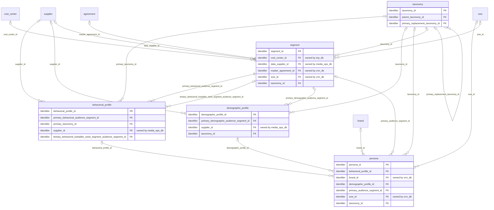

# Logical model: cdp_db

Generated by advgen from the pinned Advertising MVM; do not edit by hand. Regenerate with `uv run advgen build`.

**Source system role:** Customer Data Platform / DMP. Audience taxonomy, segments, profiles, personas, lookalike models, segment membership, suppression lists and activations to platforms.

The logical model is technology-neutral: entities, business attributes with logical domains, optionality, keys and every business relationship, **including relationships to entities owned by other systems** (marked *owned by …*). How each relationship is physically implemented (enforced FK vs soft reference) is decided in the physical model.

## Contents

- [audience.audience_segmentation](#audienceaudience_segmentation)
- [audience.targeting_activation](#audiencetargeting_activation)
- [Code sets](#code-sets)
- [Normalization notes](#normalization-notes)

## audience.audience_segmentation

| Entity | Kind | Definition |
|---|---|---|
| [behavioral_profile](#behavioral_profile) | master | Behavioral audience profile capturing observed digital and offline behaviors — including browsing categories, purchase history signals, app usage patterns, content consumption categories, search intent signals, recency/… |
| [demographic_profile](#demographic_profile) | master | Structured demographic attribute set for audience definitions — including age band, gender, household income tier, education level, marital status, parental status, geographic region, DMA (Designated Market Area), langu… |
| [persona](#persona) | master | Synthesized audience persona profiles representing archetypal target audience groups for campaign planning and creative strategy. |
| [segment](#segment) | master | Master record and SSOT for all audience segments — first-party, second-party, and third-party — used across campaigns. |
| [taxonomy](#taxonomy) | reference | Reference taxonomy for standardized audience classification categories — aligned to IAB Audience Taxonomy v1.1 and custom agency extensions. |

### behavioral_profile

Behavioral audience profile capturing observed digital and offline behaviors — including browsing categories, purchase history signals, app usage patterns, content consumption categories, search intent signals, recency/frequency/monetary (RFM) scores, and cross-device activity. Sourced from DMP/CDP integrations, The Trade Desk audience data, and first-party behavioral signals. Used for behavioral targeting and lookalike modeling.

**Primary identifier:** `behavioral_profile_id`

| Attribute | Business name | Domain | Opt. | Key | Definition |
|---|---|---|---|---|---|
| `behavioral_profile_id` | Behavioral Profile ID | Identifier | M | PK | Unique identifier for the behavioral audience profile record. |
| `primary_behavioral_audience_segment_id` | Audience Segment ID | Identifier → segment | M | FK | Reference to the parent audience segment this behavioral profile belongs to. |
| `primary_taxonomy_id` | Primary Taxonomy Id (Foreign Key) | Identifier → taxonomy | O | FK | Foreign key linking to audience.taxonomy. |
| `supplier_id` | Supplier Id (Foreign Key) | Identifier → supplier (media_ops_db) | O | FK | Foreign key linking to vendor.supplier. |
| `tertiary_behavioral_lookalike_seed_segment_audience_segment_id` | Lookalike Seed Segment ID | Identifier → segment | O | FK | Reference to the seed audience segment used to generate this lookalike behavioral profile, if applicable. |
| `app_usage_pattern` | App Usage Pattern | Text | O |  | Description of observed mobile app usage patterns (e.g., 'Gaming Apps', 'Shopping Apps', 'News Apps', 'Social Media Apps'). |
| `brand_affinity_category` | Brand Affinity Category | Text | O |  | Category of brands or products the user has shown affinity toward based on observed behavior (e.g., 'Luxury Brands', 'Eco-Friendly Products', 'Tech Gadgets'). |
| `browsing_category_primary` | Primary Browsing Category | Text | O |  | The primary content category observed in the user's browsing behavior (e.g., 'Automotive', 'Travel', 'Finance', 'Health & Wellness'). |
| `browsing_category_secondary` | Secondary Browsing Category | Text | O |  | The secondary content category observed in the user's browsing behavior, indicating additional interests. |
| `consent_status` | Consent Status | Code | O |  | Privacy consent status for behavioral data collection and usage, ensuring compliance with GDPR, CCPA, and other privacy regulations. |
| `consent_timestamp` | Consent Timestamp | Timestamp | O |  | Timestamp when consent was granted or last updated for this behavioral profile. |
| `content_consumption_category` | Content Consumption Category | Text | O |  | Category of content consumed by the user (e.g., 'Video', 'Articles', 'Podcasts', 'Social Media'). |
| `cross_device_activity_flag` | Cross-Device Activity Flag | Indicator | M |  | Indicates whether the behavioral profile includes cross-device activity tracking and identity resolution. |
| `data_retention_expiry_date` | Data Retention Expiry Date | Date | O |  | Date when this behavioral profile data must be purged or anonymized per privacy regulations and data retention policies. |
| `day_of_week_preference` | Day of Week Preference | Code | O |  | Observed preference for day of week when the user is most active online. |
| `device_type_primary` | Primary Device Type | Code | O |  | The primary device type observed in the user's digital behavior. |
| `engagement_level` | Engagement Level | Code | O |  | Overall engagement level classification based on interaction frequency, depth, and duration. |
| `frequency_score` | Frequency Score | Quantity | O |  | Frequency component of RFM scoring model, indicating how often the user exhibits the behavior (scale 1-5, 5 being most frequent). |
| `geographic_behavior_pattern` | Geographic Behavior Pattern | Text | O |  | Description of observed geographic or location-based behavior patterns (e.g., 'Urban Commuter', 'Frequent Traveler', 'Suburban Resident'). |
| `last_observed_behavior_date` | Last Observed Behavior Date | Date | O |  | Date when the most recent behavioral signal was observed for this profile. |
| `lookalike_similarity_score` | Lookalike Similarity Score | Rate | O |  | Similarity score (0.00 to 100.00) indicating how closely this profile matches the seed segment for lookalike modeling. |
| `monetary_score` | Monetary Score | Quantity | O |  | Monetary component of RFM scoring model, indicating the value associated with the user's behavior (scale 1-5, 5 being highest value). |
| `notes` | Profile Notes | Text | O |  | Free-text notes or comments about this behavioral profile for internal reference and documentation. |
| `privacy_jurisdiction` | Privacy Jurisdiction | Text | O |  | Primary privacy jurisdiction applicable to this behavioral profile (e.g., 'EU', 'California', 'Global'). |
| `profile_creation_date` | Profile Creation Date | Date | O |  | Date when this behavioral profile was first created in the system. |
| `profile_last_updated_timestamp` | Profile Last Updated Timestamp | Timestamp | O |  | Timestamp when this behavioral profile was last updated with new behavioral signals or attributes. |
| `profile_name` | Behavioral Profile Name | Name | M |  | Human-readable name or label for this behavioral profile (e.g., 'High-Intent Auto Shoppers', 'Frequent Travelers'). |
| `profile_quality_score` | Profile Quality Score | Rate | O |  | Quality score (0.00 to 100.00) indicating the accuracy, completeness, and reliability of the behavioral profile data. |
| `profile_reach_estimate` | Profile Reach Estimate | Quantity | O |  | Estimated number of unique users or devices matching this behavioral profile, used for campaign planning and media buying. |
| `profile_status` | Behavioral Profile Status | Code | M |  | Current lifecycle status of the behavioral profile indicating availability for targeting. |
| `profile_type` | Behavioral Profile Type | Code | O |  | Classification of the behavioral profile based on data source and construction method. |
| `purchase_intent_signal` | Purchase Intent Signal | Code | O |  | Derived signal indicating the likelihood of purchase behavior based on observed actions (e.g., cart additions, product page views, price comparisons). |
| `recency_score` | Recency Score | Quantity | O |  | Recency component of RFM (Recency, Frequency, Monetary) scoring model, indicating how recently the user exhibited the behavior (scale 1-5, 5 being most recent). |
| `search_intent_keywords` | Search Intent Keywords | Text | O |  | Comma-separated list of observed search keywords or phrases indicating user intent and interests. |
| `seasonal_behavior_pattern` | Seasonal Behavior Pattern | Text | O |  | Description of observed seasonal or cyclical behavior patterns (e.g., 'Holiday Shopper', 'Back-to-School', 'Summer Traveler'). |
| `targeting_eligibility_flag` | Targeting Eligibility Flag | Indicator | M |  | Indicates whether this behavioral profile is currently eligible for use in campaign targeting based on quality, consent, and compliance checks. |
| `time_of_day_preference` | Time of Day Preference | Code | O |  | Observed preference for time of day when the user is most active online. |
| `created_at` | Created At | Timestamp | M |  | Timestamp when the row was inserted. |
| `created_by` | Created By | Text | M |  | Application user (session setting app.actor) or database role that inserted the row. |
| `updated_at` | Updated At | Timestamp | M |  | Timestamp of the last update. |
| `updated_by` | Updated By | Text | M |  | Application user or database role that last updated the row. |

### demographic_profile

Structured demographic attribute set for audience definitions — including age band, gender, household income tier, education level, marital status, parental status, geographic region, DMA (Designated Market Area), language, ethnicity (where legally permissible), and employment category. Sourced from Nielsen, Comscore, and first-party CRM data. Serves as the demographic dimension for segment qualification and targeting criteria.

**Primary identifier:** `demographic_profile_id`. **Business key(s):** `profile_code`

| Attribute | Business name | Domain | Opt. | Key | Definition |
|---|---|---|---|---|---|
| `demographic_profile_id` | Demographic Profile Identifier (ID) | Identifier | M | PK | Unique identifier for the demographic profile record. |
| `primary_demographic_audience_segment_id` | Data Management Platform (DMP) Segment Identifier (ID) | Identifier → segment | O | FK | External segment identifier from the Data Management Platform (DMP) system. |
| `supplier_id` | Supplier Id (Foreign Key) | Identifier → supplier (media_ops_db) | O | FK | Foreign key linking to vendor.supplier. |
| `taxonomy_id` | Audience Taxonomy Id (Foreign Key) | Identifier → taxonomy | O | FK | Foreign key linking to audience.taxonomy. |
| `age_band` | Age Band | Code | O |  | Age range classification for the demographic profile. |
| `children_age_range` | Children Age Range | Text | O |  | Age range of children in household (e.g., '0-5', '6-12', '13-17'). |
| `consent_date` | Consent Date | Date | O |  | Date when consent was obtained for use of this demographic data. |
| `consent_expiration_date` | Consent Expiration Date | Date | O |  | Date when consent expires and data can no longer be used for targeting. |
| `consent_status` | Consent Status | Code | O |  | Privacy consent status for use of this demographic data in targeting. |
| `country_code` | Country Code | ISO Code | O |  | Three-letter ISO country code (e.g., 'USA', 'CAN', 'GBR'). |
| `dma_code` | Designated Market Area (DMA) Code | Business Code | O |  | Nielsen Designated Market Area code representing the geographic television market. |
| `dma_name` | Designated Market Area (DMA) Name | Name | O |  | Human-readable name of the Nielsen DMA (e.g., 'New York', 'Los Angeles', 'Chicago'). |
| `education_level` | Education Level | Code | O |  | Highest level of education attained. |
| `employment_category` | Employment Category | Code (employment_category) | O |  | Employment status classification. |
| `estimated_population_size` | Estimated Population Size | Quantity | O |  | Estimated number of individuals matching this demographic profile. |
| `ethnicity` | Ethnicity | Text | O |  | Ethnic or cultural background classification where legally permissible and consented. |
| `gender` | Gender | Code | O |  | Gender classification for the demographic profile. |
| `geographic_region` | Geographic Region | Code | O |  | Broad geographic region classification within the country. |
| `homeownership_status` | Homeownership Status | Code | O |  | Indicates whether the individual owns or rents their residence. |
| `household_income_tier` | Household Income Tier | Code | O |  | Household income bracket classification. |
| `household_size` | Household Size | Quantity | O |  | Number of individuals in the household. |
| `last_verified_date` | Last Verified Date | Date | O |  | Date when the demographic profile data was last verified or updated. |
| `marital_status` | Marital Status | Code | O |  | Marital status classification for the demographic profile. |
| `occupation_category` | Occupation Category | Text | O |  | Broad occupational category (e.g., 'Professional', 'Management', 'Service', 'Sales', 'Technical'). |
| `parental_status` | Parental Status | Code | O |  | Indicates whether the individual is a parent. |
| `postal_code` | Postal Code | Business Code | O |  | Postal code (ZIP code in U.S.) for geographic targeting and localization. |
| `primary_language` | Primary Language | Text | O |  | Primary language spoken by the demographic segment (e.g., 'English', 'Spanish', 'Mandarin'). |
| `profile_code` | Demographic Profile Code | Business Code | M | UK | Standardized code or identifier used across systems to reference this demographic profile (e.g., 'DEM-001', 'PROF-URBAN-25-34'). |
| `profile_confidence_score` | Profile Confidence Score | Rate | O |  | Confidence score (0-100) indicating the accuracy and completeness of the demographic profile data. |
| `profile_description` | Profile Description | Text | O |  | Detailed textual description of the demographic profile, including key characteristics and targeting use cases. |
| `profile_name` | Demographic Profile Name | Name | M |  | Human-readable name or label for this demographic profile segment (e.g., 'Affluent Urban Millennials', 'Suburban Families'). |
| `profile_status` | Profile Status | Code | O |  | Current lifecycle status of the demographic profile. |
| `psychographic_segment` | Psychographic Segment | Text | O |  | Psychographic or lifestyle segment classification (e.g., 'Early Adopters', 'Value Seekers', 'Luxury Enthusiasts'). |
| `urbanicity` | Urbanicity | Code | O |  | Classification of residential area type. |
| `vehicle_ownership` | Vehicle Ownership | Code | O |  | Indicates whether the individual owns a vehicle. |
| `created_at` | Created Timestamp | Timestamp | M |  | Timestamp when the row was inserted. |
| `created_by` | Created By | Text | M |  | Application user (session setting app.actor) or database role that inserted the row. |
| `updated_at` | Updated Timestamp | Timestamp | M |  | Timestamp of the last update. |
| `updated_by` | Updated By | Text | M |  | Application user or database role that last updated the row. |

### persona

Synthesized audience persona profiles representing archetypal target audience groups for campaign planning and creative strategy. Captures persona name, narrative description, demographic summary, psychographic traits, media consumption habits, purchase intent signals, pain points, motivations, and associated brand affinity scores. Used by account teams and strategists to align creative briefs and media plans to defined audience archetypes.

**Primary identifier:** `persona_id`. **Business key(s):** `persona_code`

| Attribute | Business name | Domain | Opt. | Key | Definition |
|---|---|---|---|---|---|
| `persona_id` | Persona Identifier (ID) | Identifier | M | PK | Unique identifier for the audience persona profile. |
| `behavioral_profile_id` | Behavioral Profile Id (Foreign Key) | Identifier → behavioral_profile | O | FK | Foreign key linking to audience.behavioral_profile. |
| `brand_id` | Client Brand Id (Foreign Key) | Identifier → brand (crm_db) | O | FK | Foreign key linking to client.brand. |
| `demographic_profile_id` | Demographic Profile Id (Foreign Key) | Identifier → demographic_profile | O | FK | Foreign key linking to audience.demographic_profile. |
| `primary_audience_segment_id` | Primary Audience Segment Id (Foreign Key) | Identifier → segment | O | FK | Foreign key linking to audience.segment. |
| `sow_id` | Sow Id (Foreign Key) | Identifier → sow (crm_db) | O | FK | Foreign key linking to contract.sow. |
| `taxonomy_id` | Taxonomy Id (Foreign Key) | Identifier → taxonomy | O | FK | Foreign key linking to audience.taxonomy. |
| `ccpa_opt_out_eligible` | California Consumer Privacy Act (CCPA) Opt-Out Eligible | Indicator | M |  | Indicates whether individuals matching this persona have CCPA opt-out rights for data sale. |
| `cdp_audience_key` | Customer Data Platform (CDP) Audience Key | Business Code | O |  | Reference key for this persona in the Customer Data Platform for cross-channel activation. |
| `cltv_estimate` | Customer Lifetime Value (CLTV) Estimate | Decimal | O |  | Projected lifetime value in USD for customers matching this persona profile. |
| `consent_compliant_flag` | Consent Compliant Flag | Indicator | M |  | Indicates whether this persona profile is built exclusively from privacy-compliant, consented data sources. |
| `content_preferences` | Content Preferences | Text | O |  | Types of content and messaging styles that resonate with this persona (e.g., 'Educational', 'Humorous', 'Inspirational'). |
| `conversion_propensity` | Conversion Propensity | Decimal | O |  | Likelihood score (0-100) that this persona will convert based on historical campaign performance. |
| `data_source_type` | Data Source Type | Code | O |  | Classification of the primary data source used to construct this persona profile. |
| `dmp_segment_ids` | Data Management Platform (DMP) Segment Identifiers (IDs) | Text | O |  | Comma-separated list of DMP segment IDs that map to this persona for programmatic activation. |
| `estimated_reach` | Estimated Reach | Quantity | O |  | Estimated total addressable audience size for this persona across all available channels. |
| `gdpr_lawful_basis` | General Data Protection Regulation (GDPR) Lawful Basis | Code | O |  | Legal basis under GDPR for processing personal data associated with this persona. |
| `last_validated_date` | Last Validated Date | Date | O |  | Date when this persona profile was last reviewed and validated by strategy or account teams. |
| `narrative_description` | Narrative Description | Text | O |  | Rich narrative description of the persona, including lifestyle, values, and behavioral characteristics used by creative teams. |
| `pain_points` | Pain Points | Text | O |  | Key challenges, frustrations, or unmet needs that this persona experiences, used to inform messaging strategy. |
| `persona_code` | Persona Code | Business Code | M | UK | Short alphanumeric code used for quick reference in campaign planning and media buying systems. |
| `persona_name` | Persona Name | Name | M |  | The archetypal name or label assigned to this persona (e.g., 'Tech-Savvy Millennial', 'Budget-Conscious Parent'). |
| `persona_status` | Persona Status | Code | M |  | Current lifecycle status of the persona profile. |
| `preferred_channels` | Preferred Channels | Text | O |  | Comma-separated list of most effective marketing channels for reaching this persona (e.g., 'Social Media, CTV, Digital Display'). |
| `social_media_platforms` | Social Media Platforms | Text | O |  | Comma-separated list of social media platforms where this persona is most active (e.g., 'Facebook, Instagram, TikTok'). |
| `usage_count` | Usage Count | Quantity | O |  | Number of campaigns or media plans that have actively targeted this persona. |
| `created_at` | Created Timestamp | Timestamp | M |  | Timestamp when the row was inserted. |
| `created_by` | Created By | Text | M |  | Application user (session setting app.actor) or database role that inserted the row. |
| `updated_at` | Last Updated Timestamp | Timestamp | M |  | Timestamp of the last update. |
| `updated_by` | Updated By | Text | M |  | Application user or database role that last updated the row. |

### segment

Master record and SSOT for all audience segments — first-party, second-party, and third-party — used across campaigns. Captures segment name, type (behavioral, demographic, psychographic, contextual, lookalike), data source (1P/2P/3P), segment size, creation method (rules-based, ML-modeled, imported), activation status, refresh cadence, expiry date, IAB taxonomy classification, and owning team. Embeds full qualification criteria spanning demographic attributes (age band, gender, income tier, DMA, education, marital/parental status, language), behavioral signals (browsing categories, purchase history, RFM scores, app usage, cross-device activity, search intent, content consumption), and psychographic dimensions (VALS, brand affinity, lifestyle segments, interest taxonomies, purchase motivations, personality indicators, media attitudes). Qualification criteria are sourced from Nielsen, Comscore, first-party CRM, DMP/CDP integrations, survey data, and social listening. SSOT for all audience segment definitions, targeting rules, and profile-level qualification logic in the advertising platform.

**Primary identifier:** `segment_id`

| Attribute | Business name | Domain | Opt. | Key | Definition |
|---|---|---|---|---|---|
| `segment_id` | Segment Identifier (ID) | Identifier | M | PK | Unique identifier for the audience segment. |
| `cost_center_id` | Cost Center Id (Foreign Key) | Identifier → cost_center (erp_db) | O | FK | Foreign key linking to finance.cost_center. |
| `data_supplier_id` | Data Supplier Id (Foreign Key) | Identifier → supplier (media_ops_db) | O | FK | Foreign key linking to vendor.supplier. |
| `master_agreement_id` | Master Agreement Id (Foreign Key) | Identifier → agreement (crm_db) | O | FK | Foreign key linking to contract.agreement. |
| `sow_id` | Sow Id (Foreign Key) | Identifier → sow (crm_db) | O | FK | Foreign key linking to contract.sow. |
| `taxonomy_id` | Audience Taxonomy Id (Foreign Key) | Identifier → taxonomy | O | FK | Foreign key linking to audience.taxonomy. |
| `activation_status` | Activation Status | Code | O |  | Indicates whether the segment has been pushed to DSPs, ad servers, or activation platforms for live campaign use. |
| `age_band_max` | Maximum Age Band | Quantity | O |  | Upper bound of the age range for demographic qualification (e.g., 24 for 18-24 age band). |
| `age_band_min` | Minimum Age Band | Quantity | O |  | Lower bound of the age range for demographic qualification (e.g., 18 for 18-24 age band). |
| `app_usage_flag` | App Usage Flag | Indicator | M |  | Indicates whether segment qualification includes mobile app usage or in-app behavior signals. |
| `audience_segment_description` | Segment Description | Text | O |  | Detailed business description of the segment purpose, target audience characteristics, and intended use cases for campaign targeting. |
| `audience_segment_name` | Segment Name | Name | M |  | Human-readable name of the audience segment used for identification and campaign targeting. |
| `audience_segment_status` | Segment Status | Code | M |  | Current lifecycle status of the segment: active (available for targeting), inactive (paused), draft (under development), archived (historical reference), or expired (past validity… |
| `audience_segment_type` | Segment Type | Code | O |  | Classification of the segment based on the primary targeting methodology: behavioral (actions/browsing), demographic (age/gender/income), psychographic (attitudes/values), context… |
| `brand_affinity_list` | Brand Affinity List | Text | O |  | Comma-separated list of brands that segment members have shown affinity toward through engagement, purchase, or social signals. |
| `browsing_categories` | Browsing Categories | Text | O |  | Comma-separated list of IAB content categories or site categories that segment members have browsed (e.g., IAB1 for Automotive, IAB3 for Business). |
| `ccpa_compliant_flag` | California Consumer Privacy Act (CCPA) Compliant Flag | Indicator | M |  | Indicates whether the segment meets CCPA requirements for consumer opt-out rights and data sale restrictions. |
| `consent_status` | Consent Status | Code | O |  | Privacy consent status for segment members under GDPR, CCPA, or other privacy regulations: consented (explicit opt-in), not_consented (no consent), pending (consent requested), or… |
| `content_consumption_topics` | Content Consumption Topics | Text | O |  | Comma-separated list of content topics or themes consumed by segment members (e.g., 'sports', 'finance', 'travel'). |
| `creation_method` | Segment Creation Method | Code | O |  | Methodology used to build the segment: rules-based (Boolean logic), ML-modeled (algorithmic clustering/propensity), imported (from external platform), survey-derived (research pan… |
| `cross_device_flag` | Cross-Device Flag | Indicator | M |  | Indicates whether segment uses cross-device identity resolution to track users across desktop, mobile, tablet, and CTV. |
| `data_source_tier` | Data Source Tier | Code | O |  | Origin tier of the segment data: first-party (owned CRM/web/app data), second-party (partner-shared data), or third-party (purchased from data providers). |
| `dma_codes` | Designated Market Area (DMA) Codes | Text | O |  | Comma-separated list of Nielsen DMA codes (e.g., 501 for New York) used for geographic targeting. |
| `education_level` | Education Level | Code (education_level) | O |  | Highest education attainment level used for demographic qualification (e.g., high school, bachelor, graduate). |
| `effective_date` | Effective Date | Date | O |  | Date when the segment becomes available for targeting and activation. |
| `expiry_date` | Expiry Date | Date | O |  | Date when the segment is no longer valid for targeting, either due to data staleness, consent expiration, or campaign end. |
| `external_code` | External Segment Code | Business Code | O |  | External identifier or code used by DSPs, DMPs, CDPs, and third-party platforms to reference this segment. |
| `gdpr_compliant_flag` | General Data Protection Regulation (GDPR) Compliant Flag | Indicator | M |  | Indicates whether the segment meets GDPR requirements for lawful processing, consent, and data subject rights. |
| `gender` | Gender | Code | O |  | Gender demographic filter applied to segment qualification. |
| `income_tier` | Income Tier | Code (income_tier) | O |  | Household income bracket or tier used for demographic qualification (e.g., <50K, 50K-100K, 100K+). |
| `interest_taxonomy` | Interest Taxonomy | Text | O |  | Comma-separated list of interest categories or hobbies (e.g., 'fitness', 'gaming', 'cooking') used for psychographic qualification. |
| `language_preference` | Language Preference | Text | O |  | Primary language preference for segment members (ISO 639-1 codes: EN, ES, FR, etc.). |
| `lifestyle_segment` | Lifestyle Segment | Text | O |  | Lifestyle or life-stage classification (e.g., 'young professionals', 'empty nesters', 'urban millennials') used for psychographic qualification. |
| `marital_status` | Marital Status | Code | O |  | Marital status demographic filter applied to segment qualification. |
| `parental_status` | Parental Status | Code | O |  | Indicates whether segment targets parents, non-parents, or all. |
| `purchase_history_flag` | Purchase History Flag | Indicator | M |  | Indicates whether segment qualification includes past purchase behavior from CRM or e-commerce data. |
| `refresh_cadence` | Refresh Cadence | Code | O |  | Frequency at which segment membership is recalculated and updated: real-time (streaming), hourly, daily, weekly, monthly, or static (one-time build). |
| `rfm_score` | Recency Frequency Monetary (RFM) Score | Text | O |  | RFM segmentation score (e.g., 555 for best customers, 111 for low-value) used for behavioral qualification. |
| `search_intent_keywords` | Search Intent Keywords | Text | O |  | Comma-separated list of search keywords or intent signals used for behavioral qualification (e.g., 'luxury cars', 'mortgage refinance'). |
| `size` | Segment Size | Quantity | O |  | Total count of unique users, devices, or households currently qualifying for this segment. |
| `vals_segment` | Values and Lifestyles (VALS) Segment | Code (vals_segment) | O |  | VALS psychographic segmentation classification (e.g., Innovators, Thinkers, Achievers, Experiencers) used for psychographic qualification. |
| `created_at` | Created Timestamp | Timestamp | M |  | Timestamp when the row was inserted. |
| `created_by` | Created By | Text | M |  | Application user (session setting app.actor) or database role that inserted the row. |
| `updated_at` | Last Updated Timestamp | Timestamp | M |  | Timestamp of the last update. |
| `updated_by` | Updated By | Text | M |  | Application user or database role that last updated the row. |

### taxonomy

Reference taxonomy for standardized audience classification categories — aligned to IAB Audience Taxonomy v1.1 and custom agency extensions. Captures taxonomy node ID, parent node, category name, category level (tier 1/2/3), IAB standard code, description, applicable data types (behavioral/demographic/contextual), and active status. Provides the controlled vocabulary for consistent segment classification across campaigns, platforms, and reporting.

**Primary identifier:** `taxonomy_id`. **Business key(s):** `taxonomy_code`

| Attribute | Business name | Domain | Opt. | Key | Definition |
|---|---|---|---|---|---|
| `taxonomy_id` | Audience Taxonomy Identifier (ID) | Identifier | M | PK | Unique identifier for the audience taxonomy node. |
| `parent_taxonomy_id` | Parent Taxonomy Identifier (ID) | Identifier → taxonomy | O | FK | Reference to the parent node in the taxonomy hierarchy. |
| `primary_replacement_taxonomy_id` | Replacement Taxonomy Identifier (ID) | Identifier → taxonomy | O | FK | Reference to the taxonomy node that replaces this deprecated category. |
| `applicable_platforms` | Applicable Platforms | Text | O |  | Comma-separated list of digital platforms and channels where this taxonomy category is applicable (e.g., display, video, social, search, CTV, DOOH). |
| `average_cpm_usd` | Average Cost Per Mille (CPM) United States Dollars (USD) | Amount | O |  | Average cost per thousand impressions in US dollars for media buys targeting this audience category. |
| `category_description` | Category Description | Text | O |  | Detailed description of the audience category, including defining characteristics, typical behaviors, and use cases. |
| `category_name` | Category Name | Name | M |  | Human-readable name of the audience taxonomy category. |
| `cdp_integration_enabled` | Customer Data Platform (CDP) Integration Enabled Flag | Indicator | M |  | Indicates whether this taxonomy category is integrated with Customer Data Platform for unified customer profile enrichment and personalization. |
| `comscore_compatible` | Comscore Compatible Flag | Indicator | M |  | Indicates whether this taxonomy category can be mapped to Comscore digital audience measurement segments for cross-platform analytics and validation. |
| `consent_required` | Consent Required Flag | Indicator | M |  | Indicates whether explicit user consent is required under GDPR, CCPA, or other privacy regulations before using this audience category for targeting. |
| `cpm_last_updated_date` | Cost Per Mille (CPM) Last Updated Date | Date | O |  | Date when the average CPM value was last refreshed from campaign performance data and market intelligence. |
| `data_source_type` | Data Source Type | Code | O |  | Classification of the data source origin for this audience category. |
| `data_type` | Data Type | Code | O |  | Primary data classification type for this audience category. |
| `deprecation_reason` | Deprecation Reason | Text | O |  | Explanation for why this taxonomy category was deprecated or retired. |
| `dmp_integration_enabled` | Data Management Platform (DMP) Integration Enabled Flag | Indicator | M |  | Indicates whether this taxonomy category is integrated with the agency Data Management Platform for audience activation and cross-platform targeting. |
| `dsp_activation_enabled` | Demand-Side Platform (DSP) Activation Enabled Flag | Indicator | M |  | Indicates whether this taxonomy category is available for programmatic activation via Demand-Side Platforms such as The Trade Desk. |
| `effective_end_date` | Effective End Date | Date | O |  | Date when this taxonomy category was deprecated or retired. |
| `effective_start_date` | Effective Start Date | Date | O |  | Date when this taxonomy category became available for use. |
| `estimated_reach` | Estimated Reach | Quantity | O |  | Estimated total addressable audience size (unique users or devices) for this taxonomy category across all integrated platforms. |
| `exclusion_categories` | Exclusion Categories | Text | O |  | Comma-separated list of taxonomy codes that should be excluded when this category is used, to prevent audience overlap or conflicting targeting logic. |
| `iab_standard_code` | Interactive Advertising Bureau (IAB) Standard Code | Business Code | O |  | Official IAB Audience Taxonomy standard code for this category. |
| `is_active` | Active Status Flag | Indicator | M |  | Indicates whether this taxonomy category is currently active and available for use in campaign planning and targeting. |
| `last_reviewed_date` | Last Reviewed Date | Date | O |  | Date when this taxonomy category was last reviewed for accuracy, relevance, and compliance. |
| `minimum_segment_size` | Minimum Segment Size | Quantity | O |  | Minimum number of unique users or devices required for this audience category to be activated in campaigns. |
| `nielsen_compatible` | Nielsen Compatible Flag | Indicator | M |  | Indicates whether this taxonomy category can be mapped to Nielsen audience measurement segments for GRP and TRP calculation. |
| `path` | Taxonomy Path | Text | O |  | Full hierarchical path from root to this node, using forward-slash delimiter (e.g., Demographics/Age/18-24). |
| `privacy_classification` | Privacy Classification | Code | O |  | Privacy sensitivity level of the audience data in this category. |
| `reach_last_updated_date` | Reach Last Updated Date | Date | O |  | Date when the estimated reach value was last refreshed from source systems. |
| `taxonomy_code` | Taxonomy Code | Business Code | M | UK | Unique alphanumeric code identifying this taxonomy node. |
| `taxonomy_level` | Taxonomy Level | Quantity | O |  | Hierarchical tier level of this taxonomy node. |
| `usage_guidelines` | Usage Guidelines | Text | O |  | Best practice guidance and restrictions for using this audience category in campaigns. |
| `version_number` | Version Number | Business Code | O |  | Version identifier for this taxonomy node, following semantic versioning convention (major.minor.patch). |
| `created_at` | Created Timestamp | Timestamp | M |  | Timestamp when the row was inserted. |
| `created_by` | Created By | Text | M |  | Application user (session setting app.actor) or database role that inserted the row. |
| `updated_at` | Last Modified Timestamp | Timestamp | M |  | Timestamp of the last update. |
| `updated_by` | Updated By | Text | M |  | Application user or database role that last updated the row. |

## audience.targeting_activation

| Entity | Kind | Definition |
|---|---|---|
| [activation](#activation) | transactional | Operational record of an audience segment being activated (pushed) to a specific DSP, SSP, or media platform for campaign targeting. |
| [lookalike_model](#lookalike_model) | master | Operational record of a lookalike audience model built from a seed segment — capturing seed segment reference, model algorithm type (cosine similarity, gradient boosting, neural net), expansion ratio, similarity thresho… |
| [segment_membership](#segment_membership) | association | Association record linking individual audience identifiers (cookie IDs, device IDs, hashed emails, MAIDs) to specific audience segments. |
| [suppression_list](#suppression_list) | master | Audience suppression list record defining identifiers to be excluded from campaign targeting — including converted customers, opted-out users, competitor employees, brand safety exclusions, and frequency-capped audience… |

```mermaid
erDiagram
    activation {
        Identifier activation_id PK
        Identifier activation_platform_audience_audience_segment_id FK
        Identifier activation_segment_id FK
        Identifier asset_id FK "owned by work_mgmt_db"
        Identifier budget_line_id FK "owned by erp_db"
        Identifier campaign_id FK "owned by media_ops_db"
        Identifier contract_insertion_order_id FK "owned by crm_db"
        Identifier cost_center_id FK "owned by erp_db"
        Identifier creative_deliverable_id FK "owned by work_mgmt_db"
        Identifier flight_id FK "owned by media_ops_db"
        Identifier initiative_id FK "owned by work_mgmt_db"
        Identifier line_item_id FK "owned by media_ops_db"
        Identifier lookalike_model_id FK
        Identifier supplier_id FK "owned by media_ops_db"
        Identifier suppression_list_id FK
        Identifier tech_partner_id FK "owned by media_ops_db"
    }
    lookalike_model {
        Identifier lookalike_model_id PK
        Identifier advertiser_id FK "owned by crm_db"
        Identifier brand_id FK "owned by crm_db"
        Identifier campaign_id FK "owned by media_ops_db"
        Identifier contract_insertion_order_id FK "owned by crm_db"
        Identifier cost_center_id FK "owned by erp_db"
        Identifier development_initiative_id FK "owned by work_mgmt_db"
        Identifier segment_id FK
        Identifier supplier_id FK "owned by media_ops_db"
        Identifier taxonomy_id FK
        Identifier tech_partner_id FK "owned by media_ops_db"
    }
    segment_membership {
        Identifier segment_membership_id PK
        Identifier budget_line_id FK "owned by erp_db"
        Identifier cost_center_id FK "owned by erp_db"
        Identifier initiative_id FK "owned by work_mgmt_db"
        Identifier segment_id FK
        Identifier supplier_id FK "owned by media_ops_db"
        Identifier tech_partner_id FK "owned by media_ops_db"
    }
    suppression_list {
        Identifier suppression_list_id PK
        Identifier advertiser_id FK "owned by crm_db"
        Identifier brand_id FK "owned by crm_db"
        Identifier campaign_id FK "owned by media_ops_db"
        Identifier contract_insertion_order_id FK "owned by crm_db"
        Identifier creation_initiative_id FK "owned by work_mgmt_db"
        Identifier data_supplier_id FK "owned by media_ops_db"
        Identifier enforcement_tech_partner_id FK "owned by media_ops_db"
        Identifier flight_id FK "owned by media_ops_db"
        Identifier governing_agreement_id FK "owned by crm_db"
        Identifier segment_id FK
    }
    segment |o--o{ activation : "activation_platform_audience_audience_segment_id"
    segment |o--o{ activation : "activation_segment_id"
    asset |o--o{ activation : "asset_id"
    budget_line |o--o{ activation : "budget_line_id"
    campaign |o--o{ activation : "campaign_id"
    contract_insertion_order |o--o{ activation : "contract_insertion_order_id"
    cost_center |o--o{ activation : "cost_center_id"
    creative_deliverable |o--o{ activation : "creative_deliverable_id"
    flight |o--o{ activation : "flight_id"
    initiative |o--o{ activation : "initiative_id"
    line_item |o--o{ activation : "line_item_id"
    lookalike_model |o--o{ activation : "lookalike_model_id"
    supplier |o--o{ activation : "supplier_id"
    suppression_list |o--o{ activation : "suppression_list_id"
    tech_partner |o--o{ activation : "tech_partner_id"
    advertiser |o--o{ lookalike_model : "advertiser_id"
    brand |o--o{ lookalike_model : "brand_id"
    campaign |o--o{ lookalike_model : "campaign_id"
    contract_insertion_order |o--o{ lookalike_model : "contract_insertion_order_id"
    cost_center |o--o{ lookalike_model : "cost_center_id"
    initiative |o--o{ lookalike_model : "development_initiative_id"
    segment |o--o{ lookalike_model : "segment_id"
    supplier |o--o{ lookalike_model : "supplier_id"
    taxonomy |o--o{ lookalike_model : "taxonomy_id"
    tech_partner |o--o{ lookalike_model : "tech_partner_id"
    budget_line |o--o{ segment_membership : "budget_line_id"
    cost_center |o--o{ segment_membership : "cost_center_id"
    initiative |o--o{ segment_membership : "initiative_id"
    segment ||--o{ segment_membership : "segment_id"
    supplier |o--o{ segment_membership : "supplier_id"
    tech_partner |o--o{ segment_membership : "tech_partner_id"
    advertiser |o--o{ suppression_list : "advertiser_id"
    brand |o--o{ suppression_list : "brand_id"
    campaign |o--o{ suppression_list : "campaign_id"
    contract_insertion_order |o--o{ suppression_list : "contract_insertion_order_id"
    initiative |o--o{ suppression_list : "creation_initiative_id"
    supplier |o--o{ suppression_list : "data_supplier_id"
    tech_partner |o--o{ suppression_list : "enforcement_tech_partner_id"
    flight |o--o{ suppression_list : "flight_id"
    agreement |o--o{ suppression_list : "governing_agreement_id"
    segment |o--o{ suppression_list : "segment_id"
```

### activation

Operational record of an audience segment being activated (pushed) to a specific DSP, SSP, or media platform for campaign targeting. Captures activation date, target platform (The Trade Desk, DV360, Meta, etc.), segment ID, activation status (pending/active/expired/paused), estimated reach, match rate, activation method (pixel, API, S2S), and associated campaign reference. Tracks the operational lifecycle of audience deployment.

**Primary identifier:** `activation_id`

| Attribute | Business name | Domain | Opt. | Key | Definition |
|---|---|---|---|---|---|
| `activation_id` | Audience Activation ID | Identifier | M | PK | Unique identifier for the audience activation record. |
| `activation_platform_audience_audience_segment_id` | Platform Audience ID | Identifier → segment | O | FK | External identifier assigned by the target platform (DSP/SSP) for this activated audience segment. |
| `activation_segment_id` | Audience Segment ID | Identifier → segment | O | FK | Reference to the audience segment being activated for targeting. |
| `asset_id` | Creative Asset Id (Foreign Key) | Identifier → asset (work_mgmt_db) | O | FK | Foreign key linking to creative.asset. |
| `budget_line_id` | Budget Line Id (Foreign Key) | Identifier → budget_line (erp_db) | O | FK | Foreign key linking to finance.budget_line. |
| `campaign_id` | Campaign ID | Identifier → campaign (media_ops_db) | O | FK | Reference to the campaign for which this audience segment is being activated. |
| `contract_insertion_order_id` | Contract Insertion Order Id (Foreign Key) | Identifier → contract_insertion_order (crm_db) | O | FK | Foreign key linking to contract.contract_insertion_order. |
| `cost_center_id` | Cost Center Id (Foreign Key) | Identifier → cost_center (erp_db) | O | FK | Foreign key linking to finance.cost_center. |
| `creative_deliverable_id` | Creative Deliverable Id (Foreign Key) | Identifier → creative_deliverable (work_mgmt_db) | O | FK | Foreign key linking to creative.creative_deliverable. |
| `flight_id` | Flight Id (Foreign Key) | Identifier → flight (media_ops_db) | O | FK | Foreign key linking to campaign.flight. |
| `initiative_id` | Initiative Id (Foreign Key) | Identifier → initiative (work_mgmt_db) | O | FK | Foreign key linking to project.initiative. |
| `line_item_id` | Line Item Id (Foreign Key) | Identifier → line_item (media_ops_db) | O | FK | Foreign key linking to campaign.line_item. |
| `lookalike_model_id` | Lookalike Model Id (Foreign Key) | Identifier → lookalike_model | O | FK | Foreign key linking to audience.lookalike_model. |
| `supplier_id` | Supplier Id (Foreign Key) | Identifier → supplier (media_ops_db) | O | FK | Foreign key linking to vendor.supplier. |
| `suppression_list_id` | Suppression List Id (Foreign Key) | Identifier → suppression_list | O | FK | Foreign key linking to audience.suppression_list. |
| `tech_partner_id` | Tech Partner Id (Foreign Key) | Identifier → tech_partner (media_ops_db) | O | FK | Foreign key linking to vendor.tech_partner. |
| `activation_date` | Activation Date | Date | O |  | Date when the audience segment was activated and pushed to the target platform. |
| `activation_method` | Activation Method | Code | O |  | Technical method used to push the audience segment to the target platform. |
| `activation_name` | Activation Name | Name | O |  | Business-friendly name or label for this activation instance. |
| `activation_status` | Activation Status | Code | M |  | Current operational status of the audience activation in its lifecycle. |
| `activation_timestamp` | Activation Timestamp | Timestamp | O |  | Precise timestamp when the activation was initiated and the segment push began. |
| `activation_type` | Activation Type | Code | O |  | Classification of the activation purpose and targeting strategy. |
| `bid_modifier` | Bid Modifier | Decimal | O |  | Multiplier applied to base bid amounts for this audience segment (e.g., 1.25 = 25% bid increase, 0.80 = 20% bid decrease). |
| `consent_framework` | Consent Framework | Code | O |  | Privacy consent framework applied to this activation. |
| `consent_status` | Consent Status | Code | O |  | Privacy consent status for the audience segment members at the time of activation, ensuring GDPR and CCPA compliance. |
| `cost_cpm` | Activation Cost CPM (Cost Per Mille) | Amount | O |  | Cost per thousand impressions charged by the data provider or platform for activating this audience segment. |
| `currency_code` | Activation Currency Code | Currency Code | O |  | Three-letter ISO 4217 currency code for activation costs (e.g., USD, EUR, GBP). |
| `data_source_type` | Data Source Type | Code | O |  | Origin classification of the audience data being activated (first-party = owned, second-party = partner, third-party = purchased). |
| `effective_end_date` | Effective End Date | Date | O |  | Date when the activated audience segment expires and is no longer available for targeting. |
| `effective_start_date` | Effective Start Date | Date | O |  | Date when the activated audience segment becomes available for targeting in campaigns. |
| `error_message` | Error Message | Text | O |  | Detailed error or failure message if the activation encountered issues during processing or sync. |
| `estimated_reach` | Estimated Reach | Quantity | O |  | Estimated number of unique users or devices in the activated audience segment available for targeting. |
| `frequency_cap` | Frequency Cap | Quantity | O |  | Maximum number of times an individual user in the activated segment should be exposed to campaign creative within the frequency window. |
| `frequency_cap_window_hours` | Frequency Cap Window Hours | Quantity | O |  | Time window in hours over which the frequency cap is applied. |
| `last_sync_timestamp` | Last Sync Timestamp | Timestamp | O |  | Timestamp of the most recent successful synchronization of audience data to the target platform. |
| `match_rate_percentage` | Match Rate Percentage | Percentage | O |  | Percentage of audience segment records successfully matched and recognized by the target platform, expressed as a decimal (e.g., 75.50 for 75.5%). |
| `matched_user_count` | Matched User Count | Quantity | O |  | Actual number of users or devices successfully matched by the target platform during activation. |
| `next_sync_timestamp` | Next Sync Timestamp | Timestamp | O |  | Scheduled timestamp for the next audience data synchronization to the target platform. |
| `notes` | Activation Notes | Text | O |  | Free-form notes or comments about this activation for operational context and troubleshooting. |
| `priority_level` | Priority Level | Code | O |  | Business priority assigned to this activation for resource allocation and optimization decisions. |
| `retry_count` | Retry Count | Quantity | O |  | Number of retry attempts made for failed activations before marking as permanently failed. |
| `sync_frequency` | Sync Frequency | Code | O |  | Cadence at which the audience segment membership is refreshed and re-synced to the target platform. |
| `unmatched_user_count` | Unmatched User Count | Quantity | O |  | Number of users or devices from the segment that could not be matched by the target platform. |
| `created_at` | Created Timestamp | Timestamp | M |  | Timestamp when the row was inserted. |
| `created_by` | Created By | Text | M |  | Application user (session setting app.actor) or database role that inserted the row. |
| `updated_at` | Updated Timestamp | Timestamp | M |  | Timestamp of the last update. |
| `updated_by` | Updated By | Text | M |  | Application user or database role that last updated the row. |

### lookalike_model

Operational record of a lookalike audience model built from a seed segment — capturing seed segment reference, model algorithm type (cosine similarity, gradient boosting, neural net), expansion ratio, similarity threshold, model training date, model version, platform (The Trade Desk, DV360), estimated reach, validation accuracy, and model status. Enables scale expansion of high-value audience segments for prospecting campaigns.

**Primary identifier:** `lookalike_model_id`

| Attribute | Business name | Domain | Opt. | Key | Definition |
|---|---|---|---|---|---|
| `lookalike_model_id` | Lookalike Model Identifier (ID) | Identifier | M | PK | Unique identifier for the lookalike audience model record. |
| `advertiser_id` | Client Identifier (ID) | Identifier → advertiser (crm_db) | O | FK | Reference to the advertiser or client account that owns this lookalike model for campaign use and billing purposes. |
| `brand_id` | Client Brand Id (Foreign Key) | Identifier → brand (crm_db) | O | FK | Foreign key linking to client.brand. |
| `campaign_id` | Campaign Identifier (ID) | Identifier → campaign (media_ops_db) | O | FK | Optional reference to a specific campaign for which this lookalike model was created, enabling campaign-specific audience modeling strategies. |
| `contract_insertion_order_id` | Contract Insertion Order Id (Foreign Key) | Identifier → contract_insertion_order (crm_db) | O | FK | Foreign key linking to contract.contract_insertion_order. |
| `cost_center_id` | Cost Center Id (Foreign Key) | Identifier → cost_center (erp_db) | O | FK | Foreign key linking to finance.cost_center. |
| `development_initiative_id` | Development Initiative Id (Foreign Key) | Identifier → initiative (work_mgmt_db) | O | FK | Foreign key linking to project.initiative. |
| `segment_id` | Seed Segment Identifier (ID) | Identifier → segment | O | FK | Reference to the source audience segment used as the foundation for building the lookalike model. |
| `supplier_id` | Supplier Id (Foreign Key) | Identifier → supplier (media_ops_db) | O | FK | Foreign key linking to vendor.supplier. |
| `taxonomy_id` | Taxonomy Id (Foreign Key) | Identifier → taxonomy | O | FK | Foreign key linking to audience.taxonomy. |
| `tech_partner_id` | Tech Partner Id (Foreign Key) | Identifier → tech_partner (media_ops_db) | O | FK | Foreign key linking to vendor.tech_partner. |
| `algorithm_type` | Algorithm Type | Code (algorithm_type) | O |  | Machine learning algorithm used to build the lookalike model. |
| `baseline_performance_value` | Baseline Performance Value | Amount | O |  | Benchmark performance metric value from the seed segment, used to compare lookalike audience performance against the original high-value segment. |
| `consent_compliant_flag` | Consent Compliant Flag | Indicator | M |  | Indicates whether the lookalike model was built using only users who provided explicit consent for data usage under GDPR, CCPA, or other privacy regulations. |
| `currency_code` | Currency Code | Code | O |  | ISO 4217 three-letter currency code for the model cost and related financial metrics. |
| `data_source_type` | Data Source Type | Code | O |  | Classification of the data used to build the seed segment and train the model. |
| `estimated_reach` | Estimated Reach | Quantity | O |  | Projected number of unique users or devices in the lookalike audience available for targeting across campaigns. |
| `expansion_ratio` | Expansion Ratio | Rate | O |  | Multiplier indicating how many times larger the lookalike audience is compared to the seed segment (e.g., 10.00 means the lookalike is 10x the seed size). |
| `expiration_date` | Expiration Date | Date | O |  | Date when the lookalike model is scheduled to expire and become unavailable for targeting unless refreshed or extended. |
| `feature_set` | Feature Set | Text | O |  | Comma-separated list of data attributes used as input features for model training (e.g., demographics, behavioral signals, purchase history, engagement metrics). |
| `geographic_scope` | Geographic Scope | Text | O |  | Geographic boundary for the lookalike audience (e.g., USA, CAN, GBR, global). |
| `last_refresh_date` | Last Refresh Date | Date | O |  | Date when the lookalike model was most recently retrained or refreshed with updated seed segment data. |
| `model_cost` | Model Cost | Amount | O |  | Total cost incurred to build and deploy the lookalike model, including data acquisition, platform fees, and computational resources. |
| `model_description` | Model Description | Text | O |  | Detailed business description of the lookalike model purpose, target use cases, and strategic rationale for campaign planners and media buyers. |
| `model_name` | Lookalike Model Name | Name | M |  | Business-friendly name assigned to the lookalike model for identification and campaign planning purposes. |
| `model_status` | Model Status | Code | M |  | Current lifecycle state of the lookalike model. |
| `model_version` | Model Version | Text | O |  | Version identifier for the lookalike model, enabling tracking of model iterations and A/B testing across versions. |
| `next_refresh_date` | Next Refresh Date | Date | O |  | Scheduled date for the next model retraining cycle based on the refresh frequency policy. |
| `performance_metric_type` | Performance Metric Type | Code | O |  | Primary Key Performance Indicator (KPI) used to evaluate the lookalike model effectiveness in campaigns. |
| `refresh_frequency_days` | Refresh Frequency (Days) | Quantity | O |  | Number of days between scheduled model retraining cycles to maintain accuracy and relevance as audience behaviors evolve. |
| `similarity_threshold` | Similarity Threshold | Rate | O |  | Minimum similarity score (0.0000 to 1.0000) required for a user to be included in the lookalike audience. |
| `training_date` | Model Training Date | Date | O |  | Date when the lookalike model was trained on the seed segment data. |
| `validation_accuracy` | Validation Accuracy | Rate | O |  | Model accuracy score (0.0000 to 1.0000) measured on a holdout validation dataset, indicating how well the model predicts high-value user characteristics. |
| `created_at` | Created Timestamp | Timestamp | M |  | Timestamp when the row was inserted. |
| `created_by` | Created By | Text | M |  | Application user (session setting app.actor) or database role that inserted the row. |
| `updated_at` | Modified Timestamp | Timestamp | M |  | Timestamp of the last update. |
| `updated_by` | Updated By | Text | M |  | Application user or database role that last updated the row. |

### segment_membership

Association record linking individual audience identifiers (cookie IDs, device IDs, hashed emails, MAIDs) to specific audience segments. Captures membership start date, expiry date, membership source, confidence score, inclusion/exclusion flag, and last refresh timestamp. Enables real-time segment population tracking and audience size reporting across DMP, CDP, and DSP platforms including The Trade Desk.

**Primary identifier:** `segment_membership_id`

| Attribute | Business name | Domain | Opt. | Key | Definition |
|---|---|---|---|---|---|
| `segment_membership_id` | Segment Membership Identifier (ID) | Identifier | M | PK | Unique identifier for the segment membership record. |
| `budget_line_id` | Budget Line Id (Foreign Key) | Identifier → budget_line (erp_db) | O | FK | Foreign key linking to finance.budget_line. |
| `cost_center_id` | Cost Center Id (Foreign Key) | Identifier → cost_center (erp_db) | O | FK | Foreign key linking to finance.cost_center. |
| `initiative_id` | Initiative Id (Foreign Key) | Identifier → initiative (work_mgmt_db) | O | FK | Foreign key linking to project.initiative. |
| `segment_id` | Segment Identifier (ID) | Identifier → segment | M | FK | Reference to the specific audience segment that this identifier belongs to. |
| `supplier_id` | Supplier Id (Foreign Key) | Identifier → supplier (media_ops_db) | O | FK | Foreign key linking to vendor.supplier. |
| `tech_partner_id` | Tech Partner Id (Foreign Key) | Identifier → tech_partner (media_ops_db) | O | FK | Foreign key linking to vendor.tech_partner. |
| `activation_status` | Activation Status | Code | O |  | The status of this segment membership in the DSP or activation platform. |
| `activation_timestamp` | Activation Timestamp | Timestamp | O |  | The timestamp when this segment membership was successfully activated in the DSP or targeting platform. |
| `audience_identifier` | Audience Identifier | Text | M |  | The individual audience identifier (cookie ID, device ID, hashed email, MAID, or other pseudonymous identifier) that is a member of the segment. |
| `confidence_score` | Confidence Score | Rate | O |  | A numeric score between 0 and 1 representing the confidence or probability that the audience identifier truly belongs to this segment. |
| `cost_per_member` | Cost Per Member (CPM) | Amount | O |  | The cost paid to acquire or license this specific segment membership from a third-party data provider, expressed in the campaign currency. |
| `currency_code` | Currency Code | Currency Code | O |  | The three-letter ISO 4217 currency code for the cost per member amount (e.g., USD, EUR, GBP). |
| `device_type` | Device Type | Code | O |  | The type of device associated with this audience identifier. |
| `frequency_cap` | Frequency Cap | Quantity | O |  | The maximum number of times this audience identifier should be exposed to ads from campaigns targeting this segment within a defined time period. |
| `geographic_region` | Geographic Region | Text | O |  | The geographic region or market associated with this segment membership, if the segment has geographic targeting criteria. |
| `identifier_type` | Identifier Type | Code | M |  | The type of audience identifier used for this membership record. |
| `inclusion_flag` | Inclusion Flag | Indicator | M |  | Boolean flag indicating whether this is an inclusion (true) or exclusion (false) membership. |
| `last_refresh_timestamp` | Last Refresh Timestamp | Timestamp | O |  | The timestamp when this segment membership record was last refreshed or re-evaluated. |
| `match_rate` | Match Rate | Rate | O |  | The rate at which this audience identifier successfully matched to the segment criteria, expressed as a decimal between 0 and 1. |
| `membership_expiry_date` | Membership Expiry Date | Date | O |  | The date when the segment membership expires or is scheduled to expire. |
| `membership_source` | Membership Source | Code (membership_source) | O |  | The origin or derivation method of the segment membership. |
| `membership_start_date` | Membership Start Date | Date | O |  | The date when the audience identifier first became a member of this segment. |
| `membership_status` | Membership Status | Code | M |  | Current lifecycle status of the segment membership. |
| `recency_days` | Recency Days | Quantity | O |  | The number of days since the audience identifier last exhibited the behavior or attribute that qualifies them for this segment. |
| `segment_priority` | Segment Priority | Quantity | O |  | A numeric priority ranking for this segment membership when the audience identifier belongs to multiple overlapping segments. |
| `created_at` | Created Timestamp | Timestamp | M |  | Timestamp when the row was inserted. |
| `created_by` | Created By | Text | M |  | Application user (session setting app.actor) or database role that inserted the row. |
| `updated_at` | Updated Timestamp | Timestamp | M |  | Timestamp of the last update. |
| `updated_by` | Updated By | Text | M |  | Application user or database role that last updated the row. |

### suppression_list

Audience suppression list record defining identifiers to be excluded from campaign targeting — including converted customers, opted-out users, competitor employees, brand safety exclusions, and frequency-capped audiences. Captures list name, suppression type, identifier type (hashed email, cookie, MAID), list size, source system, creation date, expiry date, and associated campaign or advertiser scope. Critical for privacy compliance and media efficiency.

**Primary identifier:** `suppression_list_id`. **Business key(s):** `list_code`

| Attribute | Business name | Domain | Opt. | Key | Definition |
|---|---|---|---|---|---|
| `suppression_list_id` | Suppression List Identifier (ID) | Identifier | M | PK | Unique identifier for the suppression list record. |
| `advertiser_id` | Advertiser Identifier (ID) | Identifier → advertiser (crm_db) | O | FK | Identifier of the advertiser to which this suppression list is scoped. |
| `brand_id` | Client Brand Id (Foreign Key) | Identifier → brand (crm_db) | O | FK | Foreign key linking to client.brand. |
| `campaign_id` | Campaign Identifier (ID) | Identifier → campaign (media_ops_db) | O | FK | Identifier of the specific campaign to which this suppression list is applied. |
| `contract_insertion_order_id` | Contract Insertion Order Id (Foreign Key) | Identifier → contract_insertion_order (crm_db) | O | FK | Foreign key linking to contract.contract_insertion_order. |
| `creation_initiative_id` | Creation Initiative Id (Foreign Key) | Identifier → initiative (work_mgmt_db) | O | FK | Foreign key linking to project.initiative. |
| `data_supplier_id` | Data Supplier Id (Foreign Key) | Identifier → supplier (media_ops_db) | O | FK | Foreign key linking to vendor.supplier. |
| `enforcement_tech_partner_id` | Enforcement Tech Partner Id (Foreign Key) | Identifier → tech_partner (media_ops_db) | O | FK | Foreign key linking to vendor.tech_partner. |
| `flight_id` | Flight Id (Foreign Key) | Identifier → flight (media_ops_db) | O | FK | Foreign key linking to campaign.flight. |
| `governing_agreement_id` | Governing Agreement Id (Foreign Key) | Identifier → agreement (crm_db) | O | FK | Foreign key linking to contract.agreement. |
| `segment_id` | Source Segment Id (Foreign Key) | Identifier → segment | O | FK | Foreign key linking to audience.segment. |
| `approval_status` | Approval Status | Code | O |  | Approval workflow status for the suppression list (approved, pending, rejected). |
| `approval_timestamp` | Approval Timestamp | Timestamp | O |  | Timestamp when the suppression list was approved for use in campaigns. |
| `archive_date` | Archive Date | Date | O |  | Date when the suppression list was archived and removed from active campaign targeting systems. |
| `consent_withdrawal_flag` | Consent Withdrawal Flag | Indicator | M |  | Indicates whether the suppression list contains identifiers for users who have withdrawn marketing consent (True/False). |
| `data_cost` | Data Cost | Amount | O |  | Cost incurred to acquire or license the suppression list data from a third-party provider, in US Dollars (USD). |
| `effective_end_date` | Effective End Date | Date | O |  | Date when the suppression list expires and is no longer applied to campaign targeting. |
| `effective_start_date` | Effective Start Date | Date | O |  | Date from which the suppression list becomes active and is applied to campaign targeting. |
| `frequency_cap_period` | Frequency Cap Period | Code | O |  | Time period over which the frequency cap threshold is measured (hour, day, week, month, campaign lifetime). |
| `frequency_cap_threshold` | Frequency Cap Threshold | Quantity | O |  | Maximum number of impressions or interactions allowed before an identifier is added to the suppression list. |
| `hashing_algorithm` | Hashing Algorithm | Code | O |  | Cryptographic hashing algorithm applied to identifiers for privacy protection (SHA256, MD5, SHA1, none if identifiers are not hashed). |
| `identifier_type` | Identifier Type | Code | O |  | Type of identifier stored in the suppression list (hashed email, cookie ID, Mobile Advertising ID (MAID), device ID, customer ID, IP address). |
| `last_refresh_timestamp` | Last Refresh Timestamp | Timestamp | O |  | Timestamp of the most recent data refresh or sync operation for this suppression list. |
| `list_code` | Suppression List Code | Business Code | M | UK | Unique business code or external identifier for the suppression list used in campaign systems and Data Management Platforms (DMPs). |
| `list_name` | Suppression List Name | Name | M |  | Business-friendly name of the suppression list (e.g., 'Q4 Converted Customers', 'GDPR Opt-Out Master', 'Competitor Employees'). |
| `list_size` | List Size | Quantity | O |  | Total count of unique identifiers in the suppression list. |
| `list_status` | List Status | Code | M |  | Current lifecycle status of the suppression list (active, inactive, expired, pending approval, archived). |
| `match_rate_percentage` | Match Rate Percentage | Percentage | O |  | Percentage of identifiers in the suppression list that successfully matched against campaign targeting pools in Demand-Side Platforms (DSPs) or Data Management Platforms (DMPs). |
| `notes` | Notes | Text | O |  | Free-form notes or comments about the suppression list for internal reference, including special handling instructions or business context. |
| `platform_integration_status` | Platform Integration Status | Code | O |  | Status of the suppression list synchronization with downstream advertising platforms such as Demand-Side Platforms (DSPs), Supply-Side Platforms (SSPs), or ad servers (synced, pen… |
| `platform_sync_timestamp` | Platform Sync Timestamp | Timestamp | O |  | Timestamp of the most recent successful synchronization of the suppression list to downstream advertising platforms. |
| `privacy_compliance_flag` | Privacy Compliance Flag | Indicator | M |  | Indicates whether the suppression list was created to satisfy privacy regulations such as General Data Protection Regulation (GDPR) or California Consumer Privacy Act (CCPA) opt-o… |
| `refresh_frequency` | Refresh Frequency | Code | O |  | Cadence at which the suppression list is refreshed or re-synced from the source system (daily, weekly, monthly, quarterly, on-demand, real-time). |
| `retention_period_days` | Retention Period Days | Quantity | O |  | Number of days the suppression list and its identifiers are retained before automatic archival or deletion, per data retention policies and privacy regulations. |
| `scope_level` | Scope Level | Code | O |  | Organizational level at which the suppression list is applied (global across all advertisers, advertiser-specific, campaign-specific, line-item-specific). |
| `source_file_name` | Source File Name | Name | O |  | Name of the file or data feed from which the suppression list was ingested, if applicable. |
| `source_system` | Source System | Text | O |  | Originating system or platform that generated the suppression list (e.g., 'Salesforce CRM', 'The Trade Desk', 'Adobe Audience Manager', 'Google Campaign Manager 360', 'Internal CR… |
| `suppression_list_description` | Suppression List Description | Text | O |  | Detailed business description of the suppression list purpose, use case, and any special handling instructions. |
| `suppression_type` | Suppression Type | Code | O |  | Category of suppression defining why identifiers are excluded from targeting (converted customer, opted-out user, frequency-capped audience, competitor employee, brand safety excl… |
| `creation_date` | Creation Date | Date | O |  | Date when the suppression list was first created in the system. |
| `created_at` | Created At | Timestamp | M |  | Timestamp when the row was inserted. |
| `created_by` | Created By | Text | M |  | Application user (session setting app.actor) or database role that inserted the row. |
| `updated_at` | Last Updated Timestamp | Timestamp | M |  | Timestamp of the last update. |
| `updated_by` | Updated By | Text | M |  | Application user or database role that last updated the row. |

## Code sets

Enumerated domains promoted to reference entities (one per column name in this system):

| Code set | Values | Used by |
|---|---|---|
| `employment_category` | employed_full_time, employed_part_time, self_employed, unemployed, retired, student, undisclosed | demographic_profile.employment_category |
| `education_level` | less_than_high_school, high_school, some_college, associate, bachelor, graduate, postgraduate | segment.education_level |
| `income_tier` | <25K, 25K-50K, 50K-75K, 75K-100K, 100K-150K, 150K-250K, 250K+ | segment.income_tier |
| `vals_segment` | innovators, thinkers, achievers, experiencers, believers, strivers, makers, survivors | segment.vals_segment |
| `algorithm_type` | cosine_similarity, gradient_boosting, neural_network, random_forest, logistic_regression, collaborative_filtering, k_nearest_neighbors, decision_tree, support_vector_machine | lookalike_model.algorithm_type |
| `membership_source` | first_party, second_party, third_party, modeled, lookalike, behavioral, contextual | segment_membership.membership_source |

## Normalization notes

- Enumerated values are separate code-set entities rather than free text (6 code sets); other bounded value lists stay as attribute domains (CHECK in the physical model).
- Each entity has a single surrogate identifier; business keys are kept as alternate keys.
- The MVM's attribute depth is preserved deliberately: it is denormalised for analytics (e.g. names copied from related entities, pre-computed rates). These attributes are kept for lineage with the lakehouse and documented in the data dictionary; they are candidates for removal in a stricter 3NF iteration.
- Recursive relationships (hierarchies, revisions): `taxonomy.parent_taxonomy_id`, `taxonomy.primary_replacement_taxonomy_id`.
- Relationships to other systems: outbound {'media_ops_db': 17, 'crm_db': 12, 'erp_db': 6, 'work_mgmt_db': 6}; inbound {'media_ops_db': 15, 'work_mgmt_db': 9, 'adserver_db': 11, 'crm_db': 3}.
