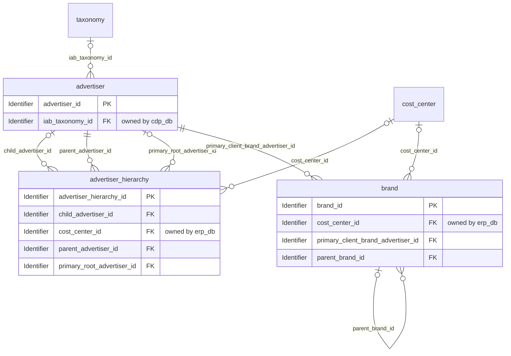
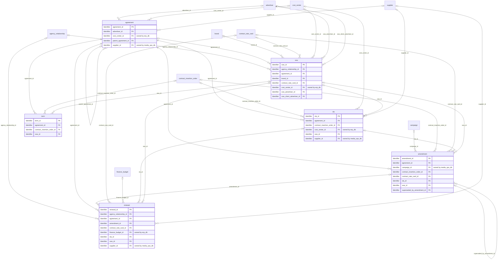

# Logical model: crm_db

Generated by advgen from the pinned Advertising MVM; do not edit by hand. Regenerate with `uv run advgen build`.

**Source system role:** Salesforce Sales Cloud (CRM). Advertiser identity, brands, account teams, client briefs and every commercial agreement (MSA, SOW, SLA, rate cards, client-side IOs).

The logical model is technology-neutral: entities, business attributes with logical domains, optionality, keys and every business relationship, **including relationships to entities owned by other systems** (marked *owned by …*). How each relationship is physically implemented (enforced FK vs soft reference) is decided in the physical model.

## Contents

- [client.account_management](#clientaccount_management)
- [client.advertiser_identity](#clientadvertiser_identity)
- [contract.commercial_pricing](#contractcommercial_pricing)
- [contract.contract_foundations](#contractcontract_foundations)
- [Code sets](#code-sets)
- [Normalization notes](#normalization-notes)

## client.account_management

| Entity | Kind | Definition |
|---|---|---|
| [account_team](#account_team) | master | Maps agency-side personnel (account directors, strategists, planners, media buyers, creatives) to specific advertiser accounts. |
| [agency_relationship](#agency_relationship) | master | Captures the formal relationship between the agency and an advertiser, including relationship type (AOR — Agency of Record, project-based, retainer, roster agency), relationship status, scope of services (media, creativ… |
| [client_brief](#client_brief) | transactional | Formal creative or campaign brief submitted by the client to initiate a new campaign, project, or creative deliverable. |
| [revenue_target](#revenue_target) | master | Annual and quarterly revenue targets set for each advertiser account, broken down by service line (media, creative, digital, PR). |

```mermaid
erDiagram
    account_team {
        Identifier account_team_id PK
        Identifier advertiser_id FK
        Identifier agency_relationship_id FK
        Identifier cost_center_id FK "owned by erp_db"
        Identifier managed_supplier_id FK "owned by media_ops_db"
    }
    agency_relationship {
        Identifier agency_relationship_id PK
        Identifier advertiser_id FK
        Identifier agreement_id FK
        Identifier primary_supplier_id FK "owned by media_ops_db"
    }
    client_brief {
        Identifier client_brief_id PK
        Identifier advertiser_id FK
        Identifier agency_relationship_id FK
        Identifier attribution_model_id FK "owned by adserver_db"
        Identifier brand_id FK
        Identifier initiative_id FK "owned by work_mgmt_db"
        Identifier segment_id FK "owned by cdp_db"
        Identifier supplier_id FK "owned by media_ops_db"
        Identifier target_persona_id FK "owned by cdp_db"
    }
    revenue_target {
        Identifier revenue_target_id PK
        Identifier advertiser_id FK
        Identifier agency_relationship_id FK
        Identifier agreement_id FK
        Identifier brand_id FK
        Identifier cost_center_id FK "owned by erp_db"
        Identifier finance_budget_id FK "owned by erp_db"
        Identifier initiative_id FK "owned by work_mgmt_db"
        Identifier sow_id FK
    }
    advertiser |o--o{ account_team : "advertiser_id"
    agency_relationship |o--o{ account_team : "agency_relationship_id"
    cost_center |o--o{ account_team : "cost_center_id"
    supplier |o--o{ account_team : "managed_supplier_id"
    advertiser |o--o{ agency_relationship : "advertiser_id"
    agreement |o--o{ agency_relationship : "agreement_id"
    supplier |o--o{ agency_relationship : "primary_supplier_id"
    advertiser |o--o{ client_brief : "advertiser_id"
    agency_relationship |o--o{ client_brief : "agency_relationship_id"
    attribution_model |o--o{ client_brief : "attribution_model_id"
    brand |o--o{ client_brief : "brand_id"
    initiative |o--o{ client_brief : "initiative_id"
    segment |o--o{ client_brief : "segment_id"
    supplier |o--o{ client_brief : "supplier_id"
    persona |o--o{ client_brief : "target_persona_id"
    advertiser |o--o{ revenue_target : "advertiser_id"
    agency_relationship |o--o{ revenue_target : "agency_relationship_id"
    agreement |o--o{ revenue_target : "agreement_id"
    brand |o--o{ revenue_target : "brand_id"
    cost_center |o--o{ revenue_target : "cost_center_id"
    finance_budget |o--o{ revenue_target : "finance_budget_id"
    initiative |o--o{ revenue_target : "initiative_id"
    sow |o--o{ revenue_target : "sow_id"
```

### account_team

Maps agency-side personnel (account directors, strategists, planners, media buyers, creatives) to specific advertiser accounts. Captures assigned team member reference, role on account (Account Director, Strategic Planner, Media Lead, Creative Director), assignment start and end dates, FTE allocation percentage, primary contact flag, backup coverage, and team status. Enables resource planning, utilization tracking, conflict-of-interest checks, QBR preparation, and client-facing org chart generation.

**Primary identifier:** `account_team_id`. **Business key(s):** `assignment_code`

| Attribute | Business name | Domain | Opt. | Key | Definition |
|---|---|---|---|---|---|
| `account_team_id` | Account Team ID | Identifier | M | PK | Unique surrogate identifier for each account team assignment record in the advertising agency. |
| `advertiser_id` | Client Account ID | Identifier → advertiser | O | FK | Reference to the advertiser or agency-managed client account to which this team member is assigned. |
| `agency_relationship_id` | Agency Relationship Id (Foreign Key) | Identifier → agency_relationship | O | FK | Foreign key linking to client.agency_relationship. |
| `cost_center_id` | Cost Center Id (Foreign Key) | Identifier → cost_center (erp_db) | O | FK | Foreign key linking to finance.cost_center. |
| `managed_supplier_id` | Managed Supplier Id (Foreign Key) | Identifier → supplier (media_ops_db) | O | FK | Foreign key linking to vendor.supplier. |
| `account_access_level` | Account Access Level | Code | O |  | The level of access this team member has to the client account record in Salesforce CRM (read, edit, or all). |
| `approval_date` | Assignment Approval Date | Date | O |  | The date on which this account team assignment was formally approved by the designated approver. |
| `assignment_code` | Assignment Code | Business Code | M | UK | Externally-known alphanumeric code uniquely identifying this account team assignment, used in Workfront project management and Salesforce CRM for cross-system reference and QBR (Q… |
| `assignment_notes` | Assignment Notes | Text | O |  | Free-text field capturing additional context about the team member's assignment, such as special responsibilities, client preferences, transition notes, or coverage arrangements. |
| `assignment_status` | Assignment Status | Code | M |  | Current lifecycle status of the team member's assignment to the account. |
| `assignment_type` | Assignment Type | Code | O |  | Classifies the nature of the team member's assignment to the account: 'dedicated' = exclusively assigned; 'shared' = split across multiple accounts; 'project_based' = assigned for… |
| `billing_rate_type` | Billing Rate Type | Code | O |  | Specifies the time unit basis for the billing rate applied to this team member's account assignment (hourly, daily, monthly, or fixed fee). |
| `billing_rate_usd` | Billing Rate (USD) | Rate | O |  | The hourly or daily billing rate in USD applied to this team member's time on the client account, as defined in the Statement of Work (SOW) or Master Service Agreement. |
| `client_facing_flag` | Client-Facing Flag | Indicator | M |  | Indicates whether this team member has direct client-facing responsibilities and appears on the client-facing org chart. |
| `conflict_of_interest_flag` | Conflict of Interest Flag | Indicator | M |  | Indicates whether a potential conflict of interest has been identified for this team member's assignment to the account (e.g., simultaneous assignment to a competing advertiser). |
| `conflict_review_date` | Conflict of Interest Review Date | Date | O |  | The date on which the most recent conflict-of-interest review was conducted for this team member's account assignment. |
| `conflict_review_outcome` | Conflict of Interest Review Outcome | Code | O |  | The outcome of the most recent conflict-of-interest review for this assignment. |
| `end_date` | Assignment End Date | Date | O |  | The date on which the agency personnel member's assignment to this client account is scheduled to end or actually ended. |
| `fte_allocation_pct` | Full-Time Equivalent (FTE) Allocation Percentage | Percentage | O |  | The percentage of the team member's full-time equivalent (FTE) capacity allocated to this specific client account, expressed as a decimal percentage (e.g., 50.00 = 50%). |
| `is_backup_contact` | Backup Contact Flag | Indicator | M |  | Indicates whether this team member serves as the backup coverage contact for the client account when the primary contact is unavailable. |
| `is_primary_contact` | Primary Contact Flag | Indicator | M |  | Indicates whether this team member is the designated primary point of contact for the client account. |
| `last_review_date` | Last Assignment Review Date | Date | O |  | The date of the most recent formal review of this team member's account assignment, typically conducted during QBR cycles or annual staffing reviews. |
| `next_review_date` | Next Assignment Review Date | Date | O |  | The scheduled date for the next formal review of this team member's account assignment. |
| `org_chart_display_order` | Org Chart Display Order | Quantity | O |  | Numeric sequence controlling the display order of this team member within the client-facing org chart for the account. |
| `planned_hours_per_month` | Planned Hours Per Month | Decimal | O |  | The planned number of hours per month this team member is expected to dedicate to this client account, as agreed in the Statement of Work (SOW) or resource plan. |
| `qbr_presenter_flag` | Quarterly Business Review (QBR) Presenter Flag | Indicator | M |  | Indicates whether this team member is designated to present at the client's Quarterly Business Review (QBR). |
| `role` | Account Team Role | Code (role) | O |  | The functional role this agency personnel member holds on the client account (e.g., Account Director, Strategic Planner, Media Lead, Creative Director, Account Manager, Media Buye… |
| `salesforce_team_member_code` | Salesforce Account Team Member ID | Business Code | O |  | The unique identifier of the corresponding AccountTeamMember record in Salesforce CRM Sales Cloud. |
| `seniority_level` | Seniority Level | Code | O |  | The seniority classification of the team member within their assigned role on this account (e.g., junior, mid, senior, lead, executive). |
| `start_date` | Assignment Start Date | Date | O |  | The date on which the agency personnel member formally began their assignment to this client account. |
| `team_function` | Team Function | Code | O |  | The agency functional discipline this team member represents on the account (account management, media, creative, strategy, analytics, or PR). |
| `created_at` | Record Created Timestamp | Timestamp | M |  | Timestamp when the row was inserted. |
| `created_by` | Created By | Text | M |  | Application user (session setting app.actor) or database role that inserted the row. |
| `updated_at` | Record Updated Timestamp | Timestamp | M |  | Timestamp of the last update. |
| `updated_by` | Updated By | Text | M |  | Application user or database role that last updated the row. |

### agency_relationship

Captures the formal relationship between the agency and an advertiser, including relationship type (AOR — Agency of Record, project-based, retainer, roster agency), relationship status, scope of services (media, creative, PR, digital, social), start and end dates, exclusivity flags, governing contract reference, and full relationship state-change history stored as effective-dated event records (AOR wins/losses, scope expansions, renewals, escalations, status transitions with effective dates, triggering events, previous state, new state, and narrative notes). This is the SSOT for both current relationship state and historical relationship lifecycle — no separate history table exists. Supports AOR tracking, pitch history, competitive conflict management, audit trail, and executive relationship lifecycle reporting.

**Primary identifier:** `agency_relationship_id`. **Business key(s):** `relationship_code`

| Attribute | Business name | Domain | Opt. | Key | Definition |
|---|---|---|---|---|---|
| `agency_relationship_id` | Agency Relationship ID | Identifier | M | PK | Unique surrogate identifier for the agency-advertiser relationship record. |
| `advertiser_id` | Client ID | Identifier → advertiser | O | FK | Reference to the advertiser or client organisation that is party to this agency relationship. |
| `agreement_id` | Contract ID | Identifier → agreement | O | FK | Reference to the governing contract or Statement of Work (SOW) that formalises the terms of this agency relationship. |
| `primary_supplier_id` | Primary Supplier Id (Foreign Key) | Identifier → supplier (media_ops_db) | O | FK | Foreign key linking to vendor.supplier. |
| `annual_fee_amount` | Annual Fee Amount | Amount | O |  | The contracted annual agency fee or retainer amount in the agreed currency for this relationship. |
| `aor_designation` | Agency of Record (AOR) Designation | Code (aor_designation) | O |  | Specifies the specific Agency of Record (AOR) designation held by the agency for this client, if applicable. |
| `brand_scope` | Brand Scope | Text | O |  | Comma-delimited list of the client's brand names or brand portfolio segments covered under this agency relationship. |
| `client_contact_email` | Primary Client Contact Email Address | Email | O |  | The business email address of the primary client contact for this relationship. |
| `commission_rate_pct` | Commission Rate Percentage | Percentage | O |  | The agreed agency commission rate expressed as a percentage of gross media spend, applicable when the fee structure type is commission_based or hybrid. |
| `competitive_conflict_flag` | Competitive Conflict Flag | Indicator | M |  | Indicates whether this agency-client relationship involves a known competitive conflict with another client in the agency's portfolio (i.e., the agency serves two competing advert… |
| `conflict_category` | Competitive Conflict Category | Text | O |  | The product or industry category in which a competitive conflict exists, if the competitive conflict flag is true (e.g., 'Automotive', 'Financial Services', 'FMCG — Beverages'). |
| `crm_opportunity_code` | CRM (Customer Relationship Management) Opportunity ID | Business Code | O |  | The external identifier of the corresponding Salesforce CRM Opportunity record that originated or tracks this agency-client relationship. |
| `current_event_type` | Current Relationship Event Type | Code (current_event_type) | O |  | The type of the most recent state-change event recorded against this relationship. |
| `effective_end_date` | Relationship Effective End Date | Date | O |  | The date on which the agency-client relationship is scheduled to end or was terminated. |
| `effective_start_date` | Relationship Effective Start Date | Date | O |  | The date on which the agency-client relationship formally commenced and became binding. |
| `estimated_annual_billings` | Estimated Annual Billings | Decimal | O |  | The estimated total annual media billings or revenue associated with this agency-client relationship, in the fee currency. |
| `event_effective_date` | Relationship Event Effective Date | Date | O |  | The business-effective date of the most recent state-change event (e.g., the date an AOR win took effect, the date a scope expansion was agreed). |
| `event_notes` | Relationship Event Notes | Text | O |  | Free-text narrative notes providing additional context for the most recent relationship state-change event. |
| `event_trigger` | Relationship Event Trigger | Text | O |  | A brief description of the business event or circumstance that triggered the most recent relationship state change (e.g., 'Client initiated competitive review', 'Scope expanded to… |
| `fee_currency_code` | Fee Currency Code | Currency Code | O |  | ISO 4217 three-letter currency code for the annual fee amount and any financial values associated with this relationship (e.g., USD, GBP, EUR). |
| `fee_structure_type` | Fee Structure Type | Code | O |  | The commercial fee model governing agency compensation under this relationship. |
| `geographic_scope` | Geographic Scope | Text | O |  | The geographic markets or territories covered by this agency-client relationship (e.g., 'USA', 'GBR,DEU,FRA', 'Global'). |
| `incumbent_agency_name` | Incumbent Agency Name | Name | O |  | The name of the previous incumbent agency that held the account prior to this relationship being established, if applicable. |
| `is_exclusive` | Exclusivity Flag | Indicator | M |  | Indicates whether the agency holds an exclusive mandate for the defined scope of services with this advertiser, preventing the client from engaging competing agencies for the same… |
| `lead_account_director` | Lead Account Director | Text | O |  | The name of the senior agency account director who holds primary responsibility for managing this client relationship. |
| `mediaocean_client_code` | Mediaocean Prisma Client Code | Business Code | O |  | The client code assigned to this advertiser in Mediaocean Prisma, the media planning and buying system of record. |
| `next_review_date` | Next Relationship Review Date | Date | O |  | The scheduled date of the next formal relationship review or Quarterly Business Review (QBR). |
| `notice_period_days` | Contractual Notice Period (Days) | Quantity | O |  | The number of calendar days of advance written notice required by either party to terminate or materially modify this agency-client relationship, as specified in the governing con… |
| `pitch_type` | Pitch Type | Code | O |  | The type of pitch or selection process through which this agency-client relationship was established. |
| `pitch_win_date` | Pitch Win Date | Date | O |  | The date on which the agency formally won the pitch or competitive review that established this relationship. |
| `previous_relationship_status` | Previous Relationship Status | Code | O |  | The relationship status immediately prior to the most recent state-change event. |
| `primary_client_contact` | Primary Client Contact Name | Text | O |  | The name of the primary contact person on the client/advertiser side for this relationship (e.g., CMO, Marketing Director, Brand Manager). |
| `relationship_code` | Agency Relationship Code | Business Code | M | UK | Externally-known alphanumeric business identifier for this agency-client relationship, used in Salesforce CRM, Mediaocean Prisma, and client-facing correspondence (e.g., REL-2024-… |
| `relationship_status` | Agency Relationship Status | Code | M |  | Current lifecycle state of the agency-client relationship. |
| `relationship_tier` | Relationship Tier | Code | O |  | The strategic importance tier assigned to this agency-client relationship based on revenue, strategic value, and growth potential. |
| `relationship_type` | Agency Relationship Type | Code | O |  | Classification of the formal relationship structure between the agency and the advertiser. |
| `renewal_date` | Relationship Renewal Date | Date | O |  | The date on which the agency-client relationship contract is due for renewal or renegotiation. |
| `review_cycle` | Relationship Review Cycle | Code | O |  | The agreed frequency at which the agency-client relationship is formally reviewed, including performance evaluation, scope assessment, and fee renegotiation. |
| `scope_of_services` | Scope of Services | Code (scope_of_services) | O |  | Comma-delimited list of service disciplines covered under this relationship (e.g., media, creative, pr, digital, social, ooh, programmatic, sem, seo). |
| `created_at` | Record Created Timestamp | Timestamp | M |  | Timestamp when the row was inserted. |
| `created_by` | Created By | Text | M |  | Application user (session setting app.actor) or database role that inserted the row. |
| `updated_at` | Record Last Modified Timestamp | Timestamp | M |  | Timestamp of the last update. |
| `updated_by` | Updated By | Text | M |  | Application user or database role that last updated the row. |

### client_brief

Formal creative or campaign brief submitted by the client to initiate a new campaign, project, or creative deliverable. Captures brief title, brief type (campaign, creative, media, PR), submission date, requesting contact, target audience description, key message, mandatory inclusions, budget indication, desired KPIs, timeline requirements, and brief status (draft, approved, in-progress, closed). The SSOT for client-originated work requests.

**Primary identifier:** `client_brief_id`. **Business key(s):** `brief_number`

| Attribute | Business name | Domain | Opt. | Key | Definition |
|---|---|---|---|---|---|
| `client_brief_id` | Client Brief ID | Identifier | M | PK | Unique system-generated identifier for the client brief record. |
| `advertiser_id` | Client ID | Identifier → advertiser | O | FK | Identifier of the client (advertiser or agency) who submitted this brief. |
| `agency_relationship_id` | Agency Relationship Id (Foreign Key) | Identifier → agency_relationship | O | FK | Foreign key linking to client.agency_relationship. |
| `attribution_model_id` | Attribution Model Id (Foreign Key) | Identifier → attribution_model (adserver_db) | O | FK | Foreign key linking to performance.attribution_model. |
| `brand_id` | Client Brand Id (Foreign Key) | Identifier → brand | O | FK | Foreign key linking to client.brand. |
| `initiative_id` | Initiative Id (Foreign Key) | Identifier → initiative (work_mgmt_db) | O | FK | Foreign key linking to project.initiative. |
| `segment_id` | Target Segment Id (Foreign Key) | Identifier → segment (cdp_db) | O | FK | Foreign key linking to audience.segment. |
| `supplier_id` | Supplier Id (Foreign Key) | Identifier → supplier (media_ops_db) | O | FK | Foreign key linking to vendor.supplier. |
| `target_persona_id` | Target Persona Id (Foreign Key) | Identifier → persona (cdp_db) | O | FK | Foreign key linking to audience.persona. |
| `approval_date` | Brief Approval Date | Date | O |  | Calendar date on which the brief was formally approved by the agency account team and accepted for execution. |
| `brand_guidelines_version` | Brand Guidelines Version | Text | O |  | Version identifier of the client brand guidelines document that must be adhered to for all creative executions under this brief (e.g., 'v3.2', '2024-Q1'). |
| `brief_number` | Brief Reference Number | Business Code | M | UK | Externally-visible, human-readable reference number assigned to the brief at submission (e.g., BRF-2024-000123). |
| `brief_status` | Brief Status | Code | M |  | Current lifecycle state of the client brief. |
| `brief_type` | Brief Type | Code (brief_type) | O |  | Classification of the brief by the type of work being requested. |
| `budget_currency_code` | Budget Currency Code | Currency Code | O |  | ISO 4217 three-letter currency code for the budget indication amount (e.g., USD, GBP, EUR). |
| `budget_indication_amount` | Budget Indication Amount | Amount | O |  | Client-indicated total budget for the campaign or project described in this brief, expressed in the operating currency. |
| `campaign_end_date` | Campaign End Date | Date | O |  | Client-requested end date for the campaign or deliverable described in the brief. |
| `campaign_objective` | Campaign Objective | Code (campaign_objective) | O |  | Primary marketing objective the client wants to achieve with this campaign or project. |
| `campaign_start_date` | Campaign Start Date | Date | O |  | Client-requested start date for the campaign or deliverable described in the brief. |
| `channel_requirements` | Channel Requirements | Text | O |  | Client-specified media channels or platforms required or preferred for this campaign (e.g., CTV, DOOH, OTT, social, search, OOH, programmatic). |
| `closed_date` | Brief Closed Date | Date | O |  | Date on which the brief was formally closed, either upon successful completion of all deliverables or cancellation. |
| `closure_reason` | Brief Closure Reason | Code | O |  | Reason code explaining why the brief was closed. |
| `competitive_context` | Competitive Context | Text | O |  | Client-provided description of the competitive landscape relevant to this campaign, including key competitors, market positioning, and Share of Voice (SOV) considerations. |
| `creative_format_requirements` | Creative Format Requirements | Text | O |  | Specific creative formats, sizes, or specifications required by the client (e.g., IAB standard banner sizes, VAST video specs, print dimensions). |
| `deliverable_due_date` | Deliverable Due Date | Date | O |  | Client-specified deadline by which the primary deliverable (creative, media plan, strategy deck, etc.) must be completed and delivered. |
| `geographic_scope` | Geographic Scope | Text | O |  | Description of the geographic markets or regions targeted by this campaign (e.g., national, specific DMAs, countries). |
| `is_agency_managed` | Agency Managed Flag | Indicator | M |  | Indicates whether this brief is submitted through an intermediary agency on behalf of the end advertiser (True) or directly by the advertiser (False). |
| `is_confidential` | Confidential Brief Flag | Indicator | M |  | Indicates whether the client has designated this brief as confidential, restricting access to named account team members only. |
| `key_message` | Key Message | Text | O |  | The primary communication message or value proposition the client wants to convey to the target audience. |
| `mandatory_exclusions` | Mandatory Exclusions | Text | O |  | Client-specified elements, themes, competitors, or content that must NOT appear in any deliverable. |
| `mandatory_inclusions` | Mandatory Inclusions | Text | O |  | Client-specified elements that must appear in all creative executions or deliverables (e.g., legal disclaimers, brand taglines, product claims, regulatory copy, logo usage require… |
| `primary_kpi` | Primary Key Performance Indicator (KPI) | Code (primary_kpi) | O |  | The single most important Key Performance Indicator (KPI) the client will use to measure campaign success. |
| `primary_kpi_target_value` | Primary KPI Target Value | Amount | O |  | Numeric target value the client expects to achieve for the primary KPI (e.g., a CTR of 0.0250 means 2.5%, a CPM of 5.00 means $5.00 per thousand impressions). |
| `priority_level` | Brief Priority Level | Code | O |  | Client or account team-assigned priority level for this brief, used to triage work intake and allocate agency resources. |
| `regulatory_compliance_notes` | Regulatory Compliance Notes | Text | O |  | Client-specified regulatory, legal, or compliance requirements that must be observed in all deliverables (e.g., GDPR consent requirements, CCPA disclosures, FTC endorsement guidel… |
| `revision_reason` | Brief Revision Reason | Text | O |  | Narrative explanation of why the brief was revised from a prior version. |
| `salesforce_opportunity_code` | Salesforce Opportunity ID | Business Code | O |  | Reference identifier of the associated Salesforce CRM Opportunity record, linking the brief to the revenue pipeline and account management context. |
| `submission_date` | Brief Submission Date | Date | O |  | Calendar date on which the client formally submitted the brief to the agency. |
| `title` | Brief Title | Name | M |  | Short, descriptive title of the client brief as provided by the requesting client contact (e.g., 'Q3 2024 Summer Campaign Launch Brief'). |
| `version` | Brief Version Number | Quantity | O |  | Incrementing version number of the brief document, starting at 1. |
| `created_at` | Record Created Timestamp | Timestamp | M |  | Timestamp when the row was inserted. |
| `created_by` | Created By | Text | M |  | Application user (session setting app.actor) or database role that inserted the row. |
| `updated_at` | Record Last Updated Timestamp | Timestamp | M |  | Timestamp of the last update. |
| `updated_by` | Updated By | Text | M |  | Application user or database role that last updated the row. |

### revenue_target

Annual and quarterly revenue targets set for each advertiser account, broken down by service line (media, creative, digital, PR). Captures target period, target amount, currency, service line, target type (gross revenue, net revenue, fee income), target owner (account director), and target status. Supports P&L management, QBR preparation, and account growth planning. Distinct from actual billed revenue owned by the finance domain.

**Primary identifier:** `revenue_target_id`. **Business key(s):** `target_code`

| Attribute | Business name | Domain | Opt. | Key | Definition |
|---|---|---|---|---|---|
| `revenue_target_id` | Client Revenue Target ID | Identifier | M | PK | Unique surrogate identifier for each client revenue target record. |
| `advertiser_id` | Advertiser ID | Identifier → advertiser | O | FK | Reference to the advertiser account for which this revenue target is set. |
| `agency_relationship_id` | Agency Relationship Id (Foreign Key) | Identifier → agency_relationship | O | FK | Foreign key linking to client.agency_relationship. |
| `agreement_id` | Agreement Id (Foreign Key) | Identifier → agreement | O | FK | Foreign key linking to contract.agreement. |
| `brand_id` | Client Brand Id (Foreign Key) | Identifier → brand | O | FK | Foreign key linking to client.brand. |
| `cost_center_id` | Cost Center Id (Foreign Key) | Identifier → cost_center (erp_db) | O | FK | Foreign key linking to finance.cost_center. |
| `finance_budget_id` | Budget Id (Foreign Key) | Identifier → finance_budget (erp_db) | O | FK | Foreign key linking to finance.finance_budget. |
| `initiative_id` | Initiative Id (Foreign Key) | Identifier → initiative (work_mgmt_db) | O | FK | Foreign key linking to project.initiative. |
| `sow_id` | Sow Id (Foreign Key) | Identifier → sow | O | FK | Foreign key linking to contract.sow. |
| `account_growth_rate_pct` | Account Growth Rate Percentage | Percentage | O |  | The year-over-year or period-over-period percentage growth rate embedded in this target relative to the prior comparable period's target. |
| `approval_date` | Target Approval Date | Date | O |  | The date on which the revenue target was formally approved by the designated approver. |
| `confidence_level` | Target Confidence Level | Code | O |  | Account team's assessed confidence in achieving this revenue target: high (strong pipeline, contracted SOW coverage), medium (pipeline in progress, partial SOW coverage), low (spe… |
| `contracted_sow_coverage_pct` | Contracted Statement of Work (SOW) Coverage Percentage | Percentage | O |  | The proportion of the revenue target already covered by signed Statements of Work (SOW) or Insertion Orders (IO) at the time of target setting or last update. |
| `crm_opportunity_code` | Customer Relationship Management (CRM) Opportunity ID | Business Code | O |  | The Salesforce CRM Sales Cloud Opportunity record ID linked to this revenue target, where the target originates from or is tracked against a specific sales opportunity. |
| `currency_code` | Currency Code (ISO 4217) | Currency Code | O |  | Three-letter ISO 4217 currency code in which the target_amount is denominated (e.g., USD, GBP, EUR). |
| `fiscal_quarter` | Fiscal Quarter | Code | O |  | The fiscal quarter to which this target applies (Q1–Q4). |
| `fiscal_year` | Fiscal Year | Quantity | O |  | The four-digit fiscal year to which this revenue target applies (e.g., 2025). |
| `fx_rate_applied` | Foreign Exchange (FX) Rate Applied | Rate | O |  | The exchange rate used to convert target_amount to target_amount_usd at the time of target creation or last revision. |
| `is_stretch_target` | Is Stretch Target Flag | Indicator | M |  | Indicates whether this target is designated as a stretch (aspirational) target above the base committed target. |
| `notes` | Target Notes | Text | O |  | Free-text field for account team commentary on the revenue target, including assumptions, dependencies, client commitments, or QBR talking points. |
| `original_target_amount` | Original Revenue Target Amount | Amount | O |  | The initial revenue target amount set at the start of the period before any revisions. |
| `period_end_date` | Target Period End Date | Date | O |  | The calendar date on which the revenue target period ends. |
| `period_start_date` | Target Period Start Date | Date | O |  | The calendar date on which the revenue target period begins. |
| `pipeline_amount` | Pipeline Revenue Amount | Amount | O |  | The total value of identified but not yet contracted revenue opportunities in the Salesforce CRM pipeline that are expected to contribute to this target. |
| `profit_centre_code` | Profit Centre Code | Business Code | O |  | SAP S/4HANA CO profit centre code associated with this revenue target, enabling segment-level P&L reporting by business unit, geography, or service line. |
| `revision_number` | Target Revision Number | Quantity | O |  | Sequential integer indicating how many times this revenue target has been revised (0 = original). |
| `revision_reason` | Target Revision Reason | Text | O |  | Free-text explanation for why the revenue target was revised (e.g., client budget reduction, scope expansion, new service line added, market conditions). |
| `roas_target` | Return on Ad Spend (ROAS) Target | Decimal | O |  | The target Return on Ad Spend (ROAS) ratio associated with this revenue target, where applicable (primarily for performance-based media service lines). |
| `service_line` | Service Line | Code | O |  | The agency service line to which this revenue target is attributed: media (Media Planning and Buying), creative (Creative Development and Production), digital (Digital Marketing a… |
| `target_amount` | Revenue Target Amount | Amount | O |  | The gross or net revenue target value set for the advertiser account for the specified period and service line, expressed in the currency defined by currency_code. |
| `target_amount_usd` | Revenue Target Amount (USD) | Amount | O |  | The revenue target amount converted to US Dollars (USD) using the exchange rate applied at the time of target setting. |
| `target_code` | Revenue Target Code | Business Code | M | UK | Externally-known alphanumeric business identifier for this revenue target record, used in Quarterly Business Review (QBR) reporting, P&L management, and cross-system reconciliatio… |
| `target_name` | Revenue Target Name | Name | M |  | Human-readable label for this revenue target, typically combining the advertiser name, service line, and target period (e.g., 'Acme Corp — Media — FY2025 Q1'). |
| `target_owner_name` | Target Owner Name | Name | O |  | Display name of the account director or account manager who owns this revenue target. |
| `target_period_type` | Target Period Type | Code | O |  | Granularity of the target period: annual (full fiscal year), quarterly (fiscal quarter), or monthly (calendar month). |
| `target_setting_method` | Target Setting Method | Code | O |  | The methodology used to derive this revenue target: top_down (allocated from agency-level P&L plan), bottom_up (built from individual campaign and SOW estimates), negotiated (agre… |
| `target_status` | Revenue Target Status | Code (target_status) | M |  | Current lifecycle state of the revenue target record. |
| `target_type` | Revenue Target Type | Code | O |  | Classification of the revenue target by income recognition method: gross_revenue (total billings before agency commission deduction), net_revenue (billings net of media costs), fe… |
| `created_at` | Record Created Timestamp | Timestamp | M |  | Timestamp when the row was inserted. |
| `created_by` | Created By | Text | M |  | Application user (session setting app.actor) or database role that inserted the row. |
| `updated_at` | Record Updated Timestamp | Timestamp | M |  | Timestamp of the last update. |
| `updated_by` | Updated By | Text | M |  | Application user or database role that last updated the row. |

## client.advertiser_identity

| Entity | Kind | Definition |
|---|---|---|
| [advertiser](#advertiser) | master | Master record for every advertiser (direct client or agency-managed brand) that the agency serves. |
| [advertiser_hierarchy](#advertiser_hierarchy) | master | Defines the parent-child organizational hierarchy among advertiser entities — holding company, subsidiary, brand, and sub-brand relationships. |
| [brand](#brand) | master | Represents an individual brand owned by an advertiser. |

### advertiser

Master record for every advertiser (direct client or agency-managed brand) that the agency serves. Captures authoritative identity including legal entity name, trading name, industry vertical (IAB taxonomy), business segment, holding company affiliation, CRM account ID (Salesforce), ERP customer number (SAP), tax identifiers (VAT/EIN), incorporation jurisdiction, credit terms, payment terms, preferred currency, account status (prospect, active, dormant, churned), account tier, and all engagement preferences (preferred communication channels, reporting cadence, invoice delivery method, language preference, time zone, approval workflow preferences, GDPR/CCPA data sharing consent flags). Also stores structured address records (registered office, billing address, shipping address, regional offices) with address type, full postal details, country (ISO 3166), geocoordinates, and validation status. This is the SSOT for advertiser identity, commercial configuration, engagement preferences, and physical/mailing addresses across the entire data model.

**Primary identifier:** `advertiser_id`

| Attribute | Business name | Domain | Opt. | Key | Definition |
|---|---|---|---|---|---|
| `advertiser_id` | Advertiser ID | Identifier | M | PK | Unique surrogate identifier for the advertiser record. |
| `iab_taxonomy_id` | Iab Taxonomy Id (Foreign Key) | Identifier → taxonomy (cdp_db) | O | FK | Foreign key linking to audience.taxonomy. |
| `account_status` | Account Status | Code | M |  | Current lifecycle status of the advertiser account. |
| `account_tier` | Account Tier | Code | O |  | Commercial tier classification of the advertiser based on revenue contribution, strategic importance, and engagement level. |
| `address_validation_status` | Address Validation Status | Code | O |  | Indicates the validation status of the advertiser's billing address against a postal address verification service. |
| `approval_workflow_type` | Approval Workflow Type | Code | O |  | Defines the creative and campaign approval workflow configuration for this advertiser. |
| `ccpa_consent_flag` | California Consumer Privacy Act (CCPA) Data Sharing Consent Flag | Indicator | M |  | Indicates whether the advertiser has opted in to data sharing under CCPA regulations. |
| `churn_date` | Churn Date | Date | O |  | The date on which the advertiser's account was marked as churned (relationship ended). |
| `credit_terms` | Credit Terms | Code | O |  | The agreed payment credit terms for this advertiser, defining the number of days after invoice date by which payment is due. |
| `crm_account_code` | Customer Relationship Management (CRM) Account ID | Business Code | O |  | The unique account identifier assigned to this advertiser in Salesforce CRM (Sales Cloud). |
| `ein` | Employer Identification Number (EIN) | Text | O |  | The US federal Employer Identification Number (EIN) assigned by the IRS to the advertiser. |
| `erp_customer_number` | Enterprise Resource Planning (ERP) Customer Number | Business Code | O |  | The customer master number assigned to this advertiser in SAP S/4HANA (FI/AR module). |
| `gdpr_consent_flag` | General Data Protection Regulation (GDPR) Data Sharing Consent Flag | Indicator | M |  | Indicates whether the advertiser has provided explicit consent for data sharing and processing under GDPR. |
| `holding_company_name` | Holding Company Name | Name | O |  | The name of the parent holding company or corporate group to which this advertiser belongs (e.g., WPP, Publicis, Omnicom client-side equivalent). |
| `incorporation_jurisdiction` | Incorporation Jurisdiction | Text | O |  | ISO 3166-1 alpha-2 or alpha-3 country code of the jurisdiction in which the advertiser's legal entity is incorporated. |
| `invoice_delivery_method` | Invoice Delivery Method | Code | O |  | The preferred method by which invoices are delivered to the advertiser. |
| `is_agency_managed` | Agency Managed Flag | Indicator | M |  | Indicates whether this advertiser is managed through an intermediary agency relationship (True) or is a direct client of the agency (False). |
| `language_preference` | Language Preference | Text | O |  | The advertiser's preferred language for communications, reports, and invoices, expressed as an IETF BCP 47 language tag (e.g., 'en-US', 'fr-FR', 'de-DE'). |
| `legal_entity_name` | Legal Entity Name | Name | M |  | The full registered legal name of the advertiser as recorded with the relevant incorporation authority. |
| `managing_agency_name` | Managing Agency Name | Name | O |  | Name of the intermediary agency managing this advertiser's account, if is_agency_managed is True. |
| `onboarding_date` | Onboarding Date | Date | O |  | The date on which the advertiser was formally onboarded as a client of the agency. |
| `payment_terms` | Payment Terms | Code | O |  | The agreed payment method/instrument for this advertiser's invoices. |
| `preferred_comm_channel` | Preferred Communication Channel | Code | O |  | The advertiser's preferred channel for day-to-day account communications and notifications. |
| `preferred_currency` | Preferred Currency | Currency Code | O |  | The ISO 4217 three-letter currency code representing the advertiser's preferred billing and reporting currency (e.g., 'USD', 'EUR', 'GBP'). |
| `primary_contact_email` | Primary Contact Email Address | Email | O |  | The primary email address of the advertiser's main point of contact at the client organization. |
| `primary_contact_name` | Primary Contact Full Name | Name | O |  | Full name of the advertiser's primary point of contact at the client organization. |
| `primary_contact_phone` | Primary Contact Phone Number | Text | O |  | Primary telephone number for the advertiser's main point of contact. |
| `registered_office_country` | Registered Office Country | ISO Code | O |  | ISO 3166-1 alpha-3 country code for the country where the advertiser's registered office is located. |
| `reporting_cadence` | Reporting Cadence | Code | O |  | The agreed frequency at which performance reports and analytics dashboards are delivered to the advertiser. |
| `time_zone` | Time Zone | Text | O |  | The advertiser's primary operational time zone expressed as an IANA Time Zone Database identifier (e.g., 'America/New_York', 'Europe/London'). |
| `trading_name` | Trading Name (DBA) | Name | O |  | The brand or 'doing business as' (DBA) name under which the advertiser operates commercially. |
| `vat_number` | Value Added Tax (VAT) Number | Business Code | O |  | The advertiser's Value Added Tax (VAT) registration number issued by the relevant tax authority. |
| `created_at` | Record Created Timestamp | Timestamp | M |  | Timestamp when the row was inserted. |
| `created_by` | Created By | Text | M |  | Application user (session setting app.actor) or database role that inserted the row. |
| `updated_at` | Record Last Updated Timestamp | Timestamp | M |  | Timestamp of the last update. |
| `updated_by` | Updated By | Text | M |  | Application user or database role that last updated the row. |

### advertiser_hierarchy

Defines the parent-child organizational hierarchy among advertiser entities — holding company, subsidiary, brand, and sub-brand relationships. Supports multi-level account trees for large conglomerates (e.g., WPP, Publicis clients) where billing, reporting, and campaign attribution must roll up through corporate structures. Tracks hierarchy type (holding, subsidiary, brand portfolio), effective dates, and consolidation flags.

**Primary identifier:** `advertiser_hierarchy_id`. **Business key(s):** `hierarchy_code`

| Attribute | Business name | Domain | Opt. | Key | Definition |
|---|---|---|---|---|---|
| `advertiser_hierarchy_id` | Advertiser Hierarchy ID | Identifier | M | PK | Unique surrogate identifier for each advertiser hierarchy relationship record. |
| `child_advertiser_id` | Child Advertiser ID | Identifier → advertiser | O | FK | Identifier of the child advertiser entity in the hierarchy (e.g., subsidiary, brand, or sub-brand). |
| `cost_center_id` | Cost Center Id (Foreign Key) | Identifier → cost_center (erp_db) | O | FK | Foreign key linking to finance.cost_center. |
| `parent_advertiser_id` | Parent Advertiser ID | Identifier → advertiser | M | FK | Identifier of the parent advertiser entity in the hierarchy (e.g., holding company or parent subsidiary). |
| `primary_root_advertiser_id` | Root Advertiser ID | Identifier → advertiser | O | FK | Identifier of the ultimate holding company or top-level entity in the advertiser corporate tree. |
| `agency_commission_rate` | Agency Commission Rate | Rate | O |  | The negotiated agency commission rate (expressed as a decimal, e.g., 0.1500 for 15%) applicable to media buys placed on behalf of the child entity within this hierarchy. |
| `approved_by` | Approved By | Text | O |  | Name or identifier of the account management or finance authority who approved the establishment or modification of this hierarchy relationship. |
| `approved_date` | Approved Date | Date | O |  | The date on which this hierarchy relationship was formally approved by the designated account management or finance authority. |
| `billing_consolidation_flag` | Billing Consolidation Flag | Indicator | M |  | Indicates whether invoices and media spend for the child entity are consolidated and billed through the parent entity. |
| `change_reason` | Hierarchy Change Reason | Code (change_reason) | O |  | Categorized reason code explaining why this hierarchy relationship record was created or last modified. |
| `consolidation_flag` | Consolidation Flag | Indicator | M |  | Indicates whether the child entity's spend, impressions, and campaign performance metrics should be financially consolidated into the parent entity's reporting and P&L. |
| `country_code` | Country Code | ISO Code | O |  | ISO 3166-1 alpha-3 three-letter country code of the primary operating jurisdiction for this hierarchy relationship. |
| `crm_hierarchy_code` | Customer Relationship Management (CRM) Hierarchy ID | Business Code | O |  | The native account hierarchy relationship identifier from Salesforce CRM Sales Cloud. |
| `currency_code` | Currency Code | Currency Code | O |  | ISO 4217 three-letter currency code for the billing and financial consolidation currency applicable to this hierarchy relationship (e.g., 'USD', 'EUR', 'GBP'). |
| `data_sharing_consent_flag` | Data Sharing Consent Flag | Indicator | M |  | Indicates whether the child advertiser entity has provided consent for audience data and campaign performance data to be shared with the parent entity in this hierarchy. |
| `effective_end_date` | Effective End Date | Date | O |  | The date on which this parent-child hierarchy relationship ceases to be operationally effective. |
| `effective_start_date` | Effective Start Date | Date | M |  | The date on which this parent-child hierarchy relationship became or becomes operationally effective. |
| `hierarchy_code` | Advertiser Hierarchy Code | Business Code | M | UK | Externally-known alphanumeric business code uniquely identifying this parent-child hierarchy relationship. |
| `hierarchy_description` | Hierarchy Relationship Description | Text | O |  | Free-text narrative describing the business context, rationale, or special conditions of this parent-child hierarchy relationship. |
| `hierarchy_level` | Hierarchy Level | Quantity | O |  | Numeric depth of the child advertiser entity within the corporate account tree, where level 1 represents the ultimate holding company. |
| `hierarchy_name` | Hierarchy Relationship Name | Name | O |  | Human-readable label describing this specific parent-child hierarchy relationship (e.g., 'Unilever > Dove Brand Portfolio'). |
| `hierarchy_path` | Hierarchy Path | Text | O |  | Materialized slash-delimited path string representing the full ancestry chain from the root holding company to the current child node (e.g., '/HoldCo/SubsidiaryA/BrandX'). |
| `hierarchy_status` | Hierarchy Status | Code | M |  | Current lifecycle state of the parent-child hierarchy relationship. |
| `hierarchy_type` | Hierarchy Type | Code (hierarchy_type) | O |  | Classifies the nature of the parent-child relationship within the advertiser corporate structure. |
| `industry_sector` | Industry Sector | Text | O |  | The IAB Content Taxonomy industry sector classification of the child advertiser entity within this hierarchy (e.g., 'Consumer Packaged Goods', 'Automotive', 'Financial Services'). |
| `is_primary_hierarchy` | Is Primary Hierarchy Flag | Indicator | M |  | Indicates whether this relationship represents the primary (canonical) hierarchy path for the child advertiser entity. |
| `market_region` | Market Region | Code (market_region) | O |  | The geographic market region in which this hierarchy relationship is operationally active (e.g., 'North America', 'EMEA', 'APAC'). |
| `ownership_percentage` | Ownership Percentage | Percentage | O |  | The percentage of ownership the parent entity holds in the child entity (0.00–100.00). |
| `prisma_hierarchy_code` | Mediaocean Prisma Hierarchy ID | Business Code | O |  | The native account hierarchy identifier from Mediaocean Prisma used for media planning, buying, and billing roll-up. |
| `relationship_role` | Hierarchy Relationship Role | Code | O |  | Describes the commercial or legal role of the child entity relative to the parent within the hierarchy (e.g., wholly-owned subsidiary vs. |
| `reporting_consolidation_flag` | Reporting Consolidation Flag | Indicator | M |  | Indicates whether campaign performance data (impressions, clicks, CTR, ROAS) for the child entity rolls up into the parent entity's consolidated reporting dashboards in Google Cam… |
| `source_system` | Source System | Code | O |  | Identifies the operational system of record from which this hierarchy relationship record was originally sourced or is mastered. |
| `sov_rollup_flag` | Share of Voice (SOV) Roll-Up Flag | Indicator | M |  | Indicates whether the child entity's media spend and impressions should be included in the parent entity's Share of Voice (SOV) calculations for competitive analysis in Nielsen Ad… |
| `version_number` | Version Number | Quantity | O |  | Monotonically incrementing version counter for this hierarchy relationship record. |
| `created_at` | Record Created Timestamp | Timestamp | M |  | Timestamp when the row was inserted. |
| `created_by` | Created By | Text | M |  | Application user (session setting app.actor) or database role that inserted the row. |
| `updated_at` | Record Updated Timestamp | Timestamp | M |  | Timestamp of the last update. |
| `updated_by` | Updated By | Text | M |  | Application user or database role that last updated the row. |

### brand

Represents an individual brand owned by an advertiser. A single advertiser may manage multiple brands (e.g., Unilever owns Dove, Axe, Lipton). Captures brand name, brand code, category, sub-category, brand tier, launch date, brand status, and the owning advertiser. Serves as the SSOT for brand identity referenced by campaigns, creative assets, and media plans. Distinct from the brand domain's brand strategy and positioning entities.

**Primary identifier:** `brand_id`. **Business key(s):** `brand_code`

| Attribute | Business name | Domain | Opt. | Key | Definition |
|---|---|---|---|---|---|
| `brand_id` | Brand ID | Identifier | M | PK | Unique identifier for the brand. |
| `cost_center_id` | Cost Center Id (Foreign Key) | Identifier → cost_center (erp_db) | O | FK | Foreign key linking to finance.cost_center. |
| `primary_client_brand_advertiser_id` | Advertiser ID | Identifier → advertiser | M | FK | Reference to the parent advertiser (client) who owns this brand. |
| `annual_media_budget` | Annual Media Budget | Amount | O |  | The total approved annual media spend budget allocated to this brand in the base currency. |
| `brand_category` | Brand Category | Code (brand_category) | O |  | Primary product or service category the brand competes in (e.g., Personal Care, Food & Beverage, Automotive, Financial Services). |
| `brand_code` | Brand Code | Business Code | M | UK | Externally-known alphanumeric short code uniquely identifying the brand across operational systems including Google Campaign Manager 360, Mediaocean Prisma, and The Trade Desk. |
| `brand_description` | Brand Description | Text | O |  | Free-text narrative describing the brand's identity, value proposition, target audience, and key differentiators. |
| `brand_name` | Brand Name | Name | M |  | The official commercial name of the brand as recognized in the market (e.g., Dove, Axe, Lipton). |
| `brand_status` | Brand Status | Code | M |  | Current lifecycle status of the brand record. |
| `brand_tier` | Brand Tier | Code | O |  | Strategic positioning tier of the brand within the advertiser's portfolio, indicating relative market positioning and investment priority. |
| `budget_currency` | Budget Currency Code | Currency Code | O |  | ISO 4217 three-letter currency code for the brand's annual media budget (e.g., USD, EUR, GBP). |
| `crm_brand_code` | Customer Relationship Management (CRM) Brand ID | Business Code | O |  | The brand's unique identifier in Salesforce CRM (Sales Cloud / Marketing Cloud). |
| `dam_folder_code` | Digital Asset Management (DAM) Folder ID | Business Code | O |  | The folder or collection identifier in Workfront DAM (Digital Asset Management) where all creative assets for this brand are stored. |
| `data_privacy_classification` | Brand Data Privacy Classification | Code | O |  | Privacy classification governing data collection and audience targeting practices for this brand. |
| `digital_advertising_enabled` | Digital Advertising Enabled Flag | Indicator | M |  | Indicates whether the brand is approved and configured for digital advertising including programmatic, paid search (PPC/SEM), and social media. |
| `discontinuation_date` | Brand Discontinuation Date | Date | O |  | The date on which the brand was officially discontinued or retired from the market. |
| `guidelines_url` | Brand Guidelines URL | URL | O |  | URL pointing to the brand's official style guide and creative guidelines document stored in Workfront DAM or Adobe Creative Cloud. |
| `is_house_brand` | House Brand Flag | Indicator | M |  | Indicates whether this brand is an agency house brand or proprietary brand (True) versus a client-owned advertiser brand (False). |
| `launch_date` | Brand Launch Date | Date | O |  | The date on which the brand was officially launched in the market. |
| `nielsen_brand_code` | Nielsen Ad Intel Brand Code | Business Code | O |  | The brand identifier assigned by Nielsen Ad Intel for competitive monitoring, audience measurement, and Gross Rating Point (GRP) tracking. |
| `operating_markets` | Brand Operating Markets | Text | O |  | Comma-separated list of ISO 3166-1 alpha-3 country codes representing all markets where the brand is actively sold and advertised. |
| `portfolio_rank` | Brand Portfolio Rank | Quantity | O |  | Numeric rank of the brand within the advertiser's portfolio based on strategic importance and revenue contribution (1 = highest priority). |
| `primary_channel` | Primary Advertising Channel | Code | O |  | The primary media channel through which the brand predominantly advertises. |
| `primary_market_country` | Primary Market Country | ISO Code | O |  | ISO 3166-1 alpha-3 country code representing the brand's primary operating market (e.g., USA, GBR, DEU). |
| `prisma_brand_code` | Mediaocean Prisma Brand Code | Business Code | O |  | The brand identifier used in Mediaocean Prisma for media planning, buying, billing, and financial reconciliation. |
| `programmatic_eligible` | Programmatic Advertising Eligible Flag | Indicator | M |  | Indicates whether the brand is approved for Real-Time Bidding (RTB) and programmatic media buying via Demand-Side Platforms (DSPs) such as The Trade Desk. |
| `regulatory_restrictions` | Brand Regulatory Restrictions | Text | O |  | Free-text description of any regulatory or legal advertising restrictions applicable to the brand (e.g., alcohol advertising watershed rules, pharmaceutical fair balance requireme… |
| `safety_level` | Brand Safety Level | Code | O |  | The brand safety classification tier governing content adjacency restrictions for programmatic and digital media buying. |
| `sov_target_pct` | Share of Voice (SOV) Target Percentage | Percentage | O |  | The client-agreed target Share of Voice (SOV) percentage for this brand within its competitive category. |
| `sub_category` | Brand Sub-Category | Text | O |  | Secondary classification within the brand category providing finer segmentation (e.g., within Personal Care: Skin Care, Hair Care, Deodorants). |
| `tagline` | Brand Tagline | Text | O |  | The official marketing tagline or slogan associated with the brand (e.g., 'Just Do It', 'Real Beauty'). |
| `website_url` | Brand Website URL | URL | O |  | The official public-facing website URL for the brand. |
| `parent_brand_id` | Parent Brand Id | Identifier → brand | O | FK | Parent brand when this brand is a sub-brand or brand extension (e.g. |
| `created_at` | Record Created Timestamp | Timestamp | M |  | Timestamp when the row was inserted. |
| `created_by` | Created By | Text | M |  | Application user (session setting app.actor) or database role that inserted the row. |
| `updated_at` | Record Updated Timestamp | Timestamp | M |  | Timestamp of the last update. |
| `updated_by` | Updated By | Text | M |  | Application user or database role that last updated the row. |

## contract.commercial_pricing

| Entity | Kind | Definition |
|---|---|---|
| [contract_deliverable](#contract_deliverable) | master | Specific contractual deliverable committed under a SOW or agreement — such as a creative asset package, media plan, campaign report, or brand strategy deck. |
| [contract_insertion_order](#contract_insertion_order) | transactional | Formal IO (Insertion Order) record authorizing media spend with a specific publisher or vendor for a defined campaign flight. |
| [contract_rate_card](#contract_rate_card) | master | Negotiated pricing schedule attached to a client agreement or vendor contract — defining unit rates for agency services (hourly FTE rates by role, production cost rates, media commission percentages) or vendor media inv… |
| [rate_card_line](#rate_card_line) | master | Individual line-item entry within a rate card defining the unit price for a specific service, role, or media placement type. |

```mermaid
erDiagram
    contract_deliverable {
        Identifier contract_deliverable_id PK
        Identifier advertiser_id FK
        Identifier agreement_id FK
        Identifier amendment_id FK
        Identifier brand_id FK
        Identifier campaign_id FK "owned by media_ops_db"
        Identifier cost_center_id FK "owned by erp_db"
        Identifier dam_asset_id FK "owned by work_mgmt_db"
        Identifier initiative_id FK "owned by work_mgmt_db"
        Identifier sla_id FK
        Identifier sow_id FK
    }
    contract_insertion_order {
        Identifier contract_insertion_order_id PK
        Identifier advertiser_id FK
        Identifier agency_relationship_id FK
        Identifier brand_id FK
        Identifier campaign_id FK "owned by media_ops_db"
        Identifier contract_rate_card_id FK
        Identifier finance_budget_id FK "owned by erp_db"
        Identifier master_service_agreement_id FK
        Identifier media_insertion_order_id FK "owned by media_ops_db"
        Identifier sow_id FK
        Identifier supplier_id FK "owned by media_ops_db"
    }
    contract_rate_card {
        Identifier contract_rate_card_id PK
        Identifier ad_channel_id FK "owned by media_ops_db"
        Identifier advertiser_id FK
        Identifier agency_relationship_id FK
        Identifier agreement_id FK
        Identifier brand_id FK
        Identifier cost_center_id FK "owned by erp_db"
        Identifier supplier_id FK "owned by media_ops_db"
        Identifier vendor_rate_card_id FK "owned by media_ops_db"
    }
    rate_card_line {
        Identifier rate_card_line_id PK
        Identifier ad_channel_id FK "owned by media_ops_db"
        Identifier ad_format_id FK "owned by media_ops_db"
        Identifier contract_rate_card_id FK
    }
    advertiser |o--o{ contract_deliverable : "advertiser_id"
    agreement ||--o{ contract_deliverable : "agreement_id"
    amendment |o--o{ contract_deliverable : "amendment_id"
    brand |o--o{ contract_deliverable : "brand_id"
    campaign |o--o{ contract_deliverable : "campaign_id"
    cost_center |o--o{ contract_deliverable : "cost_center_id"
    asset |o--o{ contract_deliverable : "dam_asset_id"
    initiative |o--o{ contract_deliverable : "initiative_id"
    sla |o--o{ contract_deliverable : "sla_id"
    sow ||--o{ contract_deliverable : "sow_id"
    advertiser |o--o{ contract_insertion_order : "advertiser_id"
    agency_relationship |o--o{ contract_insertion_order : "agency_relationship_id"
    brand |o--o{ contract_insertion_order : "brand_id"
    campaign ||--o{ contract_insertion_order : "campaign_id"
    contract_rate_card |o--o{ contract_insertion_order : "contract_rate_card_id"
    finance_budget |o--o{ contract_insertion_order : "finance_budget_id"
    agreement ||--o{ contract_insertion_order : "master_service_agreement_id"
    media_insertion_order |o--o{ contract_insertion_order : "media_insertion_order_id"
    sow |o--o{ contract_insertion_order : "sow_id"
    supplier |o--o{ contract_insertion_order : "supplier_id"
    ad_channel |o--o{ contract_rate_card : "ad_channel_id"
    advertiser |o--o{ contract_rate_card : "advertiser_id"
    agency_relationship |o--o{ contract_rate_card : "agency_relationship_id"
    agreement ||--o{ contract_rate_card : "agreement_id"
    brand |o--o{ contract_rate_card : "brand_id"
    cost_center |o--o{ contract_rate_card : "cost_center_id"
    supplier |o--o{ contract_rate_card : "supplier_id"
    vendor_rate_card |o--o{ contract_rate_card : "vendor_rate_card_id"
    ad_channel |o--o{ rate_card_line : "ad_channel_id"
    ad_format |o--o{ rate_card_line : "ad_format_id"
    contract_rate_card ||--o{ rate_card_line : "contract_rate_card_id"
```

### contract_deliverable

Specific contractual deliverable committed under a SOW or agreement — such as a creative asset package, media plan, campaign report, or brand strategy deck. Captures deliverable name, description, due date, acceptance criteria, responsible team, delivery format, and current status (pending, in-progress, submitted, accepted, rejected). Bridges contract obligations to operational execution tracked in Workfront.

**Primary identifier:** `contract_deliverable_id`. **Business key(s):** `deliverable_code`

| Attribute | Business name | Domain | Opt. | Key | Definition |
|---|---|---|---|---|---|
| `contract_deliverable_id` | Deliverable Identifier (ID) | Identifier | M | PK | Unique identifier for the contractual deliverable. |
| `advertiser_id` | Client Identifier (ID) | Identifier → advertiser | O | FK | Reference to the client or advertiser for whom this deliverable is being produced. |
| `agreement_id` | Contract Identifier (ID) | Identifier → agreement | M | FK | Reference to the parent contract or Statement of Work (SOW) under which this deliverable is committed. |
| `amendment_id` | Amendment Id (Foreign Key) | Identifier → amendment | O | FK | Foreign key linking to contract.amendment. |
| `brand_id` | Client Brand Id (Foreign Key) | Identifier → brand | O | FK | Foreign key linking to client.brand. |
| `campaign_id` | Campaign Identifier (ID) | Identifier → campaign (media_ops_db) | O | FK | Reference to the campaign or project to which this deliverable is associated, if applicable. |
| `cost_center_id` | Cost Center Id (Foreign Key) | Identifier → cost_center (erp_db) | O | FK | Foreign key linking to finance.cost_center. |
| `dam_asset_id` | Digital Asset Management (DAM) Asset Identifier (ID) | Identifier → asset (work_mgmt_db) | O | FK | The identifier of the final deliverable asset stored in the Digital Asset Management (DAM) system. |
| `initiative_id` | Initiative Id (Foreign Key) | Identifier → initiative (work_mgmt_db) | O | FK | Foreign key linking to project.initiative. |
| `sla_id` | Sla Id (Foreign Key) | Identifier → sla | O | FK | Foreign key linking to contract.sla. |
| `sow_id` | Statement of Work (SOW) Identifier (ID) | Identifier → sow | M | FK | Reference to the specific Statement of Work (SOW) that defines this deliverable. |
| `acceptance_criteria` | Acceptance Criteria | Text | O |  | The specific criteria, standards, or requirements that must be met for the client to accept the deliverable. |
| `acceptance_date` | Acceptance Date | Date | O |  | The date on which the client formally accepted the deliverable as meeting contractual requirements. |
| `actual_cost` | Actual Cost | Amount | O |  | The actual total cost incurred to produce this deliverable, used for budget reconciliation and profitability analysis. |
| `actual_hours` | Actual Hours | Decimal | O |  | The actual number of labor hours spent on completing this deliverable, tracked for billing and performance analysis. |
| `billable_amount` | Billable Amount | Amount | O |  | The amount that will be billed to the client for this deliverable, as specified in the contract or SOW. |
| `client_feedback` | Client Feedback | Text | O |  | Detailed feedback or comments provided by the client during the review process. |
| `contract_deliverable_description` | Deliverable Description | Text | O |  | Detailed description of the deliverable scope, content, and specifications as outlined in the contract or SOW. |
| `contract_deliverable_status` | Deliverable Status | Code (contract_deliverable_status) | M |  | Current lifecycle status of the deliverable (e.g., pending, in-progress, submitted, under review, accepted, rejected, on hold, cancelled). |
| `currency_code` | Currency Code | Currency Code | O |  | Three-letter ISO 4217 currency code for all monetary amounts associated with this deliverable (e.g., USD, EUR, GBP). |
| `deliverable_code` | Deliverable Code | Business Code | M | UK | Unique business identifier or code for the deliverable, often used for tracking and billing purposes. |
| `deliverable_name` | Deliverable Name | Name | M |  | The business name or title of the deliverable as specified in the contract (e.g., 'Q1 Brand Strategy Deck', 'Creative Asset Package - Summer Campaign'). |
| `deliverable_type` | Deliverable Type | Code (deliverable_type) | O |  | Classification of the deliverable by type (e.g., creative asset, media plan, campaign report, brand strategy deck, analytics dashboard). |
| `delivery_format` | Delivery Format | Code (delivery_format) | O |  | The file format or medium in which the deliverable will be provided (e.g., PDF, PowerPoint, video file, HTML, ZIP archive). |
| `delivery_method` | Delivery Method | Code | O |  | The method or channel through which the deliverable will be transmitted to the client (e.g., email, file share, DAM platform, physical delivery, client portal). |
| `due_date` | Due Date | Date | O |  | The contractually committed date by which the deliverable must be completed and submitted to the client. |
| `estimated_cost` | Estimated Cost | Amount | O |  | The estimated total cost to produce this deliverable, including labor, materials, and third-party expenses. |
| `estimated_hours` | Estimated Hours | Decimal | O |  | The estimated number of labor hours required to complete this deliverable, used for resource planning and budgeting. |
| `internal_notes` | Internal Notes | Text | O |  | Internal notes or comments from the production team regarding the deliverable, not shared with the client. |
| `is_milestone` | Is Milestone | Indicator | M |  | Boolean flag indicating whether this deliverable represents a major milestone in the contract or project timeline. |
| `priority` | Priority | Code | O |  | The business priority level assigned to this deliverable, used for resource allocation and scheduling decisions. |
| `rejection_reason` | Rejection Reason | Text | O |  | The reason provided by the client for rejecting the deliverable, if applicable, used to guide revisions. |
| `requires_client_approval` | Requires Client Approval | Indicator | M |  | Boolean flag indicating whether this deliverable requires formal client approval before being considered complete. |
| `responsible_team` | Responsible Team | Text | O |  | The internal team or department responsible for producing and delivering this deliverable (e.g., Creative, Media Planning, Analytics, Strategy). |
| `revision_number` | Revision Number | Quantity | O |  | The current revision or version number of the deliverable, incremented with each resubmission or update. |
| `submission_date` | Submission Date | Date | O |  | The actual date on which the deliverable was submitted to the client for review. |
| `created_at` | Created Timestamp | Timestamp | M |  | Timestamp when the row was inserted. |
| `created_by` | Created By | Text | M |  | Application user (session setting app.actor) or database role that inserted the row. |
| `updated_at` | Modified Timestamp | Timestamp | M |  | Timestamp of the last update. |
| `updated_by` | Modified By | Text | M |  | Application user or database role that last updated the row. |

### contract_insertion_order

Formal IO (Insertion Order) record authorizing media spend with a specific publisher or vendor for a defined campaign flight. Captures IO number, media vendor reference, campaign reference, total authorized spend, flight start and end dates, placement specifications, rate type (CPM, CPC, CPA, flat fee), and IO status (draft, pending signature, executed, paused, cancelled). The authoritative transactional record linking media buying commitments to contractual obligations under a parent agreement. Supports media cost reconciliation and vendor payment authorization workflows.

**Primary identifier:** `contract_insertion_order_id`. **Business key(s):** `io_number`

| Attribute | Business name | Domain | Opt. | Key | Definition |
|---|---|---|---|---|---|
| `contract_insertion_order_id` | Contract Insertion Order (IO) Identifier | Identifier | M | PK | Unique identifier for the insertion order record. |
| `advertiser_id` | Advertiser Identifier | Identifier → advertiser | O | FK | Reference to the client advertiser on whose behalf this media spend is authorized. |
| `agency_relationship_id` | Agency Relationship Id (Foreign Key) | Identifier → agency_relationship | O | FK | Foreign key linking to client.agency_relationship. |
| `brand_id` | Client Brand Id (Foreign Key) | Identifier → brand | O | FK | Foreign key linking to client.brand. |
| `campaign_id` | Campaign Identifier | Identifier → campaign (media_ops_db) | M | FK | Reference to the parent campaign for which this insertion order authorizes media spend. |
| `contract_rate_card_id` | Contract Rate Card Id (Foreign Key) | Identifier → contract_rate_card | O | FK | Foreign key linking to contract.contract_rate_card. |
| `finance_budget_id` | Budget Id (Foreign Key) | Identifier → finance_budget (erp_db) | O | FK | Foreign key linking to finance.finance_budget. |
| `master_service_agreement_id` | Master Service Agreement (MSA) Identifier | Identifier → agreement | M | FK | Reference to the parent master service agreement or contract under which this insertion order is executed. |
| `media_insertion_order_id` | Media Insertion Order Id (Foreign Key) | Identifier → media_insertion_order (media_ops_db) | O | FK | Foreign key linking to media.media_insertion_order. |
| `sow_id` | Sow Id (Foreign Key) | Identifier → sow | O | FK | Foreign key linking to contract.sow. |
| `supplier_id` | Media Vendor Identifier | Identifier → supplier (media_ops_db) | O | FK | Reference to the publisher or media vendor with whom this insertion order establishes a media buying commitment. |
| `agency_commission_rate` | Agency Commission Rate Percentage | Rate | O |  | The percentage commission rate earned by the agency on media spend under this insertion order, typically ranging from 0% to 20%. |
| `billing_contact_email` | Billing Contact Email Address | Email | O |  | Email address of the billing contact for invoice delivery and payment-related communications. |
| `billing_contact_name` | Billing Contact Name | Name | O |  | Name of the primary billing contact responsible for invoice processing and payment authorization for this insertion order. |
| `buying_method` | Buying Method | Code | O |  | The method by which media inventory is purchased under this insertion order. |
| `cancellation_policy` | Cancellation Policy | Text | O |  | Terms and conditions governing cancellation or early termination of the insertion order, including notice periods and financial penalties. |
| `committed_clicks` | Committed Clicks | Quantity | O |  | The total number of clicks committed or guaranteed under this insertion order for CPC-based campaigns. |
| `committed_conversions` | Committed Conversions | Quantity | O |  | The total number of conversions or acquisitions committed under this insertion order for CPA-based campaigns. |
| `committed_impressions` | Committed Impressions | Quantity | O |  | The total number of ad impressions committed or guaranteed by the media vendor under this insertion order. |
| `currency_code` | Currency Code | Currency Code | O |  | Three-letter ISO 4217 currency code for all monetary amounts in this insertion order. |
| `flight_end_date` | Flight End Date | Date | O |  | The date when the media campaign flight ends and ad serving authorization under this insertion order expires. |
| `flight_start_date` | Flight Start Date | Date | O |  | The date when the media campaign flight begins and ad serving is authorized to commence under this insertion order. |
| `io_approved_date` | Insertion Order (IO) Approved Date | Date | O |  | The date when the insertion order was approved by the media vendor, authorizing campaign setup and trafficking. |
| `io_name` | Insertion Order (IO) Name | Name | M |  | Human-readable descriptive name for the insertion order, typically including campaign reference and media vendor for easy identification. |
| `io_number` | Insertion Order (IO) Number | Business Code | M | UK | The externally-known unique business identifier for this insertion order, used in communications with media vendors and internal tracking systems. |
| `io_signed_date` | Insertion Order (IO) Signed Date | Date | O |  | The date when the insertion order was executed and signed by all required parties, establishing the binding commitment. |
| `io_status` | Insertion Order (IO) Status | Code (io_status) | M |  | Current lifecycle status of the insertion order in the approval and execution workflow. |
| `io_submitted_date` | Insertion Order (IO) Submitted Date | Date | O |  | The date when the insertion order was submitted to the media vendor for review and approval. |
| `io_type` | Insertion Order (IO) Type | Code | O |  | Classification of the insertion order based on the media buying model and inventory commitment type. |
| `make_good_policy` | Make Good Policy | Text | O |  | Terms governing make-good provisions when the media vendor fails to deliver committed impressions or performance metrics, including remediation options. |
| `media_channel` | Media Channel | Code (media_channel) | O |  | The primary media channel or platform type for this insertion order. |
| `notes` | Insertion Order (IO) Notes | Text | O |  | Free-form notes capturing additional terms, special instructions, or contextual information relevant to this insertion order. |
| `payment_terms` | Payment Terms | Code | O |  | The agreed payment terms specifying when payment is due after invoice receipt (e.g., Net 30 means payment due within 30 days). |
| `placement_specifications` | Placement Specifications | Text | O |  | Detailed specifications for ad placements including ad formats, sizes, positions, targeting criteria, and creative requirements as agreed with the media vendor. |
| `rate_amount` | Rate Amount | Rate | O |  | The unit rate or price associated with the rate type (e.g., $5.00 CPM, $0.50 CPC). |
| `rate_type` | Rate Type | Code (rate_type) | O |  | The pricing model used for this insertion order. |
| `third_party_ad_serving_fee` | Third-Party Ad Serving Fee Amount | Amount | O |  | Additional fee charged for third-party ad serving technology, tracking, and verification services associated with this insertion order. |
| `total_authorized_spend` | Total Authorized Spend Amount | Amount | O |  | The total budget amount authorized for media spend under this insertion order, representing the maximum financial commitment. |
| `trafficking_contact_email` | Trafficking Contact Email Address | Email | O |  | Email address of the trafficking contact for campaign setup and creative asset coordination. |
| `trafficking_contact_name` | Trafficking Contact Name | Name | O |  | Name of the primary trafficking contact responsible for campaign setup, creative delivery, and ad serving coordination. |
| `created_at` | Record Created Timestamp | Timestamp | M |  | Timestamp when the row was inserted. |
| `created_by` | Record Created By User | Text | M |  | Application user (session setting app.actor) or database role that inserted the row. |
| `updated_at` | Record Modified Timestamp | Timestamp | M |  | Timestamp of the last update. |
| `updated_by` | Record Modified By User | Text | M |  | Application user or database role that last updated the row. |

### contract_rate_card

Negotiated pricing schedule attached to a client agreement or vendor contract — defining unit rates for agency services (hourly FTE rates by role, production cost rates, media commission percentages) or vendor media inventory pricing (CPM floors, CPC rates, flat placement fees). Captures rate card version, effective date range, currency, rate type, and approval status. The SSOT for contractual pricing used in billing reconciliation.

**Primary identifier:** `contract_rate_card_id`. **Business key(s):** `rate_card_number, version_number`

| Attribute | Business name | Domain | Opt. | Key | Definition |
|---|---|---|---|---|---|
| `contract_rate_card_id` | Contract Rate Card Identifier (ID) | Identifier | M | PK | Unique identifier for the contract rate card. |
| `ad_channel_id` | Ad Channel Id (Foreign Key) | Identifier → ad_channel (media_ops_db) | O | FK | Foreign key linking to media.ad_channel. |
| `advertiser_id` | Advertiser Id (Foreign Key) | Identifier → advertiser | O | FK | Foreign key linking to client.advertiser. |
| `agency_relationship_id` | Agency Relationship Id (Foreign Key) | Identifier → agency_relationship | O | FK | Foreign key linking to client.agency_relationship. |
| `agreement_id` | Contract Identifier (ID) | Identifier → agreement | M | FK | Reference to the parent contract or agreement to which this rate card is attached. |
| `brand_id` | Client Brand Id (Foreign Key) | Identifier → brand | O | FK | Foreign key linking to client.brand. |
| `cost_center_id` | Cost Center Id (Foreign Key) | Identifier → cost_center (erp_db) | O | FK | Foreign key linking to finance.cost_center. |
| `supplier_id` | Supplier Id (Foreign Key) | Identifier → supplier (media_ops_db) | O | FK | Foreign key linking to vendor.supplier. |
| `vendor_rate_card_id` | Vendor Rate Card Id (Foreign Key) | Identifier → vendor_rate_card (media_ops_db) | O | FK | Foreign key linking to vendor.vendor_rate_card. |
| `approved_by` | Approved By | Text | O |  | Name or identifier of the person or role who approved this rate card for use. |
| `approved_date` | Approved Date | Date | O |  | Date when this rate card was formally approved for use. |
| `audience_segment` | Audience Segment | Text | O |  | Target audience segment or demographic to which this rate applies, such as 'Adults 18-34', 'High-Income Households', 'B2B Decision Makers'. |
| `base_rate` | Base Rate | Rate | O |  | The standard or base rate amount for this rate card entry, before any adjustments, discounts, or surcharges. |
| `billing_frequency` | Billing Frequency | Code (billing_frequency) | O |  | How often charges under this rate card are invoiced: weekly, biweekly, monthly, quarterly, milestone (upon reaching project milestones), on_completion (at project end), or custom… |
| `contract_rate_card_status` | Rate Card Status | Code (contract_rate_card_status) | M |  | Current lifecycle status of the rate card: draft (being prepared), pending_approval (submitted for review), approved (authorized but not yet effective), active (currently in force… |
| `currency_code` | Currency Code | Currency Code | O |  | Three-letter ISO 4217 currency code for all rates in this rate card (e.g., USD, EUR, GBP). |
| `discount_percentage` | Discount Percentage | Percentage | O |  | Negotiated discount percentage applied to the base rate, expressed as a percentage (e.g., 15.00 for 15% discount). |
| `effective_end_date` | Effective End Date | Date | O |  | Date when this rate card expires and is no longer applicable. |
| `effective_start_date` | Effective Start Date | Date | O |  | Date when this rate card becomes effective and applicable for billing. |
| `geography_scope` | Geography Scope | Text | O |  | Geographic scope or market to which this rate card applies, such as 'USA', 'EMEA', 'APAC', 'New York DMA', 'Global'. |
| `is_default` | Is Default Rate Card | Indicator | M |  | Flag indicating whether this is the default rate card for the associated contract or service line. |
| `is_negotiable` | Is Negotiable | Indicator | M |  | Flag indicating whether rates in this card are open to negotiation or are fixed. |
| `markup_percentage` | Markup Percentage | Percentage | O |  | Agency markup or commission percentage applied to vendor costs or media spend, expressed as a percentage (e.g., 20.00 for 20% markup). |
| `maximum_rate` | Maximum Rate | Rate | O |  | Ceiling rate or maximum charge applicable under this rate card. |
| `minimum_rate` | Minimum Rate | Rate | O |  | Floor rate or minimum charge applicable under this rate card. |
| `notes` | Rate Card Notes | Text | O |  | Free-text field for additional notes, special terms, conditions, or clarifications related to this rate card. |
| `payment_terms_days` | Payment Terms Days | Quantity | O |  | Number of days from invoice date within which payment is due under this rate card (e.g., 30 for Net 30, 60 for Net 60). |
| `pricing_model` | Pricing Model | Code (pricing_model) | O |  | The pricing structure used in this rate card: hourly (time-based), daily, monthly, per_unit (per deliverable), CPM (Cost Per Mille), CPC (Cost Per Click), CPA (Cost Per Acquisitio… |
| `rate_card_name` | Rate Card Name | Name | M |  | Descriptive name of the rate card for business reference, such as 'Q1 2024 Agency Services Rate Card' or 'Premium Media Inventory Pricing'. |
| `rate_card_number` | Rate Card Number | Business Code | M | UK | Business identifier for the rate card, typically used in invoicing and billing reconciliation. |
| `rate_card_type` | Rate Card Type | Code | O |  | Classification of the rate card by its purpose: agency_services (hourly FTE rates by role), media_inventory (CPM/CPC rates for ad placements), production (creative production cost… |
| `rate_category` | Rate Category | Text | O |  | Business classification or grouping for the rates in this card, such as 'Senior Creative Staff', 'Digital Media Placements', 'Video Production Services', or 'Programmatic Inventor… |
| `role_level` | Role Level | Text | O |  | For agency services rate cards, the seniority or role level to which this rate applies, such as 'Junior Designer', 'Senior Account Director', 'Executive Creative Director'. |
| `service_line` | Service Line | Text | O |  | The agency service line or practice area covered by this rate card, such as 'Creative Services', 'Media Planning', 'Digital Strategy', 'Production', 'Analytics'. |
| `unit_of_measure` | Unit of Measure | Code (unit_of_measure) | O |  | The unit by which the rate is measured and billed: hour (hourly rate), day (daily rate), month (monthly retainer), impression (per 1000 impressions for CPM), click (per click for… |
| `version_number` | Version Number | Business Code | M | UK | Version identifier for the rate card, supporting version control and change tracking. |
| `volume_tier` | Volume Tier | Text | O |  | Volume-based pricing tier identifier for tiered rate cards, such as 'Tier 1: 0-100K impressions', 'Tier 2: 100K-500K impressions'. |
| `created_at` | Created Timestamp | Timestamp | M |  | Timestamp when the row was inserted. |
| `created_by` | Created By | Text | M |  | Application user (session setting app.actor) or database role that inserted the row. |
| `updated_at` | Modified Timestamp | Timestamp | M |  | Timestamp of the last update. |
| `updated_by` | Modified By | Text | M |  | Application user or database role that last updated the row. |

### rate_card_line

Individual line-item entry within a rate card defining the unit price for a specific service, role, or media placement type. Captures line item code, service or role description, unit of measure (hour, impression, click, placement), unit rate, volume tier thresholds, discount percentage, and effective date range. Enables granular billing calculations and spend reconciliation against contracted rates.

**Primary identifier:** `rate_card_line_id`

| Attribute | Business name | Domain | Opt. | Key | Definition |
|---|---|---|---|---|---|
| `rate_card_line_id` | Rate Card Line Identifier | Identifier | M | PK | Primary key for rate_card_line |
| `ad_channel_id` | Ad Channel Id (Foreign Key) | Identifier → ad_channel (media_ops_db) | O | FK | Foreign key linking to media.ad_channel. |
| `ad_format_id` | Ad Format Id (Foreign Key) | Identifier → ad_format (media_ops_db) | O | FK | Foreign key linking to media.ad_format. |
| `contract_rate_card_id` | Rate Card Identifier (ID) | Identifier → contract_rate_card | M | FK | Reference to the parent rate card document that contains this line item. |
| `approval_status` | Approval Status | Code | O |  | Approval workflow status for this rate card line. |
| `approved_by` | Approved By | Text | O |  | Name or identifier of the person who approved this rate card line item. |
| `approved_timestamp` | Approved Timestamp | Timestamp | O |  | Date and time when this rate card line item was approved. |
| `billing_frequency` | Billing Frequency | Code (billing_frequency) | O |  | Cadence at which this line item is invoiced to the client. |
| `cost_center_code` | Cost Center Code | Business Code | O |  | Internal cost center or department code for financial allocation and profit and loss (P&L) tracking. |
| `currency_code` | Currency Code | Currency Code | O |  | Three-letter ISO 4217 currency code for the unit rate (e.g., USD, EUR, GBP). |
| `discount_percentage` | Discount Percentage | Percentage | O |  | Percentage discount applied to the unit rate for this line item. |
| `effective_end_date` | Effective End Date | Date | O |  | Date when this rate card line item expires or is superseded. |
| `effective_start_date` | Effective Start Date | Date | O |  | Date when this rate card line item becomes active and applicable for billing. |
| `gl_account_code` | General Ledger (GL) Account Code | Business Code | O |  | General ledger account code for revenue recognition. |
| `is_retainer_eligible` | Is Retainer Eligible Flag | Indicator | M |  | Indicates whether this line item can be included in retainer-based billing arrangements. |
| `is_taxable` | Is Taxable Flag | Indicator | M |  | Indicates whether this line item is subject to sales tax or value-added tax (VAT). |
| `line_item_code` | Line Item Code | Business Code | O |  | Business identifier code for this rate card line item. |
| `line_sequence_number` | Line Sequence Number | Quantity | O |  | Sequential ordering of this line item within the parent rate card. |
| `line_status` | Line Status | Code | M |  | Current lifecycle status of this rate card line item. |
| `markup_percentage` | Markup Percentage | Percentage | O |  | Agency markup or commission percentage applied on top of base cost for pass-through expenses or media buys. |
| `maximum_commitment_quantity` | Maximum Commitment Quantity | Decimal | O |  | Maximum volume or hours available for this line item under the contract terms. |
| `minimum_commitment_quantity` | Minimum Commitment Quantity | Decimal | O |  | Minimum volume or hours the client must purchase for this line item under the contract terms. |
| `notes` | Notes | Text | O |  | Free-text field for additional context, special terms, or clarifications related to this rate card line item. |
| `overage_rate` | Overage Rate | Rate | O |  | Rate charged for usage exceeding the maximum commitment quantity. |
| `role_title` | Role Title | Name | O |  | Job title or role designation for labor-based rate card lines (e.g., Senior Art Director, Media Planner, Account Executive). |
| `seniority_level` | Seniority Level | Code | O |  | Experience tier for labor-based rate card lines. |
| `service_description` | Service Description | Text | O |  | Detailed description of the service, role, or media placement type covered by this line item. |
| `service_type` | Service Type | Code | O |  | Category of service or deliverable covered by this rate card line. |
| `tax_category_code` | Tax Category Code | Business Code | O |  | Tax classification code for this line item. |
| `unit_of_measure` | Unit of Measure (UOM) | Code (unit_of_measure) | O |  | The unit by which this service or media placement is quantified and billed (e.g., hourly rate, cost per thousand impressions, flat fee per placement). |
| `unit_rate` | Unit Rate | Rate | O |  | The base price charged per unit of measure. |
| `volume_tier_threshold_max` | Volume Tier Threshold Maximum | Rate | O |  | Maximum quantity threshold for volume-based pricing tier. |
| `volume_tier_threshold_min` | Volume Tier Threshold Minimum | Rate | O |  | Minimum quantity threshold for volume-based pricing tier. |
| `created_at` | Created Timestamp | Timestamp | M |  | Timestamp when the row was inserted. |
| `created_by` | Created By | Text | M |  | Application user (session setting app.actor) or database role that inserted the row. |
| `updated_at` | Modified Timestamp | Timestamp | M |  | Timestamp of the last update. |
| `updated_by` | Modified By | Text | M |  | Application user or database role that last updated the row. |

## contract.contract_foundations

| Entity | Kind | Definition |
|---|---|---|
| [agreement](#agreement) | master | Master record for all commercial agreements between the agency and its clients or media vendors — including MSAs (Master Service Agreements), SOWs (Statements of Work), IOs (Insertion Orders), vendor media supply agreem… |
| [amendment](#amendment) | transactional | Formal change record modifying an existing agreement, SOW, or IO — capturing scope changes, budget adjustments, timeline extensions, or term revisions. |
| [renewal](#renewal) | transactional | Contract renewal event record tracking the lifecycle of agreement renewals — including auto-renewal triggers, manual renewal negotiations, pricing adjustments, and final outcome (renewed, renegotiated, lapsed, terminate… |
| [sla](#sla) | master | Service Level Agreement record defining measurable performance commitments within a client or vendor contract — including creative turnaround times, campaign go-live SLAs, reporting delivery deadlines, platform uptime g… |
| [sow](#sow) | master | Statement of Work entity capturing the detailed scope, deliverables, milestones, timelines, and pricing for a specific client engagement under a parent MSA or standalone agreement. |
| [term](#term) | master | Granular terms and conditions clauses attached to an agreement or SOW — including payment terms (net-30, net-60), IP ownership clauses, confidentiality obligations, indemnification provisions, termination-for-convenienc… |

### agreement

Master record for all commercial agreements between the agency and its clients or media vendors — including MSAs (Master Service Agreements), SOWs (Statements of Work), IOs (Insertion Orders), vendor media supply agreements, technology licenses, and production services contracts. Captures contract type (client or vendor), counterparty reference, status, effective and expiry dates, governing law, jurisdiction, auto-renewal flags, notice periods, total committed value, and the owning account team. Serves as the SSOT for all contractual relationships — both client-facing and supply-side — and is the anchor entity for the contract domain.

**Primary identifier:** `agreement_id`. **Business key(s):** `agreement_number`

| Attribute | Business name | Domain | Opt. | Key | Definition |
|---|---|---|---|---|---|
| `agreement_id` | Agreement Identifier (ID) | Identifier | M | PK | Unique identifier for the commercial agreement. |
| `advertiser_id` | Advertiser Identifier (ID) | Identifier → advertiser | O | FK | Reference to the client advertiser party to this agreement. |
| `cost_center_id` | Cost Center Id (Foreign Key) | Identifier → cost_center (erp_db) | O | FK | Foreign key linking to finance.cost_center. |
| `parent_agreement_id` | Parent Agreement Identifier (ID) | Identifier → agreement | O | FK | Reference to the parent or master agreement if this is a child agreement (e.g., SOW under an MSA, Amendment to an IO). |
| `supplier_id` | Supplier Id (Foreign Key) | Identifier → supplier (media_ops_db) | O | FK | Foreign key linking to vendor.supplier. |
| `agreement_number` | Agreement Number | Business Code | M | UK | Externally-known business identifier for the agreement, used in client communications and invoicing. |
| `agreement_status` | Agreement Status | Code (agreement_status) | M |  | Current lifecycle status of the agreement. |
| `agreement_type` | Agreement Type | Code (agreement_type) | O |  | Classification of the commercial agreement. |
| `approval_date` | Approval Date | Date | O |  | Date when internal approval was granted to execute this agreement. |
| `approved_by` | Approved By | Text | O |  | Name or identifier of the internal authority who approved this agreement. |
| `auto_renewal_flag` | Auto-Renewal Flag | Indicator | M |  | Indicates whether the agreement automatically renews at expiry unless terminated. |
| `compliance_review_date` | Compliance Review Date | Date | O |  | Date of the most recent compliance or legal review of this agreement. |
| `confidentiality_clause_flag` | Confidentiality Clause Flag | Indicator | M |  | Indicates whether the agreement includes a confidentiality or non-disclosure provision. |
| `contract_owner` | Contract Owner | Text | O |  | Name or identifier of the individual responsible for ongoing management and compliance of this agreement. |
| `counterparty_type` | Counterparty Type | Code | O |  | Indicates whether the agreement is with a client (revenue-generating), vendor (cost-generating), or strategic partner. |
| `currency_code` | Currency Code | Currency Code | O |  | Three-letter ISO 4217 currency code for all monetary values in this agreement. |
| `deliverables_summary` | Deliverables Summary | Text | O |  | High-level summary of key deliverables, milestones, or outputs expected under this agreement. |
| `dispute_resolution_method` | Dispute Resolution Method | Code | O |  | Agreed mechanism for resolving disputes arising from this agreement. |
| `document_storage_url` | Document Storage Uniform Resource Locator (URL) | URL | O |  | URL or file path to the signed agreement document in the Digital Asset Management (DAM) or document management system. |
| `effective_date` | Effective Date | Date | O |  | Date when the agreement becomes legally binding and enforceable. |
| `exclusivity_flag` | Exclusivity Flag | Indicator | M |  | Indicates whether the agreement grants exclusive rights to the agency or client within a defined scope or territory. |
| `expiry_date` | Expiry Date | Date | O |  | Date when the agreement terminates. |
| `governing_law` | Governing Law | Text | O |  | Legal jurisdiction whose laws govern the interpretation and enforcement of this agreement (e.g., State of New York, England and Wales). |
| `indemnity_clause_flag` | Indemnity Clause Flag | Indicator | M |  | Indicates whether the agreement includes an indemnity provision protecting one or both parties from third-party claims. |
| `liability_cap_amount` | Liability Cap Amount | Amount | O |  | Maximum liability amount either party can be held responsible for under this agreement. |
| `next_review_date` | Next Review Date | Date | O |  | Scheduled date for the next periodic review or renewal discussion of this agreement. |
| `notes` | Notes | Text | O |  | Free-text field for additional comments, special terms, or internal notes about this agreement. |
| `payment_terms_days` | Payment Terms (Days) | Quantity | O |  | Number of days from invoice date within which payment is due (e.g., Net 30, Net 60). |
| `performance_bonus_clause_flag` | Performance Bonus Clause Flag | Indicator | M |  | Indicates whether the agreement includes performance-based bonus or incentive provisions. |
| `pricing_model` | Pricing Model | Code (pricing_model) | O |  | Commercial pricing structure for this agreement. |
| `renewal_notice_period_days` | Renewal Notice Period (Days) | Quantity | O |  | Number of days advance notice required to prevent auto-renewal or to initiate renewal negotiation. |
| `scope_of_work_description` | Scope of Work (SOW) Description | Text | O |  | Detailed description of the services, deliverables, and work products covered by this agreement. |
| `signed_date` | Signed Date | Date | O |  | Date when all parties executed the agreement. |
| `sla_included_flag` | Service Level Agreement (SLA) Included Flag | Indicator | M |  | Indicates whether the agreement includes defined Service Level Agreements with performance targets and penalties. |
| `termination_date` | Termination Date | Date | O |  | Actual date when the agreement was terminated, if applicable. |
| `termination_notice_period_days` | Termination Notice Period (Days) | Quantity | O |  | Number of days advance notice required for either party to terminate the agreement. |
| `termination_reason` | Termination Reason | Text | O |  | Explanation or business reason for early termination of the agreement, if applicable. |
| `total_committed_value` | Total Committed Value | Amount | O |  | Total monetary value committed under this agreement over its full term. |
| `created_at` | Created Timestamp | Timestamp | M |  | Timestamp when the row was inserted. |
| `created_by` | Created By | Text | M |  | Application user (session setting app.actor) or database role that inserted the row. |
| `updated_at` | Last Modified Timestamp | Timestamp | M |  | Timestamp of the last update. |
| `updated_by` | Updated By | Text | M |  | Application user or database role that last updated the row. |

### amendment

Formal change record modifying an existing agreement, SOW, or IO — capturing scope changes, budget adjustments, timeline extensions, or term revisions. Each amendment records the parent contract reference, amendment number, change type, original value, revised value, effective date, reason for change, and approval chain. Maintains a complete audit trail of all contractual modifications throughout the agreement lifecycle.

**Primary identifier:** `amendment_id`

| Attribute | Business name | Domain | Opt. | Key | Definition |
|---|---|---|---|---|---|
| `amendment_id` | Amendment Identifier (ID) | Identifier | M | PK | Unique identifier for the contract amendment record. |
| `agreement_id` | Contract Identifier (ID) | Identifier → agreement | M | FK | Reference to the parent contract, Statement of Work (SOW), Master Service Agreement (MSA), or Insertion Order (IO) being amended. |
| `campaign_id` | Campaign Id (Foreign Key) | Identifier → campaign (media_ops_db) | O | FK | Foreign key linking to campaign.campaign. |
| `contract_insertion_order_id` | Insertion Order Id (Foreign Key) | Identifier → contract_insertion_order | O | FK | Foreign key linking to contract.contract_insertion_order. |
| `contract_rate_card_id` | Contract Rate Card Id (Foreign Key) | Identifier → contract_rate_card | O | FK | Foreign key linking to contract.contract_rate_card. |
| `sla_id` | Sla Id (Foreign Key) | Identifier → sla | O | FK | Foreign key linking to contract.sla. |
| `sow_id` | Sow Id (Foreign Key) | Identifier → sow | O | FK | Foreign key linking to contract.sow. |
| `superseded_by_amendment_id` | Superseded By Amendment Identifier (ID) | Identifier → amendment | O | FK | Reference to a subsequent amendment that supersedes or replaces this amendment, if applicable. |
| `agency_signatory_name` | Agency Signatory Name | Name | O |  | Full name of the agency representative who signed the amendment on behalf of the agency. |
| `agency_signatory_title` | Agency Signatory Title | Name | O |  | Job title or role of the agency representative who signed the amendment. |
| `amendment_number` | Amendment Number | Business Code | M |  | Sequential or hierarchical amendment identifier (e.g., A-001, Amendment 1, 2024-A-03) used for external reference and tracking. |
| `amendment_status` | Amendment Status | Code | M |  | Current lifecycle state of the amendment in the approval and execution workflow. |
| `amendment_type` | Amendment Type | Code | O |  | Classification of the amendment based on the nature of the contractual change being made. |
| `approval_date` | Approval Date | Date | O |  | Date on which the amendment received formal approval from the authorized approver. |
| `approved_by` | Approved By | Text | O |  | Name or identifier of the individual or authority who approved the amendment. |
| `budget_delta_amount` | Budget Delta Amount | Amount | O |  | The net change in budget amount resulting from the amendment (revised minus original). |
| `change_description` | Change Description | Text | O |  | Detailed narrative describing the specific contractual changes, modifications, or adjustments being made through this amendment. |
| `change_reason` | Change Reason | Text | O |  | Business justification or rationale for the amendment, explaining why the contractual modification is necessary. |
| `client_signatory_name` | Client Signatory Name | Name | O |  | Full name of the client representative who signed the amendment on behalf of the client organization. |
| `client_signatory_title` | Client Signatory Title | Name | O |  | Job title or role of the client representative who signed the amendment. |
| `currency_code` | Currency Code | Currency Code | O |  | Three-letter ISO 4217 currency code for all monetary amounts in this amendment. |
| `document_url` | Amendment Document Uniform Resource Locator (URL) | URL | O |  | URL or file path to the signed amendment document stored in the Digital Asset Management (DAM) system or document repository. |
| `effective_date` | Amendment Effective Date | Date | O |  | Date on which the amendment terms become binding and enforceable. |
| `execution_date` | Amendment Execution Date | Date | O |  | Date on which all required parties signed and executed the amendment. |
| `expiration_date` | Amendment Expiration Date | Date | O |  | Date on which the amendment terms expire or are no longer applicable, if applicable. |
| `legal_review_completed` | Legal Review Completed Flag | Indicator | M |  | Indicates whether the required legal review has been completed for this amendment. |
| `legal_review_date` | Legal Review Date | Date | O |  | Date on which the legal review of the amendment was completed. |
| `legal_review_required` | Legal Review Required Flag | Indicator | M |  | Indicates whether the amendment requires formal legal review before execution. |
| `notes` | Amendment Notes | Text | O |  | Additional free-form notes, comments, or internal observations related to the amendment. |
| `original_budget_amount` | Original Budget Amount | Amount | O |  | The original contracted budget amount before the amendment, if the amendment involves budget changes. |
| `original_end_date` | Original Contract End Date | Date | O |  | The original contract end date before the amendment, if the amendment involves timeline changes. |
| `original_value` | Original Contract Value | Amount | O |  | The original contractual value, term, or specification before the amendment (stored as text to accommodate various data types). |
| `requested_by` | Requested By | Text | O |  | Name or identifier of the individual or party who initiated the amendment request. |
| `requested_date` | Amendment Requested Date | Date | O |  | Date on which the amendment was formally requested by the client or agency. |
| `revised_budget_amount` | Revised Budget Amount | Amount | O |  | The new contracted budget amount after the amendment is applied, if the amendment involves budget changes. |
| `revised_end_date` | Revised Contract End Date | Date | O |  | The new contract end date after the amendment is applied, if the amendment involves timeline changes. |
| `revised_value` | Revised Contract Value | Amount | O |  | The new contractual value, term, or specification after the amendment is applied (stored as text to accommodate various data types). |
| `version_number` | Amendment Version Number | Quantity | O |  | Version number of the amendment document, incremented with each revision during the draft and approval process. |
| `created_at` | Record Created Timestamp | Timestamp | M |  | Timestamp when the row was inserted. |
| `created_by` | Created By | Text | M |  | Application user (session setting app.actor) or database role that inserted the row. |
| `updated_at` | Record Modified Timestamp | Timestamp | M |  | Timestamp of the last update. |
| `updated_by` | Updated By | Text | M |  | Application user or database role that last updated the row. |

### renewal

Contract renewal event record tracking the lifecycle of agreement renewals — including auto-renewal triggers, manual renewal negotiations, pricing adjustments, and final outcome (renewed, renegotiated, lapsed, terminated). Captures renewal notice date, renewal effective date, prior term value, new term value, renewal type (auto, manual, renegotiation), responsible account manager, and client decision-maker. Supports proactive renewal pipeline management, revenue retention forecasting, and 90/60/30-day renewal alerting workflows.

**Primary identifier:** `renewal_id`. **Business key(s):** `renewal_number`

| Attribute | Business name | Domain | Opt. | Key | Definition |
|---|---|---|---|---|---|
| `renewal_id` | Renewal Identifier (ID) | Identifier | M | PK | Unique identifier for the contract renewal event record. |
| `agency_relationship_id` | Agency Relationship Id (Foreign Key) | Identifier → agency_relationship | O | FK | Foreign key linking to client.agency_relationship. |
| `agreement_id` | Contract Identifier (ID) | Identifier → agreement | M | FK | Reference to the parent contract being renewed. |
| `amendment_id` | Amendment Id (Foreign Key) | Identifier → amendment | O | FK | Foreign key linking to contract.amendment. |
| `contract_rate_card_id` | Contract Rate Card Id (Foreign Key) | Identifier → contract_rate_card | O | FK | Foreign key linking to contract.contract_rate_card. |
| `finance_budget_id` | Finance Budget Id (Foreign Key) | Identifier → finance_budget (erp_db) | O | FK | Foreign key linking to finance.finance_budget. |
| `sla_id` | Sla Id (Foreign Key) | Identifier → sla | O | FK | Foreign key linking to contract.sla. |
| `sow_id` | Sow Id (Foreign Key) | Identifier → sow | O | FK | Foreign key linking to contract.sow. |
| `supplier_id` | Supplier Id (Foreign Key) | Identifier → supplier (media_ops_db) | O | FK | Foreign key linking to vendor.supplier. |
| `alert_sent_flag` | Renewal Alert Sent Flag | Indicator | M |  | Indicates whether automated renewal alerts (90/60/30-day notifications) were successfully sent to the account team. |
| `approval_date` | Approval Date | Date | O |  | Date when internal approval was granted for this renewal. |
| `approval_required_flag` | Approval Required Flag | Indicator | M |  | Indicates whether this renewal required executive or legal approval due to value threshold, term length, or risk factors. |
| `auto_renewal_clause_flag` | Auto-Renewal Clause Flag | Indicator | M |  | Indicates whether the renewed contract includes an automatic renewal clause for the next term. |
| `churn_risk_flag` | Churn Risk Flag | Indicator | M |  | Indicates whether this renewal was flagged as high churn risk based on client health indicators, payment issues, or competitive threats. |
| `competitive_threat_flag` | Competitive Threat Flag | Indicator | M |  | Indicates whether the renewal process involved known competitive pressure or client evaluation of alternative agencies. |
| `currency_code` | Currency Code | Currency Code | O |  | Three-letter ISO 4217 currency code for all monetary values in this renewal record (e.g., USD, EUR, GBP). |
| `decision_date` | Renewal Decision Date | Date | O |  | Date when the client or vendor formally communicated their renewal decision (renew, renegotiate, or decline). |
| `effective_date` | Renewal Effective Date | Date | O |  | Date when the renewed contract terms become binding and the new contract period begins. |
| `negotiation_end_date` | Negotiation End Date | Date | O |  | Date when renewal negotiations concluded, either with agreement or termination of discussions. |
| `negotiation_start_date` | Negotiation Start Date | Date | O |  | Date when formal renewal negotiations began with the client. |
| `new_term_end_date` | New Term End Date | Date | O |  | End date of the renewed contract term. |
| `new_term_start_date` | New Term Start Date | Date | O |  | Start date of the renewed contract term. |
| `new_term_value` | New Term Value | Amount | O |  | Total contract value of the renewed term, expressed in the contract currency. |
| `notes` | Renewal Notes | Text | O |  | Free-text field for account team notes, client feedback, negotiation highlights, or special considerations related to this renewal event. |
| `notice_date` | Renewal Notice Date | Date | O |  | Date when the renewal notice was sent to the client or vendor, triggering the renewal evaluation period. |
| `outcome` | Renewal Outcome | Code | O |  | Final result of the renewal process: renewed (client accepted renewal on existing or similar terms), renegotiated (client renewed with material changes), lapsed (client did not re… |
| `pricing_model_change_flag` | Pricing Model Change Flag | Indicator | M |  | Indicates whether the renewal involved a change to the pricing model (e.g., shift from CPM to CPA, or from fixed fee to performance-based). |
| `prior_term_end_date` | Prior Term End Date | Date | O |  | End date of the contract term that is being renewed. |
| `prior_term_start_date` | Prior Term Start Date | Date | O |  | Start date of the contract term that is being renewed. |
| `prior_term_value` | Prior Term Value | Amount | O |  | Total contract value of the term being renewed, expressed in the contract currency. |
| `probability_score` | Renewal Probability Score | Rate | O |  | Predictive score (0-100) representing the likelihood of successful renewal at the time of renewal notice. |
| `reason` | Renewal Reason | Text | O |  | Free-text explanation of the drivers behind the renewal outcome. |
| `renewal_number` | Renewal Number | Business Code | M | UK | Business-facing identifier for this renewal event, typically formatted as contract number plus renewal sequence (e.g., MSA-2024-001-R2). |
| `renewal_status` | Renewal Status | Code (renewal_status) | M |  | Current lifecycle state of the renewal event: pending (renewal window opened, no action yet), in_negotiation (active discussions), approved (client committed), renewed (executed a… |
| `renewal_type` | Renewal Type | Code | O |  | Classification of the renewal mechanism: auto (automatic renewal per contract terms), manual (proactive renewal negotiation), renegotiation (renewal with material term changes), a… |
| `scope_change_flag` | Scope Change Flag | Indicator | M |  | Indicates whether the renewal involved a change to the scope of services or deliverables (e.g., added channels, reduced markets, new service lines). |
| `sow_updated_flag` | Statement of Work (SOW) Updated Flag | Indicator | M |  | Indicates whether the renewal required an updated Statement of Work (SOW) document due to scope, deliverable, or Service Level Agreement (SLA) changes. |
| `value_change_amount` | Value Change Amount | Amount | O |  | Net change in contract value from prior term to new term (new_term_value minus prior_term_value). |
| `value_change_percentage` | Value Change Percentage | Percentage | O |  | Percentage change in contract value from prior term to new term, calculated as (value_change_amount / prior_term_value) * 100. |
| `created_at` | Record Created Timestamp | Timestamp | M |  | Timestamp when the row was inserted. |
| `created_by` | Created By | Text | M |  | Application user (session setting app.actor) or database role that inserted the row. |
| `updated_at` | Record Updated Timestamp | Timestamp | M |  | Timestamp of the last update. |
| `updated_by` | Updated By | Text | M |  | Application user or database role that last updated the row. |

### sla

Service Level Agreement record defining measurable performance commitments within a client or vendor contract — including creative turnaround times, campaign go-live SLAs, reporting delivery deadlines, platform uptime guarantees, and media trafficking response times. Captures SLA type, metric name, target value, measurement unit, measurement frequency, breach threshold, penalty mechanism (credit, fee reduction, termination right), and remediation terms. Supports contract compliance monitoring, QBR scorecards, and automated breach alerting.

**Primary identifier:** `sla_id`. **Business key(s):** `sla_code`

| Attribute | Business name | Domain | Opt. | Key | Definition |
|---|---|---|---|---|---|
| `sla_id` | Service Level Agreement (SLA) ID | Identifier | M | PK | Unique identifier for the service level agreement record. |
| `agreement_id` | Contract ID | Identifier → agreement | M | FK | Reference to the parent contract or statement of work (SOW) that contains this SLA commitment. |
| `contract_insertion_order_id` | Contract Insertion Order Id (Foreign Key) | Identifier → contract_insertion_order | O | FK | Foreign key linking to contract.contract_insertion_order. |
| `cost_center_id` | Cost Center Id (Foreign Key) | Identifier → cost_center (erp_db) | O | FK | Foreign key linking to finance.cost_center. |
| `sow_id` | Sow Id (Foreign Key) | Identifier → sow | O | FK | Foreign key linking to contract.sow. |
| `supplier_id` | Supplier Id (Foreign Key) | Identifier → supplier (media_ops_db) | O | FK | Foreign key linking to vendor.supplier. |
| `approval_authority` | Approval Authority | Text | O |  | Role or individual who has authority to approve SLA modifications, waivers, or breach remediation plans. |
| `auto_renewal_flag` | Auto-Renewal Flag | Indicator | M |  | Indicates whether this SLA automatically renews at the end of its term (true) or requires explicit renegotiation (false). |
| `baseline_measurement_period` | Baseline Measurement Period | Text | O |  | The time period over which the baseline performance was measured (e.g., 'Q4 2023', 'Last 6 months', 'Prior contract term'). |
| `baseline_performance` | Baseline Performance | Decimal | O |  | Historical or benchmark performance level used as a reference point for setting the SLA target, captured at contract negotiation. |
| `breach_threshold` | Breach Threshold | Rate | O |  | The performance level at which an SLA breach is triggered, may differ from target to allow tolerance (e.g., target 24 hours, breach at 30 hours). |
| `breach_threshold_unit` | Breach Threshold Unit | Code | O |  | Unit of measure for the breach threshold value. |
| `client_acceptance_date` | Client Acceptance Date | Date | O |  | The date when the client formally accepted and signed off on this SLA commitment. |
| `compliance_tracking_enabled` | Compliance Tracking Enabled | Indicator | M |  | Indicates whether automated compliance monitoring and breach alerting is enabled for this SLA (true) or manual tracking only (false). |
| `effective_end_date` | Effective End Date | Date | O |  | The date when this SLA commitment expires or is superseded, nullable for open-ended commitments. |
| `effective_start_date` | Effective Start Date | Date | O |  | The date when this SLA commitment becomes active and enforceable. |
| `escalation_contact` | Escalation Contact | Text | O |  | Name or role of the individual or team to be notified when an SLA breach occurs or is imminent. |
| `exclusions` | Exclusions | Text | O |  | Circumstances or conditions explicitly excluded from SLA measurement (e.g., force majeure, client-caused delays, third-party platform outages, holiday periods). |
| `last_review_date` | Last Review Date | Date | O |  | The most recent date when this SLA was reviewed during a quarterly business review (QBR) or contract review cycle. |
| `measurement_frequency` | Measurement Frequency | Code | O |  | How often the SLA performance is measured and reported (per transaction, daily, weekly, monthly, quarterly, annual). |
| `measurement_methodology` | Measurement Methodology | Text | O |  | Detailed description of how the SLA metric is calculated, what data sources are used, and any rounding or aggregation rules applied. |
| `measurement_unit` | Measurement Unit | Code | O |  | Unit of measure for the target value (hours, business days, calendar days, percentage, minutes, count). |
| `metric_name` | Metric Name | Name | O |  | The specific measurable performance indicator being tracked (e.g., 'Response Time', 'Delivery Time', 'Uptime Percentage', 'Approval Cycle Duration'). |
| `next_review_date` | Next Review Date | Date | O |  | The scheduled date for the next formal review of this SLA commitment, typically aligned with QBR cycles. |
| `notes` | Notes | Text | O |  | Additional context, clarifications, or special conditions related to this SLA that do not fit in structured fields. |
| `penalty_amount` | Penalty Amount | Amount | O |  | The monetary value or percentage of the penalty applied per breach occurrence, if applicable. |
| `penalty_currency_code` | Penalty Currency Code | Currency Code | O |  | ISO 4217 three-letter currency code for the penalty amount (e.g., USD, EUR, GBP). |
| `penalty_mechanism` | Penalty Mechanism | Code | O |  | The contractual remedy applied when an SLA is breached (service credit, fee reduction, termination right, penalty payment, none). |
| `remediation_terms` | Remediation Terms | Text | O |  | Detailed description of the corrective actions, escalation procedures, and resolution commitments when an SLA breach occurs. |
| `reporting_schedule` | Reporting Schedule | Code | O |  | Frequency at which SLA performance reports are delivered to the client or stakeholders (real-time, daily, weekly, monthly, quarterly, on-demand). |
| `sla_code` | Service Level Agreement (SLA) Code | Business Code | M | UK | Business identifier or code for the SLA, often referenced in contract documents and quarterly business reviews (QBRs). |
| `sla_name` | Service Level Agreement (SLA) Name | Name | M |  | Human-readable name of the SLA commitment (e.g., 'Creative Turnaround Time', 'Campaign Go-Live SLA', 'Reporting Delivery Deadline'). |
| `sla_status` | Service Level Agreement (SLA) Status | Code | M |  | Current lifecycle status of the SLA (active, suspended, expired, terminated, draft, under review). |
| `sla_type` | Service Level Agreement (SLA) Type | Code | O |  | Category of SLA defining the nature of the performance commitment (creative turnaround, campaign go-live, reporting delivery, platform uptime, trafficking response, client approva… |
| `target_value` | Target Value | Amount | O |  | The committed performance target value that must be met or exceeded (e.g., 24 hours, 99.9 percent, 2 business days). |
| `created_at` | Created Timestamp | Timestamp | M |  | Timestamp when the row was inserted. |
| `created_by` | Created By | Text | M |  | Application user (session setting app.actor) or database role that inserted the row. |
| `updated_at` | Modified Timestamp | Timestamp | M |  | Timestamp of the last update. |
| `updated_by` | Modified By | Text | M |  | Application user or database role that last updated the row. |

### sow

Statement of Work entity capturing the detailed scope, deliverables, milestones, timelines, and pricing for a specific client engagement under a parent MSA or standalone agreement. Tracks SOW number, version, approval status, total value, start and end dates, billing model (fixed-fee, T&M, retainer), and the responsible account manager. Supports Proposal Development and Pitching and Budget Management processes.

**Primary identifier:** `sow_id`. **Business key(s):** `sow_number, version_number`

| Attribute | Business name | Domain | Opt. | Key | Definition |
|---|---|---|---|---|---|
| `sow_id` | Statement of Work (SOW) Identifier | Identifier | M | PK | Unique identifier for the Statement of Work record. |
| `agency_relationship_id` | Agency Relationship Id (Foreign Key) | Identifier → agency_relationship | O | FK | Foreign key linking to client.agency_relationship. |
| `agreement_id` | Master Service Agreement (MSA) Identifier | Identifier → agreement | O | FK | Reference to the parent Master Service Agreement under which this SOW is executed. |
| `brand_id` | Client Brand Id (Foreign Key) | Identifier → brand | O | FK | Foreign key linking to client.brand. |
| `contract_rate_card_id` | Contract Rate Card Id (Foreign Key) | Identifier → contract_rate_card | O | FK | Foreign key linking to contract.contract_rate_card. |
| `cost_center_id` | Cost Center Id (Foreign Key) | Identifier → cost_center (erp_db) | O | FK | Foreign key linking to finance.cost_center. |
| `sow_advertiser_id` | Advertiser Identifier | Identifier → advertiser | M | FK | Reference to the specific advertiser entity under the client organization. |
| `sow_client_advertiser_id` | Client Identifier | Identifier → advertiser | O | FK | Reference to the client or advertiser for whom this SOW is executed. |
| `agency_fee_amount` | Agency Fee Amount | Amount | O |  | Total agency service fees for the SOW, excluding media costs and third-party pass-throughs. |
| `approval_date` | Approval Date | Date | O |  | Date when the SOW was formally approved by the client and agency, making it legally binding. |
| `auto_renewal_flag` | Auto-Renewal Flag | Indicator | M |  | Indicates whether the SOW automatically renews unless either party provides notice of termination. |
| `billing_model` | Billing Model | Code | O |  | Pricing structure for the SOW. |
| `confidentiality_clause` | Confidentiality Clause | Text | O |  | Text of the confidentiality and non-disclosure provisions governing how both parties handle sensitive information shared during the engagement. |
| `currency_code` | Currency Code | Currency Code | O |  | Three-letter ISO 4217 currency code for all monetary values in this SOW (e.g., USD, EUR, GBP). |
| `deliverables_summary` | Deliverables Summary | Text | O |  | High-level summary of key deliverables expected under this SOW (e.g., '3 TV spots, 10 digital banners, monthly performance reports'). |
| `effective_end_date` | Effective End Date | Date | O |  | Date when the SOW expires or the engagement concludes. |
| `effective_start_date` | Effective Start Date | Date | O |  | Date when the SOW becomes effective and work may commence. |
| `intellectual_property_ownership` | Intellectual Property (IP) Ownership | Code | O |  | Specifies who owns the intellectual property rights to work created under this SOW (client owns all, agency retains rights, shared ownership, or work-for-hire arrangement). |
| `invoicing_frequency` | Invoicing Frequency | Code | O |  | Cadence at which the client will be invoiced under this SOW. |
| `media_budget_amount` | Media Budget Amount | Amount | O |  | Total media spend budget allocated under this SOW for media buying and placement. |
| `payment_terms` | Payment Terms | Text | O |  | Contractual payment terms specifying when and how invoices are to be paid (e.g., 'Net 30', 'Net 60', '50% upfront, 50% on completion'). |
| `performance_bonus_amount` | Performance Bonus Amount | Amount | O |  | Maximum potential performance bonus amount payable to the agency if all performance criteria are met. |
| `performance_bonus_criteria` | Performance Bonus Criteria | Text | O |  | Description of performance metrics and thresholds that trigger bonus payments to the agency (e.g., 'ROAS exceeds 5:1', 'Campaign CTR above 2%'). |
| `production_budget_amount` | Production Budget Amount | Amount | O |  | Total budget allocated for creative production, including video, photography, design, and other content creation costs. |
| `renewal_notice_days` | Renewal Notice Days | Quantity | O |  | Number of days advance notice required to terminate or opt out of renewal. |
| `renewal_option_flag` | Renewal Option Flag | Indicator | M |  | Indicates whether the SOW includes an option for renewal or extension beyond the initial term. |
| `scope_of_work` | Scope of Work | Text | O |  | Comprehensive description of all services, deliverables, and activities included in the SOW. |
| `sla_deliverable_turnaround_days` | Service Level Agreement (SLA) Deliverable Turnaround Days | Quantity | O |  | Standard number of business days committed for deliverable turnaround under normal circumstances. |
| `sla_response_time_hours` | Service Level Agreement (SLA) Response Time Hours | Quantity | O |  | Maximum number of hours the agency commits to respond to client requests or issues under this SOW. |
| `sow_description` | Statement of Work (SOW) Description | Text | O |  | Detailed narrative description of the SOW scope, objectives, and high-level deliverables. |
| `sow_number` | Statement of Work (SOW) Number | Business Code | M | UK | Business-facing unique identifier for the SOW, typically formatted as SOW-XXXXXX. |
| `sow_status` | Statement of Work (SOW) Status | Code (sow_status) | M |  | Current lifecycle status of the SOW. |
| `sow_type` | Statement of Work (SOW) Type | Code (sow_type) | O |  | Classification of the SOW by engagement type. |
| `termination_clause` | Termination Clause | Text | O |  | Text of the termination provisions, specifying conditions under which either party may terminate the SOW and associated notice periods or penalties. |
| `title` | Statement of Work (SOW) Title | Name | M |  | Descriptive title of the SOW, summarizing the engagement or campaign scope (e.g., 'Q1 2024 Brand Awareness Campaign', 'Digital Media Planning Services'). |
| `total_contract_value` | Total Contract Value | Amount | O |  | Total monetary value of the SOW across its entire duration, including all fees, media spend, and pass-through costs. |
| `version_number` | Version Number | Business Code | M | UK | Version identifier for the SOW document, typically in major.minor format (e.g., 1.0, 2.1). |
| `created_at` | Created Timestamp | Timestamp | M |  | Timestamp when the row was inserted. |
| `created_by` | Created By | Text | M |  | Application user (session setting app.actor) or database role that inserted the row. |
| `updated_at` | Last Modified Timestamp | Timestamp | M |  | Timestamp of the last update. |
| `updated_by` | Updated By | Text | M |  | Application user or database role that last updated the row. |

### term

Granular terms and conditions clauses attached to an agreement or SOW — including payment terms (net-30, net-60), IP ownership clauses, confidentiality obligations, indemnification provisions, termination-for-convenience rights, and audit rights. Each term record captures clause type, clause text, effective date, negotiated flag, and approval status. Enables clause-level compliance tracking and legal review workflows.

**Primary identifier:** `term_id`

| Attribute | Business name | Domain | Opt. | Key | Definition |
|---|---|---|---|---|---|
| `term_id` | Term Identifier | Identifier | M | PK | Primary key for term |
| `agreement_id` | Contract Identifier (ID) | Identifier → agreement | M | FK | Reference to the parent contract or agreement to which this term belongs. |
| `contract_insertion_order_id` | Contract Insertion Order Id (Foreign Key) | Identifier → contract_insertion_order | O | FK | Foreign key linking to contract.contract_insertion_order. |
| `sow_id` | Sow Id (Foreign Key) | Identifier → sow | O | FK | Foreign key linking to contract.sow. |
| `amendment_count` | Amendment Count | Quantity | O |  | Number of times this term clause has been amended or modified since the original contract execution. |
| `approval_status` | Approval Status | Code (approval_status) | O |  | Current approval state of the term clause within the contract review and approval workflow (e.g., draft, pending legal review, pending finance review, pending executive approval,… |
| `approved_by` | Approved By | Text | O |  | Name or identifier of the individual or role who provided final approval for this term clause. |
| `approved_date` | Approved Date | Date | O |  | Date when the term clause received final approval and was authorized for inclusion in the executed contract. |
| `audit_frequency` | Audit Frequency | Code | O |  | Specified frequency or trigger for audit rights when audit_rights_flag is True (e.g., annual, semi-annual, quarterly, upon request). |
| `audit_rights_flag` | Audit Rights Flag | Indicator | M |  | Indicates whether this term grants audit rights to either party (True) or does not include audit provisions (False). |
| `auto_renewal_flag` | Auto-Renewal Flag | Indicator | M |  | Indicates whether this term includes automatic renewal provisions (True) or requires explicit renewal action (False). |
| `clause_category` | Clause Category | Code | O |  | High-level categorization of the clause into legal, commercial, operational, compliance, financial, or technical domains for organizational and reporting purposes. |
| `clause_summary` | Clause Summary | Text | O |  | Plain-language summary of the clause for business users, highlighting key obligations, rights, and implications. |
| `clause_text` | Clause Text | Text | O |  | Full legal text of the term clause as negotiated and executed. |
| `clause_title` | Clause Title | Name | M |  | Short descriptive title or heading of the term clause as it appears in the contract document. |
| `clause_type` | Clause Type | Code (clause_type) | O |  | Classification of the term clause by its legal or commercial function (e.g., payment terms, IP ownership, confidentiality, indemnification, termination rights, audit rights, liabi… |
| `compliance_framework` | Compliance Framework | Text | O |  | Name of the regulatory or compliance framework that governs this term (e.g., GDPR, CCPA, IAB Standards, MRC Guidelines, TAG Certification) when compliance_requirement_flag is True. |
| `compliance_requirement_flag` | Compliance Requirement Flag | Indicator | M |  | Indicates whether this term clause is subject to regulatory compliance monitoring and reporting requirements (True) or is a standard commercial term (False). |
| `confidentiality_duration_years` | Confidentiality Duration Years | Quantity | O |  | Number of years that confidentiality obligations remain in effect after contract termination when the clause type is confidentiality-related. |
| `effective_date` | Effective Date | Date | O |  | Date when this specific term clause becomes binding and enforceable within the contract lifecycle. |
| `expiration_date` | Expiration Date | Date | O |  | Date when this term clause ceases to be in effect, if applicable. |
| `indemnification_scope` | Indemnification Scope | Text | O |  | Description of the scope and limitations of indemnification obligations when the clause type is indemnification-related. |
| `intellectual_property_ownership` | Intellectual Property (IP) Ownership | Code | O |  | Specifies the ownership model for intellectual property created under the contract when the clause type is IP-related (e.g., client owns, agency owns, joint ownership, work-for-hi… |
| `last_amended_date` | Last Amended Date | Date | O |  | Date of the most recent amendment to this term clause. |
| `liability_cap_amount` | Liability Cap Amount | Amount | O |  | Maximum liability amount specified in the term clause when the clause type is liability limitation, expressed in the contract currency. |
| `liability_cap_currency` | Liability Cap Currency | Currency Code | O |  | Three-letter ISO 4217 currency code for the liability cap amount (e.g., USD, EUR, GBP). |
| `negotiated_flag` | Negotiated Flag | Indicator | M |  | Indicates whether this term was negotiated and modified from the standard template (True) or accepted as-is from the standard contract language (False). |
| `notes` | Notes | Text | O |  | Additional notes, comments, or context regarding the term clause, including negotiation history, special considerations, or implementation guidance. |
| `payment_method` | Payment Method | Code | O |  | Specified payment instrument or mechanism for financial settlement (e.g., wire transfer, ACH, check, credit card, EFT) when applicable to the term. |
| `payment_term_days` | Payment Term Days | Quantity | O |  | Number of days for payment terms (e.g., net-30, net-60, net-90) when the clause type is payment-related. |
| `penalty_provision` | Penalty Provision | Text | O |  | Description of financial or contractual penalties for non-compliance with the term, including service level breaches, late payments, or other violations. |
| `renewal_notice_days` | Renewal Notice Days | Quantity | O |  | Number of days advance notice required to opt out of automatic renewal or to initiate renewal discussions. |
| `risk_level` | Risk Level | Code | O |  | Assessment of the legal or financial risk associated with this term clause, used for prioritization of legal review and compliance monitoring. |
| `sequence` | Term Sequence | Quantity | O |  | Ordering or numbering of the term within the parent contract or Statement of Work (SOW), used to maintain clause hierarchy and presentation order. |
| `service_level_metric` | Service Level Agreement (SLA) Metric | Text | O |  | Name of the performance metric or Key Performance Indicator (KPI) specified in the service level term (e.g., response time, uptime percentage, delivery timeframe). |
| `service_level_target` | Service Level Agreement (SLA) Target | Text | O |  | Target value or threshold for the service level metric (e.g., 99.9% uptime, 24-hour response time, 5-day delivery). |
| `standard_clause_flag` | Standard Clause Flag | Indicator | M |  | Indicates whether this term is part of the organization's standard contract template (True) or is a custom clause specific to this agreement (False). |
| `term_number` | Term Number | Business Code | O |  | Business identifier for the term clause, often used for legal reference and cross-referencing within contract documents. |
| `termination_notice_days` | Termination Notice Days | Quantity | O |  | Number of days advance notice required for contract termination when the clause type is termination-related (e.g., 30-day notice, 60-day notice). |
| `created_at` | Created Timestamp | Timestamp | M |  | Timestamp when the row was inserted. |
| `created_by` | Created By | Text | M |  | Application user (session setting app.actor) or database role that inserted the row. |
| `updated_at` | Modified Timestamp | Timestamp | M |  | Timestamp of the last update. |
| `updated_by` | Updated By | Text | M |  | Application user or database role that last updated the row. |

## Code sets

Enumerated domains promoted to reference entities (one per column name in this system):

| Code set | Values | Used by |
|---|---|---|
| `role` | Account Director, Strategic Planner, Media Lead, Creative Director, Account Manager, Media Buyer, Digital Strategist, Data Analyst, PR Lead, Brand Strategist | account_team.role |
| `aor_designation` | full_service_aor, media_aor, creative_aor, digital_aor, pr_aor, social_aor, none | agency_relationship.aor_designation |
| `current_event_type` | aor_win, aor_loss, scope_expansion, scope_reduction, renewal, escalation, status_transition, termination, suspension, reinstatement, pitch_initiated | agency_relationship.current_event_type |
| `scope_of_services` | media, creative, pr, digital, social, ooh, programmatic, sem, seo, analytics, content, influencer | agency_relationship.scope_of_services |
| `brief_type` | campaign, creative, media, pr, digital, brand_strategy | client_brief.brief_type |
| `campaign_objective` | brand_awareness, lead_generation, sales_conversion, retention, consideration, reach, engagement, app_install | client_brief.campaign_objective |
| `primary_kpi` | ctr, cpm, cpc, cpa, roas, vtr, grp, trp, reach, frequency, engagement_rate, conversion_rate | client_brief.primary_kpi |
| `target_status` | draft, pending_approval, approved, active, revised, closed, cancelled | revenue_target.target_status |
| `change_reason` | acquisition, divestiture, rebranding, restructuring, correction, initial_setup, other | advertiser_hierarchy.change_reason |
| `hierarchy_type` | holding_company, subsidiary, brand_portfolio, brand, sub_brand, division | advertiser_hierarchy.hierarchy_type |
| `market_region` | North America, EMEA, APAC, LATAM, MEA, Global | advertiser_hierarchy.market_region |
| `brand_category` | Personal Care, Food & Beverage, Automotive, Financial Services, Technology, Retail, Healthcare, Entertainment, Travel, Other | brand.brand_category |
| `contract_deliverable_status` | pending, in_progress, submitted, under_review, accepted, rejected, on_hold, cancelled | contract_deliverable.contract_deliverable_status |
| `deliverable_type` | creative_asset, media_plan, campaign_report, brand_strategy, research_report, analytics_dashboard, presentation, video_production, digital_content, print_collateral | contract_deliverable.deliverable_type |
| `delivery_format` | pdf, pptx, video, html, zip, jpeg, png, mp4, xlsx, docx | contract_deliverable.delivery_format |
| `io_status` | draft, pending_signature, executed, active, paused, cancelled, completed, expired | contract_insertion_order.io_status |
| `media_channel` | display, video, mobile, social, search, native, audio, OOH, DOOH, OTT, CTV, email | contract_insertion_order.media_channel |
| `rate_type` | CPM, CPC, CPA, CPV, CPCV, flat_fee, cost_plus, percentage_of_spend | contract_insertion_order.rate_type |
| `billing_frequency` | weekly, biweekly, monthly, quarterly, milestone, on_completion, custom, hourly, daily, upon_completion | contract_rate_card.billing_frequency, rate_card_line.billing_frequency |
| `contract_rate_card_status` | draft, pending_approval, approved, active, suspended, expired, superseded | contract_rate_card.contract_rate_card_status |
| `pricing_model` | hourly, daily, monthly, per_unit, cpm, cpc, cpa, flat_fee, commission_percentage, tiered, custom, Fixed Fee, Time and Materials, Retainer, Commission, CPM, CPC, CPA, Hybrid | contract_rate_card.pricing_model, agreement.pricing_model |
| `unit_of_measure` | hour, day, month, impression, click, acquisition, unit, project, percentage, flat, week, placement, deliverable | contract_rate_card.unit_of_measure, rate_card_line.unit_of_measure |
| `agreement_status` | Draft, Pending Approval, Active, Suspended, Terminated, Expired, Renewed | agreement.agreement_status |
| `agreement_type` | MSA, SOW, IO, RFP Response, RFI Response, Vendor Media Supply, Technology License, Production Services, Amendment | agreement.agreement_type |
| `renewal_status` | pending, in_negotiation, approved, renewed, lapsed, terminated, cancelled | renewal.renewal_status |
| `sow_status` | draft, pending_approval, approved, active, completed, cancelled, on_hold | sow.sow_status |
| `sow_type` | project, retainer, campaign, media_buy, creative_services, consulting, production, research, strategy | sow.sow_type |
| `approval_status` | draft, pending_legal_review, pending_finance_review, pending_executive_approval, approved, rejected, superseded | term.approval_status |
| `clause_type` | payment, intellectual_property, confidentiality, indemnification, termination, audit_rights, liability_limitation, warranty, service_level, scope_of_work, deliverable, pricing, renewal | term.clause_type |

## Normalization notes

- Enumerated values are separate code-set entities rather than free text (29 code sets); other bounded value lists stay as attribute domains (CHECK in the physical model).
- Each entity has a single surrogate identifier; business keys are kept as alternate keys.
- The MVM's attribute depth is preserved deliberately: it is denormalised for analytics (e.g. names copied from related entities, pre-computed rates). These attributes are kept for lineage with the lakehouse and documented in the data dictionary; they are candidates for removal in a stricter 3NF iteration.
- Recursive relationships (hierarchies, revisions): `brand.parent_brand_id`, `agreement.parent_agreement_id`, `amendment.superseded_by_amendment_id`.
- Relationships to other systems: outbound {'erp_db': 12, 'media_ops_db': 16, 'adserver_db': 1, 'work_mgmt_db': 4, 'cdp_db': 3}; inbound {'media_ops_db': 29, 'work_mgmt_db': 43, 'adserver_db': 20, 'erp_db': 32, 'cdp_db': 12}.
