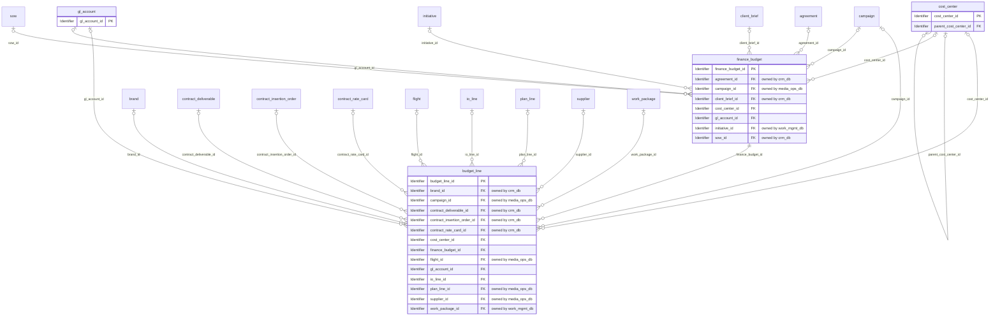

# Logical model: erp_db

Generated by advgen from the pinned Advertising MVM; do not edit by hand. Regenerate with `uv run advgen build`.

**Source system role:** SAP S/4HANA (FI/CO, AP/AR). Finance master data (cost centers, GL accounts, budgets), client invoicing, revenue recognition, payments, vendor invoices, payables and media cost reconciliation.

The logical model is technology-neutral: entities, business attributes with logical domains, optionality, keys and every business relationship, **including relationships to entities owned by other systems** (marked *owned by …*). How each relationship is physically implemented (enforced FK vs soft reference) is decided in the physical model.

## Contents

- [vendor.billing_reconciliation](#vendorbilling_reconciliation)
- [finance.budget_control](#financebudget_control)
- [finance.revenue_billing](#financerevenue_billing)
- [Code sets](#code-sets)
- [Normalization notes](#normalization-notes)

## vendor.billing_reconciliation

| Entity | Kind | Definition |
|---|---|---|
| [invoice](#invoice) | transactional | Invoice, reconciliation, and billing resolution record for media vendors, publishers, and production suppliers. |
| [io_line](#io_line) | transactional | Individual line items within a vendor Insertion Order, each specifying a discrete media buy — placement, ad unit, targeting parameters, flight dates, contracted impressions or GRPs, CPM/CPC rate, and authorized spend. |
| [performance_evaluation](#performance_evaluation) | transactional | Periodic vendor performance evaluation records capturing delivery fulfillment rate against IO commitments, make-good obligations, invoice accuracy rate, response time SLA adherence, brand safety incident count, and over… |
| [reconciliation](#reconciliation) | transactional | Media cost reconciliation record comparing IO-authorized spend against vendor-invoiced amounts and actual delivery data from ad servers (CM360, The Trade Desk). |

```mermaid
erDiagram
    invoice {
        Identifier invoice_id PK
        Identifier brand_id FK "owned by crm_db"
        Identifier campaign_id FK "owned by media_ops_db"
        Identifier contract_insertion_order_id FK "owned by crm_db"
        Identifier flight_id FK "owned by media_ops_db"
        Identifier initiative_id FK "owned by work_mgmt_db"
        Identifier line_item_id FK "owned by media_ops_db"
        Identifier production_job_id FK "owned by work_mgmt_db"
        Identifier sow_id FK "owned by crm_db"
        Identifier supplier_id FK "owned by media_ops_db"
    }
    io_line {
        Identifier io_line_id PK
        Identifier brand_id FK "owned by crm_db"
        Identifier campaign_id FK "owned by media_ops_db"
        Identifier contract_insertion_order_id FK "owned by crm_db"
        Identifier flight_id FK "owned by media_ops_db"
        Identifier initiative_id FK "owned by work_mgmt_db"
        Identifier line_item_id FK "owned by media_ops_db"
        Identifier media_placement_id FK "owned by media_ops_db"
        Identifier programmatic_deal_id FK "owned by media_ops_db"
        Identifier spec_id FK "owned by work_mgmt_db"
        Identifier supplier_id FK "owned by media_ops_db"
        Identifier vendor_io_media_insertion_order_id FK "owned by media_ops_db"
        Identifier vendor_rate_card_id FK "owned by media_ops_db"
    }
    performance_evaluation {
        Identifier performance_evaluation_id PK
        Identifier agency_relationship_id FK "owned by crm_db"
        Identifier brand_id FK "owned by crm_db"
        Identifier campaign_id FK "owned by media_ops_db"
        Identifier initiative_id FK "owned by work_mgmt_db"
        Identifier production_job_id FK "owned by work_mgmt_db"
        Identifier sla_id FK "owned by crm_db"
        Identifier sow_id FK "owned by crm_db"
        Identifier supplier_id FK "owned by media_ops_db"
    }
    reconciliation {
        Identifier reconciliation_id PK
        Identifier brand_id FK "owned by crm_db"
        Identifier campaign_id FK "owned by media_ops_db"
        Identifier contract_insertion_order_id FK "owned by crm_db"
        Identifier flight_id FK "owned by media_ops_db"
        Identifier initiative_id FK "owned by work_mgmt_db"
        Identifier invoice_id FK
        Identifier io_line_id FK
        Identifier line_item_id FK "owned by media_ops_db"
        Identifier sow_id FK "owned by crm_db"
        Identifier supplier_id FK "owned by media_ops_db"
    }
    brand |o--o{ invoice : "brand_id"
    campaign |o--o{ invoice : "campaign_id"
    contract_insertion_order |o--o{ invoice : "contract_insertion_order_id"
    flight |o--o{ invoice : "flight_id"
    initiative |o--o{ invoice : "initiative_id"
    line_item |o--o{ invoice : "line_item_id"
    production_job |o--o{ invoice : "production_job_id"
    sow |o--o{ invoice : "sow_id"
    supplier |o--o{ invoice : "supplier_id"
    brand |o--o{ io_line : "brand_id"
    campaign |o--o{ io_line : "campaign_id"
    contract_insertion_order |o--o{ io_line : "contract_insertion_order_id"
    flight |o--o{ io_line : "flight_id"
    initiative |o--o{ io_line : "initiative_id"
    line_item |o--o{ io_line : "line_item_id"
    media_placement |o--o{ io_line : "media_placement_id"
    programmatic_deal |o--o{ io_line : "programmatic_deal_id"
    spec |o--o{ io_line : "spec_id"
    supplier |o--o{ io_line : "supplier_id"
    media_insertion_order ||--o{ io_line : "vendor_io_media_insertion_order_id"
    vendor_rate_card |o--o{ io_line : "vendor_rate_card_id"
    agency_relationship |o--o{ performance_evaluation : "agency_relationship_id"
    brand |o--o{ performance_evaluation : "brand_id"
    campaign |o--o{ performance_evaluation : "campaign_id"
    initiative |o--o{ performance_evaluation : "initiative_id"
    production_job |o--o{ performance_evaluation : "production_job_id"
    sla |o--o{ performance_evaluation : "sla_id"
    sow |o--o{ performance_evaluation : "sow_id"
    supplier |o--o{ performance_evaluation : "supplier_id"
    brand |o--o{ reconciliation : "brand_id"
    campaign |o--o{ reconciliation : "campaign_id"
    contract_insertion_order |o--o{ reconciliation : "contract_insertion_order_id"
    flight |o--o{ reconciliation : "flight_id"
    initiative |o--o{ reconciliation : "initiative_id"
    invoice |o--o{ reconciliation : "invoice_id"
    io_line |o--o{ reconciliation : "io_line_id"
    line_item |o--o{ reconciliation : "line_item_id"
    sow |o--o{ reconciliation : "sow_id"
    supplier |o--o{ reconciliation : "supplier_id"
```

### invoice

Invoice, reconciliation, and billing resolution record for media vendors, publishers, and production suppliers. Captures the full invoice-to-payment lifecycle: invoice receipt (number, vendor reference, billing period, gross/net amounts, currency, payment due date), reconciliation against IO-authorized spend and actual ad server delivery data (CM360, The Trade Desk) including variance amount, variance percentage, discrepancy reason code, reconciliation period, dispute management, resolution status, and final approved billing amount. Supports invoice statuses: received, reconciled, approved, disputed, paid. Feeds SAP S/4HANA Accounts Payable, Mediaocean Prisma post-buy reconciliation, and financial close processes.

**Primary identifier:** `invoice_id`

| Attribute | Business name | Domain | Opt. | Key | Definition |
|---|---|---|---|---|---|
| `invoice_id` | Invoice ID | Identifier | M | PK | Unique surrogate identifier for the invoice record in the vendor billing and reconciliation system. |
| `brand_id` | Client Brand Id (Foreign Key) | Identifier → brand (crm_db) | O | FK | Foreign key linking to client.brand. |
| `campaign_id` | Campaign ID | Identifier → campaign (media_ops_db) | O | FK | Reference to the advertising campaign associated with the media spend or production services billed on this invoice. |
| `contract_insertion_order_id` | Contract Insertion Order Id (Foreign Key) | Identifier → contract_insertion_order (crm_db) | O | FK | Foreign key linking to contract.contract_insertion_order. |
| `flight_id` | Flight Id (Foreign Key) | Identifier → flight (media_ops_db) | O | FK | Foreign key linking to campaign.flight. |
| `initiative_id` | Initiative Id (Foreign Key) | Identifier → initiative (work_mgmt_db) | O | FK | Foreign key linking to project.initiative. |
| `line_item_id` | Line Item Id (Foreign Key) | Identifier → line_item (media_ops_db) | O | FK | Foreign key linking to campaign.line_item. |
| `production_job_id` | Production Job Id (Foreign Key) | Identifier → production_job (work_mgmt_db) | O | FK | Foreign key linking to creative.production_job. |
| `sow_id` | Sow Id (Foreign Key) | Identifier → sow (crm_db) | O | FK | Foreign key linking to contract.sow. |
| `supplier_id` | Vendor ID | Identifier → supplier (media_ops_db) | O | FK | Reference to the third-party media vendor, publisher, technology partner (DSP/SSP/DMP), or production supplier who issued this invoice. |
| `agency_discount_amount` | Agency Discount Amount | Amount | O |  | The monetary value of agency commission or trade discount deducted from the gross invoice amount, as negotiated in the vendor contract or IO. |
| `approved_billing_amount` | Approved Billing Amount | Amount | O |  | The final approved amount authorized for payment after reconciliation and dispute resolution. |
| `billing_period_end` | Billing Period End Date | Date | O |  | The end date of the media flight, production period, or service period covered by this invoice. |
| `billing_period_start` | Billing Period Start Date | Date | O |  | The start date of the media flight, production period, or service period covered by this invoice. |
| `brand_safety_compliant` | Brand Safety Compliant Flag | Indicator | M |  | Indicates whether the media inventory delivered by the vendor during the billing period was verified as brand-safe per TAG (Trustworthy Accountability Group) and internal brand sa… |
| `currency_code` | Currency Code (ISO 4217) | Currency Code | O |  | Three-letter ISO 4217 currency code for all monetary amounts on this invoice (e.g., USD, GBP, EUR). |
| `delivered_spend_amount` | Delivered Spend Amount | Amount | O |  | The actual ad spend amount as recorded by the ad server (Google CM360) or DSP (The Trade Desk) for the billing period. |
| `delivery_data_source` | Delivery Data Source | Code (delivery_data_source) | O |  | The ad server or measurement platform used as the authoritative source of delivery data for reconciliation (e.g., Google CM360, The Trade Desk). |
| `discrepancy_reason_code` | Discrepancy Reason Code | Code (discrepancy_reason_code) | O |  | Standardized code identifying the root cause of the reconciliation variance. |
| `dispute_raised_date` | Dispute Raised Date | Date | O |  | The date on which a formal billing dispute was raised with the vendor. |
| `dispute_resolution_date` | Dispute Resolution Date | Date | O |  | The date on which the billing dispute was formally resolved and the approved billing amount was agreed upon with the vendor. |
| `dispute_resolution_notes` | Dispute Resolution Notes | Text | O |  | Free-text narrative documenting the outcome of the dispute resolution process, including the agreed adjustment, vendor concessions, make-good arrangements, or credit note details. |
| `gross_amount` | Gross Invoice Amount | Amount | O |  | The total gross amount billed by the vendor before any agency discounts, rebates, or adjustments. |
| `invalid_traffic_flag` | Invalid Traffic (IVT) Flag | Indicator | M |  | Indicates whether invalid traffic (IVT) or ad fraud was detected in the delivery data for this invoice period, as identified by TAG-certified measurement tools. |
| `invoice_status` | Invoice Status | Code | M |  | Current lifecycle status of the invoice within the invoice-to-payment workflow. |
| `invoice_type` | Invoice Type | Code (invoice_type) | O |  | Classification of the invoice by the nature of services billed. |
| `io_authorized_amount` | Insertion Order (IO) Authorized Amount | Amount | O |  | The total spend amount authorized under the associated Insertion Order (IO) for the billing period. |
| `issue_date` | Invoice Issue Date | Date | O |  | The date the invoice was issued by the vendor, as stated on the invoice document. |
| `net_amount` | Net Invoice Amount | Amount | O |  | The net payable amount after deducting agency discounts and rebates from the gross amount. |
| `number` | Invoice Number | Text | O |  | Externally-assigned invoice number as provided by the vendor on the invoice document. |
| `payment_date` | Payment Date | Date | O |  | The date on which payment was issued to the vendor for the approved billing amount. |
| `payment_due_date` | Payment Due Date | Date | O |  | The contractual date by which payment must be made to the vendor to comply with agreed payment terms (e.g., Net 30, Net 60). |
| `payment_reference` | Payment Reference Number | Business Code | O |  | The payment transaction reference number generated by SAP S/4HANA FI-AP when the payment run is executed. |
| `payment_terms` | Payment Terms | Code | O |  | The contractual payment terms agreed with the vendor, defining the number of days from invoice receipt to payment due date (e.g., Net 30, Net 60). |
| `received_date` | Invoice Received Date | Date | O |  | The date the invoice was received and logged into the accounts payable system. |
| `reconciliation_date` | Reconciliation Date | Date | O |  | The date on which the invoice reconciliation was completed and the variance amount and percentage were calculated. |
| `reconciliation_period_end` | Reconciliation Period End Date | Date | O |  | The end date of the reconciliation window used to pull delivery data from CM360 or The Trade Desk for matching against this invoice. |
| `reconciliation_period_start` | Reconciliation Period Start Date | Date | O |  | The start date of the reconciliation window used to pull delivery data from CM360 or The Trade Desk for matching against this invoice. |
| `tax_amount` | Tax Amount | Amount | O |  | The applicable tax amount (e.g., VAT, GST, sales tax) charged on the invoice as required by the vendor's jurisdiction. |
| `total_payable_amount` | Total Payable Amount | Amount | O |  | The final total amount payable to the vendor, calculated as net_amount plus tax_amount. |
| `variance_amount` | Reconciliation Variance Amount | Amount | O |  | The monetary difference between the vendor's invoiced gross amount and the delivered spend amount recorded by the ad server or DSP. |
| `variance_percentage` | Reconciliation Variance Percentage | Percentage | O |  | The variance amount expressed as a percentage of the delivered spend amount. |
| `vendor_reference_number` | Vendor Reference Number | Business Code | M |  | Vendor's own internal reference or purchase order number included on the invoice, used to cross-reference the vendor's billing system and facilitate dispute resolution. |
| `created_at` | Record Created Timestamp | Timestamp | M |  | Timestamp when the row was inserted. |
| `created_by` | Created By | Text | M |  | Application user (session setting app.actor) or database role that inserted the row. |
| `updated_at` | Record Updated Timestamp | Timestamp | M |  | Timestamp of the last update. |
| `updated_by` | Updated By | Text | M |  | Application user or database role that last updated the row. |

### io_line

Individual line items within a vendor Insertion Order, each specifying a discrete media buy — placement, ad unit, targeting parameters, flight dates, contracted impressions or GRPs, CPM/CPC rate, and authorized spend. Captures delivery method (programmatic RTB, direct, guaranteed), ad format (display, video VAST, OOH, CTV), and reconciliation status against actuals. Core to Mediaocean Prisma billing and reconciliation.

**Primary identifier:** `io_line_id`

| Attribute | Business name | Domain | Opt. | Key | Definition |
|---|---|---|---|---|---|
| `io_line_id` | Vendor Insertion Order (IO) Line ID | Identifier | M | PK | Unique surrogate identifier for each individual line item within a vendor Insertion Order. |
| `brand_id` | Client Brand Id (Foreign Key) | Identifier → brand (crm_db) | O | FK | Foreign key linking to client.brand. |
| `campaign_id` | Campaign ID | Identifier → campaign (media_ops_db) | O | FK | Reference to the advertising campaign this IO line item is associated with, enabling campaign-level spend and delivery aggregation. |
| `contract_insertion_order_id` | Contract Insertion Order Id (Foreign Key) | Identifier → contract_insertion_order (crm_db) | O | FK | Foreign key linking to contract.contract_insertion_order. |
| `flight_id` | Flight Id (Foreign Key) | Identifier → flight (media_ops_db) | O | FK | Foreign key linking to campaign.flight. |
| `initiative_id` | Initiative Id (Foreign Key) | Identifier → initiative (work_mgmt_db) | O | FK | Foreign key linking to project.initiative. |
| `line_item_id` | Line Item Id (Foreign Key) | Identifier → line_item (media_ops_db) | O | FK | Foreign key linking to campaign.line_item. |
| `media_placement_id` | Campaign Manager 360 (CM360) Placement ID | Identifier → media_placement (media_ops_db) | O | FK | The placement identifier from Google Campaign Manager 360 (CM360) ad server corresponding to this IO line item. |
| `programmatic_deal_id` | Programmatic Deal ID | Identifier → programmatic_deal (media_ops_db) | O | FK | The unique deal identifier assigned by the Supply-Side Platform (SSP) or publisher for Private Marketplace (PMP) or Programmatic Guaranteed deals. |
| `spec_id` | Spec Id (Foreign Key) | Identifier → spec (work_mgmt_db) | O | FK | Foreign key linking to creative.spec. |
| `supplier_id` | Vendor ID | Identifier → supplier (media_ops_db) | O | FK | Reference to the third-party media vendor, publisher, or technology partner supplying the media inventory for this line item. |
| `vendor_io_media_insertion_order_id` | Vendor Insertion Order (IO) ID | Identifier → media_insertion_order (media_ops_db) | M | FK | Foreign key reference to the parent Insertion Order header that this line item belongs to. |
| `vendor_rate_card_id` | Vendor Rate Card Id (Foreign Key) | Identifier → vendor_rate_card (media_ops_db) | O | FK | Foreign key linking to vendor.vendor_rate_card. |
| `actual_spend` | Actual Spend | Amount | O |  | The actual amount spent against this line item based on delivered units and applicable rate, as reported by the vendor or ad server. |
| `actual_units_delivered` | Actual Units Delivered | Decimal | O |  | The actual number of units (impressions, clicks, GRPs, etc.) delivered by the vendor for this line item as reported by the ad server or third-party measurement provider. |
| `added_value_flag` | Added Value Flag | Indicator | M |  | Indicates whether this line item represents added-value inventory (bonus impressions, editorial mentions, or complimentary placements) provided by the vendor at no additional cost… |
| `agency_commission_pct` | Agency Commission Percentage | Percentage | O |  | The agency commission percentage applied to this line item's gross spend, typically 15% per industry standard. |
| `brand_safety_segments` | Brand Safety Segments | Text | O |  | Comma-separated list of brand safety and content suitability categories applied to this line item to prevent ad adjacency with inappropriate content. |
| `buying_type` | Buying Type | Code (buying_type) | O |  | The pricing and buying model for this line item. |
| `contracted_spend` | Contracted Spend | Amount | O |  | The total authorized spend amount for this line item as agreed in the Insertion Order (rate × contracted_units for unit-based buys, or flat rate for flat buys). |
| `contracted_units` | Contracted Units | Decimal | O |  | The total number of units (impressions, clicks, acquisitions, GRPs, TRPs, or views) contracted with the vendor for this line item as specified in the Insertion Order. |
| `currency_code` | Currency Code | Currency Code | O |  | ISO 4217 three-letter currency code applicable to all monetary values on this line item (rate, contracted spend, actual spend). |
| `delivery_method` | Delivery Method | Code | O |  | The mechanism by which ad inventory is purchased and delivered for this line item. |
| `dsp_line_code` | Demand-Side Platform (DSP) Line ID | Business Code | O |  | The external line item identifier assigned by the Demand-Side Platform (DSP), such as The Trade Desk, for programmatic buys. |
| `flight_end_date` | Flight End Date | Date | O |  | The date on which ad delivery for this line item is scheduled to end. |
| `flight_start_date` | Flight Start Date | Date | O |  | The date on which ad delivery for this line item is scheduled to begin. |
| `frequency_cap` | Frequency Cap | Quantity | O |  | Maximum number of times a unique user or household may be served an ad from this line item within the frequency_cap_period. |
| `frequency_cap_period` | Frequency Cap Period | Code | O |  | The time window over which the frequency_cap applies. |
| `geo_targeting` | Geographic Targeting | Text | O |  | Geographic scope of ad delivery for this line item, specifying targeted countries, regions, DMAs, or cities. |
| `grp_contracted` | Contracted Gross Rating Points (GRP) | Decimal | O |  | The total Gross Rating Points (GRPs) contracted for this line item, applicable to broadcast, OOH, and audience-guaranteed buys. |
| `line_description` | IO Line Description | Text | O |  | Human-readable description of the media buy represented by this line item, including placement name, ad unit, and targeting summary as specified in the Insertion Order. |
| `line_number` | IO Line Number | Quantity | M |  | Sequential line number identifying the position of this line item within the parent Insertion Order. |
| `line_status` | IO Line Status | Code (line_status) | M |  | Current workflow and lifecycle status of this IO line item within Mediaocean Prisma. |
| `makegood_flag` | Make-Good Flag | Indicator | M |  | Indicates whether this IO line item is a make-good — compensatory inventory provided by the vendor to offset under-delivery or quality failures on a prior line item. |
| `net_rate` | Net Rate | Rate | O |  | The net unit rate payable to the vendor after deducting agency commission from the gross rate. |
| `prisma_line_code` | Mediaocean Prisma Line ID | Business Code | O |  | The native line item identifier from Mediaocean Prisma, the system of record for media planning, buying, billing, and reconciliation. |
| `rate` | Contracted Rate | Rate | O |  | The negotiated unit rate for this line item expressed in the currency of the IO. |
| `reconciliation_status` | Reconciliation Status | Code | O |  | Financial reconciliation status of this line item comparing contracted delivery against vendor-reported actuals. |
| `targeting_description` | Targeting Description | Text | O |  | Free-text description of the audience targeting parameters applied to this line item, including demographic, geographic, behavioral, contextual, or keyword targeting criteria as c… |
| `trp_contracted` | Contracted Target Rating Points (TRP) | Decimal | O |  | The total Target Rating Points (TRPs) contracted for this line item, representing GRPs delivered specifically to the defined target audience demographic. |
| `viewability_target_pct` | Viewability Target Percentage | Percentage | O |  | The contracted minimum viewability rate (percentage of served impressions that meet MRC viewability standards) for this line item. |
| `created_at` | Record Created Timestamp | Timestamp | M |  | Timestamp when the row was inserted. |
| `created_by` | Created By | Text | M |  | Application user (session setting app.actor) or database role that inserted the row. |
| `updated_at` | Record Updated Timestamp | Timestamp | M |  | Timestamp of the last update. |
| `updated_by` | Updated By | Text | M |  | Application user or database role that last updated the row. |

### performance_evaluation

Periodic vendor performance evaluation records capturing delivery fulfillment rate against IO commitments, make-good obligations, invoice accuracy rate, response time SLA adherence, brand safety incident count, and overall vendor scorecard rating. Evaluated quarterly (QBR cycle) and used to inform preferred vendor list tier assignments and contract renewal decisions. Operational records — not aggregated analytics.

**Primary identifier:** `performance_evaluation_id`. **Business key(s):** `evaluation_number`

| Attribute | Business name | Domain | Opt. | Key | Definition |
|---|---|---|---|---|---|
| `performance_evaluation_id` | Vendor Performance Evaluation ID | Identifier | M | PK | Unique system-generated identifier for each vendor performance evaluation record. |
| `agency_relationship_id` | Agency Relationship Id (Foreign Key) | Identifier → agency_relationship (crm_db) | O | FK | Foreign key linking to client.agency_relationship. |
| `brand_id` | Client Brand Id (Foreign Key) | Identifier → brand (crm_db) | O | FK | Foreign key linking to client.brand. |
| `campaign_id` | Campaign Id (Foreign Key) | Identifier → campaign (media_ops_db) | O | FK | Foreign key linking to campaign.campaign. |
| `initiative_id` | Initiative Id (Foreign Key) | Identifier → initiative (work_mgmt_db) | O | FK | Foreign key linking to project.initiative. |
| `production_job_id` | Production Job Id (Foreign Key) | Identifier → production_job (work_mgmt_db) | O | FK | Foreign key linking to creative.production_job. |
| `sla_id` | Sla Id (Foreign Key) | Identifier → sla (crm_db) | O | FK | Foreign key linking to contract.sla. |
| `sow_id` | Sow Id (Foreign Key) | Identifier → sow (crm_db) | O | FK | Foreign key linking to contract.sow. |
| `supplier_id` | Vendor ID | Identifier → supplier (media_ops_db) | O | FK | Reference to the vendor being evaluated. |
| `actual_delivered_units` | Actual Delivered Units | Quantity | O |  | Total number of impressions, clicks, or deliverable units actually delivered by the vendor during the evaluation period as recorded in the ad server (e.g., Google Campaign Manager… |
| `approved_by` | Approved By | Text | O |  | Name or identifier of the senior stakeholder (e.g., VP of Media, Chief Procurement Officer) who formally approved this vendor performance evaluation and its resulting tier assignm… |
| `approved_timestamp` | Approved Timestamp | Timestamp | O |  | Date and time when the vendor performance evaluation was formally approved by the designated approver. |
| `brand_safety_incident_count` | Brand Safety Incident Count | Quantity | O |  | Number of brand safety incidents recorded against the vendor during the evaluation period, including ad placements adjacent to harmful, inappropriate, or non-brand-safe content. |
| `brand_safety_incident_severity` | Brand Safety Incident Severity | Code | O |  | Highest severity level of brand safety incidents recorded against the vendor during the evaluation period. |
| `contract_renewal_recommendation` | Contract Renewal Recommendation | Code | O |  | Formal recommendation for contract renewal action based on the outcome of this performance evaluation. |
| `delivery_fulfillment_rate` | Delivery Fulfillment Rate | Rate | O |  | Percentage of Insertion Order (IO) committed impressions, units, or deliverables that were actually fulfilled by the vendor during the evaluation period. |
| `disputed_invoices_count` | Disputed Invoices Count | Quantity | O |  | Number of invoices submitted by the vendor during the evaluation period that required dispute resolution, credit notes, or correction due to billing inaccuracies. |
| `evaluation_cycle` | Evaluation Cycle Quarter | Code | O |  | The fiscal quarter in which this evaluation was conducted, aligned to the QBR (Quarterly Business Review) cycle. |
| `evaluation_date` | Evaluation Date | Date | O |  | The principal business date on which the formal vendor performance evaluation was conducted or finalized, typically the QBR session date. |
| `evaluation_notes` | Evaluation Notes | Text | O |  | Free-text qualitative commentary from the evaluator capturing context, mitigating factors, notable incidents, or strategic observations not captured in the quantitative scorecard… |
| `evaluation_number` | Vendor Performance Evaluation Number | Business Code | M | UK | Externally-visible business identifier for this evaluation record, used in QBR documentation, vendor communications, and preferred vendor list reviews. |
| `evaluation_period_end_date` | Evaluation Period End Date | Date | O |  | End date of the performance measurement period covered by this evaluation, typically aligned to the quarterly QBR cycle (e.g., last day of the quarter). |
| `evaluation_period_start_date` | Evaluation Period Start Date | Date | O |  | Start date of the performance measurement period covered by this evaluation, typically aligned to the quarterly QBR cycle (e.g., first day of the quarter). |
| `evaluation_status` | Evaluation Status | Code | M |  | Current lifecycle state of the vendor performance evaluation record. |
| `evaluation_year` | Evaluation Year | Quantity | O |  | The fiscal year in which this evaluation was conducted. |
| `evaluator_name` | Evaluator Name | Name | O |  | Name of the internal agency staff member or team lead responsible for conducting and submitting this vendor performance evaluation, typically the media buyer, account director, or… |
| `invalid_traffic_rate` | Invalid Traffic (IVT) Rate | Rate | O |  | Percentage of impressions delivered by the vendor during the evaluation period classified as invalid traffic (IVT) including general invalid traffic (GIVT) and sophisticated inval… |
| `invoice_accuracy_rate` | Invoice Accuracy Rate | Rate | O |  | Percentage of vendor invoices submitted during the evaluation period that matched the reconciled billing amounts within the agreed tolerance threshold, without requiring correctio… |
| `io_committed_units` | Insertion Order (IO) Committed Units | Quantity | O |  | Total number of impressions, clicks, or deliverable units committed by the vendor across all active Insertion Orders (IOs) during the evaluation period. |
| `makegood_fulfilled_count` | Make-Good Fulfilled Count | Quantity | O |  | Number of make-good obligations that were successfully fulfilled by the vendor during the evaluation period. |
| `makegood_obligation_count` | Make-Good Obligation Count | Quantity | O |  | Number of make-good obligations raised against the vendor during the evaluation period due to under-delivery against IO commitments. |
| `mrc_accreditation_status` | Media Rating Council (MRC) Accreditation Status | Code | O |  | Current MRC (Media Rating Council) accreditation status of the vendor at the time of evaluation. |
| `overall_scorecard_rating` | Overall Vendor Scorecard Rating | Rate | O |  | Composite weighted scorecard rating for the vendor for the evaluation period, typically on a scale of 0.00 to 10.00 or 0.00 to 100.00. |
| `preferred_vendor_tier` | Preferred Vendor List (PVL) Tier | Code | O |  | Preferred vendor list tier assignment resulting from this evaluation. |
| `prior_preferred_vendor_tier` | Prior Period Preferred Vendor List (PVL) Tier | Code | O |  | The vendor's preferred vendor list tier from the immediately preceding evaluation period. |
| `prior_scorecard_rating` | Prior Period Vendor Scorecard Rating | Rate | O |  | The vendor's overall scorecard rating from the immediately preceding evaluation period. |
| `response_time_sla_adherence_rate` | Response Time Service Level Agreement (SLA) Adherence Rate | Rate | O |  | Percentage of vendor response obligations (e.g., campaign issue resolution, data discrepancy responses, creative trafficking requests) fulfilled within the contractually agreed SL… |
| `scorecard_rating_scale` | Scorecard Rating Scale | Code | O |  | The numeric scale used for the overall_scorecard_rating in this evaluation (e.g., 0-10, 0-100, 1-5). |
| `sla_breaches_count` | Service Level Agreement (SLA) Breaches Count | Quantity | O |  | Number of SLA response obligations that were not fulfilled within the contractually agreed timeframe during the evaluation period. |
| `sla_incidents_total` | Service Level Agreement (SLA) Incidents Total | Quantity | O |  | Total number of SLA-governed response obligations raised against the vendor during the evaluation period. |
| `tag_certification_status` | Trustworthy Accountability Group (TAG) Certification Status | Code | O |  | Current TAG (Trustworthy Accountability Group) certification status of the vendor at the time of evaluation. |
| `total_invoices_submitted` | Total Invoices Submitted | Quantity | O |  | Total number of invoices submitted by the vendor during the evaluation period. |
| `vendor_category` | Vendor Category | Code (vendor_category) | O |  | Classification of the vendor type being evaluated. |
| `vendor_dispute_flag` | Vendor Dispute Flag | Indicator | M |  | Indicates whether the vendor has formally disputed the findings of this performance evaluation. |
| `vendor_dispute_notes` | Vendor Dispute Notes | Text | O |  | Free-text notes capturing the vendor's formal objection or dispute rationale when vendor_dispute_flag is True. |
| `viewability_rate` | Viewability Rate | Rate | O |  | Percentage of impressions delivered by the vendor during the evaluation period that met the MRC (Media Rating Council) viewability standard (50% of pixels in view for 1 continuous… |
| `created_at` | Record Created Timestamp | Timestamp | M |  | Timestamp when the row was inserted. |
| `created_by` | Created By | Text | M |  | Application user (session setting app.actor) or database role that inserted the row. |
| `updated_at` | Record Updated Timestamp | Timestamp | M |  | Timestamp of the last update. |
| `updated_by` | Updated By | Text | M |  | Application user or database role that last updated the row. |

### reconciliation

Media cost reconciliation record comparing IO-authorized spend against vendor-invoiced amounts and actual delivery data from ad servers (CM360, The Trade Desk). Captures reconciliation period, variance amount, variance percentage, discrepancy reason code, resolution status, and approved final billing amount. Supports Mediaocean Prisma post-buy reconciliation and SAP S/4HANA financial close processes.

**Primary identifier:** `reconciliation_id`. **Business key(s):** `reconciliation_number`

| Attribute | Business name | Domain | Opt. | Key | Definition |
|---|---|---|---|---|---|
| `reconciliation_id` | Reconciliation ID | Identifier | M | PK | Unique surrogate identifier for the media cost reconciliation record. |
| `brand_id` | Client Brand Id (Foreign Key) | Identifier → brand (crm_db) | O | FK | Foreign key linking to client.brand. |
| `campaign_id` | Campaign ID | Identifier → campaign (media_ops_db) | O | FK | Reference to the advertising campaign associated with this reconciliation record, enabling campaign-level financial close and post-buy analysis. |
| `contract_insertion_order_id` | Contract Insertion Order Id (Foreign Key) | Identifier → contract_insertion_order (crm_db) | O | FK | Foreign key linking to contract.contract_insertion_order. |
| `flight_id` | Flight Id (Foreign Key) | Identifier → flight (media_ops_db) | O | FK | Foreign key linking to campaign.flight. |
| `initiative_id` | Initiative Id (Foreign Key) | Identifier → initiative (work_mgmt_db) | O | FK | Foreign key linking to project.initiative. |
| `invoice_id` | Invoice Id (Foreign Key) | Identifier → invoice | O | FK | Foreign key linking to vendor.invoice. |
| `io_line_id` | Vendor Io Line Id (Foreign Key) | Identifier → io_line | O | FK | Foreign key linking to vendor.io_line. |
| `line_item_id` | Line Item Id (Foreign Key) | Identifier → line_item (media_ops_db) | O | FK | Foreign key linking to campaign.line_item. |
| `sow_id` | Sow Id (Foreign Key) | Identifier → sow (crm_db) | O | FK | Foreign key linking to contract.sow. |
| `supplier_id` | Vendor ID | Identifier → supplier (media_ops_db) | O | FK | Reference to the third-party media vendor, publisher, or technology partner (DSP/SSP) whose invoice is being reconciled against authorized spend. |
| `adserver_delivered_amount` | Ad Server Delivered Amount | Amount | O |  | Actual media cost derived from ad server delivery data (Google Campaign Manager 360 or The Trade Desk) for the reconciliation period. |
| `adserver_source` | Ad Server Source System | Code | O |  | Identifies the authoritative ad serving or DSP platform from which delivery data was sourced for this reconciliation (e.g., Google Campaign Manager 360, The Trade Desk). |
| `approved_billing_amount` | Approved Final Billing Amount | Amount | O |  | The mutually agreed and approved final billing amount after reconciliation resolution. |
| `approved_by` | Approved By | Text | O |  | Name or identifier of the agency finance or media operations team member who formally approved the final billing amount and closed the reconciliation record. |
| `approved_timestamp` | Approval Timestamp | Timestamp | O |  | Date and time when the reconciliation record was formally approved and the final billing amount was confirmed. |
| `buying_method` | Media Buying Method | Code | O |  | Method by which the media was purchased, distinguishing between direct IO buys, programmatic guaranteed, open RTB (Real-Time Bidding), private marketplace (PMP), or preferred deal… |
| `channel_type` | Media Channel Type | Code (channel_type) | O |  | The media channel category for the spend being reconciled (e.g., Display, Video, CTV/OTT, OOH/DOOH, Search). |
| `credit_note_amount` | Credit Note Amount | Amount | O |  | Monetary value of the vendor-issued credit note applied to resolve an overbilling discrepancy. |
| `credit_note_number` | Credit Note Number | Business Code | O |  | Vendor-issued credit note reference number when a credit adjustment is issued to resolve an overbilling discrepancy. |
| `currency_code` | Currency Code | Currency Code | O |  | ISO 4217 three-letter currency code applicable to all monetary amounts on this reconciliation record (e.g., USD, GBP, EUR). |
| `discrepancy_description` | Discrepancy Description | Text | O |  | Free-text narrative explaining the specific nature of the billing discrepancy, including details of delivery shortfalls, trafficking errors, or vendor disputes not fully captured… |
| `discrepancy_reason_code` | Discrepancy Reason Code | Code (discrepancy_reason_code) | O |  | Standardized code classifying the root cause of the billing discrepancy between IO-authorized spend and vendor invoice. |
| `due_date` | Payment Due Date | Date | O |  | Date by which the approved billing amount must be paid to the vendor per contractual payment terms. |
| `io_authorized_amount` | Insertion Order (IO) Authorized Amount | Amount | O |  | Total media spend amount authorized under the Insertion Order (IO) for the reconciliation period. |
| `makegood_flag` | Make-Good Flag | Indicator | M |  | Indicates whether a make-good placement has been agreed as part of the discrepancy resolution, where the vendor compensates for delivery shortfalls with additional inventory rathe… |
| `notes` | Reconciliation Notes | Text | O |  | Free-text field for additional commentary, escalation notes, or vendor communication summaries relevant to the reconciliation record. |
| `period_end_date` | Reconciliation Period End Date | Date | O |  | End date of the media delivery period covered by this reconciliation record. |
| `period_start_date` | Reconciliation Period Start Date | Date | O |  | Start date of the media delivery period covered by this reconciliation record. |
| `prisma_reconciliation_ref` | Mediaocean Prisma Reconciliation Reference | Business Code | O |  | Reference identifier from Mediaocean Prisma post-buy reconciliation module corresponding to this record. |
| `reconciliation_number` | Reconciliation Number | Business Code | M | UK | Externally-known business identifier for this reconciliation record, used in Mediaocean Prisma post-buy workflows and SAP S/4HANA financial close correspondence with vendors. |
| `reconciliation_status` | Reconciliation Status | Code | M |  | Current lifecycle state of the reconciliation record within the post-buy financial close workflow. |
| `reconciliation_type` | Reconciliation Type | Code | O |  | Classification of the reconciliation record indicating whether it covers standard media buys, programmatic (RTB/DSP) activity, make-good placements, credit adjustments, or final b… |
| `resolution_date` | Discrepancy Resolution Date | Date | O |  | Date on which the billing discrepancy was formally resolved and the approved billing amount was agreed between the agency and the vendor. |
| `resolution_status` | Discrepancy Resolution Status | Code | O |  | Current status of the discrepancy resolution process. |
| `sap_document_number` | SAP Financial Document Number | Business Code | O |  | SAP S/4HANA FI accounting document number generated upon financial close posting of the approved billing amount. |
| `tolerance_threshold_pct` | Tolerance Threshold Percentage | Percentage | O |  | Agreed acceptable variance percentage threshold below which discrepancies are considered immaterial and do not require formal dispute resolution. |
| `variance_amount` | Variance Amount | Amount | O |  | Absolute monetary difference between the vendor-invoiced amount and the ad server delivered amount (vendor_invoiced_amount minus adserver_delivered_amount). |
| `variance_pct` | Variance Percentage | Percentage | O |  | Variance expressed as a percentage of the IO-authorized amount ((variance_amount / io_authorized_amount) * 100). |
| `vendor_invoiced_amount` | Vendor Invoiced Amount | Amount | O |  | Total gross amount billed by the vendor on their invoice for the reconciliation period. |
| `within_tolerance_flag` | Within Tolerance Flag | Indicator | M |  | Indicates whether the variance percentage falls within the agreed tolerance threshold, determining whether formal dispute escalation is required. |
| `created_at` | Record Created Timestamp | Timestamp | M |  | Timestamp when the row was inserted. |
| `created_by` | Created By | Text | M |  | Application user (session setting app.actor) or database role that inserted the row. |
| `updated_at` | Record Last Updated Timestamp | Timestamp | M |  | Timestamp of the last update. |
| `updated_by` | Updated By | Text | M |  | Application user or database role that last updated the row. |

## finance.budget_control

| Entity | Kind | Definition |
|---|---|---|
| [budget_line](#budget_line) | transactional | Granular line-item breakdown of approved budgets, enabling detailed tracking of spend by campaign flight, media channel, creative production phase, or cost category. |
| [cost_center](#cost_center) | master | Master record for agency cost centers used to allocate and track expenditures across departments, practice groups, and client accounts. |
| [finance_budget](#finance_budget) | master | Approved financial budget records for campaigns, accounts, cost centers, and agency operations, serving as the control baseline for spend authorization and variance analysis. |
| [gl_account](#gl_account) | master | General ledger chart of accounts master for the agency, aligned to SAP S/4HANA FI module. |

### budget_line

Granular line-item breakdown of approved budgets, enabling detailed tracking of spend by campaign flight, media channel, creative production phase, or cost category. Captures parent budget reference, line description, cost category, channel type, flight start/end dates, allocated amount, revised amount, committed amount, actual spend to date, variance amount, variance percentage, and approval status. Feeds margin analysis and P&L reporting at the campaign and account level.

**Primary identifier:** `budget_line_id`

| Attribute | Business name | Domain | Opt. | Key | Definition |
|---|---|---|---|---|---|
| `budget_line_id` | Budget Line Identifier (ID) | Identifier | M | PK | Unique identifier for the budget line item. |
| `brand_id` | Client Brand Id (Foreign Key) | Identifier → brand (crm_db) | O | FK | Foreign key linking to client.brand. |
| `campaign_id` | Campaign Identifier (ID) | Identifier → campaign (media_ops_db) | O | FK | Reference to the campaign this budget line supports. |
| `contract_deliverable_id` | Contract Deliverable Id (Foreign Key) | Identifier → contract_deliverable (crm_db) | O | FK | Foreign key linking to contract.contract_deliverable. |
| `contract_insertion_order_id` | Contract Insertion Order Id (Foreign Key) | Identifier → contract_insertion_order (crm_db) | O | FK | Foreign key linking to contract.contract_insertion_order. |
| `contract_rate_card_id` | Contract Rate Card Id (Foreign Key) | Identifier → contract_rate_card (crm_db) | O | FK | Foreign key linking to contract.contract_rate_card. |
| `cost_center_id` | Cost Center Id (Foreign Key) | Identifier → cost_center | O | FK | Foreign key linking to finance.cost_center. |
| `finance_budget_id` | Parent Budget Identifier (ID) | Identifier → finance_budget | M | FK | Reference to the parent budget that this line item belongs to. |
| `flight_id` | Flight Id (Foreign Key) | Identifier → flight (media_ops_db) | O | FK | Foreign key linking to campaign.flight. |
| `gl_account_id` | Gl Account Id (Foreign Key) | Identifier → gl_account | O | FK | Foreign key linking to finance.gl_account. |
| `io_line_id` | Io Line Id (Foreign Key) | Identifier → io_line | O | FK | Foreign key linking to vendor.io_line. |
| `plan_line_id` | Media Plan Line Id (Foreign Key) | Identifier → plan_line (media_ops_db) | O | FK | Foreign key linking to media.plan_line. |
| `supplier_id` | Vendor Identifier (ID) | Identifier → supplier (media_ops_db) | O | FK | Reference to the vendor or supplier associated with this budget line spend. |
| `work_package_id` | Work Package Id (Foreign Key) | Identifier → work_package (work_mgmt_db) | O | FK | Foreign key linking to project.work_package. |
| `actual_spend` | Actual Spend Amount | Amount | O |  | The actual amount spent to date against this budget line, including invoiced and paid expenses. |
| `allocated_amount` | Allocated Budget Amount | Amount | O |  | The original approved budget amount allocated to this line item at the time of budget creation. |
| `approval_status` | Budget Line Approval Status | Code | O |  | Current approval workflow status of this budget line. |
| `approved_by` | Approved By User | Text | O |  | Name or identifier of the person who approved this budget line. |
| `approved_timestamp` | Approval Timestamp | Timestamp | O |  | Date and time when this budget line was approved. |
| `billing_category` | Client Billing Category | Code | O |  | Classification of how this budget line will appear on client invoices. |
| `channel_type` | Media Channel Type | Code (channel_type) | O |  | The media channel or platform type this budget line is allocated to. |
| `committed_amount` | Committed Budget Amount | Amount | O |  | The amount of budget that has been committed through Insertion Orders (IO), contracts, or purchase orders but not yet invoiced or paid. |
| `cost_category` | Cost Category | Code (cost_category) | O |  | Classification of the budget line by cost type. |
| `currency_code` | Currency Code | Currency Code | O |  | Three-letter ISO 4217 currency code for all monetary amounts in this budget line. |
| `is_active` | Active Status Flag | Indicator | M |  | Indicates whether this budget line is currently active and available for spending. |
| `is_billable` | Billable to Client Flag | Indicator | M |  | Indicates whether this budget line represents costs that will be billed to the client or absorbed as agency overhead. |
| `line_description` | Budget Line Description | Text | O |  | Detailed textual description of what this budget line covers, including scope, deliverables, and any special conditions or assumptions. |
| `line_number` | Budget Line Number | Quantity | M |  | Sequential line number within the parent budget. |
| `markup_percentage` | Agency Markup Percentage | Percentage | O |  | The percentage markup applied to cost for client billing. |
| `notes` | Budget Line Notes | Text | O |  | Free-form notes and comments about this budget line. |
| `revised_amount` | Revised Budget Amount | Amount | O |  | The current approved budget amount after any revisions, amendments, or reforecasts. |
| `revision_number` | Budget Revision Number | Quantity | O |  | Sequential version number tracking how many times this budget line has been revised. |
| `revision_reason` | Budget Revision Reason | Text | O |  | Textual explanation for why this budget line was revised. |
| `variance_amount` | Budget Variance Amount | Amount | O |  | The absolute difference between revised budget amount and actual spend. |
| `variance_percentage` | Budget Variance Percentage | Percentage | O |  | The variance amount expressed as a percentage of the revised budget. |
| `created_at` | Record Created Timestamp | Timestamp | M |  | Timestamp when the row was inserted. |
| `created_by` | Record Created By User | Text | M |  | Application user (session setting app.actor) or database role that inserted the row. |
| `updated_at` | Record Last Modified Timestamp | Timestamp | M |  | Timestamp of the last update. |
| `updated_by` | Record Last Modified By User | Text | M |  | Application user or database role that last updated the row. |

### cost_center

Master record for agency cost centers used to allocate and track expenditures across departments, practice groups, and client accounts. Captures cost center code, name, type (overhead, billable, shared services), owning department, P&L responsibility flag, budget owner, SAP CO cost center reference, active status, and fiscal year applicability. Serves as the foundational organizational unit for management accounting, budget-vs-actual reporting, and overhead allocation in SAP S/4HANA CO module.

**Primary identifier:** `cost_center_id`. **Business key(s):** `cost_center_code`

| Attribute | Business name | Domain | Opt. | Key | Definition |
|---|---|---|---|---|---|
| `cost_center_id` | Cost Center Identifier (ID) | Identifier | M | PK | Unique identifier for the cost center record. |
| `parent_cost_center_id` | Parent Cost Center Identifier (ID) | Identifier → cost_center | O | FK | Reference to the parent cost center in a hierarchical cost center structure. |
| `allocation_method` | Allocation Method | Code | O |  | The method used to allocate costs from this cost center to other cost objects or client accounts. |
| `annual_budget_amount` | Annual Budget Amount | Amount | O |  | The total approved budget amount allocated to this cost center for the fiscal year. |
| `approval_required_flag` | Approval Required Flag | Indicator | M |  | Boolean indicator of whether expenditures charged to this cost center require explicit approval before posting. |
| `approval_threshold_amount` | Approval Threshold Amount | Rate | O |  | The monetary threshold above which expenditures charged to this cost center require additional approval. |
| `billable_flag` | Billable Flag | Indicator | M |  | Boolean indicator of whether costs incurred in this cost center are directly billable to clients. |
| `budget_owner_email` | Budget Owner Email Address | Email | O |  | The email address of the budget owner for communication regarding budget approvals, variance reporting, and financial planning. |
| `budget_owner_name` | Budget Owner Name | Name | O |  | The name of the individual responsible for managing and approving the budget for this cost center. |
| `company_code` | Company Code | Business Code | O |  | The company code or legal entity identifier to which this cost center belongs. |
| `controlling_area` | Controlling Area | Text | O |  | The controlling area in SAP S/4HANA CO that groups cost centers for management accounting and internal reporting purposes. |
| `cost_center_category` | Cost Center Category | Code | O |  | High-level functional category of the cost center. |
| `cost_center_code` | Cost Center Code | Business Code | M | UK | The externally-known unique alphanumeric code identifying the cost center in financial systems and reports. |
| `cost_center_name` | Cost Center Name | Name | M |  | The human-readable name or title of the cost center, used for display and reporting purposes. |
| `cost_center_status` | Cost Center Status | Code | M |  | Current lifecycle status of the cost center. |
| `cost_center_type` | Cost Center Type | Code | O |  | Classification of the cost center based on its function and cost allocation model. |
| `cost_pool_flag` | Cost Pool Flag | Indicator | M |  | Boolean indicator of whether this cost center functions as a cost pool that aggregates costs for subsequent allocation to other cost centers or client accounts. |
| `currency_code` | Currency Code | Currency Code | O |  | The three-letter ISO 4217 currency code in which this cost center's budget and expenses are denominated. |
| `effective_end_date` | Effective End Date | Date | O |  | The date on which this cost center configuration ceases to be effective. |
| `effective_start_date` | Effective Start Date | Date | O |  | The date on which this cost center configuration becomes effective and begins accepting cost allocations. |
| `fiscal_year` | Fiscal Year | Text | O |  | The fiscal year for which this cost center configuration is applicable. |
| `location_code` | Location Code | ISO Code | O |  | Three-letter code identifying the primary geographic location or office where this cost center operates. |
| `notes` | Cost Center Notes | Text | O |  | Free-text field for additional comments, special instructions, or contextual information about the cost center. |
| `overhead_allocation_percentage` | Overhead Allocation Percentage | Percentage | O |  | The percentage of overhead costs allocated to this cost center from shared services or administrative cost pools. |
| `owning_department` | Owning Department | Text | O |  | The department or organizational unit that owns and manages this cost center. |
| `practice_group` | Practice Group | Text | O |  | The specialized practice area or service line associated with this cost center, such as Digital Marketing, Brand Strategy, Public Relations, Data Analytics, Creative Production, M… |
| `profit_and_loss_responsibility_flag` | Profit and Loss (P&L) Responsibility Flag | Indicator | M |  | Boolean indicator of whether this cost center has direct profit and loss accountability. |
| `quarterly_budget_amount` | Quarterly Budget Amount | Amount | O |  | The budget amount allocated to this cost center for the current quarter. |
| `sap_co_cost_center_reference` | SAP Controlling (CO) Cost Center Reference | Business Code | O |  | The corresponding cost center identifier in the SAP S/4HANA Controlling (CO) module. |
| `created_at` | Created Timestamp | Timestamp | M |  | Timestamp when the row was inserted. |
| `created_by` | Created By User | Text | M |  | Application user (session setting app.actor) or database role that inserted the row. |
| `updated_at` | Last Modified Timestamp | Timestamp | M |  | Timestamp of the last update. |
| `updated_by` | Last Modified By User | Text | M |  | Application user or database role that last updated the row. |

### finance_budget

Approved financial budget records for campaigns, accounts, cost centers, and agency operations, serving as the control baseline for spend authorization and variance analysis. Captures budget version (original, revised, final), budget type (campaign, overhead, media, production, talent), fiscal year, fiscal period, approved amount, currency, budget owner, approval status, approval date, lock status, SAP CO internal order reference, and Mediaocean Prisma budget reference. Supports budget-vs-actual reporting, EBITDA tracking, and financial governance processes.

**Primary identifier:** `finance_budget_id`. **Business key(s):** `budget_number`

| Attribute | Business name | Domain | Opt. | Key | Definition |
|---|---|---|---|---|---|
| `finance_budget_id` | Budget Identifier (ID) | Identifier | M | PK | Unique identifier for the budget record. |
| `agreement_id` | Agreement Id (Foreign Key) | Identifier → agreement (crm_db) | O | FK | Foreign key linking to contract.agreement. |
| `campaign_id` | Campaign Identifier (ID) | Identifier → campaign (media_ops_db) | O | FK | Reference to the campaign this budget is allocated to, if applicable. |
| `client_brief_id` | Client Brief Id (Foreign Key) | Identifier → client_brief (crm_db) | O | FK | Foreign key linking to client.client_brief. |
| `cost_center_id` | Cost Center Identifier (ID) | Identifier → cost_center | O | FK | Reference to the cost center this budget is allocated to for internal financial tracking. |
| `gl_account_id` | Gl Account Id (Foreign Key) | Identifier → gl_account | O | FK | Foreign key linking to finance.gl_account. |
| `initiative_id` | Initiative Id (Foreign Key) | Identifier → initiative (work_mgmt_db) | O | FK | Foreign key linking to project.initiative. |
| `sow_id` | Sow Id (Foreign Key) | Identifier → sow (crm_db) | O | FK | Foreign key linking to contract.sow. |
| `allocated_amount` | Allocated Amount | Amount | O |  | Amount of the budget that has been allocated or committed to specific activities or sub-budgets, but not yet spent. |
| `approval_date` | Approval Date | Date | O |  | Date when the budget was officially approved by the authorized approver. |
| `approval_status` | Approval Status | Code | O |  | Current approval workflow status of the budget: draft (being prepared), pending (awaiting approval), approved (authorized for use), rejected (not approved), cancelled (voided). |
| `approved_amount` | Approved Budget Amount | Amount | O |  | The total approved budget amount in the specified currency. |
| `approved_by` | Approved By | Text | O |  | Name or identifier of the individual who approved the budget. |
| `budget_category` | Budget Category | Code | O |  | High-level financial category of the budget: operating (day-to-day operational expenses), capital (long-term asset investments), project (specific project-based allocation), discr… |
| `budget_description` | Budget Description | Text | O |  | Detailed description of the budget purpose, scope, and any special conditions or notes. |
| `budget_name` | Budget Name | Name | M |  | Descriptive name of the budget for easy identification and reporting purposes. |
| `budget_number` | Budget Number | Business Code | M | UK | Externally-known unique business identifier for the budget record, used for reference in financial documents and approvals. |
| `budget_type` | Budget Type | Code | O |  | Classification of the budget by its purpose: campaign (client campaign spend), overhead (agency operational costs), media (media buying allocation), production (creative productio… |
| `currency_code` | Currency Code | Currency Code | O |  | Three-letter ISO 4217 currency code for the approved budget amount (e.g., USD, EUR, GBP). |
| `effective_end_date` | Effective End Date | Date | O |  | Date when this budget expires and spend authorization ends. |
| `effective_start_date` | Effective Start Date | Date | O |  | Date when this budget becomes effective and spend authorization begins. |
| `fiscal_period` | Fiscal Period | Quantity | O |  | The fiscal period (month or quarter) within the fiscal year this budget applies to, typically 1-12 for monthly periods or 1-4 for quarterly periods. |
| `fiscal_year` | Fiscal Year | Quantity | O |  | The fiscal year this budget applies to, represented as a four-digit year (e.g., 2024). |
| `lock_status` | Lock Status | Indicator | M |  | Indicates whether the budget is locked (true) and cannot be modified, or unlocked (false) and can still be edited. |
| `mediaocean_prisma_budget_reference` | Mediaocean Prisma Budget Reference | Business Code | O |  | Reference identifier to the corresponding budget record in Mediaocean Prisma for media planning and billing reconciliation. |
| `owner` | Budget Owner | Text | O |  | Name or identifier of the individual or role responsible for managing and authorizing spend against this budget. |
| `profit_center_code` | Profit Center Code | Business Code | O |  | Profit center code in SAP S/4HANA CO for Profit and Loss (P&L) reporting and margin analysis. |
| `remaining_amount` | Remaining Amount | Amount | O |  | Remaining unspent budget amount, calculated as approved amount minus spent amount and allocated amount. |
| `revision_number` | Revision Number | Quantity | O |  | Sequential revision number tracking how many times this budget has been revised. |
| `revision_reason` | Revision Reason | Text | O |  | Business justification or reason for the most recent budget revision. |
| `sap_co_internal_order` | SAP Controlling (CO) Internal Order | Text | O |  | Reference to the SAP S/4HANA CO internal order number used for cost collection and budget control in the ERP system. |
| `spent_amount` | Spent Amount | Amount | O |  | Actual amount spent against this budget to date, used for budget-vs-actual variance analysis. |
| `variance_threshold_percent` | Variance Threshold Percentage | Percentage | O |  | Acceptable variance threshold as a percentage of the approved budget. |
| `version` | Budget Version | Code | O |  | Version status of the budget: original (initial approved budget), revised (updated after changes), final (locked final version), forecast (projected budget for planning). |
| `created_at` | Created Timestamp | Timestamp | M |  | Timestamp when the row was inserted. |
| `created_by` | Created By | Text | M |  | Application user (session setting app.actor) or database role that inserted the row. |
| `updated_at` | Modified Timestamp | Timestamp | M |  | Timestamp of the last update. |
| `updated_by` | Modified By | Text | M |  | Application user or database role that last updated the row. |

### gl_account

General ledger chart of accounts master for the agency, aligned to SAP S/4HANA FI module. Captures account code, account name, account type (asset, liability, equity, revenue, expense), financial statement category, P&L vs balance sheet classification, cost element linkage, currency, consolidation group, IFRS/GAAP mapping, and active status. Serves as the SSOT for all ledger account definitions used in journal entries, billing, and financial reporting.

**Primary identifier:** `gl_account_id`. **Business key(s):** `company_code, account_code`

| Attribute | Business name | Domain | Opt. | Key | Definition |
|---|---|---|---|---|---|
| `gl_account_id` | General Ledger (GL) Account ID | Identifier | M | PK | Unique identifier for the general ledger account. |
| `account_code` | General Ledger (GL) Account Code | Business Code | M | UK | The externally-known unique account number used in financial transactions and reporting. |
| `account_description_long` | General Ledger (GL) Account Long Description | Text | O |  | Extended description or explanatory text for the general ledger account, providing additional context, usage guidelines, or business rules for posting. |
| `account_group` | General Ledger (GL) Account Group | Text | O |  | The hierarchical grouping or category within the chart of accounts (e.g., 'Current Assets', 'Operating Expenses', 'Client Revenue'). |
| `account_name` | General Ledger (GL) Account Name | Name | M |  | The human-readable name or title of the general ledger account (e.g., 'Media Costs - Digital', 'Client Revenue - Retainer', 'Salaries and Wages'). |
| `account_type` | General Ledger (GL) Account Type | Code | O |  | The fundamental accounting classification of the account: asset, liability, equity, revenue, or expense. |
| `balance_sheet_classification` | Balance Sheet Classification | Code | O |  | The detailed balance sheet classification for asset, liability, and equity accounts: current asset, non-current asset, current liability, non-current liability, equity, or not app… |
| `chart_of_accounts` | Chart of Accounts (COA) | Text | O |  | The chart of accounts identifier to which this account belongs. |
| `company_code` | Company Code | Business Code | M | UK | The SAP company code (legal entity identifier) to which this account belongs. |
| `consolidation_group` | Consolidation Group | Text | O |  | The consolidation grouping code used for corporate group financial consolidation and elimination entries. |
| `cost_center_applicable` | Cost Center Applicable Flag | Indicator | M |  | Indicates whether this account requires cost center assignment for expense tracking and allocation. |
| `cost_element` | Cost Element | Text | O |  | The cost element code linking this GL account to the controlling (CO) module for cost center and internal order tracking. |
| `currency_code` | Currency Code | Currency Code | O |  | The three-letter ISO 4217 currency code for the account's local currency (e.g., 'USD', 'EUR', 'GBP'). |
| `field_status_group` | Field Status Group | Text | O |  | The field status group code that controls which fields are required, optional, or hidden when posting to this account. |
| `financial_statement_category` | Financial Statement Category | Code | O |  | The primary financial statement to which this account belongs: balance sheet, income statement (P&L), cash flow statement, or statement of equity. |
| `gaap_mapping` | Generally Accepted Accounting Principles (GAAP) Mapping | Text | O |  | The US GAAP account classification or line item code to which this account maps for GAAP-compliant financial reporting. |
| `gl_account_status` | General Ledger (GL) Account Status | Code | M |  | The current lifecycle status of the general ledger account: active (in use), inactive (not in use but retained), pending (awaiting approval), or archived (historical only). |
| `ifrs_mapping` | International Financial Reporting Standards (IFRS) Mapping | Text | O |  | The IFRS account classification or line item code to which this account maps for IFRS-compliant financial reporting. |
| `line_item_display` | Line Item Display Flag | Indicator | M |  | Indicates whether individual line items (journal entry details) are stored and displayed for this account. |
| `open_item_management` | Open Item Management Flag | Indicator | M |  | Indicates whether this account uses open item management for tracking and clearing individual postings (e.g., invoices, payments). |
| `pl_classification` | Profit and Loss (P&L) Classification | Code | O |  | The detailed profit and loss classification for revenue and expense accounts: operating revenue, non-operating revenue, cost of sales, operating expense, non-operating expense, or… |
| `posting_blocked` | Posting Blocked Flag | Indicator | M |  | Indicates whether direct postings to this account are currently blocked. |
| `profit_center_applicable` | Profit Center (P&L) Applicable Flag | Indicator | M |  | Indicates whether this account requires profit center assignment for P&L segmentation and profitability analysis. |
| `reconciliation_account` | Reconciliation Account Flag | Indicator | M |  | Indicates whether this is a reconciliation account (control account) that summarizes subledger balances (e.g., accounts receivable, accounts payable, vendor accounts). |
| `sort_key` | Sort Key | Business Code | O |  | The sort key or allocation field used for automatic assignment of posting keys, document numbers, or payment terms during transaction entry. |
| `tax_category` | Tax Category | Text | O |  | The tax category or tax code applicable to this account for automatic tax calculation and reporting (e.g., 'VAT Standard', 'Sales Tax Exempt', 'Input Tax'). |
| `valid_from_date` | Valid From Date | Date | O |  | The date from which this general ledger account is valid and available for use in financial transactions. |
| `valid_to_date` | Valid To Date | Date | O |  | The date until which this general ledger account is valid. |
| `created_at` | Created Timestamp | Timestamp | M |  | Timestamp when the row was inserted. |
| `created_by` | Created By User | Text | M |  | Application user (session setting app.actor) or database role that inserted the row. |
| `updated_at` | Modified Timestamp | Timestamp | M |  | Timestamp of the last update. |
| `updated_by` | Modified By User | Text | M |  | Application user or database role that last updated the row. |

## finance.revenue_billing

| Entity | Kind | Definition |
|---|---|---|
| [client_invoice](#client_invoice) | transactional | Authoritative record of invoices issued by the agency to advertising clients for services rendered, media placements, and production work. |
| [invoice_line](#invoice_line) | transactional | Individual line items on a client invoice, capturing the detailed breakdown of billable services, media costs, production fees, and agency commissions. |
| [media_cost_reconciliation](#media_cost_reconciliation) | transactional | Reconciliation records matching planned media costs (from IOs and media plans) against actual vendor invoices and third-party delivery confirmations from Mediaocean Prisma, Google Campaign Manager 360, and DSP platforms. |
| [payment](#payment) | transactional | Records of actual cash payments made to vendors (AP disbursements) and received from clients (AR receipts), serving as the SSOT for all cash movement events. |
| [revenue_recognition](#revenue_recognition) | transactional | Records governing when and how agency revenue is recognized from client contracts, retainers, and project-based engagements per ASC 606 / IFRS 15 standards. |
| [vendor_payable](#vendor_payable) | transactional | Accounts payable records for amounts owed by the agency to media vendors, publishers, production suppliers, freelancers, and technology partners. |

```mermaid
erDiagram
    client_invoice {
        Identifier client_invoice_id PK
        Identifier advertiser_id FK "owned by crm_db"
        Identifier agency_relationship_id FK "owned by crm_db"
        Identifier brand_id FK "owned by crm_db"
        Identifier buy_id FK "owned by media_ops_db"
        Identifier campaign_id FK "owned by media_ops_db"
        Identifier contract_insertion_order_id FK "owned by crm_db"
        Identifier cost_center_id FK
        Identifier delivery_pacing_id FK "owned by adserver_db"
        Identifier milestone_id FK "owned by work_mgmt_db"
        Identifier performance_kpi_target_id FK "owned by adserver_db"
        Identifier plan_id FK "owned by media_ops_db"
        Identifier sow_id FK "owned by crm_db"
    }
    invoice_line {
        Identifier invoice_line_id PK
        Identifier budget_line_id FK
        Identifier buy_id FK "owned by media_ops_db"
        Identifier campaign_id FK "owned by media_ops_db"
        Identifier click_event_id FK "owned by adserver_db"
        Identifier client_invoice_id FK
        Identifier cost_center_id FK
        Identifier creative_deliverable_id FK "owned by work_mgmt_db"
        Identifier deliverable_tracker_id FK "owned by work_mgmt_db"
        Identifier delivery_pacing_id FK "owned by adserver_db"
        Identifier gl_account_id FK
        Identifier io_line_id FK
        Identifier media_insertion_order_id FK "owned by media_ops_db"
        Identifier media_placement_id FK "owned by media_ops_db"
        Identifier performance_kpi_target_id FK "owned by adserver_db"
        Identifier plan_line_id FK "owned by media_ops_db"
        Identifier programmatic_deal_id FK "owned by media_ops_db"
        Identifier reconciliation_id FK
        Identifier revenue_recognition_id FK
        Identifier schedule_id FK "owned by media_ops_db"
        Identifier viewability_measurement_id FK "owned by adserver_db"
    }
    media_cost_reconciliation {
        Identifier media_cost_reconciliation_id PK
        Identifier budget_line_id FK
        Identifier buy_id FK "owned by media_ops_db"
        Identifier campaign_id FK "owned by media_ops_db"
        Identifier click_event_id FK "owned by adserver_db"
        Identifier conversion_event_id FK "owned by adserver_db"
        Identifier cost_center_id FK
        Identifier delivery_pacing_id FK "owned by adserver_db"
        Identifier flight_id FK "owned by media_ops_db"
        Identifier io_line_id FK
        Identifier line_item_id FK "owned by media_ops_db"
        Identifier media_insertion_order_id FK "owned by media_ops_db"
        Identifier media_placement_id FK "owned by media_ops_db"
        Identifier performance_kpi_target_id FK "owned by adserver_db"
        Identifier plan_line_id FK "owned by media_ops_db"
        Identifier reconciliation_id FK
        Identifier supplier_id FK "owned by media_ops_db"
        Identifier vendor_invoice_id FK
        Identifier vendor_payable_id FK
        Identifier video_completion_event_id FK "owned by adserver_db"
        Identifier viewability_measurement_id FK "owned by adserver_db"
    }
    payment {
        Identifier payment_id PK
        Identifier advertiser_id FK "owned by crm_db"
        Identifier buy_id FK "owned by media_ops_db"
        Identifier client_invoice_id FK
        Identifier invoice_id FK
        Identifier media_insertion_order_id FK "owned by media_ops_db"
        Identifier original_payment_id FK
        Identifier reconciliation_id FK
        Identifier supplier_id FK "owned by media_ops_db"
        Identifier vendor_payable_id FK
    }
    revenue_recognition {
        Identifier revenue_recognition_id PK
        Identifier advertiser_id FK "owned by crm_db"
        Identifier agency_relationship_id FK "owned by crm_db"
        Identifier agreement_id FK "owned by crm_db"
        Identifier brand_id FK "owned by crm_db"
        Identifier campaign_id FK "owned by media_ops_db"
        Identifier client_invoice_id FK
        Identifier cost_center_id FK
        Identifier delivery_pacing_id FK "owned by adserver_db"
        Identifier gl_account_id FK
        Identifier media_insertion_order_id FK "owned by media_ops_db"
        Identifier media_placement_id FK "owned by media_ops_db"
        Identifier milestone_id FK "owned by work_mgmt_db"
        Identifier performance_kpi_target_id FK "owned by adserver_db"
        Identifier plan_id FK "owned by media_ops_db"
    }
    vendor_payable {
        Identifier vendor_payable_id PK
        Identifier advertiser_id FK "owned by crm_db"
        Identifier brand_id FK "owned by crm_db"
        Identifier budget_line_id FK
        Identifier buy_id FK "owned by media_ops_db"
        Identifier campaign_id FK "owned by media_ops_db"
        Identifier contract_insertion_order_id FK "owned by crm_db"
        Identifier cost_center_id FK
        Identifier delivery_pacing_id FK "owned by adserver_db"
        Identifier gl_account_id FK
        Identifier io_line_id FK
        Identifier media_placement_id FK "owned by media_ops_db"
        Identifier performance_kpi_target_id FK "owned by adserver_db"
        Identifier plan_line_id FK "owned by media_ops_db"
        Identifier production_job_id FK "owned by work_mgmt_db"
        Identifier reconciliation_id FK
        Identifier schedule_id FK "owned by media_ops_db"
        Identifier supplier_id FK "owned by media_ops_db"
        Identifier vendor_invoice_id FK
        Identifier vendor_rate_card_id FK "owned by media_ops_db"
        Identifier video_completion_event_id FK "owned by adserver_db"
        Identifier viewability_measurement_id FK "owned by adserver_db"
        Identifier work_package_id FK "owned by work_mgmt_db"
    }
    advertiser |o--o{ client_invoice : "advertiser_id"
    agency_relationship |o--o{ client_invoice : "agency_relationship_id"
    brand |o--o{ client_invoice : "brand_id"
    buy |o--o{ client_invoice : "buy_id"
    campaign |o--o{ client_invoice : "campaign_id"
    contract_insertion_order |o--o{ client_invoice : "contract_insertion_order_id"
    cost_center |o--o{ client_invoice : "cost_center_id"
    delivery_pacing |o--o{ client_invoice : "delivery_pacing_id"
    milestone |o--o{ client_invoice : "milestone_id"
    performance_kpi_target |o--o{ client_invoice : "performance_kpi_target_id"
    plan |o--o{ client_invoice : "plan_id"
    sow |o--o{ client_invoice : "sow_id"
    budget_line |o--o{ invoice_line : "budget_line_id"
    buy |o--o{ invoice_line : "buy_id"
    campaign |o--o{ invoice_line : "campaign_id"
    click_event |o--o{ invoice_line : "click_event_id"
    client_invoice ||--o{ invoice_line : "client_invoice_id"
    cost_center |o--o{ invoice_line : "cost_center_id"
    creative_deliverable |o--o{ invoice_line : "creative_deliverable_id"
    deliverable_tracker |o--o{ invoice_line : "deliverable_tracker_id"
    delivery_pacing |o--o{ invoice_line : "delivery_pacing_id"
    gl_account |o--o{ invoice_line : "gl_account_id"
    io_line |o--o{ invoice_line : "io_line_id"
    media_insertion_order |o--o{ invoice_line : "media_insertion_order_id"
    media_placement |o--o{ invoice_line : "media_placement_id"
    performance_kpi_target |o--o{ invoice_line : "performance_kpi_target_id"
    plan_line |o--o{ invoice_line : "plan_line_id"
    programmatic_deal |o--o{ invoice_line : "programmatic_deal_id"
    reconciliation |o--o{ invoice_line : "reconciliation_id"
    revenue_recognition |o--o{ invoice_line : "revenue_recognition_id"
    schedule |o--o{ invoice_line : "schedule_id"
    viewability_measurement |o--o{ invoice_line : "viewability_measurement_id"
    budget_line |o--o{ media_cost_reconciliation : "budget_line_id"
    buy |o--o{ media_cost_reconciliation : "buy_id"
    campaign |o--o{ media_cost_reconciliation : "campaign_id"
    click_event |o--o{ media_cost_reconciliation : "click_event_id"
    conversion_event |o--o{ media_cost_reconciliation : "conversion_event_id"
    cost_center |o--o{ media_cost_reconciliation : "cost_center_id"
    delivery_pacing |o--o{ media_cost_reconciliation : "delivery_pacing_id"
    flight |o--o{ media_cost_reconciliation : "flight_id"
    io_line |o--o{ media_cost_reconciliation : "io_line_id"
    line_item |o--o{ media_cost_reconciliation : "line_item_id"
    media_insertion_order |o--o{ media_cost_reconciliation : "media_insertion_order_id"
    media_placement |o--o{ media_cost_reconciliation : "media_placement_id"
    performance_kpi_target |o--o{ media_cost_reconciliation : "performance_kpi_target_id"
    plan_line |o--o{ media_cost_reconciliation : "plan_line_id"
    reconciliation |o--o{ media_cost_reconciliation : "reconciliation_id"
    supplier |o--o{ media_cost_reconciliation : "supplier_id"
    invoice |o--o{ media_cost_reconciliation : "vendor_invoice_id"
    vendor_payable |o--o{ media_cost_reconciliation : "vendor_payable_id"
    video_completion_event |o--o{ media_cost_reconciliation : "video_completion_event_id"
    viewability_measurement |o--o{ media_cost_reconciliation : "viewability_measurement_id"
    advertiser |o--o{ payment : "advertiser_id"
    buy |o--o{ payment : "buy_id"
    client_invoice |o--o{ payment : "client_invoice_id"
    invoice |o--o{ payment : "invoice_id"
    media_insertion_order |o--o{ payment : "media_insertion_order_id"
    payment |o--o{ payment : "original_payment_id"
    reconciliation |o--o{ payment : "reconciliation_id"
    supplier |o--o{ payment : "supplier_id"
    vendor_payable |o--o{ payment : "vendor_payable_id"
    advertiser |o--o{ revenue_recognition : "advertiser_id"
    agency_relationship |o--o{ revenue_recognition : "agency_relationship_id"
    agreement |o--o{ revenue_recognition : "agreement_id"
    brand |o--o{ revenue_recognition : "brand_id"
    campaign |o--o{ revenue_recognition : "campaign_id"
    client_invoice |o--o{ revenue_recognition : "client_invoice_id"
    cost_center |o--o{ revenue_recognition : "cost_center_id"
    delivery_pacing |o--o{ revenue_recognition : "delivery_pacing_id"
    gl_account |o--o{ revenue_recognition : "gl_account_id"
    media_insertion_order |o--o{ revenue_recognition : "media_insertion_order_id"
    media_placement |o--o{ revenue_recognition : "media_placement_id"
    milestone |o--o{ revenue_recognition : "milestone_id"
    performance_kpi_target |o--o{ revenue_recognition : "performance_kpi_target_id"
    plan |o--o{ revenue_recognition : "plan_id"
    advertiser |o--o{ vendor_payable : "advertiser_id"
    brand |o--o{ vendor_payable : "brand_id"
    budget_line |o--o{ vendor_payable : "budget_line_id"
    buy |o--o{ vendor_payable : "buy_id"
    campaign |o--o{ vendor_payable : "campaign_id"
    contract_insertion_order |o--o{ vendor_payable : "contract_insertion_order_id"
    cost_center |o--o{ vendor_payable : "cost_center_id"
    delivery_pacing |o--o{ vendor_payable : "delivery_pacing_id"
    gl_account |o--o{ vendor_payable : "gl_account_id"
    io_line |o--o{ vendor_payable : "io_line_id"
    media_placement |o--o{ vendor_payable : "media_placement_id"
    performance_kpi_target |o--o{ vendor_payable : "performance_kpi_target_id"
    plan_line |o--o{ vendor_payable : "plan_line_id"
    production_job |o--o{ vendor_payable : "production_job_id"
    reconciliation |o--o{ vendor_payable : "reconciliation_id"
    schedule |o--o{ vendor_payable : "schedule_id"
    supplier |o--o{ vendor_payable : "supplier_id"
    invoice |o--o{ vendor_payable : "vendor_invoice_id"
    vendor_rate_card |o--o{ vendor_payable : "vendor_rate_card_id"
    video_completion_event |o--o{ vendor_payable : "video_completion_event_id"
    viewability_measurement |o--o{ vendor_payable : "viewability_measurement_id"
    work_package |o--o{ vendor_payable : "work_package_id"
```

### client_invoice

Authoritative record of invoices issued by the agency to advertising clients for services rendered, media placements, and production work. Captures invoice number, invoice date, due date, billing period, client account reference, SOW/IO reference, invoice type (retainer, project, media, production), line item summary, subtotal, tax amount, total amount, currency, payment terms (net 30/60/90), payment status, SAP FI document number, and Mediaocean Prisma billing reference. Core to revenue recognition and accounts receivable management.

**Primary identifier:** `client_invoice_id`. **Business key(s):** `invoice_number`

| Attribute | Business name | Domain | Opt. | Key | Definition |
|---|---|---|---|---|---|
| `client_invoice_id` | Client Invoice Identifier (ID) | Identifier | M | PK | Unique identifier for the client invoice record. |
| `advertiser_id` | Advertiser Identifier (ID) | Identifier → advertiser (crm_db) | O | FK | Reference to the client advertiser account being invoiced. |
| `agency_relationship_id` | Agency Relationship Id (Foreign Key) | Identifier → agency_relationship (crm_db) | O | FK | Foreign key linking to client.agency_relationship. |
| `brand_id` | Client Brand Id (Foreign Key) | Identifier → brand (crm_db) | O | FK | Foreign key linking to client.brand. |
| `buy_id` | Buy Id (Foreign Key) | Identifier → buy (media_ops_db) | O | FK | Foreign key linking to media.buy. |
| `campaign_id` | Campaign Id (Foreign Key) | Identifier → campaign (media_ops_db) | O | FK | Foreign key linking to campaign.campaign. |
| `contract_insertion_order_id` | Contract Insertion Order Id (Foreign Key) | Identifier → contract_insertion_order (crm_db) | O | FK | Foreign key linking to contract.contract_insertion_order. |
| `cost_center_id` | Cost Center Id (Foreign Key) | Identifier → cost_center | O | FK | Foreign key linking to finance.cost_center. |
| `delivery_pacing_id` | Delivery Pacing Id (Foreign Key) | Identifier → delivery_pacing (adserver_db) | O | FK | Foreign key linking to performance.delivery_pacing. |
| `milestone_id` | Project Milestone Id (Foreign Key) | Identifier → milestone (work_mgmt_db) | O | FK | Foreign key linking to project.milestone. |
| `performance_kpi_target_id` | Performance Kpi Target Id (Foreign Key) | Identifier → performance_kpi_target (adserver_db) | O | FK | Foreign key linking to performance.performance_kpi_target. |
| `plan_id` | Plan Id (Foreign Key) | Identifier → plan (media_ops_db) | O | FK | Foreign key linking to media.plan. |
| `sow_id` | Sow Id (Foreign Key) | Identifier → sow (crm_db) | O | FK | Foreign key linking to contract.sow. |
| `adjustment_amount` | Adjustment Amount | Amount | O |  | Additional adjustments applied to the invoice (credits, surcharges, reconciliation adjustments). |
| `amount_outstanding` | Amount Outstanding | Amount | O |  | Remaining unpaid balance on the invoice. |
| `amount_paid` | Amount Paid | Amount | O |  | Total amount received from the client against this invoice. |
| `approved_by` | Approved By | Text | O |  | Name or identifier of the agency employee who approved the invoice for issuance. |
| `approved_timestamp` | Approved Timestamp | Timestamp | O |  | Date and time when the invoice was approved for issuance. |
| `billing_contact_email` | Billing Contact Email Address | Email | O |  | Email address of the billing contact for invoice delivery and payment correspondence. |
| `billing_contact_name` | Billing Contact Name | Name | O |  | Name of the client contact responsible for invoice receipt and payment processing. |
| `billing_period_end_date` | Billing Period End Date | Date | O |  | End date of the period covered by this invoice. |
| `billing_period_start_date` | Billing Period Start Date | Date | O |  | Start date of the period covered by this invoice. |
| `currency_code` | Currency Code | Currency Code | O |  | Three-letter ISO 4217 currency code for the invoice (e.g., USD, EUR, GBP). |
| `discount_amount` | Discount Amount | Amount | O |  | Total discount applied to the invoice. |
| `dispute_date` | Dispute Date | Date | O |  | Date when the client raised a dispute on this invoice. |
| `dispute_reason` | Dispute Reason | Text | O |  | Reason provided by client for disputing the invoice. |
| `due_date` | Payment Due Date | Date | O |  | Date by which payment is expected from the client based on agreed payment terms. |
| `invoice_date` | Invoice Date | Date | O |  | Date the invoice was issued to the client. |
| `invoice_notes` | Invoice Notes | Text | O |  | Free-text notes or special instructions related to the invoice. |
| `invoice_number` | Invoice Number | Business Code | M | UK | Externally-visible unique invoice number issued to the client. |
| `invoice_status` | Invoice Status | Code (invoice_status) | M |  | Current lifecycle status of the invoice: draft (not yet finalized), issued (approved for sending), sent (delivered to client), partially_paid (payment in progress), paid (fully se… |
| `invoice_type` | Invoice Type | Code | O |  | Classification of the invoice based on billing model: retainer (recurring fee), project (fixed scope), media (placement costs), production (creative development), pass_through (th… |
| `mediaocean_billing_reference` | Mediaocean Prisma Billing Reference | Business Code | O |  | Reference identifier from Mediaocean Prisma billing system for media cost reconciliation and invoice generation. |
| `payment_method` | Payment Method | Code | O |  | Expected or preferred payment method for this invoice: wire transfer, ACH (Automated Clearing House), check, credit card, or direct debit. |
| `payment_received_date` | Payment Received Date | Date | O |  | Date when full or final payment was received from the client. |
| `payment_terms` | Payment Terms | Code (payment_terms) | O |  | Agreed payment terms defining when payment is due: net_15 (15 days), net_30 (30 days), net_45 (45 days), net_60 (60 days), net_90 (90 days), due_on_receipt (immediate), custom (no… |
| `purchase_order_number` | Purchase Order (PO) Number | Business Code | O |  | Client purchase order number required for invoice processing. |
| `revenue_recognition_date` | Revenue Recognition Date | Date | O |  | Date when revenue from this invoice is recognized in financial statements. |
| `sap_fi_document_number` | SAP Financial Accounting (FI) Document Number | Business Code | O |  | SAP S/4HANA FI document number for the accounting entry created from this invoice. |
| `sent_timestamp` | Sent Timestamp | Timestamp | O |  | Date and time when the invoice was sent to the client. |
| `subtotal_amount` | Subtotal Amount | Amount | O |  | Total invoice amount before taxes, discounts, or adjustments. |
| `tax_amount` | Tax Amount | Amount | O |  | Total tax amount applied to the invoice (sales tax, VAT, GST). |
| `total_amount` | Total Invoice Amount | Amount | O |  | Final total amount due from the client. |
| `created_at` | Created Timestamp | Timestamp | M |  | Timestamp when the row was inserted. |
| `created_by` | Created By | Text | M |  | Application user (session setting app.actor) or database role that inserted the row. |
| `updated_at` | Modified Timestamp | Timestamp | M |  | Timestamp of the last update. |
| `updated_by` | Updated By | Text | M |  | Application user or database role that last updated the row. |

### invoice_line

Individual line items on a client invoice, capturing the detailed breakdown of billable services, media costs, production fees, and agency commissions. Captures invoice reference, line number, service description, billing code, quantity, unit rate, line amount, tax code, revenue recognition category, campaign reference, cost center, GL account code, and delivery confirmation flag. Enables granular revenue recognition and client billing transparency per IAB billing standards.

**Primary identifier:** `invoice_line_id`

| Attribute | Business name | Domain | Opt. | Key | Definition |
|---|---|---|---|---|---|
| `invoice_line_id` | Invoice Line Identifier (ID) | Identifier | M | PK | Unique identifier for the invoice line item. |
| `budget_line_id` | Budget Line Id (Foreign Key) | Identifier → budget_line | O | FK | Foreign key linking to finance.budget_line. |
| `buy_id` | Media Buy Id (Foreign Key) | Identifier → buy (media_ops_db) | O | FK | Foreign key linking to media.buy. |
| `campaign_id` | Campaign Identifier (ID) | Identifier → campaign (media_ops_db) | O | FK | Reference to the advertising campaign associated with this billable line item. |
| `click_event_id` | Click Event Id (Foreign Key) | Identifier → click_event (adserver_db) | O | FK | Foreign key linking to performance.click_event. |
| `client_invoice_id` | Invoice Identifier (ID) | Identifier → client_invoice | M | FK | Reference to the parent invoice header. |
| `cost_center_id` | Cost Center Id (Foreign Key) | Identifier → cost_center | O | FK | Foreign key linking to finance.cost_center. |
| `creative_deliverable_id` | Creative Deliverable Id (Foreign Key) | Identifier → creative_deliverable (work_mgmt_db) | O | FK | Foreign key linking to creative.creative_deliverable. |
| `deliverable_tracker_id` | Deliverable Tracker Id (Foreign Key) | Identifier → deliverable_tracker (work_mgmt_db) | O | FK | Foreign key linking to project.deliverable_tracker. |
| `delivery_pacing_id` | Delivery Pacing Id (Foreign Key) | Identifier → delivery_pacing (adserver_db) | O | FK | Foreign key linking to performance.delivery_pacing. |
| `gl_account_id` | Gl Account Id (Foreign Key) | Identifier → gl_account | O | FK | Foreign key linking to finance.gl_account. |
| `io_line_id` | Io Line Id (Foreign Key) | Identifier → io_line | O | FK | Foreign key linking to vendor.io_line. |
| `media_insertion_order_id` | Media Insertion Order Id (Foreign Key) | Identifier → media_insertion_order (media_ops_db) | O | FK | Foreign key linking to media.media_insertion_order. |
| `media_placement_id` | Media Placement Identifier (ID) | Identifier → media_placement (media_ops_db) | O | FK | Reference to the specific media placement being billed. |
| `performance_kpi_target_id` | Performance Kpi Target Id (Foreign Key) | Identifier → performance_kpi_target (adserver_db) | O | FK | Foreign key linking to performance.performance_kpi_target. |
| `plan_line_id` | Media Plan Line Id (Foreign Key) | Identifier → plan_line (media_ops_db) | O | FK | Foreign key linking to media.plan_line. |
| `programmatic_deal_id` | Programmatic Deal Id (Foreign Key) | Identifier → programmatic_deal (media_ops_db) | O | FK | Foreign key linking to media.programmatic_deal. |
| `reconciliation_id` | Reconciliation Id (Foreign Key) | Identifier → reconciliation | O | FK | Foreign key linking to vendor.reconciliation. |
| `revenue_recognition_id` | Revenue Recognition Id (Foreign Key) | Identifier → revenue_recognition | O | FK | Foreign key linking to finance.revenue_recognition. |
| `schedule_id` | Schedule Id (Foreign Key) | Identifier → schedule (media_ops_db) | O | FK | Foreign key linking to media.schedule. |
| `viewability_measurement_id` | Viewability Measurement Id (Foreign Key) | Identifier → viewability_measurement (adserver_db) | O | FK | Foreign key linking to performance.viewability_measurement. |
| `billing_code` | Billing Code | Business Code | O |  | Internal billing classification code used to categorize the type of service or cost being invoiced. |
| `billing_status` | Billing Status | Code (billing_status) | M |  | Current lifecycle status of this invoice line item. |
| `commission_amount` | Commission Amount | Amount | O |  | Total agency commission earned on this line item. |
| `commission_percentage` | Commission Percentage | Percentage | O |  | Agency commission rate applied to media costs. |
| `currency_code` | Currency Code | Currency Code | O |  | Three-letter ISO 4217 currency code for the line amount. |
| `delivery_confirmation_date` | Delivery Confirmation Date | Date | O |  | Date on which service delivery was confirmed by client or operations. |
| `delivery_confirmed_flag` | Delivery Confirmed Flag | Indicator | M |  | Indicates whether service delivery has been confirmed and validated. |
| `discount_amount` | Discount Amount | Amount | O |  | Absolute monetary discount applied to this line item. |
| `discount_percentage` | Discount Percentage | Percentage | O |  | Percentage discount applied to this line item. |
| `dispute_flag` | Dispute Flag | Indicator | M |  | Indicates whether this line item is under client dispute. |
| `dispute_reason` | Dispute Reason | Text | O |  | Client-provided reason for disputing this invoice line item. |
| `line_amount` | Line Amount | Amount | O |  | Total monetary value for this invoice line before tax. |
| `line_number` | Line Number | Quantity | M |  | Sequential line number within the invoice. |
| `line_total` | Line Total | Decimal | O |  | Total amount for this invoice line including tax. |
| `notes` | Notes | Text | O |  | Free-form notes and comments related to this invoice line item. |
| `purchase_order_number` | Purchase Order (PO) Number | Business Code | O |  | Client purchase order number authorizing this expenditure. |
| `quantity` | Quantity | Decimal | O |  | Numeric quantity of units being billed. |
| `revenue_recognition_category` | Revenue Recognition Category | Code | O |  | Classification of revenue recognition status for this line item. |
| `revenue_recognition_date` | Revenue Recognition Date | Date | O |  | Date on which revenue for this line item is recognized in the general ledger. |
| `service_category` | Service Category | Code (service_category) | O |  | High-level categorization of the billable service. |
| `service_description` | Service Description | Text | O |  | Detailed narrative description of the billable service, media cost, production fee, or agency commission. |
| `service_end_date` | Service End Date | Date | O |  | End date of the service period being billed. |
| `service_start_date` | Service Start Date | Date | O |  | Start date of the service period being billed. |
| `tax_amount` | Tax Amount | Amount | O |  | Total tax amount applied to this invoice line. |
| `tax_code` | Tax Code | Business Code | O |  | Tax classification code determining the applicable tax treatment for this line item. |
| `unit_of_measure` | Unit of Measure (UOM) | Code (unit_of_measure) | O |  | The unit by which quantity is measured. |
| `unit_rate` | Unit Rate | Rate | O |  | Price per unit of measure. |
| `created_at` | Created Timestamp | Timestamp | M |  | Timestamp when the row was inserted. |
| `created_by` | Created By | Text | M |  | Application user (session setting app.actor) or database role that inserted the row. |
| `updated_at` | Modified Timestamp | Timestamp | M |  | Timestamp of the last update. |
| `updated_by` | Modified By | Text | M |  | Application user or database role that last updated the row. |

### media_cost_reconciliation

Reconciliation records matching planned media costs (from IOs and media plans) against actual vendor invoices and third-party delivery confirmations from Mediaocean Prisma, Google Campaign Manager 360, and DSP platforms. Captures media buy reference, IO number, planned cost, billed cost, delivered impressions, reconciled amount, variance amount, variance reason (under-delivery, rate discrepancy, make-good), reconciliation status (open, in-dispute, cleared), billing period, vendor reference, and Mediaocean Prisma reconciliation document number. Core to sequential liability management and client billing integrity.

**Primary identifier:** `media_cost_reconciliation_id`. **Business key(s):** `reconciliation_document_number`

| Attribute | Business name | Domain | Opt. | Key | Definition |
|---|---|---|---|---|---|
| `media_cost_reconciliation_id` | Media Cost Reconciliation ID | Identifier | M | PK | Unique identifier for the media cost reconciliation record. |
| `budget_line_id` | Budget Line Id (Foreign Key) | Identifier → budget_line | O | FK | Foreign key linking to finance.budget_line. |
| `buy_id` | Media Buy ID | Identifier → buy (media_ops_db) | O | FK | Reference to the media buy that this reconciliation record pertains to. |
| `campaign_id` | Campaign Id (Foreign Key) | Identifier → campaign (media_ops_db) | O | FK | Foreign key linking to campaign.campaign. |
| `click_event_id` | Click Event Id (Foreign Key) | Identifier → click_event (adserver_db) | O | FK | Foreign key linking to performance.click_event. |
| `conversion_event_id` | Conversion Event Id (Foreign Key) | Identifier → conversion_event (adserver_db) | O | FK | Foreign key linking to performance.conversion_event. |
| `cost_center_id` | Cost Center Id | Identifier → cost_center | O | FK | FK to finance.cost_center |
| `delivery_pacing_id` | Delivery Pacing Id (Foreign Key) | Identifier → delivery_pacing (adserver_db) | O | FK | Foreign key linking to performance.delivery_pacing. |
| `flight_id` | Flight Id (Foreign Key) | Identifier → flight (media_ops_db) | O | FK | Foreign key linking to campaign.flight. |
| `io_line_id` | Io Line Id (Foreign Key) | Identifier → io_line | O | FK | Foreign key linking to vendor.io_line. |
| `line_item_id` | Line Item Id (Foreign Key) | Identifier → line_item (media_ops_db) | O | FK | Foreign key linking to campaign.line_item. |
| `media_insertion_order_id` | Media Insertion Order Id (Foreign Key) | Identifier → media_insertion_order (media_ops_db) | O | FK | Foreign key linking to media.media_insertion_order. |
| `media_placement_id` | Media Placement Id (Foreign Key) | Identifier → media_placement (media_ops_db) | O | FK | Foreign key linking to media.media_placement. |
| `performance_kpi_target_id` | Performance Kpi Target Id (Foreign Key) | Identifier → performance_kpi_target (adserver_db) | O | FK | Foreign key linking to performance.performance_kpi_target. |
| `plan_line_id` | Plan Line Id (Foreign Key) | Identifier → plan_line (media_ops_db) | O | FK | Foreign key linking to media.plan_line. |
| `reconciliation_id` | Reconciliation Id (Foreign Key) | Identifier → reconciliation | O | FK | Foreign key linking to vendor.reconciliation. |
| `supplier_id` | Vendor ID | Identifier → supplier (media_ops_db) | O | FK | Identifier for the media vendor or publisher who provided the media inventory and submitted the invoice. |
| `vendor_invoice_id` | Vendor Invoice Id (Foreign Key) | Identifier → invoice | O | FK | Foreign key linking to vendor.invoice. |
| `vendor_payable_id` | Vendor Payable Id (Foreign Key) | Identifier → vendor_payable | O | FK | Foreign key linking to finance.vendor_payable. |
| `video_completion_event_id` | Video Completion Event Id (Foreign Key) | Identifier → video_completion_event (adserver_db) | O | FK | Foreign key linking to performance.video_completion_event. |
| `viewability_measurement_id` | Viewability Measurement Id (Foreign Key) | Identifier → viewability_measurement (adserver_db) | O | FK | Foreign key linking to performance.viewability_measurement. |
| `actual_cpm` | Actual Cost Per Mille (CPM) | Amount | O |  | The actual cost per thousand impressions calculated from billed cost and delivered impressions. |
| `approved_by` | Approved By | Text | O |  | Name or identifier of the person who approved the final reconciled amount. |
| `approved_timestamp` | Approved Timestamp | Timestamp | O |  | Date and time when the reconciliation was formally approved for payment processing and client billing. |
| `billed_cost_amount` | Billed Cost Amount | Amount | O |  | The actual cost amount invoiced by the vendor for the media delivery. |
| `billing_period_end_date` | Billing Period End Date | Date | O |  | End date of the billing period covered by this reconciliation record. |
| `billing_period_start_date` | Billing Period Start Date | Date | O |  | Start date of the billing period covered by this reconciliation record. |
| `cpm_variance` | Cost Per Mille (CPM) Variance | Amount | O |  | The difference between planned CPM and actual CPM. |
| `currency_code` | Currency Code | Currency Code | O |  | Three-letter ISO 4217 currency code for all monetary amounts in this reconciliation record. |
| `delivered_impressions` | Delivered Impressions | Quantity | O |  | The actual number of impressions delivered by the vendor as confirmed by third-party ad serving platforms (Google Campaign Manager 360, DSP platforms). |
| `dispute_flag` | Dispute Flag | Indicator | M |  | Boolean indicator of whether this reconciliation record is currently under dispute. |
| `dispute_opened_date` | Dispute Opened Date | Date | O |  | Date when a dispute was formally opened for this reconciliation record. |
| `dispute_resolution_notes` | Dispute Resolution Notes | Text | O |  | Free-text notes documenting the dispute resolution process, including vendor communications, adjustments made, and final agreement terms. |
| `dispute_resolved_date` | Dispute Resolved Date | Date | O |  | Date when the dispute was formally resolved and the reconciliation was cleared. |
| `gl_posting_date` | General Ledger (GL) Posting Date | Date | O |  | Date when the reconciled amount was posted to the general ledger in SAP S/4HANA FI. |
| `impression_variance` | Impression Variance | Quantity | O |  | The difference between planned impressions and delivered impressions. |
| `impression_variance_percentage` | Impression Variance Percentage | Percentage | O |  | The impression variance expressed as a percentage of planned impressions. |
| `make_good_flag` | Make-Good Flag | Indicator | M |  | Boolean indicator of whether this reconciliation includes make-good impressions provided by the vendor to compensate for under-delivery or quality issues. |
| `make_good_impressions` | Make-Good Impressions | Quantity | O |  | Number of additional impressions provided by the vendor as make-good compensation. |
| `payment_due_date` | Payment Due Date | Date | O |  | Date by which payment to the vendor is due based on contract payment terms. |
| `planned_cost_amount` | Planned Cost Amount | Amount | O |  | The originally planned media cost as specified in the insertion order and media plan. |
| `planned_cpm` | Planned Cost Per Mille (CPM) | Amount | O |  | The planned cost per thousand impressions as negotiated in the media buy. |
| `planned_impressions` | Planned Impressions | Quantity | O |  | The number of impressions originally planned and contracted in the insertion order. |
| `reconciled_amount` | Reconciled Amount | Amount | O |  | The final agreed-upon cost amount after reconciliation adjustments, dispute resolution, and variance analysis. |
| `reconciliation_document_number` | Reconciliation Document Number | Business Code | M | UK | Unique document number generated by Mediaocean Prisma for this reconciliation transaction. |
| `reconciliation_status` | Reconciliation Status | Code | M |  | Current workflow status of the reconciliation record. |
| `third_party_verification_date` | Third-Party Verification Date | Date | O |  | Date when the third-party verification data was received or confirmed. |
| `third_party_verification_source` | Third-Party Verification Source | Text | O |  | Name of the third-party ad serving or verification platform that provided the delivered impressions data (e.g., Google Campaign Manager 360, The Trade Desk, Nielsen, Comscore). |
| `variance_amount` | Variance Amount | Amount | O |  | The difference between planned cost and reconciled amount. |
| `variance_percentage` | Variance Percentage | Percentage | O |  | The variance amount expressed as a percentage of the planned cost. |
| `variance_reason_code` | Variance Reason Code | Code | O |  | Standardized code indicating the primary reason for the cost variance. |
| `variance_reason_description` | Variance Reason Description | Text | O |  | Detailed free-text explanation of the variance reason, including context, supporting evidence, and resolution notes. |
| `vendor_reference` | Vendor Reference | Business Code | O |  | External reference identifier provided by the media vendor or publisher for this billing cycle. |
| `created_at` | Created Timestamp | Timestamp | M |  | Timestamp when the row was inserted. |
| `created_by` | Created By | Text | M |  | Application user (session setting app.actor) or database role that inserted the row. |
| `updated_at` | Last Modified Timestamp | Timestamp | M |  | Timestamp of the last update. |
| `updated_by` | Updated By | Text | M |  | Application user or database role that last updated the row. |

### payment

Records of actual cash payments made to vendors (AP disbursements) and received from clients (AR receipts), serving as the SSOT for all cash movement events. Captures payment reference number, payment date, payment direction (inbound/outbound), payment method (ACH, wire, check, credit card), payer/payee reference, linked invoice or payable reference, payment amount, currency, exchange rate applied, bank account reference, clearing document number, SAP FI payment document number, reconciliation status, and value date. Supports cash flow forecasting, bank reconciliation, DSO/DPO calculation, and working capital management.

**Primary identifier:** `payment_id`. **Business key(s):** `reference_number`

| Attribute | Business name | Domain | Opt. | Key | Definition |
|---|---|---|---|---|---|
| `payment_id` | Payment Identifier (ID) | Identifier | M | PK | Unique identifier for the payment transaction record. |
| `advertiser_id` | Client Identifier (ID) | Identifier → advertiser (crm_db) | O | FK | Reference to the client or advertiser associated with this payment. |
| `buy_id` | Buy Id (Foreign Key) | Identifier → buy (media_ops_db) | O | FK | Foreign key linking to media.buy. |
| `client_invoice_id` | Client Invoice Id (Foreign Key) | Identifier → client_invoice | O | FK | Foreign key linking to finance.client_invoice. |
| `invoice_id` | Invoice Identifier (ID) | Identifier → invoice | O | FK | Reference to the invoice being settled by this payment. |
| `media_insertion_order_id` | Media Insertion Order Id (Foreign Key) | Identifier → media_insertion_order (media_ops_db) | O | FK | Foreign key linking to media.media_insertion_order. |
| `original_payment_id` | Original Payment Identifier (ID) | Identifier → payment | O | FK | Reference to the original payment record that this payment reverses. |
| `reconciliation_id` | Reconciliation Id (Foreign Key) | Identifier → reconciliation | O | FK | Foreign key linking to vendor.reconciliation. |
| `supplier_id` | Vendor Identifier (ID) | Identifier → supplier (media_ops_db) | O | FK | Reference to the vendor, publisher, or supplier associated with this payment. |
| `vendor_payable_id` | Vendor Payable Id (Foreign Key) | Identifier → vendor_payable | O | FK | Foreign key linking to finance.vendor_payable. |
| `amount` | Payment Amount | Amount | O |  | The gross monetary value of the payment transaction in the specified currency. |
| `approval_date` | Approval Date | Date | O |  | The date on which the payment was approved. |
| `approval_status` | Approval Status | Code | O |  | Indicates whether the payment has been approved for processing: pending approval (awaiting authorization), approved (authorized for execution), or rejected (denied by approver). |
| `approved_by` | Approved By | Text | O |  | The name or identifier of the person who approved the payment for processing. |
| `bank_transaction_reference` | Bank Transaction Identifier (ID) | Business Code | O |  | The unique transaction identifier assigned by the bank or payment processor. |
| `channel` | Payment Channel | Code | O |  | The interface or channel through which the payment was initiated or received: online portal, mobile app, direct bank transfer, lockbox service, manual entry by AP/AR clerk, or API… |
| `clearing_document_number` | Clearing Document Number | Business Code | O |  | The document number assigned during the clearing process in the financial system. |
| `currency_code` | Currency Code | Currency Code | O |  | Three-letter ISO 4217 currency code representing the currency in which the payment was made (e.g., USD, EUR, GBP, JPY). |
| `direction` | Payment Direction | Code | O |  | Indicates whether this is a payment received from a client (inbound/AR receipt) or a payment made to a vendor (outbound/AP disbursement). |
| `discount_amount` | Discount Amount | Amount | O |  | The monetary value of any early payment discount or settlement discount applied to this payment. |
| `exchange_rate` | Exchange Rate | Rate | O |  | The foreign exchange rate applied to convert the payment amount to the agency's functional currency. |
| `fiscal_period` | Fiscal Period | Quantity | O |  | The fiscal period (month or quarter) within the fiscal year in which this payment was recorded. |
| `fiscal_year` | Fiscal Year | Quantity | O |  | The fiscal year in which this payment was recorded, based on the payment date. |
| `functional_currency_amount` | Functional Currency Amount | Amount | O |  | The payment amount converted to the agency's functional currency using the exchange rate. |
| `is_reversal` | Is Reversal Flag | Indicator | M |  | Boolean flag indicating whether this payment is a reversal of a previous payment transaction. |
| `memo` | Payment Memo | Text | O |  | Free-text memo or notes field providing additional context about the payment. |
| `payee_name` | Payee Name | Name | O |  | The name of the party receiving the payment. |
| `payer_name` | Payer Name | Name | O |  | The name of the party making the payment. |
| `payment_date` | Payment Date | Date | O |  | The date on which the payment transaction was executed or received. |
| `payment_method` | Payment Method | Code | O |  | The financial instrument or mechanism used to execute the payment: ACH (Automated Clearing House), wire transfer, check, credit card, debit card, or electronic transfer. |
| `payment_status` | Payment Status | Code | M |  | Current lifecycle status of the payment: pending (initiated but not cleared), cleared (funds transferred), failed (transaction rejected), cancelled (voided before clearing), rever… |
| `payment_type` | Payment Type | Code | O |  | Classification of the payment purpose: invoice payment (standard settlement), advance payment (prepayment), refund (return of funds), rebate (volume discount payment), commission… |
| `reconciliation_date` | Reconciliation Date | Date | O |  | The date on which the payment was successfully reconciled to its corresponding invoice or bank statement. |
| `reconciliation_status` | Reconciliation Status | Code | O |  | Indicates whether the payment has been matched to its corresponding invoice, payable, or bank statement entry: unreconciled (no match), partially reconciled (partial match), fully… |
| `reference_number` | Payment Reference Number | Business Code | M | UK | Externally-known unique reference number assigned to this payment transaction for tracking and reconciliation purposes. |
| `remittance_advice_reference` | Remittance Advice Reference | Business Code | O |  | Reference number or identifier from the remittance advice document accompanying the payment. |
| `sap_payment_document_number` | SAP Payment Document Number | Business Code | O |  | The payment document number generated in SAP S/4HANA FI module. |
| `terms` | Payment Terms | Text | O |  | The contractual payment terms applicable to this payment (e.g., Net 30, Net 60, 2/10 Net 30). |
| `value_date` | Value Date | Date | O |  | The date on which the funds become available in the receiving account or are debited from the paying account. |
| `withholding_tax_amount` | Withholding Tax Amount | Amount | O |  | The amount of tax withheld from the payment as required by tax regulations. |
| `created_at` | Created Timestamp | Timestamp | M |  | Timestamp when the row was inserted. |
| `created_by` | Created By | Text | M |  | Application user (session setting app.actor) or database role that inserted the row. |
| `updated_at` | Modified Timestamp | Timestamp | M |  | Timestamp of the last update. |
| `updated_by` | Updated By | Text | M |  | Application user or database role that last updated the row. |

### revenue_recognition

Records governing when and how agency revenue is recognized from client contracts, retainers, and project-based engagements per ASC 606 / IFRS 15 standards. Captures contract reference, performance obligation description, recognition method (straight-line, milestone, percentage-of-completion), recognition start/end date, total contract value, recognized amount to date, deferred revenue amount, recognition status, fiscal period, and SAP FI revenue recognition document reference. Critical for accurate P&L reporting.

**Primary identifier:** `revenue_recognition_id`

| Attribute | Business name | Domain | Opt. | Key | Definition |
|---|---|---|---|---|---|
| `revenue_recognition_id` | Revenue Recognition ID | Identifier | M | PK | Unique identifier for the revenue recognition record. |
| `advertiser_id` | Client ID | Identifier → advertiser (crm_db) | O | FK | Reference to the client (advertiser) for whom revenue is being recognized. |
| `agency_relationship_id` | Agency Relationship Id (Foreign Key) | Identifier → agency_relationship (crm_db) | O | FK | Foreign key linking to client.agency_relationship. |
| `agreement_id` | Contract ID | Identifier → agreement (crm_db) | O | FK | Reference to the client contract or Statement of Work (SOW) that governs this revenue recognition event. |
| `brand_id` | Client Brand Id (Foreign Key) | Identifier → brand (crm_db) | O | FK | Foreign key linking to client.brand. |
| `campaign_id` | Campaign ID | Identifier → campaign (media_ops_db) | O | FK | Reference to the advertising campaign associated with this revenue recognition, if applicable. |
| `client_invoice_id` | Invoice ID | Identifier → client_invoice | O | FK | Reference to the client invoice associated with this revenue recognition event, if revenue has been billed. |
| `cost_center_id` | Cost Center Id (Foreign Key) | Identifier → cost_center | O | FK | Foreign key linking to finance.cost_center. |
| `delivery_pacing_id` | Delivery Pacing Id (Foreign Key) | Identifier → delivery_pacing (adserver_db) | O | FK | Foreign key linking to performance.delivery_pacing. |
| `gl_account_id` | Gl Account Id (Foreign Key) | Identifier → gl_account | O | FK | Foreign key linking to finance.gl_account. |
| `media_insertion_order_id` | Media Insertion Order Id (Foreign Key) | Identifier → media_insertion_order (media_ops_db) | O | FK | Foreign key linking to media.media_insertion_order. |
| `media_placement_id` | Media Placement Id (Foreign Key) | Identifier → media_placement (media_ops_db) | O | FK | Foreign key linking to media.media_placement. |
| `milestone_id` | Project Milestone Id (Foreign Key) | Identifier → milestone (work_mgmt_db) | O | FK | Foreign key linking to project.milestone. |
| `performance_kpi_target_id` | Performance Kpi Target Id (Foreign Key) | Identifier → performance_kpi_target (adserver_db) | O | FK | Foreign key linking to performance.performance_kpi_target. |
| `plan_id` | Plan Id (Foreign Key) | Identifier → plan (media_ops_db) | O | FK | Foreign key linking to media.plan. |
| `adjustment_reason` | Adjustment Reason | Text | O |  | Explanation for any adjustment, reversal, or correction made to the revenue recognition record. |
| `approved_by` | Revenue Recognition Approved By User | Text | O |  | User ID or name of the finance manager or controller who approved this revenue recognition entry, ensuring compliance with ASC 606 and internal controls. |
| `approved_timestamp` | Revenue Recognition Approved Timestamp | Timestamp | O |  | Timestamp when this revenue recognition entry was approved by the finance manager or controller. |
| `contract_reference_number` | Contract Reference Number | Business Code | O |  | External business identifier for the contract or Statement of Work (SOW) document. |
| `currency_code` | Currency Code | Currency Code | O |  | Three-letter ISO 4217 currency code for all monetary amounts in this revenue recognition record (e.g., USD, EUR, GBP). |
| `deferred_revenue_amount` | Deferred Revenue Amount | Amount | O |  | Amount of revenue that has been billed or received but not yet recognized, representing the contract liability. |
| `fiscal_period` | Fiscal Period | Quantity | O |  | Fiscal period (month or quarter) within the fiscal year when revenue is recognized, typically 1-12 for monthly periods or 1-4 for quarterly periods. |
| `fiscal_quarter` | Fiscal Quarter | Quantity | O |  | Fiscal quarter (1-4) within the fiscal year for quarterly business review (QBR) and financial reporting purposes. |
| `fiscal_year` | Fiscal Year | Quantity | O |  | Fiscal year in which this revenue recognition event occurs, used for financial reporting and Profit and Loss (P&L) aggregation. |
| `is_active` | Is Active Record Flag | Indicator | M |  | Boolean flag indicating whether this revenue recognition record is currently active (True) or has been superseded or voided (False). |
| `notes` | Revenue Recognition Notes | Text | O |  | Additional notes, comments, or context regarding this revenue recognition event, including any special considerations or exceptions. |
| `percentage_complete` | Percentage Complete | Decimal | O |  | Percentage of completion for this performance obligation, used when recognition method is percentage-of-completion. |
| `performance_obligation_description` | Performance Obligation Description | Text | O |  | Detailed description of the specific performance obligation being fulfilled (e.g., media planning services, creative production, campaign execution, retainer services). |
| `profit_center_code` | Profit Center Code | Business Code | O |  | Profit center code in SAP S/4HANA CO for segment reporting and Earnings Before Interest Taxes Depreciation and Amortization (EBITDA) tracking. |
| `recognition_end_date` | Revenue Recognition End Date | Date | O |  | Date when revenue recognition is expected to complete for this performance obligation, typically aligned with contract end date or service completion. |
| `recognition_method` | Revenue Recognition Method | Code | O |  | Method used to recognize revenue for this performance obligation per accounting standards. |
| `recognition_start_date` | Revenue Recognition Start Date | Date | O |  | Date when revenue recognition begins for this performance obligation, typically aligned with contract effective date or service commencement. |
| `recognition_status` | Revenue Recognition Status | Code | M |  | Current lifecycle status of the revenue recognition record. |
| `recognized_amount_to_date` | Recognized Amount to Date | Amount | O |  | Cumulative revenue amount recognized to date for this performance obligation. |
| `revenue_type` | Revenue Type | Code (revenue_type) | O |  | Classification of revenue stream type. |
| `sap_fi_document_number` | SAP Financial Accounting (FI) Document Number | Business Code | O |  | SAP S/4HANA FI document number for the revenue recognition posting, providing traceability to the general ledger entry. |
| `sap_fi_posting_date` | SAP Financial Accounting (FI) Posting Date | Date | O |  | Date when the revenue recognition entry was posted in SAP S/4HANA FI general ledger. |
| `service_line` | Service Line | Text | O |  | Agency service line or business unit delivering the performance obligation (e.g., Media Planning, Creative Services, Digital Marketing, Account Management, Data Analytics). |
| `total_contract_value` | Total Contract Value | Amount | O |  | Total monetary value allocated to this specific performance obligation from the contract. |
| `unbilled_revenue_amount` | Unbilled Revenue Amount | Amount | O |  | Amount of revenue recognized but not yet billed to the client, representing a contract asset or accrued revenue. |
| `created_at` | Record Created Timestamp | Timestamp | M |  | Timestamp when the row was inserted. |
| `created_by` | Record Created By User | Text | M |  | Application user (session setting app.actor) or database role that inserted the row. |
| `updated_at` | Record Modified Timestamp | Timestamp | M |  | Timestamp of the last update. |
| `updated_by` | Record Modified By User | Text | M |  | Application user or database role that last updated the row. |

### vendor_payable

Accounts payable records for amounts owed by the agency to media vendors, publishers, production suppliers, freelancers, and technology partners. Captures vendor reference, payable document number, invoice date, due date, payment terms (net 30/60/90/120), gross amount, net amount, early payment discount amount, discount deadline, currency, payment status (open, scheduled, paid, disputed), SAP FI vendor invoice document number, Mediaocean Prisma payable reference, media buy reference, sequential liability flag, and reconciliation status. Supports media cost reconciliation, vendor payment processing, cash flow planning, and sequential liability management.

**Primary identifier:** `vendor_payable_id`. **Business key(s):** `payable_document_number`

| Attribute | Business name | Domain | Opt. | Key | Definition |
|---|---|---|---|---|---|
| `vendor_payable_id` | Vendor Payable Identifier (ID) | Identifier | M | PK | Unique identifier for the vendor payable record. |
| `advertiser_id` | Client Identifier (ID) | Identifier → advertiser (crm_db) | O | FK | Reference to the client account for which this vendor expense was incurred. |
| `brand_id` | Client Brand Id (Foreign Key) | Identifier → brand (crm_db) | O | FK | Foreign key linking to client.brand. |
| `budget_line_id` | Budget Line Id (Foreign Key) | Identifier → budget_line | O | FK | Foreign key linking to finance.budget_line. |
| `buy_id` | Media Buy Identifier (ID) | Identifier → buy (media_ops_db) | O | FK | Reference to the media buy that generated this vendor payable. |
| `campaign_id` | Campaign Identifier (ID) | Identifier → campaign (media_ops_db) | O | FK | Reference to the advertising campaign for which this vendor cost was incurred. |
| `contract_insertion_order_id` | Contract Insertion Order Id (Foreign Key) | Identifier → contract_insertion_order (crm_db) | O | FK | Foreign key linking to contract.contract_insertion_order. |
| `cost_center_id` | Cost Center Id (Foreign Key) | Identifier → cost_center | O | FK | Foreign key linking to finance.cost_center. |
| `delivery_pacing_id` | Delivery Pacing Id (Foreign Key) | Identifier → delivery_pacing (adserver_db) | O | FK | Foreign key linking to performance.delivery_pacing. |
| `gl_account_id` | Gl Account Id (Foreign Key) | Identifier → gl_account | O | FK | Foreign key linking to finance.gl_account. |
| `io_line_id` | Io Line Id (Foreign Key) | Identifier → io_line | O | FK | Foreign key linking to vendor.io_line. |
| `media_placement_id` | Media Placement Id (Foreign Key) | Identifier → media_placement (media_ops_db) | O | FK | Foreign key linking to media.media_placement. |
| `performance_kpi_target_id` | Performance Kpi Target Id (Foreign Key) | Identifier → performance_kpi_target (adserver_db) | O | FK | Foreign key linking to performance.performance_kpi_target. |
| `plan_line_id` | Plan Line Id (Foreign Key) | Identifier → plan_line (media_ops_db) | O | FK | Foreign key linking to media.plan_line. |
| `production_job_id` | Production Job Id (Foreign Key) | Identifier → production_job (work_mgmt_db) | O | FK | Foreign key linking to creative.production_job. |
| `reconciliation_id` | Reconciliation Id (Foreign Key) | Identifier → reconciliation | O | FK | Foreign key linking to vendor.reconciliation. |
| `schedule_id` | Schedule Id (Foreign Key) | Identifier → schedule (media_ops_db) | O | FK | Foreign key linking to media.schedule. |
| `supplier_id` | Vendor Identifier (ID) | Identifier → supplier (media_ops_db) | O | FK | Reference to the vendor, publisher, production supplier, freelancer, or technology partner to whom payment is owed. |
| `vendor_invoice_id` | Vendor Invoice Id (Foreign Key) | Identifier → invoice | O | FK | Foreign key linking to vendor.invoice. |
| `vendor_rate_card_id` | Vendor Rate Card Id (Foreign Key) | Identifier → vendor_rate_card (media_ops_db) | O | FK | Foreign key linking to vendor.vendor_rate_card. |
| `video_completion_event_id` | Video Completion Event Id (Foreign Key) | Identifier → video_completion_event (adserver_db) | O | FK | Foreign key linking to performance.video_completion_event. |
| `viewability_measurement_id` | Viewability Measurement Id (Foreign Key) | Identifier → viewability_measurement (adserver_db) | O | FK | Foreign key linking to performance.viewability_measurement. |
| `work_package_id` | Work Package Id (Foreign Key) | Identifier → work_package (work_mgmt_db) | O | FK | Foreign key linking to project.work_package. |
| `approval_date` | Approval Date | Date | O |  | The date the vendor payable was approved for payment. |
| `approved_by` | Approved By User Identifier | Text | O |  | The user identifier of the person who approved the vendor payable for payment. |
| `currency_code` | Currency Code (ISO 4217) | Currency Code | O |  | Three-letter ISO 4217 currency code for the payable amount (e.g., USD, EUR, GBP). |
| `discount_amount` | Early Payment Discount Amount | Amount | O |  | The discount amount available if payment is made by the early payment discount deadline. |
| `discount_deadline` | Early Payment Discount Deadline | Date | O |  | The last date by which payment must be made to qualify for the early payment discount. |
| `dispute_date` | Dispute Date | Date | O |  | The date the payable was flagged as disputed. |
| `dispute_reason` | Dispute Reason | Text | O |  | Free-text description of the reason for disputing the vendor payable. |
| `due_date` | Payment Due Date | Date | O |  | The date by which payment must be made to the vendor according to the agreed payment terms. |
| `fiscal_period` | Fiscal Period | Quantity | O |  | The fiscal period (month or quarter) within the fiscal year in which this vendor payable is recorded. |
| `fiscal_year` | Fiscal Year | Quantity | O |  | The fiscal year in which this vendor payable is recorded for financial reporting purposes. |
| `gross_amount` | Gross Payable Amount | Amount | O |  | The total amount owed to the vendor before any discounts or adjustments are applied. |
| `invoice_date` | Invoice Date | Date | O |  | The date the vendor invoice was issued. |
| `mediaocean_payable_reference` | Mediaocean Prisma Payable Reference | Business Code | O |  | The unique payable reference identifier from Mediaocean Prisma billing system. |
| `net_amount` | Net Payable Amount | Amount | O |  | The final amount payable to the vendor after applying early payment discounts and any other adjustments. |
| `notes` | Payable Notes | Text | O |  | Free-text notes or comments related to the vendor payable. |
| `payable_document_number` | Payable Document Number | Business Code | M | UK | The unique business document number assigned to this accounts payable record, used for tracking and reconciliation purposes. |
| `payment_date` | Actual Payment Date | Date | O |  | The date the payment was actually made to the vendor. |
| `payment_method` | Payment Method | Code | O |  | The payment instrument or mechanism used to settle the vendor payable. |
| `payment_reference_number` | Payment Reference Number | Business Code | O |  | The unique reference number assigned to the payment transaction (e.g., check number, wire confirmation number, ACH trace number). |
| `payment_status` | Payment Status | Code | M |  | Current status of the vendor payment in the accounts payable lifecycle. |
| `payment_terms` | Payment Terms | Text | O |  | The contractual payment terms agreed with the vendor, typically expressed as net days (net_30, net_60, net_90, net_120). |
| `posting_date` | General Ledger (GL) Posting Date | Date | O |  | The date the vendor payable was posted to the general ledger. |
| `reconciliation_status` | Reconciliation Status | Code | O |  | Status of the three-way reconciliation process between vendor invoice, media buy order, and actual delivery. |
| `sap_fi_document_number` | SAP Financial Accounting (FI) Vendor Invoice Document Number | Business Code | O |  | The SAP S/4HANA FI document number for the vendor invoice posting. |
| `sequential_liability_flag` | Sequential Liability Flag | Indicator | M |  | Indicates whether this payable is subject to sequential liability rules, where the agency is liable for vendor payment only after receiving payment from the client. |
| `tax_amount` | Tax Amount | Amount | O |  | The total tax amount included in the vendor payable (e.g., sales tax, VAT, GST). |
| `withholding_tax_amount` | Withholding Tax Amount | Amount | O |  | The amount of tax withheld from the vendor payment as required by tax regulations. |
| `created_at` | Record Created Timestamp | Timestamp | M |  | Timestamp when the row was inserted. |
| `created_by` | Created By | Text | M |  | Application user (session setting app.actor) or database role that inserted the row. |
| `updated_at` | Record Modified Timestamp | Timestamp | M |  | Timestamp of the last update. |
| `updated_by` | Updated By | Text | M |  | Application user or database role that last updated the row. |

## Code sets

Enumerated domains promoted to reference entities (one per column name in this system):

| Code set | Values | Used by |
|---|---|---|
| `delivery_data_source` | cm360, the_trade_desk, mediaocean_prisma, nielsen, comscore, vendor_reported, other | invoice.delivery_data_source |
| `discrepancy_reason_code` | delivery_shortfall, overbilling, trafficking_error, data_discrepancy, invalid_traffic, make_good, other, ad_fraud, brand_safety_block, viewability_adjustment, billing_error, makegood_offset | invoice.discrepancy_reason_code, reconciliation.discrepancy_reason_code |
| `invoice_type` | media, production, technology, data, talent, other | invoice.invoice_type |
| `buying_type` | CPM, CPC, CPA, CPV, CPCV, flat_rate, GRP, TRP | io_line.buying_type |
| `line_status` | draft, pending_approval, approved, active, paused, completed, cancelled, reconciled | io_line.line_status |
| `vendor_category` | media_publisher, dsp, ssp, dmp, cdp, production_supplier, technology_partner, research_vendor | performance_evaluation.vendor_category |
| `channel_type` | display, video, search, social, ooh, dooh, ctv, ott, audio, print, digital, tv, radio, programmatic | reconciliation.channel_type, budget_line.channel_type |
| `cost_category` | media, creative_production, talent, technology, research, overhead, contingency | budget_line.cost_category |
| `invoice_status` | draft, issued, sent, partially_paid, paid, overdue, disputed, cancelled | client_invoice.invoice_status |
| `payment_terms` | net_15, net_30, net_45, net_60, net_90, due_on_receipt, custom | client_invoice.payment_terms |
| `billing_status` | draft, pending_approval, approved, billed, disputed, adjusted, cancelled | invoice_line.billing_status |
| `service_category` | media_cost, creative_production, agency_fee, strategic_planning, research_insights, technology_platform, third_party_cost | invoice_line.service_category |
| `unit_of_measure` | impressions, clicks, hours, days, units, flat_fee, cpm, cpc, cpa | invoice_line.unit_of_measure |
| `revenue_type` | retainer, project, commission, media_markup, production, consulting, performance_fee | revenue_recognition.revenue_type |

## Normalization notes

- Enumerated values are separate code-set entities rather than free text (14 code sets); other bounded value lists stay as attribute domains (CHECK in the physical model).
- Each entity has a single surrogate identifier; business keys are kept as alternate keys.
- The MVM's attribute depth is preserved deliberately: it is denormalised for analytics (e.g. names copied from related entities, pre-computed rates). These attributes are kept for lineage with the lakehouse and documented in the data dictionary; they are candidates for removal in a stricter 3NF iteration.
- Recursive relationships (hierarchies, revisions): `cost_center.parent_cost_center_id`, `payment.original_payment_id`.
- Relationships to other systems: outbound {'crm_db': 32, 'media_ops_db': 55, 'work_mgmt_db': 15, 'adserver_db': 18}; inbound {'media_ops_db': 24, 'work_mgmt_db': 14, 'adserver_db': 2, 'cdp_db': 6, 'crm_db': 12}.
