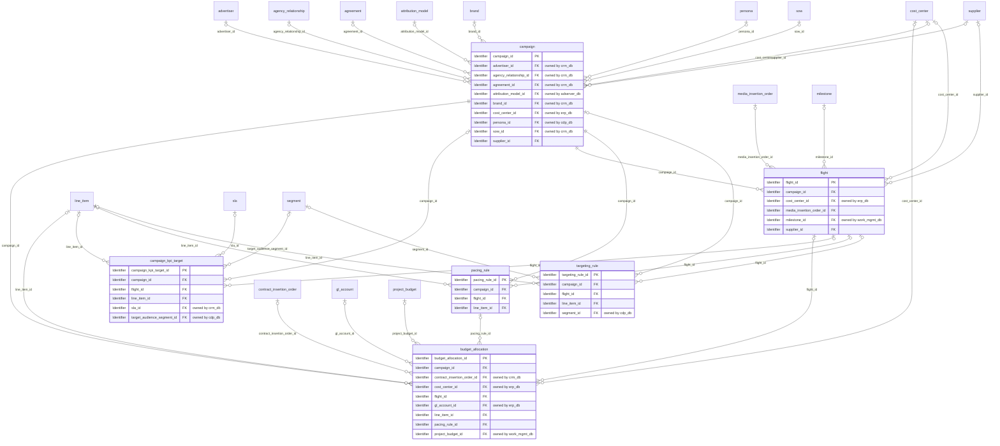
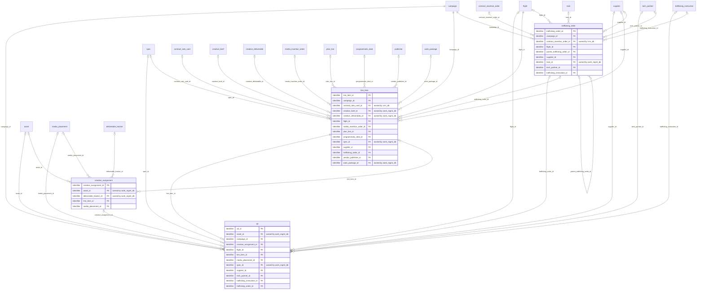
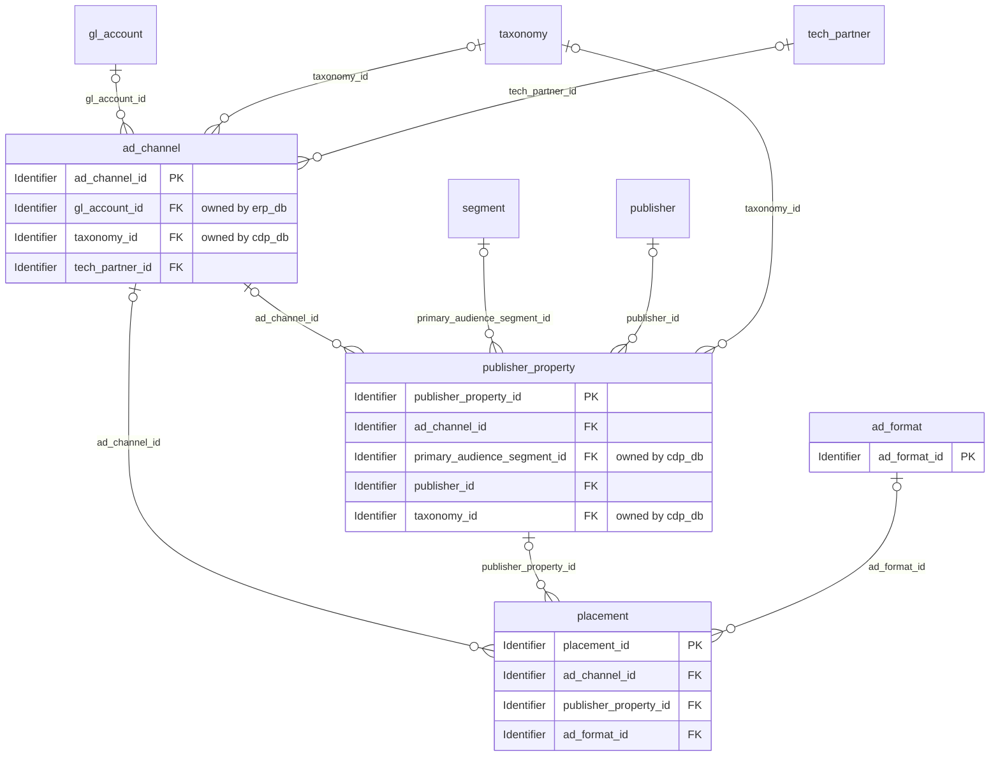
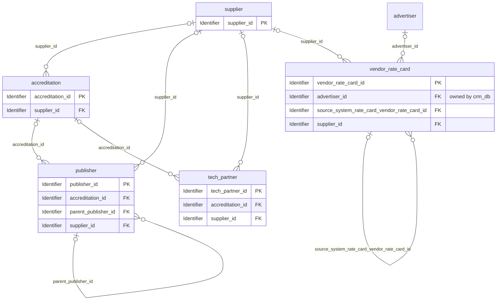

# Logical model: media_ops_db

Generated by advgen from the pinned Advertising MVM; do not edit by hand. Regenerate with `uv run advgen build`.

**Source system role:** Mediaocean Prisma (media planning and buying). Campaign structure, media plans, placements, buys, insertion orders, programmatic deals, trafficking and the vendor/publisher registry with rate cards.

The logical model is technology-neutral: entities, business attributes with logical domains, optionality, keys and every business relationship, **including relationships to entities owned by other systems** (marked *owned by …*). How each relationship is physically implemented (enforced FK vs soft reference) is decided in the physical model.

## Contents

- [campaign.campaign_planning](#campaigncampaign_planning)
- [campaign.media_execution](#campaignmedia_execution)
- [media.campaign_planning](#mediacampaign_planning)
- [media.media_buying](#mediamedia_buying)
- [media.placement_inventory](#mediaplacement_inventory)
- [vendor.vendor_registry](#vendorvendor_registry)
- [Code sets](#code-sets)
- [Normalization notes](#normalization-notes)

## campaign.campaign_planning

| Entity | Kind | Definition |
|---|---|---|
| [budget_allocation](#budget_allocation) | transactional | Unified financial and delivery control record governing how campaign budget is distributed AND how delivery is paced across flights, line items, channels, and time periods. |
| [campaign](#campaign) | master | Master record for an advertising campaign — the authoritative SSOT for campaign identity, objectives, KPIs, flight dates, status, and high-level strategy. |
| [campaign_kpi_target](#campaign_kpi_target) | master | Defines the specific, measurable KPI targets set for a campaign, flight, or line item at the time of planning and as revised during execution. |
| [flight](#flight) | master | Represents a discrete time-bounded execution window within a campaign — a campaign flight (also called a campaign burst or wave). |
| [pacing_rule](#pacing_rule) | master | Defines the delivery pacing strategy and guardrails for a campaign, flight, or line item. |
| [targeting_rule](#targeting_rule) | master | Defines the audience, contextual, and brand safety targeting parameters applied to a campaign, flight, or line item. |

### budget_allocation

Unified financial and delivery control record governing how campaign budget is distributed AND how delivery is paced across flights, line items, channels, and time periods. Captures allocation reference, parent campaign reference, parent flight reference, line item reference, channel type, budget period (monthly, weekly, flight), planned budget amount, revised budget amount, committed spend, actual spend to date, remaining budget, currency, budget source (client-approved, agency-estimated), allocation method (percentage, fixed, dynamic), pacing rule name, pacing type (even, accelerated, front-loaded, back-loaded, custom curve), daily impression goal, daily spend cap, weekly impression goal, weekly spend cap, pacing check frequency (hourly, daily), over-delivery action (pause, throttle, alert), under-delivery action (boost, alert), pacing alert threshold percentage, over-delivery tolerance percentage, under-delivery tolerance percentage, auto-optimization enabled flag, optimization algorithm reference, effective date range, last reconciliation date, and reconciliation status. Serves as the single SSOT for budget allocation decisions, delivery pacing strategy, and pacing guardrails — practitioners manage budget and pacing as a unified workflow because pacing cannot be set independently of budget constraints. Subsumes all pacing rule definitions previously modeled separately.

**Primary identifier:** `budget_allocation_id`

| Attribute | Business name | Domain | Opt. | Key | Definition |
|---|---|---|---|---|---|
| `budget_allocation_id` | Budget Allocation ID | Identifier | M | PK | Unique identifier for the budget allocation record. |
| `campaign_id` | Campaign ID | Identifier → campaign | M | FK | Reference to the parent campaign for which budget is being allocated. |
| `contract_insertion_order_id` | Contract Insertion Order Id (Foreign Key) | Identifier → contract_insertion_order (crm_db) | O | FK | Foreign key linking to contract.contract_insertion_order. |
| `cost_center_id` | Cost Center Id (Foreign Key) | Identifier → cost_center (erp_db) | O | FK | Foreign key linking to finance.cost_center. |
| `flight_id` | Flight ID | Identifier → flight | O | FK | Reference to the parent flight within the campaign for which budget is allocated. |
| `gl_account_id` | Gl Account Id (Foreign Key) | Identifier → gl_account (erp_db) | O | FK | Foreign key linking to finance.gl_account. |
| `line_item_id` | Line Item ID | Identifier → line_item | O | FK | Reference to the specific line item receiving this budget allocation. |
| `pacing_rule_id` | Pacing Rule Id (Foreign Key) | Identifier → pacing_rule | O | FK | Foreign key linking to campaign.pacing_rule. |
| `project_budget_id` | Project Budget Id (Foreign Key) | Identifier → project_budget (work_mgmt_db) | O | FK | Foreign key linking to project.project_budget. |
| `actual_spend` | Actual Spend Amount | Amount | O |  | The actual amount spent to date against this budget allocation, based on delivered impressions and clicks. |
| `allocation_method` | Allocation Method | Code | O |  | The method used to distribute budget across periods or channels (e.g., percentage-based, fixed amount, dynamic optimization). |
| `allocation_reference` | Allocation Reference Number | Business Code | O |  | Business-facing reference number or code for this budget allocation, used for tracking and reconciliation. |
| `allocation_status` | Allocation Status | Code | M |  | The current lifecycle status of this budget allocation (e.g., draft, active, paused, completed, cancelled). |
| `auto_optimization_enabled` | Auto-Optimization Enabled Flag | Indicator | M |  | Indicates whether automated optimization algorithms are enabled to adjust bids and budgets dynamically based on performance. |
| `budget_period_type` | Budget Period Type | Code | O |  | The time period granularity for which this budget allocation applies (e.g., monthly, weekly, flight-level). |
| `budget_source` | Budget Source | Code | O |  | The origin or authority for this budget allocation (e.g., client-approved, agency-estimated, internal forecast). |
| `channel_type` | Channel Type | Code (channel_type) | O |  | The advertising channel or media type for which this budget is allocated. |
| `committed_spend` | Committed Spend Amount | Amount | O |  | The amount of budget that has been committed through insertion orders or programmatic deals but not yet spent. |
| `currency_code` | Currency Code | Currency Code | O |  | Three-letter ISO 4217 currency code for all monetary amounts in this allocation (e.g., USD, EUR, GBP). |
| `daily_impression_goal` | Daily Impression Goal | Quantity | O |  | The target number of impressions to be delivered per day under the pacing rule. |
| `daily_spend_cap` | Daily Spend Cap | Amount | O |  | The maximum amount that can be spent per day for this allocation, enforced by the pacing rule. |
| `effective_end_date` | Effective End Date | Date | O |  | The date when this budget allocation expires and delivery must stop. |
| `effective_start_date` | Effective Start Date | Date | O |  | The date when this budget allocation becomes active and delivery can begin. |
| `last_reconciliation_date` | Last Reconciliation Date | Date | O |  | The date when this budget allocation was last reconciled against actual spend and delivery data from ad servers and billing systems. |
| `notes` | Allocation Notes | Text | O |  | Free-text notes or comments about this budget allocation, including rationale for revisions, special instructions, or reconciliation findings. |
| `optimization_algorithm_reference` | Optimization Algorithm Reference | Business Code | O |  | Reference to the specific optimization algorithm or strategy applied to this allocation (e.g., CPA optimization, ROAS maximization). |
| `over_delivery_action` | Over-Delivery Action | Code | O |  | The action to take when delivery exceeds the pacing goal or budget cap (e.g., pause campaign, throttle bids, send alert). |
| `over_delivery_tolerance_pct` | Over-Delivery Tolerance Percentage | Percentage | O |  | The acceptable percentage over-delivery before corrective action is taken (e.g., 5.00 means 5% over-delivery is tolerated). |
| `pacing_alert_threshold_pct` | Pacing Alert Threshold Percentage | Percentage | O |  | The percentage deviation from the pacing goal that triggers an alert to campaign managers (e.g., 10.00 means alert at 10% deviation). |
| `pacing_check_frequency` | Pacing Check Frequency | Code | O |  | How frequently the pacing engine evaluates delivery performance and adjusts bid strategies (e.g., real-time, hourly, daily). |
| `pacing_type` | Pacing Type | Code | O |  | The pacing strategy governing how budget and impressions are delivered over time (e.g., even, accelerated, front-loaded, back-loaded, custom curve). |
| `planned_budget_amount` | Planned Budget Amount | Amount | O |  | The original planned budget amount allocated for this period and channel, as approved in the initial media plan. |
| `reconciliation_status` | Reconciliation Status | Code | O |  | The current status of the budget reconciliation process for this allocation (e.g., pending, reconciled, discrepancy found, approved). |
| `remaining_budget` | Remaining Budget Amount | Amount | O |  | The remaining unspent budget available for this allocation, calculated as revised (or planned) budget minus actual spend and committed spend. |
| `revised_budget_amount` | Revised Budget Amount | Amount | O |  | The revised budget amount after any adjustments, reallocations, or change orders. |
| `under_delivery_action` | Under-Delivery Action | Code | O |  | The action to take when delivery falls short of the pacing goal (e.g., boost bids, increase budget allocation, send alert). |
| `under_delivery_tolerance_pct` | Under-Delivery Tolerance Percentage | Percentage | O |  | The acceptable percentage under-delivery before corrective action is taken (e.g., 5.00 means 5% under-delivery is tolerated). |
| `weekly_impression_goal` | Weekly Impression Goal | Quantity | O |  | The target number of impressions to be delivered per week under the pacing rule. |
| `weekly_spend_cap` | Weekly Spend Cap | Amount | O |  | The maximum amount that can be spent per week for this allocation, enforced by the pacing rule. |
| `created_at` | Created Timestamp | Timestamp | M |  | Timestamp when the row was inserted. |
| `created_by` | Created By | Text | M |  | Application user (session setting app.actor) or database role that inserted the row. |
| `updated_at` | Last Modified Timestamp | Timestamp | M |  | Timestamp of the last update. |
| `updated_by` | Updated By | Text | M |  | Application user or database role that last updated the row. |

### campaign

Master record for an advertising campaign — the authoritative SSOT for campaign identity, objectives, KPIs, flight dates, status, and high-level strategy. Captures campaign name, advertiser/client reference, campaign type (brand awareness, direct response, performance, retention, seasonal, always-on), campaign status (draft, approved, active, paused, completed, cancelled), start and end dates, campaign objective, primary KPI, secondary KPIs, target ROAS, target CPA, target CPM, target CTR, overall budget ceiling, currency, campaign tier, IAB category, campaign brief reference, approval status, approved by, approved date, go-live date, and audit timestamps. Serves as the root entity for all downstream campaign execution, trafficking, and performance data.

**Primary identifier:** `campaign_id`. **Business key(s):** `campaign_code`

| Attribute | Business name | Domain | Opt. | Key | Definition |
|---|---|---|---|---|---|
| `campaign_id` | Campaign Identifier (ID) | Identifier | M | PK | Unique identifier for the advertising campaign. |
| `advertiser_id` | Advertiser Identifier (ID) | Identifier → advertiser (crm_db) | O | FK | Reference to the advertiser or client who owns this campaign. |
| `agency_relationship_id` | Agency Relationship Id (Foreign Key) | Identifier → agency_relationship (crm_db) | O | FK | Foreign key linking to client.agency_relationship. |
| `agreement_id` | Agreement Id (Foreign Key) | Identifier → agreement (crm_db) | O | FK | Foreign key linking to contract.agreement. |
| `attribution_model_id` | Attribution Model Id (Foreign Key) | Identifier → attribution_model (adserver_db) | O | FK | Foreign key linking to performance.attribution_model. |
| `brand_id` | Client Brand Id (Foreign Key) | Identifier → brand (crm_db) | O | FK | Foreign key linking to client.brand. |
| `cost_center_id` | Cost Center Id (Foreign Key) | Identifier → cost_center (erp_db) | O | FK | Foreign key linking to finance.cost_center. |
| `persona_id` | Persona Id (Foreign Key) | Identifier → persona (cdp_db) | O | FK | Foreign key linking to audience.persona. |
| `sow_id` | Sow Id (Foreign Key) | Identifier → sow (crm_db) | O | FK | Foreign key linking to contract.sow. |
| `supplier_id` | Supplier Id (Foreign Key) | Identifier → supplier | O | FK | Foreign key linking to vendor.supplier. |
| `approval_status` | Approval Status | Code | O |  | Current approval status of the campaign in the review workflow: pending, approved, rejected, or revision requested. |
| `approved_by` | Approved By | Text | O |  | Name or identifier of the person who approved the campaign for activation. |
| `approved_date` | Approval Date | Date | O |  | Date when the campaign was officially approved for execution. |
| `brand_safety_level` | Brand Safety Level | Code | O |  | Brand safety filtering level applied to the campaign: standard, moderate, strict, or custom. |
| `budget_amount` | Campaign Budget Amount | Amount | O |  | Total budget allocated for the campaign. |
| `campaign_code` | Campaign Code | Business Code | M | UK | External business identifier or code for the campaign, often used in trafficking systems and insertion orders. |
| `campaign_name` | Campaign Name | Name | M |  | Human-readable name of the advertising campaign used for identification and reporting. |
| `campaign_status` | Campaign Status | Code | M |  | Current lifecycle status of the campaign: draft (planning), approved (ready), active (running), paused (temporarily stopped), completed (finished), or cancelled (terminated). |
| `campaign_tier` | Campaign Tier | Code | O |  | Strategic importance or priority tier of the campaign within the advertisers portfolio. |
| `campaign_type` | Campaign Type | Code | O |  | Classification of the campaign based on its strategic objective: brand awareness, direct response, performance, retention, seasonal, or always-on. |
| `conversion_window_days` | Conversion Window Days | Quantity | O |  | Number of days after an ad interaction during which a conversion can be attributed to the campaign. |
| `currency_code` | Currency Code | Currency Code | O |  | Three-letter ISO 4217 currency code for the campaign budget and financial metrics. |
| `device_targeting` | Device Targeting | Text | O |  | Device types targeted by the campaign. |
| `end_date` | Campaign End Date | Date | O |  | The date when the campaign is scheduled to end. |
| `frequency_cap` | Frequency Cap | Quantity | O |  | Maximum number of times an ad should be shown to the same user within the frequency cap window. |
| `frequency_cap_window` | Frequency Cap Window | Code | O |  | Time window for the frequency cap: per hour, day, week, month, or entire campaign duration. |
| `geo_targeting` | Geographic Targeting | Text | O |  | Geographic targeting parameters for the campaign. |
| `go_live_date` | Go-Live Date | Date | O |  | Actual date when the campaign went live and started serving ads. |
| `iab_category` | Interactive Advertising Bureau (IAB) Category | Text | O |  | IAB content taxonomy category for the campaign, used for brand safety and contextual targeting. |
| `notes` | Campaign Notes | Text | O |  | Free-form notes or comments about the campaign for internal reference and collaboration. |
| `objective` | Campaign Objective | Text | O |  | Primary business objective or goal of the campaign, such as increase brand awareness, drive conversions, generate leads, or boost engagement. |
| `pacing_strategy` | Pacing Strategy | Code | O |  | Budget pacing strategy for the campaign: even (spread evenly), ASAP (spend as fast as possible), custom (user-defined), or dayparting (time-of-day based). |
| `primary_kpi` | Primary Key Performance Indicator (KPI) | Text | O |  | The main metric used to measure campaign success, such as CTR, CPA, ROAS, impressions, conversions, or reach. |
| `start_date` | Campaign Start Date | Date | M |  | The date when the campaign is scheduled to begin running. |
| `target_audience_description` | Target Audience Description | Text | O |  | Textual description of the target audience for the campaign, including demographic, psychographic, and behavioral characteristics. |
| `target_cpa` | Target Cost Per Acquisition (CPA) | Amount | O |  | Target cost per acquisition or conversion for the campaign. |
| `target_cpm` | Target Cost Per Mille (CPM) | Amount | O |  | Target cost per thousand impressions for the campaign. |
| `target_ctr` | Target Click-Through Rate (CTR) | Decimal | O |  | Target click-through rate percentage for the campaign. |
| `target_roas` | Target Return on Ad Spend (ROAS) | Decimal | O |  | Target return on ad spend ratio for the campaign. |
| `viewability_standard` | Viewability Standard | Code | O |  | Viewability measurement standard applied to the campaign: MRC (Media Rating Council), GroupM, or custom threshold. |
| `created_at` | Record Created Timestamp | Timestamp | M |  | Timestamp when the row was inserted. |
| `created_by` | Record Created By | Text | M |  | Application user (session setting app.actor) or database role that inserted the row. |
| `updated_at` | Record Modified Timestamp | Timestamp | M |  | Timestamp of the last update. |
| `updated_by` | Updated By | Text | M |  | Application user or database role that last updated the row. |

### campaign_kpi_target

Defines the specific, measurable KPI targets set for a campaign, flight, or line item at the time of planning and as revised during execution. Captures KPI target ID, parent entity type (campaign/flight/line_item), parent entity reference, KPI type (impressions, clicks, CTR, conversions, CPA, CPM, CPC, ROAS, VTR, GRP, TRP, SOV, reach, frequency, NPS), target value, target unit, target period (total, daily, weekly, monthly), baseline value, stretch target value, measurement methodology, measurement source (Nielsen, Comscore, CM360, GA, custom), reporting cadence, is_primary_kpi flag, and effective date range. Enables structured KPI governance and performance benchmarking across all campaign types.

**Primary identifier:** `campaign_kpi_target_id`

| Attribute | Business name | Domain | Opt. | Key | Definition |
|---|---|---|---|---|---|
| `campaign_kpi_target_id` | Campaign Key Performance Indicator (KPI) Target Identifier | Identifier | M | PK | Unique identifier for the campaign KPI target record. |
| `campaign_id` | Campaign Identifier | Identifier → campaign | O | FK | Reference to the campaign when parent_entity_type is 'campaign'. |
| `flight_id` | Flight Identifier | Identifier → flight | O | FK | Reference to the flight when parent_entity_type is 'flight'. |
| `line_item_id` | Line Item Identifier | Identifier → line_item | O | FK | Reference to the line item when parent_entity_type is 'line_item'. |
| `sla_id` | Sla Id (Foreign Key) | Identifier → sla (crm_db) | O | FK | Foreign key linking to contract.sla. |
| `target_audience_segment_id` | Target Audience Segment Id (Foreign Key) | Identifier → segment (cdp_db) | O | FK | Foreign key linking to audience.segment. |
| `alert_threshold_percentage` | Alert Threshold Percentage | Percentage | O |  | The percentage deviation from target that triggers a performance alert. |
| `baseline_value` | Baseline Value | Amount | O |  | The baseline or minimum acceptable value for this KPI. |
| `benchmark_source` | Benchmark Source | Text | O |  | The source of industry benchmark data used to establish this target (e.g., Nielsen norms, IAB benchmarks, historical campaign data). |
| `benchmark_value` | Benchmark Value | Amount | O |  | The industry or historical benchmark value for this KPI type. |
| `channel_scope` | Channel Scope | Text | O |  | The media channel or platform for which this KPI target applies (e.g., display, video, social, search). |
| `confidence_level` | Confidence Level | Code | O |  | The level of confidence in achieving this target based on historical performance, market conditions, and campaign parameters. |
| `currency_code` | Currency Code | Currency Code | O |  | ISO 4217 three-letter currency code for monetary KPI targets (CPA, CPM, CPC, ROAS). |
| `effective_end_date` | Effective End Date | Date | O |  | The date through which this KPI target remains active. |
| `effective_start_date` | Effective Start Date | Date | O |  | The date from which this KPI target becomes active and should be measured. |
| `geographic_scope` | Geographic Scope | Text | O |  | The geographic region or market for which this KPI target applies. |
| `is_primary_kpi` | Is Primary Key Performance Indicator (KPI) Flag | Indicator | M |  | Indicates whether this is the primary KPI for the parent entity. |
| `kpi_type` | Key Performance Indicator (KPI) Type | Code (kpi_type) | O |  | The specific KPI metric being targeted. |
| `measurement_methodology` | Measurement Methodology | Text | O |  | Description of the methodology used to measure and calculate this KPI. |
| `measurement_source` | Measurement Source System | Code | O |  | The system or platform that will provide the actual measurement data for this KPI. |
| `notes` | Notes | Text | O |  | Additional notes, context, or special instructions related to this KPI target. |
| `optimization_priority` | Optimization Priority | Code | O |  | The priority level for optimization efforts when this KPI is underperforming. |
| `parent_entity_type` | Parent Entity Type | Code | O |  | The type of parent entity to which this KPI target is attached. |
| `reporting_cadence` | Reporting Cadence | Code | O |  | The frequency at which this KPI should be measured and reported. |
| `revision_reason` | Revision Reason | Text | O |  | Business justification for the most recent revision to this KPI target. |
| `stretch_target_value` | Stretch Target Value | Amount | O |  | The aspirational or stretch goal value for this KPI. |
| `target_audience_segment` | Target Audience Segment | Text | O |  | The specific audience segment for which this KPI target applies. |
| `target_period` | Target Period | Code | O |  | The time period over which the target should be achieved. |
| `target_revision_number` | Target Revision Number | Quantity | O |  | Version number tracking revisions to this KPI target. |
| `target_status` | Target Status | Code | M |  | Current lifecycle status of the KPI target. |
| `target_unit` | Target Unit of Measure | Code | O |  | The unit of measure for the target_value. |
| `target_value` | Target Value | Amount | O |  | The numeric target value for the KPI. |
| `created_at` | Created Timestamp | Timestamp | M |  | Timestamp when the row was inserted. |
| `created_by` | Created By User | Text | M |  | Application user (session setting app.actor) or database role that inserted the row. |
| `updated_at` | Modified Timestamp | Timestamp | M |  | Timestamp of the last update. |
| `updated_by` | Modified By User | Text | M |  | Application user or database role that last updated the row. |

### flight

Represents a discrete time-bounded execution window within a campaign — a campaign flight (also called a campaign burst or wave). Captures flight name, parent campaign reference, flight start date, flight end date, flight status, flight budget allocation, flight objective override, pacing type (even, front-loaded, back-loaded, custom), pacing goal, daypart restrictions, flight priority, channel mix for this flight, and notes. Enables multi-flight campaign structures where a single campaign runs in sequential or overlapping bursts with distinct budgets and targeting parameters. Aligns with Mediaocean Prisma flight-level planning constructs.

**Primary identifier:** `flight_id`. **Business key(s):** `flight_code`

| Attribute | Business name | Domain | Opt. | Key | Definition |
|---|---|---|---|---|---|
| `flight_id` | Flight Identifier (ID) | Identifier | M | PK | Unique identifier for the campaign flight. |
| `campaign_id` | Campaign Identifier (ID) | Identifier → campaign | M | FK | Reference to the parent campaign under which this flight executes. |
| `cost_center_id` | Cost Center Id (Foreign Key) | Identifier → cost_center (erp_db) | O | FK | Foreign key linking to finance.cost_center. |
| `media_insertion_order_id` | Media Insertion Order Id (Foreign Key) | Identifier → media_insertion_order | O | FK | Foreign key linking to media.media_insertion_order. |
| `milestone_id` | Project Milestone Id (Foreign Key) | Identifier → milestone (work_mgmt_db) | O | FK | Foreign key linking to project.milestone. |
| `supplier_id` | Supplier Id (Foreign Key) | Identifier → supplier | O | FK | Foreign key linking to vendor.supplier. |
| `audience_segments` | Audience Segments | Text | O |  | Comma-separated list or structured description of audience segments targeted in this flight (e.g., demographic, behavioral, contextual, or custom segments from DMP/CDP). |
| `budget_allocated` | Flight Budget Allocated | Amount | O |  | The total budget allocated to this flight, representing the financial envelope for all media buys, creative production, and execution costs within this burst period. |
| `budget_currency_code` | Budget Currency Code | Currency Code | O |  | Three-letter ISO 4217 currency code for the flight budget (e.g., USD, EUR, GBP). |
| `channel_mix` | Channel Mix | Text | O |  | Comma-separated list or structured description of the media channels included in this flight (e.g., 'Display, Video, Social, OOH'). |
| `creative_rotation` | Creative Rotation Strategy | Code | O |  | The strategy for rotating multiple creatives within this flight (even = equal distribution, weighted = custom weights, optimized = algorithm-driven, sequential = fixed order). |
| `daypart_restrictions` | Daypart Restrictions | Text | O |  | Time-of-day or day-of-week restrictions for ad delivery within this flight (e.g., 'Weekdays 6AM-10PM', 'Prime Time Only'). |
| `device_targeting` | Device Targeting | Text | O |  | Device types targeted for ad delivery in this flight (e.g., 'Desktop, Mobile, Tablet, CTV'). |
| `end_date` | Flight End Date | Date | M |  | The date when this flight concludes execution. |
| `flight_code` | Flight Code | Business Code | M | UK | Externally-known unique code or identifier for this flight, used in trafficking systems, insertion orders, and billing reconciliation. |
| `flight_name` | Flight Name | Name | M |  | Human-readable name or label for this flight, often indicating the burst period, theme, or seasonal focus (e.g., 'Holiday Wave 1', 'Back-to-School Burst'). |
| `flight_status` | Flight Status | Code | M |  | Current lifecycle status of the flight. |
| `frequency_cap` | Frequency Cap | Quantity | O |  | Maximum number of times a single user should see an ad from this flight within a defined time window. |
| `frequency_cap_period` | Frequency Cap Period | Code | O |  | The time window over which the frequency cap is enforced (e.g., per day, per week, for the entire flight duration). |
| `geo_targeting` | Geographic Targeting | Text | O |  | Geographic targeting parameters for this flight, specifying countries, regions, DMAs, postal codes, or custom geo-fences where ads should be delivered. |
| `notes` | Flight Notes | Text | O |  | Free-text notes or comments about this flight, capturing special instructions, strategic rationale, or operational considerations. |
| `objective` | Flight Objective | Code | O |  | The primary marketing objective for this flight. |
| `pacing_goal` | Pacing Goal | Code | O |  | The metric by which pacing is measured and controlled (e.g., impressions delivered, clicks generated, conversions achieved, unique reach, or spend amount). |
| `pacing_type` | Pacing Type | Code | O |  | The budget pacing strategy for this flight. |
| `priority` | Flight Priority | Quantity | O |  | Numeric priority ranking for this flight relative to other flights in the same campaign or portfolio. |
| `start_date` | Flight Start Date | Date | M |  | The date when this flight begins execution. |
| `target_frequency` | Target Frequency | Decimal | O |  | The planned average number of times each unique user should be exposed to the ad during this flight. |
| `target_grp` | Target Gross Rating Points (GRP) | Decimal | O |  | The planned Gross Rating Points for this flight, representing the sum of all rating points delivered. |
| `target_impressions` | Target Impressions | Quantity | O |  | The planned number of ad impressions to be delivered during this flight. |
| `target_reach` | Target Reach | Quantity | O |  | The planned number of unique individuals or households to be reached during this flight. |
| `target_trp` | Target Rating Points (TRP) | Decimal | O |  | The planned Target Rating Points for this flight, representing GRP adjusted for the specific target audience. |
| `created_at` | Flight Created Timestamp | Timestamp | M |  | Timestamp when the row was inserted. |
| `created_by` | Flight Created By User | Text | M |  | Application user (session setting app.actor) or database role that inserted the row. |
| `updated_at` | Flight Modified Timestamp | Timestamp | M |  | Timestamp of the last update. |
| `updated_by` | Flight Modified By User | Text | M |  | Application user or database role that last updated the row. |

### pacing_rule

Defines the delivery pacing strategy and guardrails for a campaign, flight, or line item. Captures pacing rule name, parent entity type, parent entity reference, pacing type (even, accelerated, front-loaded, back-loaded, custom curve), daily impression goal, daily spend cap, weekly impression goal, weekly spend cap, pacing check frequency (hourly, daily), over-delivery action (pause, throttle, alert), under-delivery action (boost, alert), pacing alert threshold percentage, auto-optimization enabled flag, optimization algorithm reference, and effective date range. Governs how campaign delivery is distributed over time to meet KPIs and avoid over/under-spend.

**Primary identifier:** `pacing_rule_id`

| Attribute | Business name | Domain | Opt. | Key | Definition |
|---|---|---|---|---|---|
| `pacing_rule_id` | Pacing Rule Identifier (ID) | Identifier | M | PK | Unique identifier for the pacing rule record. |
| `campaign_id` | Campaign Identifier (ID) | Identifier → campaign | M | FK | Reference to the parent campaign entity to which this pacing rule applies. |
| `flight_id` | Flight Identifier (ID) | Identifier → flight | O | FK | Reference to the parent flight entity to which this pacing rule applies, if applicable. |
| `line_item_id` | Line Item Identifier (ID) | Identifier → line_item | O | FK | Reference to the parent line item entity to which this pacing rule applies, if applicable. |
| `auto_optimization_enabled` | Auto-Optimization Enabled Flag | Indicator | M |  | Indicates whether automated optimization algorithms are enabled to adjust pacing dynamically based on performance data. |
| `currency_code` | Currency Code | Currency Code | O |  | Three-letter ISO 4217 currency code for all monetary values in this pacing rule (e.g., USD, EUR, GBP). |
| `custom_curve_definition` | Custom Curve Definition | Text | O |  | JSON or structured definition of a custom pacing curve when pacing_type is set to custom_curve. |
| `daily_impression_goal` | Daily Impression Goal | Quantity | O |  | Target number of impressions to be delivered per day under this pacing rule. |
| `daily_spend_cap` | Daily Spend Cap | Amount | O |  | Maximum spend allowed per day under this pacing rule, expressed in the campaign currency. |
| `dayparting_enabled` | Dayparting Enabled Flag | Indicator | M |  | Indicates whether dayparting (time-of-day targeting) is applied as part of the pacing strategy. |
| `dayparting_schedule` | Dayparting Schedule | Text | O |  | Structured definition of the dayparting schedule (e.g., JSON or cron-like format) specifying hours and days when delivery is allowed or prioritized. |
| `effective_end_date` | Effective End Date | Date | O |  | The date on which this pacing rule ceases to be active. |
| `effective_start_date` | Effective Start Date | Date | O |  | The date from which this pacing rule becomes active and begins governing delivery. |
| `notes` | Pacing Rule Notes | Text | O |  | Free-text notes or comments about this pacing rule, used for documentation and operational context. |
| `over_delivery_action` | Over-Delivery Action | Code | O |  | The action to be taken when delivery exceeds the pacing goal or cap (e.g., pause delivery, throttle impressions, send alert). |
| `pacing_alert_threshold_pct` | Pacing Alert Threshold Percentage (PCT) | Percentage | O |  | The percentage deviation from the pacing goal that triggers an alert to campaign managers (e.g., 10.00 means alert if delivery is 10% off target). |
| `pacing_check_frequency` | Pacing Check Frequency | Code | O |  | The frequency at which the pacing engine evaluates delivery progress against goals and applies throttling or boosting actions. |
| `pacing_status` | Pacing Rule Status | Code | M |  | Current lifecycle status of the pacing rule indicating whether it is actively governing delivery. |
| `pacing_type` | Pacing Type | Code | O |  | The delivery pacing strategy applied to the campaign or line item. |
| `parent_entity_type` | Parent Entity Type | Code | O |  | The type of parent entity to which this pacing rule is attached (e.g., campaign, flight, line item, insertion order). |
| `priority_level` | Priority Level | Quantity | O |  | Numeric priority level for this pacing rule when multiple rules apply to the same entity. |
| `rule_name` | Pacing Rule Name | Name | M |  | Human-readable name or label for the pacing rule, used for identification and reporting purposes. |
| `timezone` | Timezone | Text | O |  | IANA timezone identifier (e.g., America/New_York, Europe/London) used for interpreting pacing schedules and dayparting rules. |
| `under_delivery_action` | Under-Delivery Action | Code | O |  | The action to be taken when delivery falls short of the pacing goal (e.g., boost bid, send alert, reallocate budget). |
| `weekly_impression_goal` | Weekly Impression Goal | Quantity | O |  | Target number of impressions to be delivered per week under this pacing rule. |
| `weekly_spend_cap` | Weekly Spend Cap | Amount | O |  | Maximum spend allowed per week under this pacing rule, expressed in the campaign currency. |
| `created_at` | Created Timestamp | Timestamp | M |  | Timestamp when the row was inserted. |
| `created_by` | Created By | Text | M |  | Application user (session setting app.actor) or database role that inserted the row. |
| `updated_at` | Last Modified Timestamp | Timestamp | M |  | Timestamp of the last update. |
| `updated_by` | Updated By | Text | M |  | Application user or database role that last updated the row. |

### targeting_rule

Defines the audience, contextual, and brand safety targeting parameters applied to a campaign, flight, or line item. Captures targeting rule name, parent entity type (campaign/flight/line_item), parent entity reference, targeting dimension (geography, demographic, behavioral, contextual, keyword, device, daypart, audience segment, retargeting, lookalike, brand_safety_content_exclusion, brand_safety_keyword_block, brand_safety_domain_block, brand_safety_category_exclusion), targeting operator (include/exclude), targeting value, targeting value type, data source (first-party, second-party, third-party, DMP, CDP), audience segment reference, geo level (country, region, DMA, city, postal code), device type, OS type, browser type, connection type, language, daypart schedule, frequency cap limit, frequency cap window, frequency cap unit, brand safety tier (TAG certified, GARM standard), viewability standard, fraud prevention threshold, GDPR consent required flag, CCPA opt-out flag, recency window, and is_active flag. Enables precise audience targeting governance and brand safety enforcement across programmatic and direct channels.

**Primary identifier:** `targeting_rule_id`

| Attribute | Business name | Domain | Opt. | Key | Definition |
|---|---|---|---|---|---|
| `targeting_rule_id` | Targeting Rule ID | Identifier | M | PK | Unique identifier for the targeting rule. |
| `campaign_id` | Parent Entity ID | Identifier → campaign | O | FK | The identifier of the parent entity (campaign, flight, or line_item) to which this targeting rule applies. |
| `flight_id` | Flight Id (Foreign Key) | Identifier → flight | O | FK | Foreign key linking to campaign.flight. |
| `line_item_id` | Line Item Id (Foreign Key) | Identifier → line_item | O | FK | Foreign key linking to campaign.line_item. |
| `segment_id` | Audience Segment ID | Identifier → segment (cdp_db) | O | FK | Reference to the audience segment when targeting dimension is audience_segment, retargeting, or lookalike. |
| `brand_safety_tier` | Brand Safety Tier | Code | O |  | The brand safety standard applied: Trustworthy Accountability Group (TAG) certified, Global Alliance for Responsible Media (GARM) standard, or custom. |
| `browser_type` | Browser Type | Text | O |  | The web browser targeted (e.g., Chrome, Safari, Firefox, Edge). |
| `ccpa_opt_out_flag` | California Consumer Privacy Act (CCPA) Opt-Out Flag | Indicator | M |  | Indicates whether this targeting rule respects CCPA opt-out requests (Do Not Sell My Personal Information). |
| `connection_type` | Connection Type | Code | O |  | The type of network connection targeted: WiFi, cellular, ethernet, or unknown. |
| `data_source` | Data Source | Code | O |  | The origin of the targeting data: first-party (owned), second-party (partner), third-party (purchased), Data Management Platform (DMP), or Customer Data Platform (CDP). |
| `daypart_schedule` | Daypart Schedule | Text | O |  | The time-of-day or day-of-week schedule for ad delivery, specified in a structured format (e.g., JSON or cron-like expression). |
| `device_type` | Device Type | Code | O |  | The type of device targeted: desktop, mobile, tablet, Connected TV (CTV), Over-the-Top (OTT), or wearable. |
| `effective_end_date` | Effective End Date | Date | O |  | The date when this targeting rule expires and is no longer applied. |
| `effective_start_date` | Effective Start Date | Date | O |  | The date when this targeting rule becomes active and begins to be applied. |
| `fraud_prevention_threshold` | Fraud Prevention Threshold | Rate | O |  | The minimum fraud detection score (0-100) required for ad delivery, used to filter out suspected invalid traffic. |
| `frequency_cap_limit` | Frequency Cap Limit | Quantity | O |  | The maximum number of times an ad can be shown to a user within the specified frequency cap window. |
| `frequency_cap_unit` | Frequency Cap Unit | Code | O |  | The time unit for the frequency cap window: hour, day, week, month, or lifetime. |
| `frequency_cap_window` | Frequency Cap Window | Quantity | O |  | The time window (in the unit specified by frequency_cap_unit) over which the frequency cap limit applies. |
| `gdpr_consent_required` | General Data Protection Regulation (GDPR) Consent Required | Indicator | M |  | Indicates whether GDPR user consent is required for this targeting rule to be applied. |
| `geo_level` | Geographic Level | Code | O |  | The granularity of geographic targeting: country, region/state, Designated Market Area (DMA), city, or postal code. |
| `is_active` | Is Active | Indicator | M |  | Indicates whether this targeting rule is currently active and being applied to ad delivery. |
| `language` | Language | Text | O |  | The language targeted, specified as ISO 639-1 two-letter language code (e.g., en, es, fr). |
| `os_type` | Operating System (OS) Type | Text | O |  | The operating system targeted (e.g., iOS, Android, Windows, macOS, tvOS). |
| `parent_entity_type` | Parent Entity Type | Code | O |  | The type of entity to which this targeting rule is applied: campaign, flight, or line_item. |
| `priority` | Targeting Rule Priority | Quantity | O |  | The priority or precedence of this targeting rule when multiple rules apply to the same entity. |
| `recency_window` | Recency Window | Quantity | O |  | The time window (in days) for behavioral or retargeting data recency, specifying how recent user activity must be to qualify for targeting. |
| `rule_name` | Targeting Rule Name | Name | M |  | Business-friendly name for the targeting rule, used for identification and reporting purposes. |
| `targeting_dimension` | Targeting Dimension | Code (targeting_dimension) | O |  | The dimension or category of targeting applied by this rule. |
| `targeting_operator` | Targeting Operator | Code | O |  | Specifies whether the targeting rule includes or excludes the specified targeting value. |
| `targeting_value` | Targeting Value | Amount | O |  | The specific value or identifier for the targeting dimension (e.g., country code, age range, device type, audience segment ID). |
| `targeting_value_type` | Targeting Value Type | Code | O |  | Indicates the format of the targeting value: single value, range, comma-separated list, or pattern/regex. |
| `viewability_standard` | Viewability Standard | Code | O |  | The viewability measurement standard applied: Media Rating Council (MRC), Interactive Advertising Bureau (IAB), or custom. |
| `created_at` | Created Timestamp | Timestamp | M |  | Timestamp when the row was inserted. |
| `created_by` | Created By | Text | M |  | Application user (session setting app.actor) or database role that inserted the row. |
| `updated_at` | Modified Timestamp | Timestamp | M |  | Timestamp of the last update. |
| `updated_by` | Modified By | Text | M |  | Application user or database role that last updated the row. |

## campaign.media_execution

| Entity | Kind | Definition |
|---|---|---|
| [ad](#ad) | master | Individual ad unit record representing a specific creative execution trafficked and served within a campaign line item. |
| [creative_assignment](#creative_assignment) | association | This association product represents the assignment of creative assets to line items for media execution. |
| [line_item](#line_item) | master | Granular execution unit within a campaign flight representing a single buyable unit of media — the atomic record of what is being bought, at what price, on which channel, for which audience. |
| [trafficking_order](#trafficking_order) | transactional | Represents the formal trafficking instruction set issued to an ad server or DSP to activate campaign line items and ads. |

### ad

Individual ad unit record representing a specific creative execution trafficked and served within a campaign line item. Captures ad name, parent line item reference, campaign reference, ad type (banner, video, native, rich media, audio, DOOH), ad format dimensions (width x height), VAST/VPAID tag reference, click-through URL, impression tracker URL, view tracker URL, creative asset reference, ad status (draft, pending review, approved, rejected, live, paused, archived), trafficking status, ad server ad ID (CM360), go-live date, end date, frequency cap, frequency cap period, and audit timestamps. Bridges the campaign execution layer to the creative asset layer. Aligns with Google Campaign Manager 360 ad trafficking entities.

**Primary identifier:** `ad_id`

| Attribute | Business name | Domain | Opt. | Key | Definition |
|---|---|---|---|---|---|
| `ad_id` | Ad ID | Identifier | M | PK | Unique identifier for the ad unit. |
| `asset_id` | Creative Asset ID | Identifier → asset (work_mgmt_db) | O | FK | Reference to the creative asset (image, video, HTML5, audio) used in this ad execution. |
| `campaign_id` | Campaign ID | Identifier → campaign | M | FK | Reference to the parent campaign to which this ad belongs. |
| `creative_assignment_id` | Creative Assignment Id (Foreign Key) | Identifier → creative_assignment | O | FK | Foreign key linking to campaign.creative_assignment. |
| `flight_id` | Flight Id (Foreign Key) | Identifier → flight | O | FK | Foreign key linking to campaign.flight. |
| `line_item_id` | Line Item ID | Identifier → line_item | M | FK | Reference to the parent campaign line item under which this ad is trafficked. |
| `media_placement_id` | Media Placement Id (Foreign Key) | Identifier → media_placement | O | FK | Foreign key linking to media.media_placement. |
| `spec_id` | Spec Id (Foreign Key) | Identifier → spec (work_mgmt_db) | O | FK | Foreign key linking to creative.spec. |
| `supplier_id` | Supplier Id (Foreign Key) | Identifier → supplier | O | FK | Foreign key linking to vendor.supplier. |
| `tech_partner_id` | Tech Partner Id (Foreign Key) | Identifier → tech_partner | O | FK | Foreign key linking to vendor.tech_partner. |
| `trafficking_instruction_id` | Trafficking Instruction Id (Foreign Key) | Identifier → trafficking_instruction | O | FK | Foreign key linking to media.trafficking_instruction. |
| `trafficking_order_id` | Trafficking Order Id (Foreign Key) | Identifier → trafficking_order | O | FK | Foreign key linking to campaign.trafficking_order. |
| `ad_name` | Ad Name | Name | M |  | Human-readable name assigned to this ad unit for identification and reporting purposes. |
| `ad_status` | Ad Status | Code (ad_status) | M |  | Current lifecycle status of the ad unit. |
| `ad_type` | Ad Type | Code (ad_type) | O |  | Classification of the ad unit by format type. |
| `approval_date` | Approval Date | Date | O |  | Date when the ad was approved for trafficking and serving. |
| `approved_by` | Approved By | Text | O |  | Name or identifier of the user who approved the ad for serving. |
| `brand_safety_verified` | Brand Safety Verified | Indicator | M |  | Indicates whether the ad creative has passed brand safety verification checks. |
| `ccpa_opt_out_honored` | CCPA (California Consumer Privacy Act) Opt-Out Honored | Indicator | M |  | Indicates whether this ad honors CCPA Do Not Sell requests. |
| `click_through_url` | Click-Through URL (CTR) | URL | O |  | Destination URL where users are directed when they click on the ad. |
| `end_date` | End Date | Date | O |  | Date when the ad stops serving. |
| `format` | Ad Format Dimensions | Text | O |  | Dimensions of the ad creative in width x height format (e.g., 300x250, 728x90, 1920x1080). |
| `frequency_cap` | Frequency Cap | Quantity | O |  | Maximum number of times this ad can be shown to a unique user within the frequency cap period. |
| `frequency_cap_period` | Frequency Cap Period | Code | O |  | Time window over which the frequency cap is enforced. |
| `gdpr_consent_required` | GDPR (General Data Protection Regulation) Consent Required | Indicator | M |  | Indicates whether user consent is required under GDPR before serving this ad. |
| `go_live_date` | Go-Live Date | Date | O |  | Date when the ad becomes eligible to start serving. |
| `impression_tracker_url` | Impression Tracker URL | URL | O |  | Third-party tracking pixel or beacon URL fired when the ad impression is served. |
| `landing_page_url` | Landing Page URL | URL | O |  | Final destination landing page URL after click-through, excluding tracking parameters. |
| `notes` | Ad Notes | Text | O |  | Free-text notes or comments about the ad unit for internal reference and collaboration. |
| `priority` | Ad Priority | Quantity | O |  | Serving priority of this ad relative to other ads in the same line item. |
| `rejection_reason` | Rejection Reason | Text | O |  | Explanation for why the ad was rejected during review. |
| `server_ad_code` | Ad Server Ad ID | Business Code | O |  | External identifier assigned by the ad server platform (e.g., Google Campaign Manager 360) for this ad unit. |
| `ssl_compliant` | SSL (Secure Sockets Layer) Compliant | Indicator | M |  | Indicates whether the ad creative and all tracking tags are served over HTTPS for secure delivery. |
| `third_party_tracking_enabled` | Third-Party Tracking Enabled | Indicator | M |  | Indicates whether third-party tracking pixels and beacons are enabled for this ad. |
| `trafficking_status` | Trafficking Status | Code | O |  | Operational status indicating whether the ad has been trafficked to the ad server and its current serving state. |
| `vast_tag_url` | VAST (Video Ad Serving Template) Tag URL | URL | O |  | VAST or VPAID tag URL for video ad serving. |
| `view_tracker_url` | View Tracker URL | URL | O |  | Third-party tracking URL fired when the ad is viewable according to MRC viewability standards. |
| `vpaid_enabled` | VPAID (Video Player-Ad Interface Definition) Enabled | Indicator | M |  | Indicates whether the ad uses VPAID for interactive video ad execution. |
| `weight` | Ad Weight | Quantity | O |  | Relative weight for rotation when multiple ads are eligible to serve. |
| `created_at` | Created Timestamp | Timestamp | M |  | Timestamp when the row was inserted. |
| `created_by` | Created By | Text | M |  | Application user (session setting app.actor) or database role that inserted the row. |
| `updated_at` | Modified Timestamp | Timestamp | M |  | Timestamp of the last update. |
| `updated_by` | Modified By | Text | M |  | Application user or database role that last updated the row. |

### creative_assignment

This association product represents the assignment of creative assets to line items for media execution. It captures the operational relationship between what is being bought (line item) and what creative content is served (creative asset). Each record links one line item to one creative asset with attributes that govern rotation, scheduling, trafficking, and performance tracking for that specific pairing.. Existence Justification: In advertising operations, line items routinely serve multiple creative assets simultaneously through rotation strategies (A/B testing, dynamic creative optimization, sequential messaging). Each creative asset is reused across multiple line items spanning different campaigns, flights, and targeting strategies. The business actively manages creative assignments as operational records with rotation weights, scheduling windows, trafficking status, and performance metrics tracked per line-item-asset pairing.

**Primary identifier:** `creative_assignment_id`

| Attribute | Business name | Domain | Opt. | Key | Definition |
|---|---|---|---|---|---|
| `creative_assignment_id` | Creative Assignment ID | Identifier | M | PK | Unique identifier for this creative assignment record. |
| `asset_id` | Creative Assignment - Creative Asset Id | Identifier → asset (work_mgmt_db) | O | FK | Foreign key linking to the creative asset assigned to this line item |
| `deliverable_tracker_id` | Deliverable Tracker Id (Foreign Key) | Identifier → deliverable_tracker (work_mgmt_db) | O | FK | Foreign key linking to project.deliverable_tracker. |
| `line_item_id` | Creative Assignment - Line Item Id | Identifier → line_item | O | FK | Foreign key linking to the line item that will serve this creative asset |
| `media_placement_id` | Media Placement Id (Foreign Key) | Identifier → media_placement | O | FK | Foreign key linking to media.media_placement. |
| `click_count` | Click Count | Quantity | O |  | The number of clicks generated by this specific creative asset on this specific line item. |
| `conversion_count` | Conversion Count | Quantity | O |  | The number of conversions attributed to this specific creative asset on this specific line item. |
| `ctr` | Click-Through Rate | Decimal | O |  | Click-through rate for this creative-line item pairing, calculated as (clicks / impressions). |
| `end_date` | Assignment End Date | Date | O |  | The date when this creative asset stops serving on this line item. |
| `impression_count` | Impression Count | Quantity | O |  | The number of impressions delivered for this specific creative asset on this specific line item. |
| `priority_rank` | Priority Rank | Quantity | O |  | The priority or sequence order of this creative within the line item's rotation. |
| `rotation_weight` | Rotation Weight | Rate | O |  | The percentage or weight assigned to this creative asset within the line item's creative rotation. |
| `start_date` | Assignment Start Date | Date | O |  | The date when this creative asset begins serving on this line item. |
| `trafficking_status` | Trafficking Status | Text | M |  | The operational status of this specific creative-to-line-item assignment in the ad serving platform. |
| `view_count` | View Count | Quantity | O |  | The number of video views or viewable impressions for this specific creative asset on this specific line item. |
| `created_at` | Assignment Created Date | Timestamp | M |  | Timestamp when the row was inserted. |
| `created_by` | Created By | Text | M |  | Application user (session setting app.actor) or database role that inserted the row. |
| `updated_at` | Last Modified Date | Timestamp | M |  | Timestamp of the last update. |
| `updated_by` | Updated By | Text | M |  | Application user or database role that last updated the row. |

### line_item

Granular execution unit within a campaign flight representing a single buyable unit of media — the atomic record of what is being bought, at what price, on which channel, for which audience. Captures line item name, parent flight reference, campaign reference, channel type (display, video, search, social, OOH, CTV, audio), ad format, placement type, targeting summary, start date, end date, booked impressions, booked clicks, booked views, rate type (CPM, CPC, CPA, CPV, flat), rate amount, net cost, gross cost, currency, IO reference, vendor/publisher reference, trafficking status, delivery status, pacing status, and creative assignment status. The primary unit of media planning and buying execution. Aligns with Google Campaign Manager 360 placement and The Trade Desk ad group constructs.

**Primary identifier:** `line_item_id`. **Business key(s):** `line_item_code`

| Attribute | Business name | Domain | Opt. | Key | Definition |
|---|---|---|---|---|---|
| `line_item_id` | Line Item Identifier (ID) | Identifier | M | PK | Unique identifier for the line item. |
| `campaign_id` | Campaign Identifier (ID) | Identifier → campaign | M | FK | Reference to the parent campaign under which this line item executes. |
| `contract_rate_card_id` | Contract Rate Card Id (Foreign Key) | Identifier → contract_rate_card (crm_db) | O | FK | Foreign key linking to contract.contract_rate_card. |
| `creative_brief_id` | Creative Brief Id (Foreign Key) | Identifier → creative_brief (work_mgmt_db) | O | FK | Foreign key linking to creative.creative_brief. |
| `creative_deliverable_id` | Creative Deliverable Id (Foreign Key) | Identifier → creative_deliverable (work_mgmt_db) | O | FK | Foreign key linking to creative.creative_deliverable. |
| `flight_id` | Flight Identifier (ID) | Identifier → flight | M | FK | Reference to the parent campaign flight that contains this line item. |
| `media_insertion_order_id` | Media Insertion Order Id (Foreign Key) | Identifier → media_insertion_order | O | FK | Foreign key linking to media.media_insertion_order. |
| `plan_line_id` | Plan Line Id (Foreign Key) | Identifier → plan_line | O | FK | Foreign key linking to media.plan_line. |
| `programmatic_deal_id` | Programmatic Deal Identifier (ID) | Identifier → programmatic_deal | O | FK | The unique identifier for a programmatic deal (PMP, preferred deal, or programmatic guaranteed) associated with this line item. |
| `spec_id` | Spec Id (Foreign Key) | Identifier → spec (work_mgmt_db) | O | FK | Foreign key linking to creative.spec. |
| `supplier_id` | Supplier Id (Foreign Key) | Identifier → supplier | O | FK | Foreign key linking to vendor.supplier. |
| `trafficking_order_id` | Trafficking Order Id (Foreign Key) | Identifier → trafficking_order | O | FK | Foreign key linking to campaign.trafficking_order. |
| `vendor_publisher_id` | Vendor Publisher Identifier (ID) | Identifier → publisher | O | FK | Reference to the media vendor or publisher delivering this line item inventory. |
| `work_package_id` | Work Package Id (Foreign Key) | Identifier → work_package (work_mgmt_db) | O | FK | Foreign key linking to project.work_package. |
| `ad_format` | Ad Format | Text | O |  | The creative format specification for this line item (e.g., 300x250 banner, 15-second pre-roll, sponsored post). |
| `agency_commission_rate` | Agency Commission Rate | Rate | O |  | The commission percentage applied to this line item. |
| `booked_clicks` | Booked Clicks | Quantity | O |  | The contracted number of clicks to be delivered for this line item. |
| `booked_conversions` | Booked Conversions | Quantity | O |  | The contracted number of conversions or acquisitions to be delivered for this line item. |
| `booked_impressions` | Booked Impressions | Quantity | O |  | The contracted number of impressions to be delivered for this line item. |
| `booked_views` | Booked Views | Quantity | O |  | The contracted number of video views or viewable impressions to be delivered for this line item. |
| `brand_safety_tier` | Brand Safety Tier | Code | O |  | The level of brand safety filtering applied to this line item. |
| `channel_type` | Channel Type | Code (channel_type) | O |  | The media channel through which this line item will be executed. |
| `creative_assignment_status` | Creative Assignment Status | Code | O |  | The status of creative asset assignment and approval for this line item. |
| `currency_code` | Currency Code | Currency Code | O |  | Three-letter ISO 4217 currency code for all monetary values on this line item. |
| `delivery_status` | Delivery Status | Code (delivery_status) | M |  | The current delivery performance status of the line item. |
| `end_date` | Line Item End Date | Date | M |  | The date when this line item stops serving. |
| `frequency_cap_impressions` | Frequency Cap Impressions | Quantity | O |  | The maximum number of impressions a unique user can receive for this line item within the frequency cap period. |
| `frequency_cap_period` | Frequency Cap Period | Code | O |  | The time period over which the frequency cap is applied. |
| `gross_cost` | Gross Cost | Amount | O |  | The gross media cost for this line item before agency commission. |
| `is_programmatic` | Is Programmatic Flag | Indicator | M |  | Indicates whether this line item is executed through programmatic buying platforms (DSP) or through direct/manual insertion orders. |
| `line_item_code` | Line Item Code | Business Code | M | UK | External business identifier or SKU for the line item. |
| `line_item_name` | Line Item Name | Name | M |  | Human-readable name for the line item. |
| `line_sequence` | Line Sequence Number | Quantity | O |  | Ordinal position of this line item within the parent flight. |
| `net_cost` | Net Cost | Amount | O |  | The net media cost for this line item after agency commission and discounts. |
| `pacing_status` | Pacing Status | Code | O |  | The current pacing health of the line item relative to its delivery goal and timeline. |
| `pacing_strategy` | Pacing Strategy | Code | O |  | The delivery pacing strategy for this line item. |
| `placement_type` | Placement Type | Code (placement_type) | O |  | The buying model or inventory type for this line item. |
| `priority` | Line Item Priority | Quantity | O |  | The delivery priority of this line item relative to other line items competing for the same inventory. |
| `rate_amount` | Rate Amount | Rate | O |  | The unit rate for this line item based on the rate type. |
| `rate_type` | Rate Type | Code (rate_type) | O |  | The pricing model for this line item. |
| `start_date` | Line Item Start Date | Date | M |  | The date when this line item begins serving. |
| `targeting_summary` | Targeting Summary | Text | O |  | High-level summary of audience targeting parameters applied to this line item (demographics, geography, behavior, context). |
| `trafficking_status` | Trafficking Status | Code (trafficking_status) | O |  | The operational status of line item setup and creative trafficking. |
| `viewability_target_percentage` | Viewability Target Percentage | Percentage | O |  | The target percentage of impressions that must meet viewability standards (MRC definition: 50% of pixels in view for 1 second for display, 2 seconds for video). |
| `created_at` | Created Timestamp | Timestamp | M |  | Timestamp when the row was inserted. |
| `created_by` | Created By | Text | M |  | Application user (session setting app.actor) or database role that inserted the row. |
| `updated_at` | Modified Timestamp | Timestamp | M |  | Timestamp of the last update. |
| `updated_by` | Updated By | Text | M |  | Application user or database role that last updated the row. |

### trafficking_order

Represents the formal trafficking instruction set issued to an ad server or DSP to activate campaign line items and ads. Captures trafficking order number, parent campaign reference, parent flight reference, ad server platform (CM360, The Trade Desk, etc.), trafficking status (pending, submitted, in-progress, live, completed, rejected), submitted by, submitted date, go-live date, trafficking notes, QA status, QA completed by, QA completed date, number of line items trafficked, number of ads trafficked, VAST tag validation status, pixel firing validation status, and audit timestamps. Represents the operational handoff from planning to execution — a distinct business workflow from the campaign plan itself.

**Primary identifier:** `trafficking_order_id`. **Business key(s):** `trafficking_order_number`

| Attribute | Business name | Domain | Opt. | Key | Definition |
|---|---|---|---|---|---|
| `trafficking_order_id` | Trafficking Order Identifier (ID) | Identifier | M | PK | Unique identifier for the trafficking order. |
| `campaign_id` | Campaign Identifier (ID) | Identifier → campaign | M | FK | Reference to the parent campaign for which this trafficking order is issued. |
| `contract_insertion_order_id` | Contract Insertion Order Id (Foreign Key) | Identifier → contract_insertion_order (crm_db) | O | FK | Foreign key linking to contract.contract_insertion_order. |
| `flight_id` | Flight Identifier (ID) | Identifier → flight | O | FK | Reference to the parent flight or media schedule within the campaign that this trafficking order activates. |
| `parent_trafficking_order_id` | Parent Trafficking Order Identifier (ID) | Identifier → trafficking_order | O | FK | Reference to the original trafficking order if this is a revision or amendment, enabling tracking of the full order history and change lineage. |
| `supplier_id` | Supplier Id (Foreign Key) | Identifier → supplier | O | FK | Foreign key linking to vendor.supplier. |
| `task_id` | Task Id (Foreign Key) | Identifier → task (work_mgmt_db) | O | FK | Foreign key linking to project.task. |
| `tech_partner_id` | Tech Partner Id (Foreign Key) | Identifier → tech_partner | O | FK | Foreign key linking to vendor.tech_partner. |
| `trafficking_instruction_id` | Trafficking Instruction Id (Foreign Key) | Identifier → trafficking_instruction | O | FK | Foreign key linking to media.trafficking_instruction. |
| `actual_live_timestamp` | Actual Live Timestamp | Timestamp | O |  | Actual date and time when the trafficking order went live and ads began serving, as confirmed by the ad server platform. |
| `ad_server_order_code` | Ad Server Order Identifier (ID) | Business Code | O |  | External order or campaign identifier assigned by the ad server platform (e.g., CM360 order ID, Trade Desk campaign ID) for cross-system reconciliation. |
| `ads_trafficked_count` | Ads Trafficked Count | Quantity | O |  | Total number of individual ad creatives that were trafficked and uploaded to the ad server as part of this trafficking order. |
| `completion_timestamp` | Completion Timestamp | Timestamp | O |  | Date and time when the trafficking order was marked as completed, indicating that all line items and ads are live and the operational handoff is finalized. |
| `go_live_date` | Go-Live Date | Date | O |  | Scheduled date when the trafficked campaign line items and ads are expected to begin serving live impressions. |
| `line_items_trafficked_count` | Line Items Trafficked Count | Quantity | O |  | Total number of campaign line items that were trafficked and configured in the ad server as part of this trafficking order. |
| `pixel_firing_validation_status` | Pixel Firing Validation Status | Code | O |  | Validation status of tracking pixels and conversion tags, confirming that impression, click, and conversion pixels are firing correctly in test environments. |
| `priority_level` | Priority Level | Code | O |  | Operational priority assigned to this trafficking order, indicating urgency and sequencing for ad operations team workload management. |
| `qa_completed_timestamp` | Quality Assurance (QA) Completed Timestamp | Timestamp | O |  | Date and time when the quality assurance review was completed and the trafficking order was approved or rejected for go-live. |
| `qa_status` | Quality Assurance (QA) Status | Code | O |  | Current status of the quality assurance review process for this trafficking order, indicating whether pre-launch validation checks have been completed and passed. |
| `rejection_reason` | Rejection Reason | Text | O |  | Detailed explanation provided when a trafficking order is rejected during QA or by the ad server platform, including specific issues that must be resolved before resubmission. |
| `revision_number` | Revision Number | Quantity | O |  | Sequential version number tracking revisions and resubmissions of the trafficking order due to changes, corrections, or rejections. |
| `sla_met_flag` | Service Level Agreement (SLA) Met Flag | Indicator | M |  | Boolean indicator of whether the trafficking order was completed within the defined SLA target hours, used for operational performance tracking. |
| `sla_target_hours` | Service Level Agreement (SLA) Target Hours | Quantity | O |  | Target number of hours within which the trafficking order should be completed from submission to go-live, as defined by internal SLA policies. |
| `submitted_timestamp` | Submitted Timestamp | Timestamp | O |  | Date and time when the trafficking order was submitted to the ad server or DSP for processing and activation. |
| `trafficking_notes` | Trafficking Notes | Text | O |  | Free-text operational notes and instructions provided by the trafficking team regarding special setup requirements, targeting parameters, creative specifications, or platform-spec… |
| `trafficking_order_number` | Trafficking Order Number | Business Code | M | UK | Business-facing unique trafficking order number used for operational reference and communication with ad ops teams and external platforms. |
| `trafficking_status` | Trafficking Status | Code (trafficking_status) | M |  | Current lifecycle status of the trafficking order indicating its progress through the ad operations workflow from submission to go-live. |
| `trafficking_type` | Trafficking Type | Code | O |  | Classification of the trafficking order based on the campaign buying model and activation method (standard direct IO, programmatic guaranteed, sponsorship, etc.). |
| `vast_tag_validation_status` | Video Ad Serving Template (VAST) Tag Validation Status | Code | O |  | Validation status of VAST tags for video ad creatives, indicating whether the tags conform to IAB VAST specifications and are ready for serving. |
| `created_at` | Created Timestamp | Timestamp | M |  | Timestamp when the row was inserted. |
| `created_by` | Created By | Text | M |  | Application user (session setting app.actor) or database role that inserted the row. |
| `updated_at` | Last Modified Timestamp | Timestamp | M |  | Timestamp of the last update. |
| `updated_by` | Updated By | Text | M |  | Application user or database role that last updated the row. |

## media.campaign_planning

| Entity | Kind | Definition |
|---|---|---|
| [media_placement](#media_placement) | master | Operational record representing a specific ad placement purchased from a media vendor — the atomic unit of a media buy. |
| [plan](#plan) | master | Master record representing a structured media plan developed during the media planning phase. |
| [plan_line](#plan_line) | master | Individual line-item within a media plan representing a specific channel, vehicle, and flight combination. |
| [schedule](#schedule) | master | Operational master record representing the detailed airing/delivery schedule for purchased media placements — specifying exactly when and where ads will run across all channels. |

```mermaid
erDiagram
    media_placement {
        Identifier media_placement_id PK
        Identifier ad_channel_id FK
        Identifier ad_format_id FK
        Identifier ad_server_tech_partner_id FK
        Identifier asset_id FK "owned by work_mgmt_db"
        Identifier contract_rate_card_id FK "owned by crm_db"
        Identifier cost_center_id FK "owned by erp_db"
        Identifier gl_account_id FK "owned by erp_db"
        Identifier media_ad_server_placement_id FK
        Identifier media_catalog_placement_id FK
        Identifier media_insertion_order_id FK
        Identifier original_placement_media_placement_id FK
        Identifier primary_media_audience_segment_id FK "owned by cdp_db"
        Identifier programmatic_deal_id FK
        Identifier publisher_id FK
        Identifier publisher_property_id FK
        Identifier spec_id FK "owned by work_mgmt_db"
    }
    plan {
        Identifier plan_id PK
        Identifier advertiser_id FK "owned by crm_db"
        Identifier agency_relationship_id FK "owned by crm_db"
        Identifier brand_id FK "owned by crm_db"
        Identifier campaign_id FK
        Identifier cost_center_id FK "owned by erp_db"
        Identifier creative_brief_id FK "owned by work_mgmt_db"
        Identifier finance_budget_id FK "owned by erp_db"
        Identifier gl_account_id FK "owned by erp_db"
        Identifier initiative_id FK "owned by work_mgmt_db"
        Identifier persona_id FK "owned by cdp_db"
        Identifier segment_id FK "owned by cdp_db"
        Identifier sow_id FK "owned by crm_db"
    }
    plan_line {
        Identifier plan_line_id PK
        Identifier ad_channel_id FK
        Identifier ad_format_id FK
        Identifier asset_id FK "owned by work_mgmt_db"
        Identifier campaign_id FK
        Identifier contract_rate_card_id FK "owned by crm_db"
        Identifier cost_center_id FK "owned by erp_db"
        Identifier creative_brief_id FK "owned by work_mgmt_db"
        Identifier gl_account_id FK "owned by erp_db"
        Identifier media_insertion_order_id FK
        Identifier media_placement_id FK
        Identifier plan_id FK
        Identifier programmatic_deal_id FK
        Identifier publisher_id FK
        Identifier publisher_property_id FK
        Identifier segment_id FK "owned by cdp_db"
    }
    schedule {
        Identifier schedule_id PK
        Identifier ad_channel_id FK
        Identifier ad_format_id FK
        Identifier asset_id FK "owned by work_mgmt_db"
        Identifier buy_id FK
        Identifier campaign_id FK
        Identifier cost_center_id FK "owned by erp_db"
        Identifier gl_account_id FK "owned by erp_db"
        Identifier initiative_id FK "owned by work_mgmt_db"
        Identifier media_insertion_order_id FK
        Identifier media_placement_id FK
        Identifier plan_line_id FK
        Identifier programmatic_deal_id FK
        Identifier segment_id FK "owned by cdp_db"
        Identifier sow_id FK "owned by crm_db"
        Identifier supplier_id FK
        Identifier trafficking_instruction_id FK
        Identifier vendor_rate_card_id FK
    }
    ad_channel |o--o{ media_placement : "ad_channel_id"
    ad_format |o--o{ media_placement : "ad_format_id"
    tech_partner |o--o{ media_placement : "ad_server_tech_partner_id"
    asset |o--o{ media_placement : "asset_id"
    contract_rate_card |o--o{ media_placement : "contract_rate_card_id"
    cost_center |o--o{ media_placement : "cost_center_id"
    gl_account |o--o{ media_placement : "gl_account_id"
    placement |o--o{ media_placement : "media_ad_server_placement_id"
    placement |o--o{ media_placement : "media_catalog_placement_id"
    media_insertion_order ||--o{ media_placement : "media_insertion_order_id"
    media_placement |o--o{ media_placement : "original_placement_media_placement_id"
    segment |o--o{ media_placement : "primary_media_audience_segment_id"
    programmatic_deal |o--o{ media_placement : "programmatic_deal_id"
    publisher |o--o{ media_placement : "publisher_id"
    publisher_property |o--o{ media_placement : "publisher_property_id"
    spec |o--o{ media_placement : "spec_id"
    advertiser |o--o{ plan : "advertiser_id"
    agency_relationship |o--o{ plan : "agency_relationship_id"
    brand |o--o{ plan : "brand_id"
    campaign ||--o{ plan : "campaign_id"
    cost_center |o--o{ plan : "cost_center_id"
    creative_brief |o--o{ plan : "creative_brief_id"
    finance_budget |o--o{ plan : "finance_budget_id"
    gl_account |o--o{ plan : "gl_account_id"
    initiative |o--o{ plan : "initiative_id"
    persona |o--o{ plan : "persona_id"
    segment |o--o{ plan : "segment_id"
    sow |o--o{ plan : "sow_id"
    ad_channel |o--o{ plan_line : "ad_channel_id"
    ad_format |o--o{ plan_line : "ad_format_id"
    asset |o--o{ plan_line : "asset_id"
    campaign |o--o{ plan_line : "campaign_id"
    contract_rate_card |o--o{ plan_line : "contract_rate_card_id"
    cost_center |o--o{ plan_line : "cost_center_id"
    creative_brief |o--o{ plan_line : "creative_brief_id"
    gl_account |o--o{ plan_line : "gl_account_id"
    media_insertion_order |o--o{ plan_line : "media_insertion_order_id"
    media_placement |o--o{ plan_line : "media_placement_id"
    plan ||--o{ plan_line : "plan_id"
    programmatic_deal |o--o{ plan_line : "programmatic_deal_id"
    publisher |o--o{ plan_line : "publisher_id"
    publisher_property |o--o{ plan_line : "publisher_property_id"
    segment |o--o{ plan_line : "segment_id"
    ad_channel |o--o{ schedule : "ad_channel_id"
    ad_format |o--o{ schedule : "ad_format_id"
    asset |o--o{ schedule : "asset_id"
    buy |o--o{ schedule : "buy_id"
    campaign ||--o{ schedule : "campaign_id"
    cost_center |o--o{ schedule : "cost_center_id"
    gl_account |o--o{ schedule : "gl_account_id"
    initiative |o--o{ schedule : "initiative_id"
    media_insertion_order |o--o{ schedule : "media_insertion_order_id"
    media_placement |o--o{ schedule : "media_placement_id"
    plan_line |o--o{ schedule : "plan_line_id"
    programmatic_deal |o--o{ schedule : "programmatic_deal_id"
    segment |o--o{ schedule : "segment_id"
    sow |o--o{ schedule : "sow_id"
    supplier |o--o{ schedule : "supplier_id"
    trafficking_instruction |o--o{ schedule : "trafficking_instruction_id"
    vendor_rate_card |o--o{ schedule : "vendor_rate_card_id"
```

### media_placement

Operational record representing a specific ad placement purchased from a media vendor — the atomic unit of a media buy. Captures placement name, ad unit size/format, channel type, vendor/publisher, site/station/network, position, targeting parameters, flight start/end dates, contracted units, contracted impressions, rate type (CPM, CPC, CPA, flat), contracted rate, total contracted value, trafficking status, and ad server placement ID from Google Campaign Manager 360. Links to insertion order and media plan line.

**Primary identifier:** `media_placement_id`. **Business key(s):** `placement_code`

| Attribute | Business name | Domain | Opt. | Key | Definition |
|---|---|---|---|---|---|
| `media_placement_id` | Media Placement ID | Identifier | M | PK | Unique surrogate identifier for the media placement record. |
| `ad_channel_id` | Ad Channel Id (Foreign Key) | Identifier → ad_channel | O | FK | Foreign key linking to media.ad_channel. |
| `ad_format_id` | Ad Format Id (Foreign Key) | Identifier → ad_format | O | FK | Foreign key linking to media.ad_format. |
| `ad_server_tech_partner_id` | Ad Server Tech Partner Id (Foreign Key) | Identifier → tech_partner | O | FK | Foreign key linking to vendor.tech_partner. |
| `asset_id` | Creative Asset Id (Foreign Key) | Identifier → asset (work_mgmt_db) | O | FK | Foreign key linking to creative.asset. |
| `contract_rate_card_id` | Contract Rate Card Id (Foreign Key) | Identifier → contract_rate_card (crm_db) | O | FK | Foreign key linking to contract.contract_rate_card. |
| `cost_center_id` | Cost Center Id (Foreign Key) | Identifier → cost_center (erp_db) | O | FK | Foreign key linking to finance.cost_center. |
| `gl_account_id` | Gl Account Id (Foreign Key) | Identifier → gl_account (erp_db) | O | FK | Foreign key linking to finance.gl_account. |
| `media_ad_server_placement_id` | Ad Server Placement ID | Identifier → placement | O | FK | The placement identifier assigned by Google Campaign Manager 360 (CM360) ad server used for trafficking, creative assignment, and delivery reporting. |
| `media_catalog_placement_id` | Catalog Placement Id (Foreign Key) | Identifier → placement | O | FK | Foreign key linking to media.placement. |
| `media_insertion_order_id` | Insertion Order (IO) ID | Identifier → media_insertion_order | M | FK | Reference to the parent Insertion Order (IO) under which this placement was purchased. |
| `original_placement_media_placement_id` | Original Placement ID | Identifier → media_placement | O | FK | For make-good placements (is_makegood = true), the reference to the original media_placement_id that this placement is compensating for. |
| `primary_media_audience_segment_id` | Target Segment Id (Foreign Key) | Identifier → segment (cdp_db) | O | FK | Foreign key linking to audience.segment. |
| `programmatic_deal_id` | Programmatic Deal ID | Identifier → programmatic_deal | O | FK | The unique deal identifier for programmatic private marketplace (PMP) or programmatic guaranteed deals, as assigned by the Supply-Side Platform (SSP) or publisher. |
| `publisher_id` | Vendor / Publisher ID | Identifier → publisher | O | FK | Reference to the media vendor or publisher from whom this placement was purchased (e.g., Google, Meta, NBC Universal, Clear Channel). |
| `publisher_property_id` | Publisher Property Id (Foreign Key) | Identifier → publisher_property | O | FK | Foreign key linking to media.publisher_property. |
| `spec_id` | Spec Id (Foreign Key) | Identifier → spec (work_mgmt_db) | O | FK | Foreign key linking to creative.spec. |
| `above_fold_classification` | Above Fold Classification | Code | O |  | Classification indicating whether the placement typically appears above or below the fold on initial page load, critical for viewability. |
| `ad_unit_size` | Ad Unit Size | Text | O |  | Dimensions of the ad unit in pixels (e.g., 728x90, 300x250, 1920x1080) or duration for video/audio placements. |
| `agency_commission_pct` | Agency Commission Percentage | Percentage | O |  | The agency commission percentage applied to this placement's gross contracted value, typically 15% per industry standard (4As convention). |
| `approved_date` | Placement Approved Date | Date | O |  | The date on which this placement was formally approved by the client or account team, authorizing the media vendor to proceed with trafficking and delivery. |
| `brand_safety_category` | Brand Safety Category | Text | O |  | The IAB content category exclusion or inclusion list applied to this placement to ensure brand-safe ad delivery (e.g., 'Exclude: Adult Content, Violence, Hate Speech'). |
| `brand_safety_tier` | Brand Safety Tier | Code | O |  | Brand safety classification tier for this placement, indicating content adjacency risk level per Trustworthy Accountability Group (TAG) standards. |
| `buying_method` | Buying Method | Code | O |  | The method by which this placement was purchased: direct IO with publisher, programmatic guaranteed, private marketplace (PMP) deal, open auction Real-Time Bidding (RTB), or prefe… |
| `cancellation_notice_days` | Cancellation Notice Days | Quantity | O |  | Number of days advance notice required to cancel or modify a booked campaign on this placement without penalty. |
| `channel_type` | Channel Type | Code (channel_type) | O |  | The media channel category for this placement (e.g., digital display, broadcast TV, Out-of-Home (OOH), Connected TV (CTV)/Over-the-Top (OTT), print). |
| `content_category` | Content Category | Text | O |  | IAB Content Taxonomy category for the content surrounding this placement (e.g., News, Sports, Entertainment, Finance). |
| `contracted_impressions` | Contracted Impressions | Quantity | O |  | The total number of ad impressions guaranteed or estimated for this placement under the IO. |
| `contracted_rate` | Contracted Rate | Rate | O |  | The negotiated unit rate for this placement as agreed in the Insertion Order (IO), expressed in the applicable rate type currency (e.g., CPM rate in USD, CPC rate in USD, flat fee… |
| `contracted_units` | Contracted Units | Quantity | O |  | The total number of units (impressions, clicks, acquisitions, GRPs, or flat occurrences) contracted for this placement as specified in the Insertion Order. |
| `contracted_value` | Contracted Value | Amount | O |  | The total gross monetary value of this placement as contracted in the Insertion Order (IO), calculated as contracted rate × contracted units. |
| `cpm_floor_price` | Cost Per Mille (CPM) Floor Price | Amount | O |  | Minimum CPM rate for this placement position, used in programmatic bidding and rate card negotiations. |
| `cpm_list_price` | Cost Per Mille (CPM) List Price | Amount | O |  | Published list CPM rate for this placement on the rate card, before negotiation or discounts. |
| `currency_code` | Currency Code | Currency Code | O |  | ISO 4217 three-letter currency code for all monetary values on this placement (e.g., 'USD', 'GBP', 'EUR'). |
| `daypart_availability` | Daypart Availability | Text | O |  | Time-of-day availability for this placement (e.g., Prime Time, Daytime, Late Night, Run-of-Schedule), relevant for broadcast and digital video. |
| `device_targeting` | Device Targeting | Code | O |  | Device type targeting parameters for this placement position. |
| `effective_end_date` | Effective End Date | Date | O |  | Date when this placement position will be or was retired from available inventory (nullable for ongoing placements). |
| `effective_start_date` | Effective Start Date | Date | O |  | Date when this placement position became available in inventory for booking and trafficking. |
| `environment_type` | Environment Type | Code (environment_type) | O |  | The platform environment where the placement is delivered (web, mobile app, Connected TV (CTV), Over-the-Top (OTT), Digital Out-of-Home (DOOH), etc.). |
| `estimated_monthly_impressions` | Estimated Monthly Impressions | Quantity | O |  | Projected monthly impression volume available for this placement position, used in media planning and forecasting. |
| `estimated_reach_pct` | Estimated Reach Percentage (Pct) | Percentage | O |  | Estimated percentage of target audience reached by this placement within a standard campaign flight. |
| `flight_end_date` | Flight End Date | Date | O |  | The date on which the ad placement is scheduled to stop delivering. |
| `flight_start_date` | Flight Start Date | Date | O |  | The date on which the ad placement is scheduled to begin delivering impressions or airing. |
| `frequency_cap` | Frequency Cap | Quantity | O |  | The maximum number of times a unique user or household may be served this ad within the defined frequency cap period. |
| `frequency_cap_impressions` | Frequency Cap Impressions | Quantity | O |  | Maximum number of impressions per user within the frequency cap period, enforced at placement level. |
| `frequency_cap_period` | Frequency Cap Period | Code | O |  | The time window over which the frequency cap applies (e.g., per day, per week, per month, lifetime of the campaign). |
| `geo_targeting_scope` | Geographic (Geo) Targeting Scope | Code | O |  | Geographic targeting granularity available for this placement (global, national, Designated Market Area (DMA), postal code, etc.). |
| `grp_contracted` | Contracted Gross Rating Points (GRP) | Decimal | O |  | The total Gross Rating Points (GRP) contracted for this placement, applicable to broadcast TV, radio, and OOH buys. |
| `is_guaranteed_inventory` | Is Guaranteed Inventory | Indicator | M |  | Flag indicating whether this placement is sold as guaranteed inventory (direct buy) versus non-guaranteed (programmatic auction). |
| `is_makegood` | Make-Good Indicator | Indicator | M |  | Indicates whether this placement was created as a make-good (compensatory placement) to replace under-delivered or cancelled inventory from a prior placement. |
| `is_programmatic_eligible` | Is Programmatic Eligible | Indicator | M |  | Flag indicating whether this placement is available for programmatic buying through Demand-Side Platforms (DSP) and Supply-Side Platforms (SSP). |
| `makegood_policy` | Makegood Policy | Text | O |  | Publisher policy for makegoods (compensatory ad delivery) when this placement underdelivers against contracted impressions or performance benchmarks. |
| `net_contracted_value` | Net Contracted Value | Amount | O |  | The net monetary value of this placement after deducting agency commission from the gross contracted value. |
| `placement_code` | Placement Code | Business Code | M | UK | External business identifier or SKU for the placement position, used in media planning and buying systems. |
| `placement_name` | Placement Name | Name | M |  | Human-readable name describing the placement position (e.g., Homepage Leaderboard, In-Stream Pre-Roll, Sidebar Rectangle, Sponsored Post Slot). |
| `placement_status` | Placement Status | Code | M |  | Current lifecycle status of the placement position in inventory management. |
| `placement_type` | Placement Type | Code (placement_type) | O |  | Classification of the placement format type according to IAB standards. |
| `position` | Placement Position | Code (position) | O |  | The specific position or placement location within the site, broadcast, or publication (e.g., above-the-fold, pre-roll, homepage takeover, run-of-site). |
| `position_type` | Position Type | Code (position_type) | O |  | Specific position classification within the property page or content stream, critical for viewability and engagement benchmarks. |
| `rate_type` | Rate Type | Code (rate_type) | O |  | The pricing model applied to this placement: Cost Per Mille (CPM), Cost Per Click (CPC), Cost Per Acquisition (CPA), Cost Per View (CPV), flat fee, Gross Rating Point (GRP), or Ta… |
| `site_name` | Site / Station / Network Name | Name | O |  | The name of the specific website, TV station, radio station, publication, or network where the ad will run (e.g., 'CNN.com', 'NBC Nightly News', 'The New York Times'). |
| `targeting_parameters` | Targeting Parameters | Text | O |  | Descriptive summary of the audience and contextual targeting criteria applied to this placement (e.g., 'Adults 25-54, HHI $75K+, Interest: Auto, Geo: US-NY'). |
| `third_party_verification_required` | Third Party Verification Required | Indicator | M |  | Flag indicating whether third-party verification tags (viewability, brand safety, fraud detection) are required for this placement. |
| `trafficking_notes` | Trafficking Notes | Text | O |  | Free-text operational notes entered by the ad operations team during trafficking in Google Campaign Manager 360, including special instructions, creative rotation rules, technical… |
| `trafficking_status` | Trafficking Status | Code (trafficking_status) | O |  | Current operational status of the placement in the ad trafficking workflow. |
| `vast_tag_required` | Video Ad Serving Template (VAST) Tag Required | Indicator | M |  | Flag indicating whether this placement requires VAST tag implementation for video ad serving. |
| `viewability_rate_benchmark_pct` | Viewability Rate Benchmark Percentage (Pct) | Percentage | O |  | Historical or guaranteed viewability rate benchmark for this placement, measured per Media Rating Council (MRC) standards. |
| `viewability_target_pct` | Viewability Target Percentage | Percentage | O |  | The minimum viewability percentage contracted or targeted for this digital placement, per MRC viewability standards (e.g., 70% viewable impressions). |
| `vpaid_supported` | Video Player-Ad Interface Definition (VPAID) Supported | Indicator | M |  | Flag indicating whether this placement supports VPAID interactive video ad units. |
| `created_at` | Record Created Timestamp | Timestamp | M |  | Timestamp when the row was inserted. |
| `created_by` | Created By | Text | M |  | Application user (session setting app.actor) or database role that inserted the row. |
| `updated_at` | Record Updated Timestamp | Timestamp | M |  | Timestamp of the last update. |
| `updated_by` | Updated By | Text | M |  | Application user or database role that last updated the row. |

### plan

Master record representing a structured media plan developed during the media planning phase. Captures plan name, client, campaign reference, planning period, total planned budget, target audience, channel mix allocation, GRP/TRP delivery targets, reach and frequency objectives, target markets/DMAs, demographic targets, approval status, and planner ownership. Sourced from Mediaocean Prisma. Serves as the SSOT for planned media strategy before buying execution begins.

**Primary identifier:** `plan_id`. **Business key(s):** `plan_number`

| Attribute | Business name | Domain | Opt. | Key | Definition |
|---|---|---|---|---|---|
| `plan_id` | Media Plan ID | Identifier | M | PK | Unique surrogate identifier for the media plan record in the Databricks Silver Layer. |
| `advertiser_id` | Client ID | Identifier → advertiser (crm_db) | O | FK | Reference to the advertiser/client for whom this media plan is developed. |
| `agency_relationship_id` | Agency Relationship Id (Foreign Key) | Identifier → agency_relationship (crm_db) | O | FK | Foreign key linking to client.agency_relationship. |
| `brand_id` | Client Brand Id (Foreign Key) | Identifier → brand (crm_db) | O | FK | Foreign key linking to client.brand. |
| `campaign_id` | Campaign ID | Identifier → campaign | M | FK | Reference to the parent campaign this media plan supports. |
| `cost_center_id` | Cost Center Id (Foreign Key) | Identifier → cost_center (erp_db) | O | FK | Foreign key linking to finance.cost_center. |
| `creative_brief_id` | Creative Brief Id (Foreign Key) | Identifier → creative_brief (work_mgmt_db) | O | FK | Foreign key linking to creative.creative_brief. |
| `finance_budget_id` | Budget Id (Foreign Key) | Identifier → finance_budget (erp_db) | O | FK | Foreign key linking to finance.finance_budget. |
| `gl_account_id` | Gl Account Id (Foreign Key) | Identifier → gl_account (erp_db) | O | FK | Foreign key linking to finance.gl_account. |
| `initiative_id` | Initiative Id (Foreign Key) | Identifier → initiative (work_mgmt_db) | O | FK | Foreign key linking to project.initiative. |
| `persona_id` | Persona Id (Foreign Key) | Identifier → persona (cdp_db) | O | FK | Foreign key linking to audience.persona. |
| `segment_id` | Target Segment Id (Foreign Key) | Identifier → segment (cdp_db) | O | FK | Foreign key linking to audience.segment. |
| `sow_id` | Sow Id (Foreign Key) | Identifier → sow (crm_db) | O | FK | Foreign key linking to contract.sow. |
| `agency_commission_pct` | Agency Commission Percentage | Percentage | O |  | The percentage of the gross media budget retained by the agency as commission. |
| `approval_date` | Approval Date | Date | O |  | The date on which the media plan received formal client or internal approval. |
| `approval_status` | Approval Status | Code | O |  | The client or internal approval status of the media plan. |
| `approved_by` | Approved By | Text | O |  | Name or identifier of the client contact or internal stakeholder who formally approved this media plan. |
| `buying_approach` | Buying Approach | Code | O |  | The media buying methodology planned for this plan — direct IO-based buying, programmatic Real-Time Bidding (RTB) via DSP, or a hybrid approach. |
| `channel_mix` | Channel Mix | Text | O |  | Comma-separated list of media channels included in this plan (e.g., 'digital_display, paid_social, ctv, ooh, broadcast_tv'). |
| `currency_code` | Currency Code | Currency Code | O |  | ISO 4217 three-letter currency code in which the media plan budget and financial targets are denominated (e.g., USD, GBP, EUR). |
| `daypart_strategy` | Daypart Strategy | Code | O |  | The planned daypart scheduling strategy for broadcast and digital media placements. |
| `flight_end_date` | Flight End Date | Date | O |  | The date on which the planned media activity concludes in-market. |
| `flight_start_date` | Flight Start Date | Date | O |  | The date on which the planned media activity begins running in-market. |
| `frequency_target` | Frequency Target | Decimal | O |  | The planned average number of times a member of the target audience is exposed to the advertising during the flight period. |
| `geographic_scope` | Geographic Scope | Code | O |  | The geographic coverage level of the media plan, indicating whether the campaign runs nationally, regionally, locally, or internationally. |
| `grp_target` | Gross Rating Point (GRP) Target | Decimal | O |  | The planned Gross Rating Point (GRP) delivery target for this media plan, representing the total weight of advertising exposure across the total population. |
| `is_addressable` | Is Addressable Media Flag | Indicator | M |  | Indicates whether this media plan includes addressable media components (e.g., addressable TV, CTV/OTT targeting at household level). |
| `is_programmatic` | Is Programmatic Flag | Indicator | M |  | Indicates whether this media plan includes programmatic buying components executed via a Demand-Side Platform (DSP) such as The Trade Desk. |
| `net_budget` | Net Budget | Amount | O |  | The net media budget after deducting agency commission and applicable fees from the gross planned budget. |
| `plan_name` | Media Plan Name | Name | M |  | Human-readable descriptive name of the media plan, typically including client name, campaign flight, and planning period (e.g., 'Acme Q3 2025 Brand Awareness Plan'). |
| `plan_number` | Media Plan Number | Business Code | M | UK | Externally-known unique business identifier for the media plan as assigned by Mediaocean Prisma. |
| `plan_status` | Media Plan Status | Code (plan_status) | M |  | Current lifecycle state of the media plan within the planning and buying workflow. |
| `plan_type` | Media Plan Type | Code (plan_type) | O |  | Classification of the media plan by strategic objective and buying approach. |
| `primary_kpi` | Primary Key Performance Indicator (KPI) | Code (primary_kpi) | O |  | The primary Key Performance Indicator (KPI) against which this media plan's success will be measured. |
| `prisma_plan_code` | Mediaocean Prisma Plan ID | Business Code | O |  | The native plan identifier assigned by Mediaocean Prisma, the system of record for media planning and buying. |
| `reach_target_pct` | Reach Target Percentage | Percentage | O |  | The planned percentage of the target audience to be reached at least once during the flight period. |
| `sfdc_opportunity_code` | Salesforce (SFDC) Opportunity ID | Business Code | O |  | The Salesforce CRM Opportunity ID associated with this media plan. |
| `target_age_range` | Target Age Range | Text | O |  | The primary demographic age range targeted by this media plan (e.g., '25-54', '18-34'). |
| `target_cpm` | Target Cost Per Mille (CPM) | Amount | O |  | The planned Cost Per Mille (CPM) — cost per 1,000 impressions — used as the benchmark rate for this media plan. |
| `target_gender` | Target Gender | Code | O |  | Gender targeting parameter for the media plan audience. |
| `target_markets` | Target Markets / Designated Market Areas (DMAs) | Text | O |  | Comma-separated list of target geographic markets or Designated Market Areas (DMAs) where media will run (e.g., 'New York DMA, Los Angeles DMA, Chicago DMA'). |
| `total_planned_budget` | Total Planned Budget | Amount | O |  | The gross total budget allocated to this media plan across all channels and placements for the full flight period. |
| `trp_target` | Target Rating Point (TRP) Target | Decimal | O |  | The planned Target Rating Point (TRP) delivery target for this media plan, representing the total weight of advertising exposure within the defined target audience demographic. |
| `version` | Media Plan Version | Text | O |  | Version identifier of the media plan (e.g., v1.0, v2.3). |
| `created_at` | Record Created Timestamp | Timestamp | M |  | Timestamp when the row was inserted. |
| `created_by` | Created By | Text | M |  | Application user (session setting app.actor) or database role that inserted the row. |
| `updated_at` | Record Last Updated Timestamp | Timestamp | M |  | Timestamp of the last update. |
| `updated_by` | Updated By | Text | M |  | Application user or database role that last updated the row. |

### plan_line

Individual line-item within a media plan representing a specific channel, vehicle, and flight combination. Captures line number, media type (TV, digital, OOH, print, OTT/CTV, DOOH), vehicle name, market, start/end dates, planned units, planned GRPs/TRPs, planned impressions, planned CPM/CPC/CPA, planned spend, and approval status. Enables granular budget allocation and channel-level planning visibility.

**Primary identifier:** `plan_line_id`

| Attribute | Business name | Domain | Opt. | Key | Definition |
|---|---|---|---|---|---|
| `plan_line_id` | Media Plan Line ID | Identifier | M | PK | Unique surrogate identifier for each individual line item within a media plan. |
| `ad_channel_id` | Ad Channel Id (Foreign Key) | Identifier → ad_channel | O | FK | Foreign key linking to media.ad_channel. |
| `ad_format_id` | Ad Format Id (Foreign Key) | Identifier → ad_format | O | FK | Foreign key linking to media.ad_format. |
| `asset_id` | Creative Asset Id (Foreign Key) | Identifier → asset (work_mgmt_db) | O | FK | Foreign key linking to creative.asset. |
| `campaign_id` | Campaign ID | Identifier → campaign | O | FK | Reference to the advertising campaign this media plan line supports. |
| `contract_rate_card_id` | Contract Rate Card Id (Foreign Key) | Identifier → contract_rate_card (crm_db) | O | FK | Foreign key linking to contract.contract_rate_card. |
| `cost_center_id` | Cost Center Id (Foreign Key) | Identifier → cost_center (erp_db) | O | FK | Foreign key linking to finance.cost_center. |
| `creative_brief_id` | Creative Brief Id (Foreign Key) | Identifier → creative_brief (work_mgmt_db) | O | FK | Foreign key linking to creative.creative_brief. |
| `gl_account_id` | Gl Account Id (Foreign Key) | Identifier → gl_account (erp_db) | O | FK | Foreign key linking to finance.gl_account. |
| `media_insertion_order_id` | Media Insertion Order Id (Foreign Key) | Identifier → media_insertion_order | O | FK | Foreign key linking to media.media_insertion_order. |
| `media_placement_id` | Placement ID | Identifier → media_placement | O | FK | Reference to the specific media placement or ad unit associated with this line item. |
| `plan_id` | Media Plan ID | Identifier → plan | M | FK | Reference to the parent media plan that contains this line item. |
| `programmatic_deal_id` | Programmatic Deal ID | Identifier → programmatic_deal | O | FK | Unique deal identifier for programmatic private marketplace (PMP) or programmatic guaranteed (PG) transactions associated with this line item. |
| `publisher_id` | Publisher Id | Identifier → publisher | O | FK | FK to vendor.publisher |
| `publisher_property_id` | Publisher Property Id (Foreign Key) | Identifier → publisher_property | O | FK | Foreign key linking to media.publisher_property. |
| `segment_id` | Target Segment Id (Foreign Key) | Identifier → segment (cdp_db) | O | FK | Foreign key linking to audience.segment. |
| `agency_commission_pct` | Agency Commission Percentage | Percentage | O |  | Percentage of gross media spend retained by the agency as commission for this line item. |
| `approval_status` | Approval Status | Code | O |  | Current workflow approval status of this media plan line item. |
| `buying_status` | Buying Status | Code (buying_status) | M |  | Operational buying and trafficking status of this line item, tracking progression from plan through insertion order issuance, confirmation, trafficking, and delivery. |
| `buying_type` | Buying Type | Code (buying_type) | O |  | The pricing and buying model for this line item, determining how media is purchased and measured. |
| `country_code` | Country Code | ISO Code | O |  | ISO 3166-1 alpha-3 country code for the geographic territory where this media line item will be delivered (e.g., USA, GBR, CAN). |
| `currency_code` | Currency Code | Currency Code | O |  | ISO 4217 three-letter currency code for all monetary values on this line item (e.g., USD, GBP, EUR). |
| `daypart` | Daypart | Code (daypart) | O |  | Broadcast or digital daypart specification for this line item, defining the time-of-day window for ad delivery (e.g., primetime, daytime, late_night). |
| `flight_end_date` | Flight End Date | Date | O |  | The date on which ad delivery for this media plan line item is scheduled to end. |
| `flight_start_date` | Flight Start Date | Date | O |  | The date on which ad delivery for this media plan line item is scheduled to begin. |
| `is_bonus` | Is Bonus Line | Indicator | M |  | Indicates whether this line item represents bonus or added-value inventory provided by the publisher at no additional cost as part of a negotiated package. |
| `is_makegood` | Is Makegood Line | Indicator | M |  | Indicates whether this line item is a makegood — compensatory inventory provided by the publisher to replace underdelivered or preempted spots from a prior buy. |
| `line_name` | Line Item Name | Name | M |  | Descriptive name for this media plan line item, typically combining the vehicle, placement, and flight period (e.g., 'CNN Homepage Takeover - Q1 2025'). |
| `line_number` | Line Number | Quantity | M |  | Sequential line number identifying the position of this line item within the parent media plan. |
| `market` | Market | Text | O |  | Geographic market or designated market area (DMA) where this media line item will run (e.g., 'New York DMA', 'National', 'Los Angeles DMA'). |
| `media_subtype` | Media Subtype | Code (media_subtype) | O |  | Granular classification within the media type (e.g., display, video, paid_search, social, connected_tv, digital_out_of_home, programmatic, direct). |
| `media_type` | Media Type | Code (media_type) | O |  | High-level classification of the media channel for this line item (e.g., digital, television, radio, print, out_of_home, cinema). |
| `planned_cpa` | Planned Cost Per Acquisition (CPA) | Amount | O |  | Planned Cost Per Acquisition (CPA) — the negotiated or estimated cost for each conversion or acquisition event generated by this line item. |
| `planned_cpc` | Planned Cost Per Click (CPC) | Amount | O |  | Planned Cost Per Click (CPC) — the negotiated or estimated cost for each click generated by this line item. |
| `planned_cpm` | Planned Cost Per Mille (CPM) | Amount | O |  | Planned Cost Per Mille (CPM) — the negotiated or estimated cost per 1,000 impressions for this line item. |
| `planned_frequency` | Planned Frequency | Decimal | O |  | Planned average number of times a member of the target audience will be exposed to the ad during the flight period. |
| `planned_grps` | Planned Gross Rating Points (GRPs) | Decimal | O |  | Planned Gross Rating Points (GRPs) for this line item, representing total audience delivery as a percentage of the total target population. |
| `planned_impressions` | Planned Impressions | Quantity | O |  | The total number of ad impressions planned for this line item across the flight period. |
| `planned_net_spend` | Planned Net Spend | Amount | O |  | Planned net media spend after agency commission, discounts, and negotiated rebates have been deducted from the gross planned spend. |
| `planned_reach_pct` | Planned Reach Percentage | Percentage | O |  | Planned percentage of the target audience expected to be exposed to the ad at least once during the flight period. |
| `planned_spend` | Planned Spend | Amount | O |  | Total planned gross media spend allocated to this line item for the full flight period, in the plan currency. |
| `planned_trps` | Planned Target Rating Points (TRPs) | Decimal | O |  | Planned Target Rating Points (TRPs) for this line item, representing audience delivery specifically among the defined target demographic as a percentage of that target population. |
| `planned_units` | Planned Units | Decimal | O |  | The planned quantity of media units to be purchased for this line item. |
| `created_at` | Created Timestamp | Timestamp | M |  | Timestamp when the row was inserted. |
| `created_by` | Created By | Text | M |  | Application user (session setting app.actor) or database role that inserted the row. |
| `updated_at` | Last Modified Timestamp | Timestamp | M |  | Timestamp of the last update. |
| `updated_by` | Updated By | Text | M |  | Application user or database role that last updated the row. |

### schedule

Operational master record representing the detailed airing/delivery schedule for purchased media placements — specifying exactly when and where ads will run across all channels. Captures schedule name, channel/vehicle, market/DMA, scheduled air dates and times, daypart classification (early morning, daytime, prime, late night, overnight, weekend), ad unit/format, creative rotation instructions, pod position (for broadcast), scheduled impressions/units per period, frequency cap, trafficking status, and last-updated timestamp. Daypart classification follows Nielsen standard daypart definitions. Sourced from Google Campaign Manager 360 trafficking and Mediaocean Prisma scheduling modules.

**Primary identifier:** `schedule_id`. **Business key(s):** `schedule_number`

| Attribute | Business name | Domain | Opt. | Key | Definition |
|---|---|---|---|---|---|
| `schedule_id` | Media Schedule ID | Identifier | M | PK | Unique surrogate identifier for the media schedule record. |
| `ad_channel_id` | Ad Channel Id (Foreign Key) | Identifier → ad_channel | O | FK | Foreign key linking to media.ad_channel. |
| `ad_format_id` | Ad Format Id (Foreign Key) | Identifier → ad_format | O | FK | Foreign key linking to media.ad_format. |
| `asset_id` | Creative Asset ID | Identifier → asset (work_mgmt_db) | O | FK | Reference to the primary creative asset assigned to this media schedule slot. |
| `buy_id` | Buy Id (Foreign Key) | Identifier → buy | O | FK | Foreign key linking to media.buy. |
| `campaign_id` | Campaign ID | Identifier → campaign | M | FK | Reference to the parent advertising campaign under which this media schedule is executed. |
| `cost_center_id` | Cost Center Id (Foreign Key) | Identifier → cost_center (erp_db) | O | FK | Foreign key linking to finance.cost_center. |
| `gl_account_id` | Gl Account Id (Foreign Key) | Identifier → gl_account (erp_db) | O | FK | Foreign key linking to finance.gl_account. |
| `initiative_id` | Initiative Id (Foreign Key) | Identifier → initiative (work_mgmt_db) | O | FK | Foreign key linking to project.initiative. |
| `media_insertion_order_id` | Insertion Order (IO) ID | Identifier → media_insertion_order | O | FK | Reference to the Insertion Order (IO) that authorises the purchase of this scheduled media. |
| `media_placement_id` | Placement ID | Identifier → media_placement | O | FK | Reference to the media placement this schedule governs — the specific ad unit slot purchased on a publisher property. |
| `plan_line_id` | Plan Line Id (Foreign Key) | Identifier → plan_line | O | FK | Foreign key linking to media.plan_line. |
| `programmatic_deal_id` | Programmatic Deal ID | Identifier → programmatic_deal | O | FK | Unique deal identifier for programmatic guaranteed or private marketplace (PMP) transactions, as assigned by the Supply-Side Platform (SSP) or publisher. |
| `segment_id` | Target Segment Id (Foreign Key) | Identifier → segment (cdp_db) | O | FK | Foreign key linking to audience.segment. |
| `sow_id` | Sow Id (Foreign Key) | Identifier → sow (crm_db) | O | FK | Foreign key linking to contract.sow. |
| `supplier_id` | Supplier Id (Foreign Key) | Identifier → supplier | O | FK | Foreign key linking to vendor.supplier. |
| `trafficking_instruction_id` | Trafficking Instruction Id (Foreign Key) | Identifier → trafficking_instruction | O | FK | Foreign key linking to media.trafficking_instruction. |
| `vendor_rate_card_id` | Vendor Rate Card Id (Foreign Key) | Identifier → vendor_rate_card | O | FK | Foreign key linking to vendor.vendor_rate_card. |
| `ad_duration_seconds` | Ad Duration (Seconds) | Quantity | O |  | Length of the ad creative in seconds, applicable to broadcast TV, radio, CTV/OTT, and digital video formats (e.g., 15, 30, 60). |
| `air_end_time` | Scheduled Air End Time | Timestamp | O |  | Precise date-time at which the ad unit is scheduled to stop airing or delivering on a given occurrence. |
| `air_start_time` | Scheduled Air Start Time | Timestamp | O |  | Precise date-time at which the ad unit is scheduled to begin airing or delivering on a given occurrence. |
| `buying_type` | Media Buying Type | Code | O |  | Method by which the media inventory was purchased — direct IO, programmatic guaranteed, private marketplace (PMP) deal, open exchange, or Real-Time Bidding (RTB). |
| `cpm_rate` | Cost Per Mille (CPM) Rate | Rate | O |  | Negotiated Cost Per Mille (CPM) — the cost per 1,000 ad impressions for this scheduled placement. |
| `creative_rotation_type` | Creative Rotation Type | Code | O |  | Instruction governing how multiple creative assets are rotated across scheduled impressions — even (equal distribution), weighted (percentage-based), sequential (ordered), or opti… |
| `currency_code` | Currency Code | Currency Code | O |  | ISO 4217 three-letter currency code for the net and gross cost amounts on this media schedule (e.g., USD, GBP, EUR). |
| `daypart` | Daypart Classification | Code (daypart) | O |  | Nielsen standard daypart classification indicating the time-of-day segment in which the ad is scheduled to air. |
| `dma_code` | Designated Market Area (DMA) Code | Business Code | O |  | Nielsen-assigned three-digit numeric code identifying the Designated Market Area (DMA) for broadcast and local media scheduling. |
| `flight_end_date` | Flight End Date | Date | O |  | The last calendar date on which ads are scheduled to air or deliver under this media schedule. |
| `flight_start_date` | Flight Start Date | Date | O |  | The first calendar date on which ads are scheduled to air or deliver under this media schedule. |
| `frequency_cap` | Frequency Cap | Quantity | O |  | Maximum number of times a unique user or household may be served this ad within the defined frequency cap period. |
| `frequency_cap_period` | Frequency Cap Period | Code | O |  | Time window over which the frequency cap applies — hour, day, week, month, or lifetime of the campaign. |
| `gross_cost` | Gross Media Cost | Amount | O |  | Gross cost of the scheduled media buy before agency commission deduction, expressed in the billing currency. |
| `is_makegood` | Make-Good Indicator | Indicator | M |  | Flag indicating whether this schedule record represents a make-good — a compensatory placement provided by the media vendor to offset an under-delivery or missed airing from a pri… |
| `market_name` | Market Name | Name | O |  | Geographic market or Designated Market Area (DMA) where the media will air or be delivered — e.g., 'New York', 'Los Angeles', 'National'. |
| `net_cost` | Net Media Cost | Amount | O |  | Net cost of the scheduled media buy after agency commission and negotiated discounts, expressed in the billing currency. |
| `pod_position` | Pod Position | Code | O |  | Requested or guaranteed position of the ad within a commercial break pod for broadcast TV, radio, and CTV/OTT channels. |
| `preemptible` | Preemptible Indicator | Indicator | M |  | Flag indicating whether this scheduled placement can be preempted by a higher-paying advertiser. |
| `schedule_name` | Media Schedule Name | Name | M |  | Human-readable name assigned to this media schedule record, typically reflecting the campaign flight, channel, and market (e.g., 'Q3_BrandLaunch_PrimeTV_NYC'). |
| `schedule_number` | Media Schedule Number | Business Code | M | UK | Externally-known alphanumeric reference number for this schedule, as assigned by the media planning system (Mediaocean Prisma) or trafficking system (Google Campaign Manager 360). |
| `scheduled_grp` | Scheduled Gross Rating Points (GRP) | Decimal | O |  | Total Gross Rating Points (GRP) planned for this media schedule, representing the sum of ratings across all scheduled airings. |
| `scheduled_impressions` | Scheduled Impressions | Quantity | O |  | Total number of ad impressions contracted and scheduled for delivery under this media schedule record for the defined flight period. |
| `scheduled_trp` | Scheduled Target Rating Points (TRP) | Decimal | O |  | Total Target Rating Points (TRP) planned for this media schedule, measuring GRP delivery against a specific target audience demographic. |
| `scheduled_units` | Scheduled Units | Quantity | O |  | Number of discrete ad units (spots, insertions, or placements) scheduled for the flight period — applicable to broadcast (spots), print (insertions), and OOH (faces/panels). |
| `source_system_ref` | Source System Reference | Business Code | O |  | Native record identifier from the originating operational system — Google Campaign Manager 360 placement ID or Mediaocean Prisma schedule line number. |
| `trafficking_notes` | Trafficking Notes | Text | O |  | Free-text field for trafficking instructions, special placement requirements, or operational notes associated with this media schedule — e.g., 'Run adjacent to news content only',… |
| `trafficking_status` | Trafficking Status | Code (trafficking_status) | O |  | Current operational status of this media schedule in the trafficking workflow. |
| `vehicle_name` | Media Vehicle Name | Name | O |  | Name of the specific media vehicle (publisher, network, station, or platform) where the ad will be delivered — e.g., 'NBC Primetime', 'New York Times Digital', 'Spotify', 'Clear C… |
| `created_at` | Record Created Timestamp | Timestamp | M |  | Timestamp when the row was inserted. |
| `created_by` | Created By | Text | M |  | Application user (session setting app.actor) or database role that inserted the row. |
| `updated_at` | Last Updated Timestamp | Timestamp | M |  | Timestamp of the last update. |
| `updated_by` | Updated By | Text | M |  | Application user or database role that last updated the row. |

## media.media_buying

| Entity | Kind | Definition |
|---|---|---|
| [buy](#buy) | transactional | Transactional record capturing the execution of a media purchase — the business event of committing agency/client spend to a specific media vehicle against an authorized IO and plan line. |
| [media_insertion_order](#media_insertion_order) | master | Authoritative master record for all Insertion Orders (IOs) issued to media vendors and publishers. |
| [programmatic_deal](#programmatic_deal) | master | Master record for programmatic media deals negotiated with DSPs, SSPs, exchanges, and retail media networks — including Private Marketplace (PMP) deals, Preferred Deals, Programmatic Guaranteed (PG) deals, and retailer-… |
| [trafficking_instruction](#trafficking_instruction) | transactional | Transactional record capturing ad trafficking instructions issued to ad servers and media vendors for creative asset delivery. |

```mermaid
erDiagram
    buy {
        Identifier buy_id PK
        Identifier ad_channel_id FK
        Identifier ad_format_id FK
        Identifier asset_id FK "owned by work_mgmt_db"
        Identifier contract_rate_card_id FK "owned by crm_db"
        Identifier cost_center_id FK "owned by erp_db"
        Identifier finance_budget_id FK "owned by erp_db"
        Identifier gl_account_id FK "owned by erp_db"
        Identifier initiative_id FK "owned by work_mgmt_db"
        Identifier media_insertion_order_id FK
        Identifier media_placement_id FK
        Identifier plan_line_id FK
        Identifier programmatic_deal_id FK
        Identifier segment_id FK "owned by cdp_db"
        Identifier sow_id FK "owned by crm_db"
        Identifier supplier_id FK
    }
    media_insertion_order {
        Identifier media_insertion_order_id PK
        Identifier ad_channel_id FK
        Identifier advertiser_id FK "owned by crm_db"
        Identifier agency_relationship_id FK "owned by crm_db"
        Identifier agreement_id FK "owned by crm_db"
        Identifier brand_id FK "owned by crm_db"
        Identifier campaign_id FK
        Identifier cost_center_id FK "owned by erp_db"
        Identifier finance_budget_id FK "owned by erp_db"
        Identifier gl_account_id FK "owned by erp_db"
        Identifier initiative_id FK "owned by work_mgmt_db"
        Identifier plan_id FK
        Identifier publisher_id FK
        Identifier publisher_property_id FK
        Identifier sow_id FK "owned by crm_db"
        Identifier supplier_id FK
        Identifier vendor_rate_card_id FK
        Identifier contract_insertion_order_id FK "owned by crm_db"
    }
    programmatic_deal {
        Identifier programmatic_deal_id PK
        Identifier ad_channel_id FK
        Identifier ad_format_id FK
        Identifier advertiser_id FK "owned by crm_db"
        Identifier agreement_id FK "owned by crm_db"
        Identifier brand_id FK "owned by crm_db"
        Identifier campaign_id FK
        Identifier cost_center_id FK "owned by erp_db"
        Identifier dsp_tech_partner_id FK
        Identifier finance_budget_id FK "owned by erp_db"
        Identifier gl_account_id FK "owned by erp_db"
        Identifier media_insertion_order_id FK
        Identifier publisher_id FK
        Identifier publisher_property_id FK
        Identifier segment_id FK "owned by cdp_db"
        Identifier spec_id FK "owned by work_mgmt_db"
    }
    trafficking_instruction {
        Identifier trafficking_instruction_id PK
        Identifier ad_channel_id FK
        Identifier ad_format_id FK
        Identifier asset_id FK "owned by work_mgmt_db"
        Identifier buy_id FK
        Identifier campaign_id FK
        Identifier cost_center_id FK "owned by erp_db"
        Identifier creative_brief_id FK "owned by work_mgmt_db"
        Identifier media_insertion_order_id FK
        Identifier media_placement_id FK
        Identifier parent_instruction_trafficking_instruction_id FK
        Identifier plan_line_id FK
        Identifier programmatic_deal_id FK
        Identifier segment_id FK "owned by cdp_db"
        Identifier sow_id FK "owned by crm_db"
        Identifier spec_id FK "owned by work_mgmt_db"
        Identifier suppression_list_id FK "owned by cdp_db"
        Identifier tech_partner_id FK
    }
    ad_channel |o--o{ buy : "ad_channel_id"
    ad_format |o--o{ buy : "ad_format_id"
    asset |o--o{ buy : "asset_id"
    contract_rate_card |o--o{ buy : "contract_rate_card_id"
    cost_center |o--o{ buy : "cost_center_id"
    finance_budget |o--o{ buy : "finance_budget_id"
    gl_account |o--o{ buy : "gl_account_id"
    initiative |o--o{ buy : "initiative_id"
    media_insertion_order |o--o{ buy : "media_insertion_order_id"
    media_placement ||--o{ buy : "media_placement_id"
    plan_line ||--o{ buy : "plan_line_id"
    programmatic_deal |o--o{ buy : "programmatic_deal_id"
    segment |o--o{ buy : "segment_id"
    sow |o--o{ buy : "sow_id"
    supplier |o--o{ buy : "supplier_id"
    ad_channel |o--o{ media_insertion_order : "ad_channel_id"
    advertiser |o--o{ media_insertion_order : "advertiser_id"
    agency_relationship |o--o{ media_insertion_order : "agency_relationship_id"
    agreement |o--o{ media_insertion_order : "agreement_id"
    brand |o--o{ media_insertion_order : "brand_id"
    campaign |o--o{ media_insertion_order : "campaign_id"
    cost_center |o--o{ media_insertion_order : "cost_center_id"
    finance_budget |o--o{ media_insertion_order : "finance_budget_id"
    gl_account |o--o{ media_insertion_order : "gl_account_id"
    initiative |o--o{ media_insertion_order : "initiative_id"
    plan ||--o{ media_insertion_order : "plan_id"
    publisher |o--o{ media_insertion_order : "publisher_id"
    publisher_property |o--o{ media_insertion_order : "publisher_property_id"
    sow |o--o{ media_insertion_order : "sow_id"
    supplier |o--o{ media_insertion_order : "supplier_id"
    vendor_rate_card |o--o{ media_insertion_order : "vendor_rate_card_id"
    contract_insertion_order |o--o{ media_insertion_order : "contract_insertion_order_id"
    ad_channel |o--o{ programmatic_deal : "ad_channel_id"
    ad_format |o--o{ programmatic_deal : "ad_format_id"
    advertiser |o--o{ programmatic_deal : "advertiser_id"
    agreement |o--o{ programmatic_deal : "agreement_id"
    brand |o--o{ programmatic_deal : "brand_id"
    campaign ||--o{ programmatic_deal : "campaign_id"
    cost_center |o--o{ programmatic_deal : "cost_center_id"
    tech_partner |o--o{ programmatic_deal : "dsp_tech_partner_id"
    finance_budget |o--o{ programmatic_deal : "finance_budget_id"
    gl_account |o--o{ programmatic_deal : "gl_account_id"
    media_insertion_order |o--o{ programmatic_deal : "media_insertion_order_id"
    publisher |o--o{ programmatic_deal : "publisher_id"
    publisher_property |o--o{ programmatic_deal : "publisher_property_id"
    segment |o--o{ programmatic_deal : "segment_id"
    spec |o--o{ programmatic_deal : "spec_id"
    ad_channel |o--o{ trafficking_instruction : "ad_channel_id"
    ad_format |o--o{ trafficking_instruction : "ad_format_id"
    asset |o--o{ trafficking_instruction : "asset_id"
    buy |o--o{ trafficking_instruction : "buy_id"
    campaign ||--o{ trafficking_instruction : "campaign_id"
    cost_center |o--o{ trafficking_instruction : "cost_center_id"
    creative_brief |o--o{ trafficking_instruction : "creative_brief_id"
    media_insertion_order |o--o{ trafficking_instruction : "media_insertion_order_id"
    media_placement |o--o{ trafficking_instruction : "media_placement_id"
    trafficking_instruction |o--o{ trafficking_instruction : "parent_instruction_trafficking_instruction_id"
    plan_line |o--o{ trafficking_instruction : "plan_line_id"
    programmatic_deal |o--o{ trafficking_instruction : "programmatic_deal_id"
    segment |o--o{ trafficking_instruction : "segment_id"
    sow |o--o{ trafficking_instruction : "sow_id"
    spec |o--o{ trafficking_instruction : "spec_id"
    suppression_list |o--o{ trafficking_instruction : "suppression_list_id"
    tech_partner |o--o{ trafficking_instruction : "tech_partner_id"
```

### buy

Transactional record capturing the execution of a media purchase — the business event of committing agency/client spend to a specific media vehicle against an authorized IO and plan line. Captures buy date, buyer name, vendor, channel, buy type (upfront, scatter, programmatic RTB, direct, retail media network, CTV/OTT addressable), buy status (pending, confirmed, cancelled), negotiated rate, total buy value, authorized spend ceiling, DSP/SSP reference (The Trade Desk deal ID for programmatic), market type (upfront commitment/scatter opportunistic/makeweight), upfront deal year reference for broadcast, and reconciliation status. Supports all buying modalities including traditional broadcast (linear, addressable), digital direct, programmatic (display, video, CTV, audio), and emerging retail media network purchases.

**Primary identifier:** `buy_id`. **Business key(s):** `buy_number`

| Attribute | Business name | Domain | Opt. | Key | Definition |
|---|---|---|---|---|---|
| `buy_id` | Media Buy ID | Identifier | M | PK | Unique system-generated identifier for the media buy record. |
| `ad_channel_id` | Ad Channel Id (Foreign Key) | Identifier → ad_channel | O | FK | Foreign key linking to media.ad_channel. |
| `ad_format_id` | Ad Format Id (Foreign Key) | Identifier → ad_format | O | FK | Foreign key linking to media.ad_format. |
| `asset_id` | Creative Asset Id (Foreign Key) | Identifier → asset (work_mgmt_db) | O | FK | Foreign key linking to creative.asset. |
| `contract_rate_card_id` | Contract Rate Card Id (Foreign Key) | Identifier → contract_rate_card (crm_db) | O | FK | Foreign key linking to contract.contract_rate_card. |
| `cost_center_id` | Cost Center Id (Foreign Key) | Identifier → cost_center (erp_db) | O | FK | Foreign key linking to finance.cost_center. |
| `finance_budget_id` | Budget Id (Foreign Key) | Identifier → finance_budget (erp_db) | O | FK | Foreign key linking to finance.finance_budget. |
| `gl_account_id` | Gl Account Id (Foreign Key) | Identifier → gl_account (erp_db) | O | FK | Foreign key linking to finance.gl_account. |
| `initiative_id` | Initiative Id (Foreign Key) | Identifier → initiative (work_mgmt_db) | O | FK | Foreign key linking to project.initiative. |
| `media_insertion_order_id` | Insertion Order (IO) ID | Identifier → media_insertion_order | O | FK | Reference to the authorizing Insertion Order (IO) under which this media buy is executed. |
| `media_placement_id` | Placement ID | Identifier → media_placement | M | FK | Reference to the specific media placement or ad unit being purchased (e.g., a specific ad slot, daypart, or digital placement). |
| `plan_line_id` | Media Plan Line ID | Identifier → plan_line | M | FK | Reference to the specific media plan line item this buy executes against. |
| `programmatic_deal_id` | Programmatic Deal Id (Foreign Key) | Identifier → programmatic_deal | O | FK | Foreign key linking to media.programmatic_deal. |
| `segment_id` | Target Segment Id (Foreign Key) | Identifier → segment (cdp_db) | O | FK | Foreign key linking to audience.segment. |
| `sow_id` | Sow Id (Foreign Key) | Identifier → sow (crm_db) | O | FK | Foreign key linking to contract.sow. |
| `supplier_id` | Vendor ID | Identifier → supplier | O | FK | Reference to the media vendor or publisher from whom the media inventory is purchased (e.g., broadcast network, digital publisher, OOH operator). |
| `added_value_flag` | Added Value Flag | Indicator | M |  | Indicates whether this buy includes added-value inventory (bonus impressions, sponsored content, or value-add placements) negotiated as part of the overall media deal at no increm… |
| `agency_commission_amount` | Agency Commission Amount | Amount | O |  | Agency commission deducted from the gross buy amount, typically 15% of gross per industry standard. |
| `authorized_spend_ceiling` | Authorized Spend Ceiling | Amount | O |  | Maximum spend amount authorized for this media buy as approved on the Insertion Order or client budget authorization. |
| `booked_units` | Booked Units | Decimal | O |  | Quantity of media delivery units contracted in this buy (e.g., number of impressions, GRPs, TRPs, clicks, or spots). |
| `buy_date` | Media Buy Date | Date | O |  | The principal real-world business event date on which the media buy was executed — i.e., the date the agency committed spend to the media vehicle. |
| `buy_number` | Media Buy Number | Business Code | M | UK | Externally-known alphanumeric identifier for the media buy, used in communications with vendors, on Insertion Orders, and in billing reconciliation. |
| `buy_status` | Media Buy Status | Code | M |  | Current workflow lifecycle state of the media buy. |
| `buy_type` | Media Buy Type | Code | O |  | Classification of the buying modality used to acquire this media inventory. |
| `cancellation_date` | Cancellation Date | Date | O |  | Date on which this media buy was cancelled, if applicable. |
| `cancellation_reason` | Cancellation Reason | Code | O |  | Reason code for the cancellation of this media buy. |
| `currency_code` | Currency Code | Currency Code | O |  | ISO 4217 three-letter currency code in which the buy amounts are denominated (e.g., USD, GBP, EUR). |
| `delivery_status` | Delivery Status | Code | O |  | Current state of media inventory delivery against the booked buy. |
| `flight_end_date` | Flight End Date | Date | O |  | The date on which media delivery for this buy is scheduled to conclude. |
| `flight_start_date` | Flight Start Date | Date | O |  | The date on which media delivery for this buy is scheduled to begin. |
| `gross_buy_amount` | Gross Buy Amount | Amount | O |  | Total gross value of the media buy before agency commission, discounts, or adjustments. |
| `makegood_flag` | Makegood Flag | Indicator | M |  | Indicates whether this media buy is a makegood — compensatory inventory provided by the vendor to remedy underdelivery or audience guarantee shortfalls on a prior buy. |
| `market_type` | Market Type | Code | O |  | Broadcast market commitment classification. |
| `negotiated_rate` | Negotiated Rate | Rate | O |  | The unit rate negotiated with the vendor for this media buy, expressed in the applicable rate basis (e.g., CPM, CPC, CPA, GRP cost). |
| `net_buy_amount` | Net Buy Amount | Amount | O |  | Net cost of the media buy after deducting agency commission from the gross amount. |
| `notes` | Buy Notes | Text | O |  | Free-text field for buyer annotations, special deal terms, negotiation notes, or operational instructions associated with this media buy. |
| `prisma_buy_code` | Mediaocean Prisma Buy ID | Business Code | O |  | Source system identifier for this buy record in Mediaocean Prisma, the system of record for media planning, buying, and billing. |
| `rate_basis` | Rate Basis | Code (rate_basis) | O |  | The pricing metric on which the negotiated rate is denominated. |
| `reconciliation_status` | Reconciliation Status | Code | O |  | Current state of the financial reconciliation process for this media buy. |
| `upfront_deal_year` | Upfront Deal Year | Text | O |  | Broadcast season year reference for upfront market commitments (e.g., '2024-2025'). |
| `created_at` | Record Created Timestamp | Timestamp | M |  | Timestamp when the row was inserted. |
| `created_by` | Created By | Text | M |  | Application user (session setting app.actor) or database role that inserted the row. |
| `updated_at` | Record Updated Timestamp | Timestamp | M |  | Timestamp of the last update. |
| `updated_by` | Updated By | Text | M |  | Application user or database role that last updated the row. |

### media_insertion_order

Authoritative master record for all Insertion Orders (IOs) issued to media vendors and publishers. Captures IO number, advertiser, agency, vendor, flight dates, total authorized spend, payment terms, cancellation policy, IO status (draft, executed, cancelled), and client authorization details (authorizing party, authorization date, authorization method). Sourced from Mediaocean Prisma and serves as the contractual backbone for all media buys. Links to media plans, placements, and vendor records.

**Primary identifier:** `media_insertion_order_id`. **Business key(s):** `io_number, version_number`

| Attribute | Business name | Domain | Opt. | Key | Definition |
|---|---|---|---|---|---|
| `media_insertion_order_id` | Media Insertion Order (IO) ID | Identifier | M | PK | Unique surrogate identifier for the Insertion Order record. |
| `ad_channel_id` | Ad Channel Id (Foreign Key) | Identifier → ad_channel | O | FK | Foreign key linking to media.ad_channel. |
| `advertiser_id` | Advertiser ID | Identifier → advertiser (crm_db) | O | FK | Reference to the advertiser (client brand) on whose behalf this IO is issued. |
| `agency_relationship_id` | Agency Relationship Id (Foreign Key) | Identifier → agency_relationship (crm_db) | O | FK | Foreign key linking to client.agency_relationship. |
| `agreement_id` | Master Contract ID | Identifier → agreement (crm_db) | O | FK | Reference to the overarching master service agreement or framework contract under which this IO is issued. |
| `brand_id` | Client Brand Id (Foreign Key) | Identifier → brand (crm_db) | O | FK | Foreign key linking to client.brand. |
| `campaign_id` | Campaign ID | Identifier → campaign | O | FK | Reference to the advertising campaign this IO supports. |
| `cost_center_id` | Cost Center Id (Foreign Key) | Identifier → cost_center (erp_db) | O | FK | Foreign key linking to finance.cost_center. |
| `finance_budget_id` | Budget Id (Foreign Key) | Identifier → finance_budget (erp_db) | O | FK | Foreign key linking to finance.finance_budget. |
| `gl_account_id` | Gl Account Id (Foreign Key) | Identifier → gl_account (erp_db) | O | FK | Foreign key linking to finance.gl_account. |
| `initiative_id` | Initiative Id (Foreign Key) | Identifier → initiative (work_mgmt_db) | O | FK | Foreign key linking to project.initiative. |
| `plan_id` | Media Plan ID | Identifier → plan | M | FK | Reference to the parent media plan from which this IO was generated. |
| `publisher_id` | Vendor / Publisher ID | Identifier → publisher | O | FK | Reference to the media vendor or publisher receiving this IO. |
| `publisher_property_id` | Publisher Property Id (Foreign Key) | Identifier → publisher_property | O | FK | Foreign key linking to media.publisher_property. |
| `sow_id` | Sow Id (Foreign Key) | Identifier → sow (crm_db) | O | FK | Foreign key linking to contract.sow. |
| `supplier_id` | Agency ID | Identifier → supplier | O | FK | Reference to the internal agency entity (buying unit) issuing this IO on behalf of the advertiser. |
| `vendor_rate_card_id` | Rate Card ID | Identifier → vendor_rate_card | O | FK | Reference to the vendor rate card governing the pricing of placements under this IO. |
| `agency_commission_amount` | Agency Commission Amount | Amount | O |  | Agency commission deducted from the gross authorized spend, typically calculated as a percentage of gross billings (standard 15% of gross or negotiated rate). |
| `authorized_spend_amount` | IO Authorized Gross Spend Amount | Amount | O |  | Total gross media spend authorized under this IO, expressed in the IO currency. |
| `billing_cycle` | IO Billing Cycle | Code | O |  | Frequency at which the vendor invoices against this IO. |
| `brand_safety_requirements` | Brand Safety Requirements | Text | O |  | Free-text or structured description of brand safety and suitability requirements contractually mandated for this IO (e.g., IAB content category exclusions, GARM brand safety floor… |
| `buying_method` | Media Buying Method | Code | O |  | The transactional mechanism used to purchase media under this IO. |
| `cancellation_notice_days` | Cancellation Notice Period (Days) | Quantity | O |  | Number of business days advance notice required to cancel this IO without incurring the full cancellation penalty. |
| `cancellation_policy` | IO Cancellation Policy | Code | O |  | Contractual cancellation terms governing the IO. |
| `currency_code` | IO Currency Code | Currency Code | O |  | ISO 4217 three-letter currency code for all monetary amounts on this IO (e.g., USD, GBP, EUR). |
| `execution_date` | IO Execution Date | Date | O |  | The date on which the IO was formally executed (signed/authorized) by all parties. |
| `flight_end_date` | IO Flight End Date | Date | O |  | The last date on which media placements under this IO are authorized to run. |
| `flight_start_date` | IO Flight Start Date | Date | O |  | The first date on which media placements under this IO are authorized to run. |
| `guaranteed_impressions` | Guaranteed Impression Volume | Quantity | O |  | Total number of ad impressions contractually guaranteed by the vendor under this IO. |
| `io_name` | Insertion Order (IO) Name | Name | M |  | Human-readable descriptive name for the IO, typically combining advertiser, campaign, channel, and flight period (e.g., 'BrandX_Q3_2024_Display_IO'). |
| `io_number` | Insertion Order (IO) Number | Business Code | M | UK | Externally-known, human-readable Insertion Order number assigned by Mediaocean Prisma at IO creation. |
| `io_status` | Insertion Order (IO) Status | Code | M |  | Current workflow state of the Insertion Order. |
| `io_type` | Insertion Order (IO) Type | Code (io_type) | O |  | Classification of the IO by buying method. |
| `is_programmatic` | Is Programmatic IO Flag | Indicator | M |  | Indicates whether this IO governs programmatic media buying (True) or a direct/traditional buy (False). |
| `makegood_policy` | Make-Good Policy | Code | O |  | Contractual make-good policy specifying how the vendor compensates for under-delivery against guaranteed impressions or GRPs. |
| `net_spend_amount` | IO Net Spend Amount | Amount | O |  | Net media cost payable to the vendor after deducting agency commission from the gross authorized spend. |
| `notes` | IO Notes | Text | O |  | Free-text field for additional contractual terms, special instructions, or operational notes associated with this IO that are not captured in structured fields. |
| `payment_terms` | IO Payment Terms | Code | O |  | Contractual payment terms agreed with the vendor, specifying the number of days after invoice date by which payment is due (e.g., Net 30, Net 45). |
| `po_number` | Purchase Order (PO) Number | Business Code | O |  | Client-issued Purchase Order number associated with this IO. |
| `pricing_model` | IO Pricing Model | Code | O |  | The cost pricing model agreed with the vendor for this IO. |
| `prisma_io_code` | Mediaocean Prisma IO System ID | Business Code | O |  | Native system identifier for this IO in Mediaocean Prisma. |
| `version_number` | IO Version Number | Quantity | M | UK | Sequential version number incremented each time the IO is formally amended (e.g., spend increase, flight date change). |
| `contract_insertion_order_id` | Contract Insertion Order Id | Identifier → contract_insertion_order (crm_db) | O | FK | The client-side contractual IO (CRM) that this vendor-facing media IO executes. |
| `created_at` | IO Record Created Timestamp | Timestamp | M |  | Timestamp when the row was inserted. |
| `created_by` | Created By | Text | M |  | Application user (session setting app.actor) or database role that inserted the row. |
| `updated_at` | IO Record Updated Timestamp | Timestamp | M |  | Timestamp of the last update. |
| `updated_by` | Updated By | Text | M |  | Application user or database role that last updated the row. |

### programmatic_deal

Master record for programmatic media deals negotiated with DSPs, SSPs, exchanges, and retail media networks — including Private Marketplace (PMP) deals, Preferred Deals, Programmatic Guaranteed (PG) deals, and retailer-specific programmatic inventory (Amazon DSP, Walmart Connect, Instacart Ads). Captures deal ID (The Trade Desk deal ID, Amazon DSP deal ID), deal name, deal type (PMP, PG, open auction, retailer PMP), DSP platform, SSP/exchange/retailer, publisher, CPM floor price, deal start/end dates, impression commitment, targeting parameters (including shopper/purchase data for RMN), deal status, RTB bid strategy, and closed-loop measurement availability flag. Sourced from The Trade Desk, Amazon DSP, and other programmatic platforms.

**Primary identifier:** `programmatic_deal_id`. **Business key(s):** `deal_code`

| Attribute | Business name | Domain | Opt. | Key | Definition |
|---|---|---|---|---|---|
| `programmatic_deal_id` | Media Programmatic Deal ID | Identifier | M | PK | Unique surrogate identifier for the programmatic deal record. |
| `ad_channel_id` | Ad Channel Id (Foreign Key) | Identifier → ad_channel | O | FK | Foreign key linking to media.ad_channel. |
| `ad_format_id` | Ad Format Id (Foreign Key) | Identifier → ad_format | O | FK | Foreign key linking to media.ad_format. |
| `advertiser_id` | Advertiser ID | Identifier → advertiser (crm_db) | O | FK | Reference to the advertiser (client brand) on whose behalf this programmatic deal is negotiated and executed. |
| `agreement_id` | Agreement Id (Foreign Key) | Identifier → agreement (crm_db) | O | FK | Foreign key linking to contract.agreement. |
| `brand_id` | Client Brand Id (Foreign Key) | Identifier → brand (crm_db) | O | FK | Foreign key linking to client.brand. |
| `campaign_id` | Campaign ID | Identifier → campaign | M | FK | Reference to the parent advertising campaign under which this programmatic deal is executed. |
| `cost_center_id` | Cost Center Id (Foreign Key) | Identifier → cost_center (erp_db) | O | FK | Foreign key linking to finance.cost_center. |
| `dsp_tech_partner_id` | Dsp Tech Partner Id (Foreign Key) | Identifier → tech_partner | O | FK | Foreign key linking to vendor.tech_partner. |
| `finance_budget_id` | Finance Budget Id (Foreign Key) | Identifier → finance_budget (erp_db) | O | FK | Foreign key linking to finance.finance_budget. |
| `gl_account_id` | Gl Account Id (Foreign Key) | Identifier → gl_account (erp_db) | O | FK | Foreign key linking to finance.gl_account. |
| `media_insertion_order_id` | Media Insertion Order Id (Foreign Key) | Identifier → media_insertion_order | O | FK | Foreign key linking to media.media_insertion_order. |
| `publisher_id` | Publisher ID | Identifier → publisher | O | FK | Unique identifier for the publisher as assigned by the SSP, exchange, or DSP platform. |
| `publisher_property_id` | Publisher Property Id (Foreign Key) | Identifier → publisher_property | O | FK | Foreign key linking to media.publisher_property. |
| `segment_id` | Target Segment Id (Foreign Key) | Identifier → segment (cdp_db) | O | FK | Foreign key linking to audience.segment. |
| `spec_id` | Spec Id (Foreign Key) | Identifier → spec (work_mgmt_db) | O | FK | Foreign key linking to creative.spec. |
| `brand_safety_tier` | Brand Safety Tier | Code | O |  | Brand safety classification applied to this deal, determining content adjacency restrictions and inventory quality controls. |
| `budget_amount` | Deal Budget Amount | Amount | O |  | Total monetary budget allocated to this programmatic deal in the deal currency. |
| `closed_loop_measurement` | Closed-Loop Measurement Availability Flag | Indicator | M |  | Indicates whether closed-loop measurement (linking ad exposure to purchase/conversion outcomes) is available for this deal. |
| `currency_code` | Currency Code | Currency Code | O |  | ISO 4217 three-letter currency code for all monetary values on this deal (floor CPM, budget, etc.). |
| `deal_code` | Programmatic Deal ID | Business Code | M | UK | Externally-known deal identifier assigned by the DSP or SSP/exchange (e.g., The Trade Desk deal ID, Amazon DSP deal ID). |
| `deal_name` | Programmatic Deal Name | Name | M |  | Human-readable name of the programmatic deal as entered in the DSP or Mediaocean Prisma. |
| `deal_source_system` | Deal Source System | Code (deal_source_system) | O |  | The operational system of record from which this programmatic deal record was sourced. |
| `deal_status` | Programmatic Deal Status | Code | M |  | Current lifecycle state of the programmatic deal. |
| `deal_type` | Programmatic Deal Type | Code (deal_type) | O |  | Classification of the programmatic deal structure. |
| `end_date` | Deal End Date | Date | O |  | The date on which the programmatic deal expires and is no longer eligible for bidding. |
| `environment_type` | Inventory Environment Type | Code | O |  | The technical environment in which the ad inventory is served (web browser, mobile app, CTV device, DOOH screen, audio stream). |
| `external_deal_ref` | External Deal Reference | Business Code | O |  | Secondary external reference identifier for this deal as recorded in a partner system (e.g., publisher deal ID, SSP deal reference, Mediaocean Prisma order number). |
| `floor_cpm` | Cost Per Mille (CPM) Floor Price | Amount | O |  | The minimum Cost Per Mille (CPM) bid price in USD required to win impressions under this deal. |
| `frequency_cap` | Frequency Cap | Quantity | O |  | Maximum number of times a unique user/device may be served an ad under this deal within the frequency cap period. |
| `frequency_cap_period` | Frequency Cap Period | Code | O |  | The time window over which the frequency cap applies (hourly, daily, weekly, monthly, or lifetime of the deal). |
| `geo_targeting` | Geographic Targeting | Text | O |  | Geographic targeting scope for this deal, expressed as country codes, DMA regions, or postal codes (e.g., 'USA', 'USA:DMA:501', 'GBR'). |
| `impression_commitment` | Impression Commitment | Quantity | O |  | The total number of impressions committed under this deal. |
| `negotiated_timestamp` | Deal Negotiated Timestamp | Timestamp | O |  | The real-world business event timestamp when the programmatic deal was formally agreed/struck between the buyer and seller. |
| `notes` | Deal Notes | Text | O |  | Free-text field for capturing deal-specific negotiation notes, special terms, publisher commitments, or operational instructions not captured in structured fields. |
| `rtb_bid_strategy` | Real-Time Bidding (RTB) Bid Strategy | Code | O |  | The Real-Time Bidding (RTB) bid strategy configured in the DSP for this deal. |
| `shopper_data_enabled` | Shopper Data Enabled Flag | Indicator | M |  | Indicates whether retailer shopper/purchase data is used for audience targeting in this deal. |
| `start_date` | Deal Start Date | Date | O |  | The date on which the programmatic deal becomes active and eligible for bidding. |
| `viewability_threshold_pct` | Viewability Threshold Percentage | Percentage | O |  | Minimum viewability rate (as a percentage) required for impressions under this deal to be counted as valid. |
| `created_at` | Record Created Timestamp | Timestamp | M |  | Timestamp when the row was inserted. |
| `created_by` | Created By | Text | M |  | Application user (session setting app.actor) or database role that inserted the row. |
| `updated_at` | Record Updated Timestamp | Timestamp | M |  | Timestamp of the last update. |
| `updated_by` | Updated By | Text | M |  | Application user or database role that last updated the row. |

### trafficking_instruction

Transactional record capturing ad trafficking instructions issued to ad servers and media vendors for creative asset delivery. Captures instruction type (new, revision, cancellation), placement reference, creative asset reference, ad server (Google Campaign Manager 360), VAST/VPAID tag URL, click-through URL, impression tracking pixels, viewability tags, brand safety parameters, trafficking date, trafficker name, and instruction status (pending, sent, confirmed). Represents the operational event of dispatching creative to media.

**Primary identifier:** `trafficking_instruction_id`. **Business key(s):** `instruction_number`

| Attribute | Business name | Domain | Opt. | Key | Definition |
|---|---|---|---|---|---|
| `trafficking_instruction_id` | Trafficking Instruction ID | Identifier | M | PK | Unique system-generated identifier for each ad trafficking instruction record issued to an ad server or media vendor. |
| `ad_channel_id` | Ad Channel Id (Foreign Key) | Identifier → ad_channel | O | FK | Foreign key linking to media.ad_channel. |
| `ad_format_id` | Ad Format Id (Foreign Key) | Identifier → ad_format | O | FK | Foreign key linking to media.ad_format. |
| `asset_id` | Creative Asset ID | Identifier → asset (work_mgmt_db) | O | FK | Reference to the creative asset (banner, video, rich media, etc.) being dispatched via this trafficking instruction. |
| `buy_id` | Buy Id (Foreign Key) | Identifier → buy | O | FK | Foreign key linking to media.buy. |
| `campaign_id` | Campaign ID | Identifier → campaign | M | FK | Reference to the parent advertising campaign under which this trafficking instruction is issued. |
| `cost_center_id` | Cost Center Id (Foreign Key) | Identifier → cost_center (erp_db) | O | FK | Foreign key linking to finance.cost_center. |
| `creative_brief_id` | Creative Brief Id (Foreign Key) | Identifier → creative_brief (work_mgmt_db) | O | FK | Foreign key linking to creative.creative_brief. |
| `media_insertion_order_id` | Insertion Order (IO) ID | Identifier → media_insertion_order | O | FK | Reference to the Insertion Order (IO) authorizing the media buy associated with this trafficking instruction. |
| `media_placement_id` | Placement ID | Identifier → media_placement | O | FK | Reference to the media placement for which this trafficking instruction is issued. |
| `parent_instruction_trafficking_instruction_id` | Parent Trafficking Instruction ID | Identifier → trafficking_instruction | O | FK | Reference to the original trafficking instruction that this record revises or cancels. |
| `plan_line_id` | Plan Line Id (Foreign Key) | Identifier → plan_line | O | FK | Foreign key linking to media.plan_line. |
| `programmatic_deal_id` | Programmatic Deal Id (Foreign Key) | Identifier → programmatic_deal | O | FK | Foreign key linking to media.programmatic_deal. |
| `segment_id` | Target Segment Id (Foreign Key) | Identifier → segment (cdp_db) | O | FK | Foreign key linking to audience.segment. |
| `sow_id` | Sow Id (Foreign Key) | Identifier → sow (crm_db) | O | FK | Foreign key linking to contract.sow. |
| `spec_id` | Spec Id (Foreign Key) | Identifier → spec (work_mgmt_db) | O | FK | Foreign key linking to creative.spec. |
| `suppression_list_id` | Suppression List Id (Foreign Key) | Identifier → suppression_list (cdp_db) | O | FK | Foreign key linking to audience.suppression_list. |
| `tech_partner_id` | Tech Partner Id (Foreign Key) | Identifier → tech_partner | O | FK | Foreign key linking to vendor.tech_partner. |
| `ad_server_placement_code` | Ad Server Placement Code | Business Code | O |  | The unique placement tag or code assigned by the ad server (e.g., Google Campaign Manager 360 placement ID) that maps this instruction to the correct ad unit within the ad serving… |
| `brand_safety_provider` | Brand Safety Provider | Code | O |  | Name of the third-party brand safety and suitability verification provider applied to this trafficking instruction. |
| `brand_safety_segment` | Brand Safety Segment | Text | O |  | Specific brand safety content category or segment classification applied to this instruction (e.g., 'exclude adult content', 'exclude fake news', 'GARM Floor'). |
| `click_through_url` | Click-Through URL | URL | O |  | The destination URL to which users are redirected upon clicking the served ad creative. |
| `confirmed_timestamp` | Instruction Confirmed Timestamp | Timestamp | O |  | Precise date and time when the ad server or media vendor confirmed receipt and acceptance of the trafficking instruction. |
| `daypart_schedule` | Daypart Schedule | Text | O |  | Day-of-week and time-of-day scheduling parameters defining when the ad creative should be served (dayparting). |
| `delivery_end_date` | Delivery End Date | Date | O |  | The scheduled date on which ad creative delivery is to cease per this trafficking instruction. |
| `delivery_start_date` | Delivery Start Date | Date | O |  | The scheduled date on which ad creative delivery is to commence per this trafficking instruction. |
| `device_targeting` | Device Targeting | Code | O |  | Device type targeting parameters specifying which device categories the ad creative should be served on (e.g., desktop, mobile, tablet, Connected TV (CTV), or all devices). |
| `frequency_cap_impressions` | Frequency Cap Impressions | Quantity | O |  | Maximum number of times the ad creative may be served to a single unique user within the defined frequency cap period. |
| `frequency_cap_period` | Frequency Cap Period | Code | O |  | Time window over which the frequency cap impressions limit applies. |
| `geo_targeting` | Geographic Targeting | Text | O |  | Geographic targeting parameters applied to this trafficking instruction, specifying the countries, regions, DMAs, or cities where the ad should be served. |
| `impression_tracking_pixel_url` | Impression Tracking Pixel URL | URL | O |  | URL of the impression tracking pixel fired upon each ad impression to record delivery counts. |
| `instruction_number` | Trafficking Instruction Number | Business Code | M | UK | Externally-known, human-readable reference number for this trafficking instruction, used in communications with ad servers, media vendors, and internal trafficking teams. |
| `instruction_status` | Trafficking Instruction Status | Code | M |  | Current lifecycle state of the trafficking instruction: pending (created but not yet dispatched), sent (transmitted to ad server or vendor), confirmed (acknowledged by recipient),… |
| `instruction_type` | Trafficking Instruction Type | Code | O |  | Classifies the nature of the trafficking instruction: new (initial dispatch of a creative), revision (update to an existing instruction), cancellation (termination of delivery), p… |
| `notes` | Trafficking Instruction Notes | Text | O |  | Free-text field for additional operational notes, special instructions, or contextual information relevant to this trafficking instruction. |
| `rejection_reason` | Instruction Rejection Reason | Text | O |  | Free-text description of the reason provided by the ad server or media vendor when a trafficking instruction is rejected. |
| `revision_number` | Revision Number | Quantity | O |  | Sequential version number of this trafficking instruction, incremented each time a revision instruction is issued for the same placement and creative combination. |
| `sent_timestamp` | Instruction Sent Timestamp | Timestamp | O |  | Precise date and time when the trafficking instruction was transmitted to the ad server or media vendor. |
| `third_party_verification_required` | Third-Party Verification Required Flag | Indicator | M |  | Indicates whether third-party ad verification (e.g., DoubleVerify, Integral Ad Science) is mandated for this trafficking instruction per client or campaign requirements. |
| `trafficking_date` | Trafficking Date | Date | O |  | The date on which the trafficking instruction was formally issued and dispatched to the ad server or media vendor. |
| `vast_tag_url` | Video Ad Serving Template (VAST) Tag URL | URL | O |  | The Video Ad Serving Template (VAST) tag URL used for video creative delivery. |
| `viewability_tag_url` | Viewability Tag URL | URL | O |  | URL of the viewability measurement tag embedded in the ad creative to track whether the ad was viewable per MRC and IAB viewability standards (e.g., 50% of pixels in view for 1 co… |
| `vpaid_tag_url` | Video Player-Ad Interface Definition (VPAID) Tag URL | URL | O |  | The Video Player-Ad Interface Definition (VPAID) tag URL enabling interactive video ad execution within the video player environment. |
| `created_at` | Record Created Timestamp | Timestamp | M |  | Timestamp when the row was inserted. |
| `created_by` | Created By | Text | M |  | Application user (session setting app.actor) or database role that inserted the row. |
| `updated_at` | Record Updated Timestamp | Timestamp | M |  | Timestamp of the last update. |
| `updated_by` | Updated By | Text | M |  | Application user or database role that last updated the row. |

## media.placement_inventory

| Entity | Kind | Definition |
|---|---|---|
| [ad_channel](#ad_channel) | master | Master reference entity for all media and distribution channels through which advertising is delivered — including paid search (SEM/PPC), social, display, video, email, SEO, OOH/DOOH, CTV/OTT, and programmatic. |
| [ad_format](#ad_format) | reference | Reference catalog of all standardized advertising formats, their creative specifications, and trafficking requirements across channels — including IAB standard display units, video formats (VAST/VPAID), native, audio, O… |
| [placement](#placement) | master | Defines specific ad placement positions within a publisher property and channel — e.g., homepage leaderboard, in-stream pre-roll, sidebar rectangle, sponsored post slot, or DOOH screen location. |
| [publisher_property](#publisher_property) | master | Represents individual media properties, sites, apps, networks, or placements owned or operated by a publisher — e.g., a specific website, mobile app, TV network, OOH billboard network, or streaming channel. |

### ad_channel

Master reference entity for all media and distribution channels through which advertising is delivered — including paid search (SEM/PPC), social, display, video, email, SEO, OOH/DOOH, CTV/OTT, and programmatic. Owns the authoritative channel taxonomy with IAB-aligned classifications, channel codes, and delivery modalities. Also owns platform-specific operational configuration including DSP seat settings (The Trade Desk), UTM parameter conventions, bid strategy defaults, frequency cap policies, brand safety keyword lists, and GDPR/CCPA consent signal handling. SSOT for channel identity, taxonomy, and operational configuration across the enterprise.

**Primary identifier:** `ad_channel_id`. **Business key(s):** `channel_code`

| Attribute | Business name | Domain | Opt. | Key | Definition |
|---|---|---|---|---|---|
| `ad_channel_id` | Ad Channel ID | Identifier | M | PK | Unique identifier for the advertising channel. |
| `gl_account_id` | Gl Account Id (Foreign Key) | Identifier → gl_account (erp_db) | O | FK | Foreign key linking to finance.gl_account. |
| `taxonomy_id` | Taxonomy Id (Foreign Key) | Identifier → taxonomy (cdp_db) | O | FK | Foreign key linking to audience.taxonomy. |
| `tech_partner_id` | Tech Partner Id (Foreign Key) | Identifier → tech_partner | O | FK | Foreign key linking to vendor.tech_partner. |
| `agency_commission_pct` | Agency Commission Percentage | Percentage | O |  | Standard agency commission percentage applied to gross media spend on this channel. |
| `api_endpoint_url` | Application Programming Interface (API) Endpoint URL | URL | O |  | Base URL for the channels API integration. |
| `api_version` | Application Programming Interface (API) Version | Text | O |  | Version of the API specification currently in use for this channel (e.g., v14, 2023-Q4). |
| `attribution_window_days` | Attribution Window Days | Quantity | O |  | Number of days after an ad interaction (click or view) during which conversions are attributed to this channel. |
| `bid_strategy_default` | Bid Strategy Default | Code (bid_strategy_default) | O |  | Default bidding strategy applied to campaigns on this channel unless overridden at campaign level. |
| `brand_safety_keywords` | Brand Safety Keywords | Text | O |  | Comma-separated list of keywords or content categories to exclude for brand safety (e.g., violence, adult content, controversial topics). |
| `brand_safety_tier` | Brand Safety Tier | Code | O |  | Default brand safety filtering level applied to inventory on this channel. |
| `ccpa_opt_out_supported` | California Consumer Privacy Act (CCPA) Opt-Out Supported | Indicator | M |  | Indicates whether this channel supports CCPA Do Not Sell signals for California users. |
| `channel_code` | Channel Code | Business Code | M | UK | Short alphanumeric code uniquely identifying the channel across all systems (e.g., SEM_GOOGLE, SOCIAL_FB, DISPLAY_PROG). |
| `channel_name` | Channel Name | Name | M |  | Human-readable name of the advertising channel (e.g., Google Search, Facebook Social, Programmatic Display). |
| `channel_status` | Channel Status | Code | M |  | Current operational status of the channel. |
| `channel_type` | Channel Type | Code (channel_type) | O |  | Primary classification of the channel by media type. |
| `click_attribution_window_days` | Click Attribution Window Days | Quantity | O |  | Number of days after a click during which conversions are attributed to this channel. |
| `consent_signal_format` | Consent Signal Format | Code | O |  | Format of privacy consent signals passed to this channel. |
| `currency_code` | Currency Code | Currency Code | O |  | Default currency for financial transactions on this channel. |
| `delivery_modality` | Delivery Modality | Code | O |  | Method by which media is bought and delivered through this channel. |
| `dsp_seat_code` | Demand-Side Platform (DSP) Seat ID | Business Code | O |  | Unique seat identifier within the DSP platform (e.g., The Trade Desk seat ID). |
| `effective_date` | Effective Date | Date | O |  | Date when this channel configuration became active and available for campaign planning and buying. |
| `expiration_date` | Expiration Date | Date | O |  | Date when this channel configuration expires or was deprecated. |
| `frequency_cap_default` | Frequency Cap Default | Quantity | O |  | Default maximum number of times an ad can be shown to the same user within the frequency cap period. |
| `frequency_cap_period_default` | Frequency Cap Period Default | Code | O |  | Time window over which the default frequency cap is applied (e.g., 3 impressions per day). |
| `gdpr_consent_required` | General Data Protection Regulation (GDPR) Consent Required | Indicator | M |  | Indicates whether GDPR consent signals must be passed for users in EU/EEA jurisdictions when serving ads on this channel. |
| `notes` | Notes | Text | O |  | Free-text field for operational notes, special instructions, or configuration details specific to this channel. |
| `platform_type` | Platform Type | Code (platform_type) | O |  | Classification of the underlying technology platform. |
| `pricing_model` | Pricing Model | Code (pricing_model) | O |  | Default pricing model for media buys on this channel. |
| `supports_audience_targeting` | Supports Audience Targeting | Indicator | M |  | Indicates whether this channel supports audience segment targeting using first-party, third-party, or platform-native audience data. |
| `supports_dayparting` | Supports Dayparting | Indicator | M |  | Indicates whether this channel supports daypart scheduling (time-of-day and day-of-week targeting). |
| `supports_geo_targeting` | Supports Geographic Targeting | Indicator | M |  | Indicates whether this channel supports geographic targeting by country, region, DMA (Designated Market Area), postal code, or radius. |
| `supports_programmatic` | Supports Programmatic | Indicator | M |  | Indicates whether this channel supports programmatic buying via DSP platforms and RTB (Real-Time Bidding) protocols. |
| `utm_medium_default` | Urchin Tracking Module (UTM) Medium Default | Text | O |  | Default value for utm_medium parameter in campaign tracking URLs for this channel (e.g., cpc, social, display). |
| `utm_source_default` | Urchin Tracking Module (UTM) Source Default | Text | O |  | Default value for utm_source parameter in campaign tracking URLs for this channel. |
| `view_attribution_window_days` | View Attribution Window Days | Quantity | O |  | Number of days after an ad view (impression without click) during which conversions are attributed to this channel. |
| `viewability_standard` | Viewability Standard | Code | O |  | Viewability measurement standard applied to this channel. |
| `viewability_threshold_pct` | Viewability Threshold Percentage | Percentage | O |  | Minimum viewability percentage required for impressions on this channel to be considered valid for billing and reporting purposes. |
| `created_at` | Created Timestamp | Timestamp | M |  | Timestamp when the row was inserted. |
| `created_by` | Created By | Text | M |  | Application user (session setting app.actor) or database role that inserted the row. |
| `updated_at` | Updated Timestamp | Timestamp | M |  | Timestamp of the last update. |
| `updated_by` | Updated By | Text | M |  | Application user or database role that last updated the row. |

### ad_format

Reference catalog of all standardized advertising formats, their creative specifications, and trafficking requirements across channels — including IAB standard display units, video formats (VAST/VPAID), native, audio, OOH/DOOH specs, CTV interstitials, and rich media. Owns format dimensions, file size limits, MIME types, accepted creative file formats, click-through URL structures, impression tracking pixel requirements, viewability measurement vendor compatibility, platform-specific tagging requirements (Google Campaign Manager 360, The Trade Desk), IAB format classification codes, and channel×format trafficking matrices defining which specifications apply per channel context. SSOT for format identity, creative delivery specifications, and trafficking requirements.

**Primary identifier:** `ad_format_id`. **Business key(s):** `format_code`

| Attribute | Business name | Domain | Opt. | Key | Definition |
|---|---|---|---|---|---|
| `ad_format_id` | Ad Format ID | Identifier | M | PK | Unique identifier for the advertising format. |
| `accepted_file_formats` | Accepted File Formats | Text | O |  | Comma-separated list of accepted file extensions for creative assets (e.g., JPG, PNG, GIF, MP4, MOV, HTML5, ZIP). |
| `accepted_mime_types` | Accepted Multipurpose Internet Mail Extensions (MIME) Types | Text | O |  | Comma-separated list of accepted MIME types for creative files (e.g., image/jpeg, image/png, video/mp4, application/javascript). |
| `ad_server_platform_compatibility` | Ad Server Platform Compatibility | Text | O |  | Comma-separated list of ad server platforms that support this format (e.g., Google Campaign Manager 360, The Trade Desk, Sizmek, Flashtalking). |
| `aspect_ratio` | Aspect Ratio | Text | O |  | Proportional relationship between width and height (e.g., 16:9, 4:3, 1:1). |
| `brand_safety_tier` | Brand Safety Tier | Code | O |  | Brand safety classification tier for the format, indicating the level of content adjacency control and verification required (standard, enhanced, premium). |
| `channel_applicability` | Channel Applicability | Text | O |  | Comma-separated list of media channels where this format is applicable (e.g., digital, broadcast, OOH, DOOH, CTV, OTT, print, social, programmatic). |
| `click_through_url_required` | Click-Through Uniform Resource Locator (URL) Required | Indicator | M |  | Indicates whether a click-through URL is mandatory for this ad format. |
| `deprecation_date` | Deprecation Date | Date | O |  | Date when the ad format was deprecated and scheduled for retirement. |
| `device_type_compatibility` | Device Type Compatibility | Text | O |  | Comma-separated list of device types compatible with this format (e.g., desktop, mobile, tablet, CTV, smart_speaker, digital_billboard). |
| `duration_seconds` | Duration in Seconds | Quantity | O |  | Standard duration of the ad creative in seconds. |
| `effective_date` | Effective Date | Date | O |  | Date when the ad format specification became effective and available for use in media planning and trafficking. |
| `environment_type` | Environment Type | Code (environment_type) | O |  | Primary environment where the ad format is delivered (e.g., web, app, CTV, DOOH, print, broadcast, social). |
| `format_category` | Format Category | Code (format_category) | O |  | High-level classification of the ad format by media type. |
| `format_code` | Format Code | Business Code | M | UK | Standardized alphanumeric code uniquely identifying the ad format across systems (e.g., DISPLAY_300X250, VIDEO_PREROLL_15S). |
| `format_name` | Format Name | Name | M |  | Human-readable name of the advertising format (e.g., Medium Rectangle, Pre-Roll Video, Native In-Feed). |
| `format_status` | Format Status | Code | M |  | Current lifecycle status of the ad format. |
| `format_subcategory` | Format Subcategory | Text | O |  | Detailed classification within the format category (e.g., banner, interstitial, pre-roll, mid-roll, post-roll, in-stream, out-stream, expandable, takeover). |
| `frequency_cap_recommended` | Frequency Cap Recommended | Quantity | O |  | Recommended frequency cap (number of impressions per user per period) for this format to optimize user experience and campaign performance. |
| `height_pixels` | Height in Pixels | Quantity | O |  | Standard height dimension of the ad creative in pixels. |
| `iab_format_code` | Interactive Advertising Bureau (IAB) Format Code | Business Code | O |  | Official IAB classification code for the ad format, enabling standardized reporting and cross-platform compatibility. |
| `impression_tracking_pixel_required` | Impression Tracking Pixel Required | Indicator | M |  | Indicates whether an impression tracking pixel is required for delivery measurement. |
| `is_native_format` | Is Native Format | Indicator | M |  | Indicates whether the ad format is a native advertising format designed to match the form and function of the surrounding content. |
| `is_programmatic_eligible` | Is Programmatic Eligible | Indicator | M |  | Indicates whether the ad format is eligible for programmatic buying via Demand-Side Platforms (DSP) and Real-Time Bidding (RTB). |
| `max_file_size_kb` | Maximum File Size in Kilobytes (KB) | Quantity | O |  | Maximum allowed file size for the creative asset in kilobytes. |
| `placement_position_options` | Placement Position Options | Text | O |  | Comma-separated list of allowed placement positions for this format (e.g., above_the_fold, below_the_fold, in_feed, interstitial, pre_roll, mid_roll, post_roll, sidebar, footer). |
| `retirement_date` | Retirement Date | Date | O |  | Date when the ad format was fully retired and removed from active use. |
| `supports_animation` | Supports Animation | Indicator | M |  | Indicates whether the ad format supports animated creative content (e.g., GIF, HTML5 animation, video). |
| `supports_audio` | Supports Audio | Indicator | M |  | Indicates whether the ad format supports audio playback. |
| `supports_interactivity` | Supports Interactivity | Indicator | M |  | Indicates whether the ad format supports interactive elements (e.g., expandable units, rich media, VPAID). |
| `trafficking_notes` | Trafficking Notes | Text | O |  | Free-text field capturing special trafficking instructions, technical requirements, or operational notes for this ad format. |
| `vast_version_supported` | Video Ad Serving Template (VAST) Version Supported | Text | O |  | Supported VAST specification version for video ad serving (e.g., 2.0, 3.0, 4.0, 4.1, 4.2). |
| `viewability_measurement_supported` | Viewability Measurement Supported | Indicator | M |  | Indicates whether the ad format supports viewability measurement per Media Rating Council (MRC) standards. |
| `viewability_vendor_compatibility` | Viewability Vendor Compatibility | Text | O |  | Comma-separated list of viewability measurement vendors compatible with this format (e.g., IAS, MOAT, DoubleVerify, Comscore). |
| `vpaid_version_supported` | Video Player-Ad Interface Definition (VPAID) Version Supported | Text | O |  | Supported VPAID specification version for interactive video ads (e.g., 1.0, 2.0). |
| `width_pixels` | Width in Pixels | Quantity | O |  | Standard width dimension of the ad creative in pixels. |
| `created_at` | Created Timestamp | Timestamp | M |  | Timestamp when the row was inserted. |
| `created_by` | Created By | Text | M |  | Application user (session setting app.actor) or database role that inserted the row. |
| `updated_at` | Updated Timestamp | Timestamp | M |  | Timestamp of the last update. |
| `updated_by` | Updated By | Text | M |  | Application user or database role that last updated the row. |

### placement

Defines specific ad placement positions within a publisher property and channel — e.g., homepage leaderboard, in-stream pre-roll, sidebar rectangle, sponsored post slot, or DOOH screen location. Captures placement-level attributes including position type, above/below-fold classification, viewability rate benchmarks, CPM floor pricing, audience reach, and platform-specific trafficking requirements for Google Campaign Manager 360 and The Trade Desk.

**Primary identifier:** `placement_id`. **Business key(s):** `placement_code`

| Attribute | Business name | Domain | Opt. | Key | Definition |
|---|---|---|---|---|---|
| `placement_id` | placement Identifier | Identifier | M | PK | Primary key for placement |
| `ad_channel_id` | Ad Channel Id (Foreign Key) | Identifier → ad_channel | O | FK | Foreign key linking to media.ad_channel. |
| `publisher_property_id` | Publisher Property Id (Foreign Key) | Identifier → publisher_property | O | FK | Foreign key linking to media.publisher_property. |
| `ad_format_id` | Ad Format Id | Identifier → ad_format | O | FK | Default ad format sold in this placement position. |
| `placement_code` | Placement Code | Business Code | M | UK | Business code uniquely identifying the placement position across ad server and DSP setups. |
| `placement_name` | Placement Name | Name | M |  | Human-readable placement position name (e.g. |
| `position_type` | Position Type | Code | O |  | Position type of the placement within the property. |
| `fold_position` | Fold Position | Code | O |  | Above or below the fold classification for display placements. |
| `viewability_rate_benchmark_pct` | Viewability Rate Benchmark Pct | Percentage | O |  | Historical MRC viewability rate benchmark for this placement (0-100). |
| `cpm_floor_price` | Cpm Floor Price | Amount | O |  | Minimum CPM accepted for this placement. |
| `floor_price_currency_code` | Floor Price Currency Code | Currency Code | O |  | ISO 4217 currency of the CPM floor price. |
| `estimated_monthly_reach` | Estimated Monthly Reach | Quantity | O |  | Estimated monthly unique audience reach of the placement. |
| `cm360_placement_code` | Cm360 Placement Code | Business Code | O |  | Placement identifier in Google Campaign Manager 360. |
| `ttd_inventory_code` | Ttd Inventory Code | Business Code | O |  | Inventory/placement identifier in The Trade Desk. |
| `trafficking_requirements` | Trafficking Requirements | Text | O |  | Platform-specific trafficking requirements (tags |
| `placement_status` | Placement Status | Code | M |  | Lifecycle status of the placement position. |
| `created_at` | Created At | Timestamp | M |  | Timestamp when the row was inserted. |
| `created_by` | Created By | Text | M |  | Application user (session setting app.actor) or database role that inserted the row. |
| `updated_at` | Updated At | Timestamp | M |  | Timestamp of the last update. |
| `updated_by` | Updated By | Text | M |  | Application user or database role that last updated the row. |

### publisher_property

Represents individual media properties, sites, apps, networks, or placements owned or operated by a publisher — e.g., a specific website, mobile app, TV network, OOH billboard network, or streaming channel. Captures property-level attributes including URL/app ID, content vertical, audience composition, MRC-audited traffic certification, viewability benchmarks, and brand safety classification.

**Primary identifier:** `publisher_property_id`. **Business key(s):** `property_code`

| Attribute | Business name | Domain | Opt. | Key | Definition |
|---|---|---|---|---|---|
| `publisher_property_id` | Publisher Property ID | Identifier | M | PK | Unique identifier for the publisher property. |
| `ad_channel_id` | Ad Channel Id (Foreign Key) | Identifier → ad_channel | O | FK | Foreign key linking to media.ad_channel. |
| `primary_audience_segment_id` | Primary Audience Segment Id (Foreign Key) | Identifier → segment (cdp_db) | O | FK | Foreign key linking to audience.segment. |
| `publisher_id` | Publisher ID | Identifier → publisher | O | FK | Reference to the publisher or media owner that operates this property. |
| `taxonomy_id` | Taxonomy Id (Foreign Key) | Identifier → taxonomy (cdp_db) | O | FK | Foreign key linking to audience.taxonomy. |
| `ad_fraud_risk_score` | Ad Fraud Risk Score | Rate | O |  | The fraud risk score for this property (0-100 scale, where higher scores indicate higher fraud risk) based on invalid traffic (IVT) detection and TAG certification. |
| `ad_server_platform` | Ad Server Platform | Text | O |  | The primary ad serving platform used by this property (e.g., Google Ad Manager, Freewheel, Xandr, Magnite). |
| `app_bundle_code` | App Bundle ID | Business Code | O |  | The platform-specific bundle identifier for mobile or CTV apps (e.g., com.example.app). |
| `app_store_code` | App Store ID | Business Code | O |  | The unique identifier for the mobile or CTV app in the app store (e.g., Apple App Store ID, Google Play Store ID, Roku Channel Store ID). |
| `average_cpm` | Average Cost Per Mille (CPM) | Amount | O |  | The average Cost Per Mille (CPM) rate achieved for ad placements on this property over the past 90 days. |
| `brand_safety_classification` | Brand Safety Classification | Code | O |  | The brand safety tier or classification for this property based on content quality, adjacency risk, and third-party verification (e.g., TAG Certified, IAS/DV brand safety scores). |
| `campaign_manager_site_code` | Google Campaign Manager 360 Site ID | Business Code | O |  | The unique site identifier for this property in Google Campaign Manager 360 ad serving platform. |
| `content_vertical` | Content Vertical | Text | O |  | The primary content category or vertical of the property (e.g., News, Sports, Entertainment, Finance, Lifestyle) per IAB Content Taxonomy. |
| `country_code` | Country Code | ISO Code | O |  | The primary country where this property operates, using ISO 3166-1 alpha-3 country code (e.g., USA, GBR, CAN). |
| `currency_code` | Currency Code | Currency Code | O |  | The currency used for pricing and billing for this property, using ISO 4217 three-letter currency code (e.g., USD, EUR, GBP). |
| `floor_cpm` | Floor Cost Per Mille (CPM) | Amount | O |  | The minimum Cost Per Mille (CPM) rate accepted for ad placements on this property. |
| `geographic_coverage` | Geographic Coverage | Text | O |  | The primary geographic markets or regions served by this property (e.g., 'USA National', 'New York DMA', 'EMEA', 'Global'). |
| `language_code` | Language Code | Business Code | O |  | The primary language of content on this property, using ISO 639-1 two-letter language code (e.g., en, es, fr). |
| `monthly_impressions` | Monthly Impressions | Quantity | O |  | The average number of ad impressions available per month for this property. |
| `monthly_unique_visitors` | Monthly Unique Visitors | Quantity | O |  | The average number of unique visitors or users per month for this property. |
| `mrc_accredited` | Media Rating Council (MRC) Accredited | Indicator | M |  | Indicates whether the property's traffic and audience measurement has been audited and accredited by the Media Rating Council (MRC). |
| `mrc_audit_date` | Media Rating Council (MRC) Audit Date | Date | O |  | The date of the most recent MRC audit or certification for this property. |
| `pmp_deals_available` | Private Marketplace (PMP) Deals Available | Indicator | M |  | Indicates whether this property offers Private Marketplace (PMP) programmatic deals with negotiated terms and pricing. |
| `prisma_property_code` | Mediaocean Prisma Property ID | Business Code | O |  | The unique identifier for this property in the Mediaocean Prisma media planning and buying system. |
| `programmatic_enabled` | Programmatic Enabled | Indicator | M |  | Indicates whether this property is available for programmatic buying through Demand-Side Platforms (DSPs) and Supply-Side Platforms (SSPs). |
| `property_code` | Property Code | Business Code | M | UK | The externally-known unique identifier or code for this property used in media planning and buying systems (e.g., site ID, app ID, network code). |
| `property_name` | Property Name | Name | M |  | The human-readable name of the media property, site, app, network, or placement (e.g., 'ESPN Mobile App', 'The New York Times Homepage', 'Clear Channel Billboard Network'). |
| `property_status` | Property Status | Code | M |  | Current lifecycle status of the property in the media inventory system. |
| `property_type` | Property Type | Code (property_type) | O |  | The category of media property: website, mobile app, Connected TV (CTV) app, streaming channel, TV network, radio station, Out-of-Home (OOH) network, or print publication. |
| `property_url` | Property Uniform Resource Locator (URL) | URL | O |  | The primary URL or web address for the property (for websites and web-based properties). |
| `rtb_enabled` | Real-Time Bidding (RTB) Enabled | Indicator | M |  | Indicates whether this property supports Real-Time Bidding (RTB) for ad inventory. |
| `supported_ad_formats` | Supported Ad Formats | Text | O |  | Comma-separated list of ad formats supported by this property (e.g., display, video, native, audio, DOOH). |
| `tag_certified` | Trustworthy Accountability Group (TAG) Certified | Indicator | M |  | Indicates whether the property is certified by the Trustworthy Accountability Group (TAG) for brand safety and anti-fraud measures. |
| `vast_version` | Video Ad Serving Template (VAST) Version | Text | O |  | The version of the Video Ad Serving Template (VAST) standard supported by this property (e.g., VAST 2.0, VAST 3.0, VAST 4.0). |
| `video_player_type` | Video Player Type | Text | O |  | The type of video player used on this property for video ad serving (e.g., JW Player, Brightcove, Video.js, native CTV player). |
| `viewability_benchmark_pct` | Viewability Benchmark Percentage | Percentage | O |  | The average viewability rate for ad placements on this property, measured as percentage of impressions that meet MRC viewability standards (50% of pixels in view for 1+ seconds fo… |
| `vpaid_supported` | Video Player-Ad Interface Definition (VPAID) Supported | Indicator | M |  | Indicates whether this property supports the Video Player-Ad Interface Definition (VPAID) standard for interactive video ads. |
| `created_at` | Created Timestamp | Timestamp | M |  | Timestamp when the row was inserted. |
| `created_by` | Created By | Text | M |  | Application user (session setting app.actor) or database role that inserted the row. |
| `updated_at` | Updated Timestamp | Timestamp | M |  | Timestamp of the last update. |
| `updated_by` | Updated By | Text | M |  | Application user or database role that last updated the row. |

## vendor.vendor_registry

| Entity | Kind | Definition |
|---|---|---|
| [accreditation](#accreditation) | master | Tracks formal accreditation, certification, and compliance status records for vendors — including TAG Brand Safety Certified, TAG Certified Against Fraud, MRC accreditation, IAB Gold Standard, and ASA/FTC compliance cer… |
| [publisher](#publisher) | master | Master record for media publishers and inventory owners — including digital publishers, broadcast networks, OOH operators, DOOH networks, CTV/OTT platforms, and print media owners. |
| [supplier](#supplier) | master | Canonical master record and Single Source of Truth (SSOT) for all third-party vendor identities in the advertising ecosystem. |
| [tech_partner](#tech_partner) | master | Master record for advertising technology platform partners — DSPs, SSPs, DMPs, CDPs, ad servers, verification vendors (IAS, DoubleVerify), attribution platforms, and data providers. |
| [vendor_rate_card](#vendor_rate_card) | master | Vendor-published rate card defining standard pricing for media inventory, production services, or technology platform fees. |

### accreditation

Tracks formal accreditation, certification, and compliance status records for vendors — including TAG Brand Safety Certified, TAG Certified Against Fraud, MRC accreditation, IAB Gold Standard, and ASA/FTC compliance certifications. Each record captures the certifying body, certification type, issue date, expiry date, certificate reference number, and current validity status. Enables brand safety and supply chain transparency enforcement.

**Primary identifier:** `accreditation_id`

| Attribute | Business name | Domain | Opt. | Key | Definition |
|---|---|---|---|---|---|
| `accreditation_id` | Accreditation ID | Identifier | M | PK | Unique surrogate identifier for each vendor accreditation, certification, or compliance record within the vendor domain SSOT. |
| `supplier_id` | Vendor ID | Identifier → supplier | O | FK | Reference to the vendor (media publisher, technology partner, DSP, SSP, DMP, CDP, or production supplier) that holds this accreditation. |
| `accreditation_status` | Accreditation Status | Code | M |  | Current validity status of the accreditation record. |
| `accreditation_tier` | Accreditation Tier | Code | O |  | The tier or level of the accreditation where the certifying body defines multiple levels (e.g., IAB Gold Standard tiers, MRC provisional vs. |
| `anti_fraud_certified` | Anti-Fraud Certified Flag | Indicator | M |  | Indicates whether this accreditation record confers TAG Certified Against Fraud status on the vendor. |
| `application_date` | Certification Application Date | Date | O |  | The date on which the vendor first submitted the application for this accreditation or certification. |
| `audit_cycle` | Audit Cycle | Code | O |  | The frequency at which the certifying body requires the vendor to undergo re-audit or re-assessment to maintain the accreditation (e.g., annual TAG re-certification, biennial MRC… |
| `brand_safety_certified` | Brand Safety Certified Flag | Indicator | M |  | Indicates whether this accreditation record confers TAG Brand Safety Certified status on the vendor. |
| `ccpa_compliant` | California Consumer Privacy Act (CCPA) Compliant Flag | Indicator | M |  | Indicates whether the vendor has demonstrated CCPA compliance as part of this accreditation record. |
| `certificate_reference_number` | Certificate Reference Number | Business Code | O |  | The official certificate or registration number issued by the certifying body (e.g., TAG seal ID, MRC accreditation number, IAB Gold Standard reference). |
| `certification_name` | Certification Name | Name | M |  | The full official name of the certification or accreditation program as designated by the certifying body (e.g., 'TAG Brand Safety Certified Seal', 'MRC Digital Audience-Based Buy… |
| `certification_type` | Certification Type | Code (certification_type) | O |  | The specific type of accreditation or certification held by the vendor. |
| `certifying_body` | Certifying Body | Code (certifying_body) | O |  | The governing or standards body that issued the accreditation or certification (e.g., TAG, MRC, IAB, ASA, FTC). |
| `certifying_body_contact` | Certifying Body Contact | Text | O |  | Name or email of the primary contact at the certifying body responsible for managing this accreditation record. |
| `channel_scope` | Channel Scope | Code (channel_scope) | O |  | The advertising channel(s) covered by this accreditation (e.g., programmatic display, OTT/CTV, DOOH). |
| `expiry_date` | Certification Expiry Date | Date | O |  | The date on which the accreditation or certification expires and must be renewed. |
| `fee_usd` | Accreditation Fee (USD) | Amount | O |  | The fee paid by the vendor to the certifying body to obtain or renew this accreditation, denominated in US Dollars. |
| `gdpr_compliant` | General Data Protection Regulation (GDPR) Compliant Flag | Indicator | M |  | Indicates whether the vendor has demonstrated GDPR compliance as part of this accreditation record. |
| `geography_scope` | Geography Scope | Text | O |  | ISO 3166-1 alpha-3 country code(s) indicating the geographic markets covered by this accreditation (e.g., 'USA', 'GBR\|DEU\|FRA'). |
| `iab_gold_standard` | Interactive Advertising Bureau (IAB) Gold Standard Flag | Indicator | M |  | Indicates whether the vendor holds IAB Gold Standard certification as part of this accreditation record. |
| `issue_date` | Certification Issue Date | Date | O |  | The date on which the certifying body formally issued or granted the accreditation to the vendor. |
| `last_audit_date` | Last Audit Date | Date | O |  | The date of the most recent audit or assessment conducted by the certifying body against this accreditation. |
| `mrc_accredited` | Media Rating Council (MRC) Accredited Flag | Indicator | M |  | Indicates whether this accreditation record reflects MRC accreditation for audience measurement or ad verification. |
| `next_audit_date` | Next Audit Date | Date | O |  | The scheduled date for the next audit or re-assessment by the certifying body. |
| `notes` | Accreditation Notes | Text | O |  | Free-text field for additional context, conditions, or observations related to this accreditation record (e.g., conditional approval notes, scope limitations, certifying body comm… |
| `reinstatement_date` | Reinstatement Date | Date | O |  | The date on which a previously suspended or revoked accreditation was reinstated by the certifying body. |
| `renewal_alert_days` | Renewal Alert Lead Days | Quantity | O |  | Number of days before expiry_date at which automated renewal alerts should be triggered for this accreditation. |
| `renewal_date` | Certification Renewal Date | Date | O |  | The date on which the vendor submitted or completed the renewal application for this accreditation. |
| `scope_description` | Accreditation Scope Description | Text | O |  | Narrative description of the scope of the accreditation, including which services, channels, geographies, or business units are covered (e.g., 'Programmatic display and video buyi… |
| `supporting_document_url` | Supporting Document URL | URL | O |  | URL pointing to the official certificate document, audit report, or compliance evidence stored in the DAM (Digital Asset Management) system or secure document repository. |
| `suspension_date` | Suspension Date | Date | O |  | The date on which the certifying body suspended or revoked this accreditation. |
| `suspension_reason` | Suspension Reason | Text | O |  | Narrative explanation of why the accreditation was suspended or revoked by the certifying body. |
| `created_at` | Record Created Timestamp | Timestamp | M |  | Timestamp when the row was inserted. |
| `created_by` | Created By | Text | M |  | Application user (session setting app.actor) or database role that inserted the row. |
| `updated_at` | Record Updated Timestamp | Timestamp | M |  | Timestamp of the last update. |
| `updated_by` | Updated By | Text | M |  | Application user or database role that last updated the row. |

### publisher

Master record for media publishers and inventory owners — including digital publishers, broadcast networks, OOH operators, DOOH networks, CTV/OTT platforms, and print media owners. Captures publisher profile, IAB content category classifications, audience reach, MRC-audited measurement status, brand safety tier, and supply path transparency (SPO) attributes. Distinct from DSP/SSP technology partners.

**Primary identifier:** `publisher_id`

| Attribute | Business name | Domain | Opt. | Key | Definition |
|---|---|---|---|---|---|
| `publisher_id` | Publisher ID | Identifier | M | PK | Unique surrogate identifier for the publisher record in the vendor domain master. |
| `accreditation_id` | Trustworthy Accountability Group (TAG) Certification ID | Identifier → accreditation | O | FK | Unique TAG-issued certification identifier for the publisher. |
| `parent_publisher_id` | Parent Publisher ID | Identifier → publisher | O | FK | Self-referencing identifier pointing to the parent publisher entity, enabling hierarchical modelling of publisher groups and media conglomerates (e.g., a local TV station under a… |
| `supplier_id` | Supplier Id (Foreign Key) | Identifier → supplier | O | FK | Foreign key linking to vendor.supplier. |
| `ads_txt_verified` | Ads.txt Verified Status | Indicator | M |  | Indicates whether the publisher's ads.txt file has been validated, confirming that authorized digital sellers are declared and reducing the risk of unauthorized inventory resellin… |
| `audience_measurement_source` | Audience Measurement Source | Code | O |  | Identifies the third-party audience measurement provider or methodology used to validate the publisher's audience reach figures. |
| `base_cpm_rate` | Base Cost Per Mille (CPM) Rate | Rate | O |  | Publisher's standard base CPM (Cost Per Mille) rate in the agency's operating currency, representing the cost per 1,000 ad impressions. |
| `deal_type` | Deal Type | Code (deal_type) | O |  | Primary deal structure type through which the publisher's inventory is transacted. |
| `grp_enabled` | Gross Rating Point (GRP) Enabled | Indicator | M |  | Indicates whether the publisher supports Gross Rating Point (GRP) or Target Rating Point (TRP) based audience buying and reporting, typically applicable to broadcast, CTV/OTT, and… |
| `iab_content_category_code` | Interactive Advertising Bureau (IAB) Content Category Code | Business Code | O |  | Primary IAB Content Taxonomy category code (e.g., IAB1, IAB2-1) classifying the publisher's editorial content vertical. |
| `inventory_type` | Inventory Type | Code (inventory_type) | O |  | Primary ad inventory format type offered by the publisher. |
| `last_review_date` | Last Vendor Review Date | Date | O |  | Date of the most recent periodic vendor review or Quarterly Business Review (QBR) conducted for this publisher, covering brand safety compliance, performance metrics, and accredit… |
| `monthly_impressions` | Monthly Impressions | Quantity | O |  | Estimated or audited total monthly ad impression volume available from the publisher across all inventory types. |
| `monthly_unique_visitors` | Monthly Unique Visitors | Quantity | O |  | Estimated or MRC-audited monthly unique visitor count for the publisher's primary digital property, as reported by Comscore or Nielsen. |
| `mrc_accreditation_scope` | Media Rating Council (MRC) Accreditation Scope | Text | O |  | Description of the specific measurement types and platforms covered under the publisher's MRC accreditation (e.g., 'Display Impressions, Video Viewability, Cross-Platform'). |
| `next_review_date` | Next Scheduled Vendor Review Date | Date | O |  | Scheduled date for the next periodic vendor review or accreditation renewal check for this publisher. |
| `notes` | Publisher Notes | Text | O |  | Free-text field for capturing additional operational notes, special buying conditions, negotiation history, or account management observations relevant to the publisher relationsh… |
| `preferred_ssp` | Preferred Supply-Side Platform (SSP) | Text | O |  | Name of the publisher's primary or preferred Supply-Side Platform (SSP) used for programmatic inventory monetization (e.g., Google Ad Manager, Magnite, PubMatic, Index Exchange). |
| `programmatic_enabled` | Programmatic Buying Enabled | Indicator | M |  | Indicates whether the publisher's inventory is available for programmatic buying via Demand-Side Platforms (DSPs) and Supply-Side Platforms (SSPs), including Real-Time Bidding (RT… |
| `publisher_type` | Publisher Type | Code | M |  | Classification of the publisher by inventory channel category. |
| `rate_currency_code` | Rate Currency Code | Currency Code | O |  | ISO 4217 three-letter currency code for the publisher's rate card pricing (e.g., USD, GBP, EUR). |
| `sellers_json_verified` | Sellers.json Verified Status | Indicator | M |  | Indicates whether the publisher's sellers.json file has been validated, providing transparency into the supply chain by identifying all entities authorized to sell the publisher's… |
| `spo_tier` | Supply Path Optimization (SPO) Tier | Code | O |  | Supply Path Optimization (SPO) classification indicating the preferred supply path designation for this publisher. |
| `vast_vpaid_support` | Video Ad Serving Template (VAST) / Video Player-Ad Interface Definition (VPAID) Support | Code | O |  | Indicates the publisher's supported video ad serving standards: VAST (Video Ad Serving Template) only, VPAID (Video Player-Ad Interface Definition) only, both, or neither. |
| `website_url` | Publisher Website URL | URL | O |  | Primary public-facing website URL of the publisher. |
| `created_at` | Record Created Timestamp | Timestamp | M |  | Timestamp when the row was inserted. |
| `created_by` | Created By | Text | M |  | Application user (session setting app.actor) or database role that inserted the row. |
| `updated_at` | Record Last Updated Timestamp | Timestamp | M |  | Timestamp of the last update. |
| `updated_by` | Updated By | Text | M |  | Application user or database role that last updated the row. |

### supplier

Canonical master record and Single Source of Truth (SSOT) for all third-party vendor identities in the advertising ecosystem. Encompasses media publishers (digital, broadcast, OOH, DOOH, CTV/OTT, print), technology platforms (DSPs, SSPs, DMPs, CDPs, ad servers, verification vendors such as IAS and DoubleVerify, attribution platforms, data providers), production houses, research providers, and supply chain partners. Captures legal entity details, vendor type classification (enum: publisher, tech_platform, production, research, other), IAB content category (for publishers), platform type per IAB Tech Lab taxonomy and API integration status (for tech partners), audience reach metrics, MRC-audited measurement status, TAG/MRC accreditation status, TAG Certified Against Fraud, brand safety tier rating, supply path transparency (SPO) attributes, diversity certification, data sharing agreement status, programmatic supply chain role, onboarding lifecycle state, and primary agency relationship owner. All other vendor-domain products reference this entity via supplier_id. Sourced from Mediaocean Prisma vendor records, Salesforce CRM, The Trade Desk, and Google CM360 integrations.

**Primary identifier:** `supplier_id`

| Attribute | Business name | Domain | Opt. | Key | Definition |
|---|---|---|---|---|---|
| `supplier_id` | Supplier ID | Identifier | M | PK | Unique surrogate identifier for the supplier record. |
| `ads_txt_verified` | Ads.txt / Sellers.json Verification Status | Indicator | M |  | Indicates whether the publisher supplier's authorized digital sellers (ads.txt) or sellers.json file has been verified by the agency's programmatic operations team, confirming leg… |
| `agency_relationship_owner` | Primary Agency Relationship Owner | Text | O |  | Name or identifier of the primary agency employee (e.g., media director, programmatic lead, or account director) responsible for managing the commercial relationship with this sup… |
| `api_integration_status` | Application Programming Interface (API) Integration Status | Code | O |  | Current status of the API integration between the agency's technology stack and the supplier's platform. |
| `audience_reach` | Supplier Audience Reach (Unique Users) | Quantity | O |  | Estimated total unique audience reach of the supplier's media properties, expressed as number of unique users/devices per month. |
| `brand_safety_tier` | Brand Safety Tier Rating | Code | O |  | Agency-assigned brand safety tier rating for the supplier based on content quality, TAG certification, MRC accreditation, and supply chain transparency. |
| `cm360_vendor_code` | Google Campaign Manager 360 (CM360) Vendor ID | Business Code | O |  | Unique vendor or site identifier assigned to the supplier within Google Campaign Manager 360 for ad trafficking, placement management, and delivery reporting. |
| `contract_expiry_date` | Supplier Master Contract Expiry Date | Date | O |  | Expiry date of the master service agreement (MSA) or master vendor contract with the supplier. |
| `country_code` | Supplier Country of Incorporation (ISO 3166-1 Alpha-3) | ISO Code | O |  | Three-letter ISO 3166-1 alpha-3 country code representing the country where the supplier is legally incorporated. |
| `currency_code` | Supplier Billing Currency Code (ISO 4217) | Currency Code | O |  | Three-letter ISO 4217 currency code in which the supplier invoices the agency (e.g., USD, GBP, EUR). |
| `data_sharing_agreement` | Data Sharing Agreement (DSA) Status | Indicator | M |  | Indicates whether a formal data sharing agreement is in place with the supplier, governing the exchange of audience data, campaign performance data, and measurement signals. |
| `diversity_cert_type` | Supplier Diversity Certification Type | Code (diversity_cert_type) | O |  | Specific type of diversity certification held by the supplier (e.g., MBE, WBE, LGBTBE, VOSB, SDVOSB, SBE). |
| `diversity_certified` | Supplier Diversity Certification Flag | Indicator | M |  | Indicates whether the supplier holds a recognized diversity certification (e.g., MBE - Minority Business Enterprise, WBE - Women Business Enterprise, LGBTBE, VOSB). |
| `iab_content_category` | Interactive Advertising Bureau (IAB) Content Category | Text | O |  | IAB Content Taxonomy category code assigned to the publisher's primary content vertical (e.g., IAB1 - Arts & Entertainment, IAB19 - Technology & Computing). |
| `legal_name` | Supplier Legal Entity Name | Name | M |  | Full registered legal name of the supplier entity as filed with the relevant government authority. |
| `media_channel` | Supplier Media Channel | Code (media_channel) | O |  | Primary media channel through which the publisher or supplier delivers advertising inventory. |
| `mediaocean_vendor_code` | Mediaocean Prisma Vendor ID | Business Code | O |  | Unique vendor identifier assigned within Mediaocean Prisma, the agency's primary media planning, buying, and billing system of record. |
| `mrc_accredited` | Media Rating Council (MRC) Accreditation Status | Indicator | M |  | Indicates whether the supplier's audience measurement methodology or ad serving has been audited and accredited by the Media Rating Council (MRC). |
| `mrc_audit_date` | Media Rating Council (MRC) Audit Date | Date | O |  | Date of the most recent MRC audit completion for the supplier's measurement methodology or ad serving infrastructure. |
| `notes` | Supplier Notes | Text | O |  | Free-text field for capturing supplementary information about the supplier that does not fit structured fields, such as special commercial terms, relationship history, escalation… |
| `onboarding_date` | Supplier Onboarding Approval Date | Date | O |  | Date on which the supplier was formally approved and activated in the agency's vendor management system following completion of onboarding due diligence (financial, legal, brand s… |
| `onboarding_status` | Supplier Onboarding Lifecycle Status | Code | M |  | Current state of the supplier in the agency onboarding and vendor management lifecycle. |
| `payment_terms` | Supplier Payment Terms | Code | O |  | Standard payment terms agreed with the supplier for invoice settlement, as configured in SAP S/4HANA and Mediaocean Prisma. |
| `platform_type` | Technology Platform Type (IAB Tech Lab Taxonomy) | Code (platform_type) | O |  | Specific platform classification per IAB Tech Lab taxonomy for tech_platform vendor types. |
| `primary_contact_email` | Supplier Primary Contact Email Address | Email | O |  | Primary business email address for the supplier's account representative or partnership contact. |
| `primary_contact_name` | Supplier Primary Contact Full Name | Name | O |  | Full name of the primary business contact at the supplier organization responsible for account management, campaign trafficking, and billing inquiries. |
| `primary_contact_phone` | Supplier Primary Contact Phone Number | Text | O |  | Primary business phone number for the supplier contact, formatted per ITU-T E.164 standard. |
| `programmatic_supply_role` | Programmatic Supply Chain Role | Code | O |  | Defines the supplier's role in the programmatic supply chain as declared in ads.txt/sellers.json: direct (authorized direct seller of inventory), reseller (authorized to resell an… |
| `salesforce_account_code` | Salesforce CRM Account ID | Business Code | O |  | Unique account identifier for the supplier record in Salesforce CRM (Sales Cloud). |
| `spo_enabled` | Supply Path Optimization (SPO) Enabled Flag | Indicator | M |  | Indicates whether the supplier participates in the agency's Supply Path Optimization (SPO) program, meaning the agency has a direct or preferred supply relationship with this vend… |
| `tag_certified_against_fraud` | Trustworthy Accountability Group (TAG) Certified Against Fraud Status | Indicator | M |  | Indicates whether the supplier holds current TAG Certified Against Fraud certification, a key brand safety and ad fraud prevention credential. |
| `tag_seal_certification_code` | Trustworthy Accountability Group (TAG) Seal ID | Business Code | O |  | The unique TAG Seal identifier issued to the supplier upon achieving TAG certification (e.g., TAG Certified Against Fraud, TAG Brand Safety Certified). |
| `tax_identifier` | Supplier Tax Identification Number | Text | O |  | Government-issued tax identification number (e.g., EIN in the US, VAT number in the EU) for the supplier's legal entity. |
| `trade_desk_partner_code` | The Trade Desk Partner ID | Business Code | O |  | Unique partner or supply partner identifier assigned to the supplier within The Trade Desk DSP platform. |
| `trading_name` | Supplier Trading Name (DBA) | Name | O |  | The brand or 'doing business as' (DBA) name used in day-to-day media buying, campaign trafficking, and agency communications. |
| `vendor_type` | Vendor Type Classification | Code | O |  | Primary classification of the supplier within the advertising ecosystem. |
| `created_at` | Record Creation Timestamp | Timestamp | M |  | Timestamp when the row was inserted. |
| `created_by` | Created By | Text | M |  | Application user (session setting app.actor) or database role that inserted the row. |
| `updated_at` | Record Last Updated Timestamp | Timestamp | M |  | Timestamp of the last update. |
| `updated_by` | Updated By | Text | M |  | Application user or database role that last updated the row. |

### tech_partner

Master record for advertising technology platform partners — DSPs, SSPs, DMPs, CDPs, ad servers, verification vendors (IAS, DoubleVerify), attribution platforms, and data providers. Captures platform type (IAB Tech Lab taxonomy), API integration status, data sharing agreements, TAG certification, and programmatic supply chain role. Supports The Trade Desk, Google CM360, and DMP/CDP integrations.

**Primary identifier:** `tech_partner_id`

| Attribute | Business name | Domain | Opt. | Key | Definition |
|---|---|---|---|---|---|
| `tech_partner_id` | Technology Partner ID | Identifier | M | PK | Unique surrogate identifier for the advertising technology platform partner record in the vendor master. |
| `accreditation_id` | Trustworthy Accountability Group (TAG) Certification ID | Identifier → accreditation | O | FK | Official TAG-issued certification identifier for the tech partner. |
| `supplier_id` | Supplier Id (Foreign Key) | Identifier → supplier | O | FK | Foreign key linking to vendor.supplier. |
| `ads_txt_authorized` | ads.txt Authorization Flag | Indicator | M |  | Indicates whether the tech partner is listed as an authorized digital seller in the relevant ads.txt files, confirming legitimate inventory resale rights per IAB Tech Lab standard… |
| `annual_platform_fee` | Annual Platform Fee | Amount | O |  | Annual licensing or platform access fee payable to the tech partner, denominated in the contract currency. |
| `api_endpoint_url` | Application Programming Interface (API) Endpoint URL | URL | O |  | Primary API endpoint URL for programmatic integration with the tech partner's platform. |
| `api_integration_status` | Application Programming Interface (API) Integration Status | Code | O |  | Current status of the API integration between the agency's systems (The Trade Desk, Google CM360, Mediaocean Prisma) and the tech partner's platform. |
| `attribution_model_support` | Attribution Model Support | Code (attribution_model_support) | O |  | Attribution modeling methodology supported by the tech partner's platform for campaign performance measurement. |
| `audience_targeting_capability` | Audience Targeting Capability Flag | Indicator | M |  | Indicates whether the tech partner provides audience targeting capabilities (e.g., DMP/CDP segment activation, lookalike modeling, contextual targeting). |
| `brand_safety_tier` | Brand Safety Tier Classification | Code | O |  | Internal brand safety tier assigned to the tech partner based on TAG certification, MRC accreditation, IAS/DoubleVerify verification scores, and supply chain transparency. |
| `contract_end_date` | Contract End Date | Date | O |  | Expiry date of the master service agreement or platform access contract with the tech partner. |
| `contract_start_date` | Contract Start Date | Date | O |  | Effective start date of the master service agreement or platform access contract with the tech partner. |
| `data_residency_region` | Data Residency Region | Text | O |  | Geographic region where the tech partner stores and processes data (e.g., EU, US, APAC). |
| `data_sharing_agreement_flag` | Data Sharing Agreement Flag | Indicator | M |  | Indicates whether a formal data sharing agreement (DSA) is in place with the tech partner governing the exchange of audience data, campaign performance data, and first-party data. |
| `data_sharing_agreement_ref` | Data Sharing Agreement Reference Number | Business Code | O |  | Reference number or document identifier for the executed data sharing agreement with the tech partner. |
| `fee_currency_code` | Fee Currency Code | Currency Code | O |  | ISO 4217 three-letter currency code for the annual platform fee and any transactional fees charged by the tech partner (e.g., USD, GBP, EUR). |
| `iab_tech_lab_member` | Interactive Advertising Bureau (IAB) Tech Lab Member Flag | Indicator | M |  | Indicates whether the tech partner is an active member of the IAB Tech Lab, which governs programmatic standards including OpenRTB, VAST, VPAID, and ads.txt. |
| `last_audit_date` | Last Vendor Audit Date | Date | O |  | Date of the most recent vendor compliance audit conducted for the tech partner, covering TAG certification, MRC accreditation, GDPR DPA, and brand safety assessments. |
| `measurement_capability` | Measurement and Verification Capability Flag | Indicator | M |  | Indicates whether the tech partner provides independent measurement, viewability verification, or attribution services (e.g., IAS, DoubleVerify, Nielsen, Comscore). |
| `platform_type` | Platform Type (IAB Tech Lab Taxonomy) | Code (platform_type) | M |  | Categorical classification of the advertising technology platform per IAB Tech Lab taxonomy. |
| `rtb_protocol_version` | Real-Time Bidding (RTB) Protocol Version | Text | O |  | OpenRTB protocol version supported by the tech partner for programmatic buying and selling (e.g., OpenRTB 2.5, OpenRTB 2.6, OpenRTB 3.0). |
| `sellers_json_verified` | sellers.json Verification Flag | Indicator | M |  | Indicates whether the tech partner's sellers.json file has been validated per IAB Tech Lab specification, confirming supply chain transparency for programmatic inventory. |
| `soc2_certified` | SOC 2 Type II Certification Flag | Indicator | M |  | Indicates whether the tech partner holds a current SOC 2 Type II certification, confirming security, availability, and confidentiality controls. |
| `supply_chain_role` | Programmatic Supply Chain Role | Code | O |  | The partner's functional role within the programmatic advertising supply chain as defined by IAB ads.txt and sellers.json standards. |
| `supported_channels` | Supported Advertising Channels | Text | O |  | Comma-separated list of advertising channels supported by the tech partner's platform (e.g., Display, Video, CTV, OTT, DOOH, Audio, Native, Search). |
| `tech_fee_rate` | Technology Fee Rate | Rate | O |  | Percentage-based technology fee charged by the partner per media dollar transacted through their platform (e.g., DSP tech fee as a percentage of media spend). |
| `vast_vpaid_support` | Video Ad Serving Template (VAST) / Video Player-Ad Interface Definition (VPAID) Support Version | Code | O |  | Supported video ad serving standard(s) for the tech partner's platform. |
| `created_at` | Record Created Timestamp | Timestamp | M |  | Timestamp when the row was inserted. |
| `created_by` | Created By | Text | M |  | Application user (session setting app.actor) or database role that inserted the row. |
| `updated_at` | Record Last Updated Timestamp | Timestamp | M |  | Timestamp of the last update. |
| `updated_by` | Updated By | Text | M |  | Application user or database role that last updated the row. |

### vendor_rate_card

Vendor-published rate card defining standard pricing for media inventory, production services, or technology platform fees. Captures rate card version, effective date range, currency, pricing model (CPM, CPC, CPA, flat fee, GRP-based), rate tiers by volume or audience segment, and negotiated vs. open-market rate flags. Sourced from Mediaocean Prisma rate card management and vendor IO terms.

**Primary identifier:** `vendor_rate_card_id`. **Business key(s):** `rate_card_number, version`

| Attribute | Business name | Domain | Opt. | Key | Definition |
|---|---|---|---|---|---|
| `vendor_rate_card_id` | Vendor Rate Card ID | Identifier | M | PK | Unique surrogate identifier for the vendor rate card record. |
| `advertiser_id` | Advertiser Id (Foreign Key) | Identifier → advertiser (crm_db) | O | FK | Foreign key linking to client.advertiser. |
| `source_system_rate_card_vendor_rate_card_id` | Source System Rate Card ID | Identifier → vendor_rate_card | O | FK | The native identifier of this rate card record in the originating source system (Mediaocean Prisma). |
| `supplier_id` | Vendor ID | Identifier → supplier | O | FK | Reference to the vendor (media publisher, technology partner, or production supplier) who issued this rate card. |
| `ad_format` | Ad Format | Code (ad_format) | O |  | The specific creative ad format covered by this rate card entry (e.g., banner, video pre-roll, native, audio, rich media, interstitial). |
| `ad_size` | Ad Size | Text | O |  | The dimensions or specification of the ad unit covered by this rate (e.g., '300x250', '728x90', '15s', '30s', '6s bumper'). |
| `added_value_description` | Added Value Description | Text | O |  | Free-text description of any added-value elements bundled with this rate card (e.g., bonus impressions, free creative production, data targeting inclusion, brand safety tools). |
| `agency_commission_pct` | Agency Commission Percentage | Percentage | O |  | The standard agency commission percentage applicable to this rate card (typically 15% per 4As convention). |
| `approved_by` | Approved By | Text | O |  | Name or identifier of the internal stakeholder (media buyer, procurement manager) who approved this rate card for use. |
| `approved_date` | Approved Date | Date | O |  | The date on which the rate card was internally approved by the media buying or procurement team for use in campaign planning and IO execution. |
| `audience_segment_label` | Audience Segment Label | Text | O |  | The audience segment or demographic targeting profile for which this rate applies (e.g., 'Adults 18-34', 'In-Market Auto Buyers', 'Lookalike High-Value'). |
| `base_rate` | Base Rate | Rate | O |  | The standard published rate for the pricing unit defined by the pricing_model (e.g., CPM rate in currency per 1,000 impressions, CPC rate per click, flat fee amount). |
| `brand_safety_tier` | Brand Safety Tier | Code | O |  | The brand safety classification level associated with this rate card's inventory. |
| `channel_category` | Channel Category | Code | O |  | Broad channel classification for the media inventory covered by this rate card (e.g., digital, traditional broadcast/print, programmatic, direct-sold, out-of-home). |
| `currency_code` | Currency Code | Currency Code | O |  | ISO 4217 three-letter currency code in which the rate card rates are denominated (e.g., USD, GBP, EUR). |
| `discount_rate_pct` | Discount Rate Percentage | Percentage | O |  | The percentage discount applied to the base_rate to arrive at the negotiated net rate (e.g., 15.00 for a 15% agency discount). |
| `effective_end_date` | Effective End Date | Date | O |  | The date after which this rate card version is no longer valid for new bookings. |
| `effective_start_date` | Effective Start Date | Date | O |  | The date from which this rate card version becomes binding and applicable for media buying, IO execution, and billing. |
| `geo_market` | Geographic Market | Text | O |  | The geographic market or region for which this rate card applies (e.g., 'USA', 'GBR', 'New York DMA', 'EMEA'). |
| `guaranteed_viewability_pct` | Guaranteed Viewability Percentage | Percentage | O |  | The minimum viewability percentage guaranteed by the vendor for inventory sold under this rate card (e.g., 70.00 for 70% viewability guarantee). |
| `inventory_type` | Inventory Type | Code (inventory_type) | O |  | The category of media inventory or service covered by this rate card. |
| `io_terms_reference` | Insertion Order (IO) Terms Reference | Business Code | O |  | Reference identifier or URL to the vendor's standard Insertion Order (IO) terms and conditions document associated with this rate card. |
| `is_negotiated_rate` | Is Negotiated Rate Flag | Indicator | M |  | Indicates whether this rate is a negotiated/contracted rate (True) as opposed to the vendor's published open-market rate (False). |
| `minimum_spend` | Minimum Spend | Amount | O |  | The minimum monetary commitment required by the vendor to activate this rate card or rate tier. |
| `notes` | Rate Card Notes | Text | O |  | Free-text field for additional context, special conditions, or annotations related to this rate card entry (e.g., seasonal restrictions, exclusivity clauses, make-good provisions). |
| `placement_position` | Placement Position | Code (placement_position) | O |  | The placement position or contextual location of the ad unit on the publisher's inventory (e.g., above_the_fold, pre_roll, homepage_takeover). |
| `pricing_model` | Pricing Model | Code (pricing_model) | O |  | The commercial pricing model under which rates are defined. |
| `published_date` | Published Date | Date | O |  | The date on which the vendor formally published or issued this rate card version. |
| `rate_card_name` | Rate Card Name | Name | M |  | Human-readable name or title of the rate card as published by the vendor (e.g., 'Q3 2024 Display Standard Rate Card', 'Programmatic Open Market CPM Card'). |
| `rate_card_number` | Rate Card Number | Business Code | M | UK | Externally-known alphanumeric identifier assigned by the vendor or Mediaocean Prisma to uniquely reference this rate card document. |
| `rate_card_status` | Rate Card Status | Code | M |  | Current lifecycle state of the rate card. |
| `rate_card_type` | Rate Card Type | Code | O |  | Indicates whether the rates are open-market published rates or negotiated/contracted rates. |
| `rate_unit` | Rate Unit | Code (rate_unit) | O |  | The unit of measure against which the base_rate is applied (e.g., per_mille for CPM, per_click for CPC, per_grp for GRP-based broadcast buying, flat for fixed-fee placements). |
| `version` | Rate Card Version | Text | M | UK | Version identifier of the rate card (e.g., v1.0, v2.3). |
| `viewability_standard` | Viewability Standard | Code | O |  | The viewability measurement standard applied to inventory covered by this rate card (e.g., MRC display standard: 50% pixels for 1 second; MRC video: 50% pixels for 2 seconds). |
| `volume_threshold_max` | Volume Threshold Maximum | Rate | O |  | The upper bound of the volume or spend range that qualifies for this rate tier. |
| `volume_threshold_min` | Volume Threshold Minimum | Rate | O |  | The lower bound of the volume or spend range (in impressions, clicks, or currency units per currency_code) that qualifies for this rate tier. |
| `volume_threshold_unit` | Volume Threshold Unit | Code | O |  | The unit of measure for the volume thresholds (volume_threshold_min and volume_threshold_max). |
| `volume_tier_label` | Volume Tier Label | Text | O |  | Human-readable label identifying the volume or spend tier this rate applies to (e.g., 'Tier 1: $0–$50K', 'Tier 2: $50K–$250K', 'Enterprise'). |
| `created_at` | Record Created Timestamp | Timestamp | M |  | Timestamp when the row was inserted. |
| `created_by` | Created By | Text | M |  | Application user (session setting app.actor) or database role that inserted the row. |
| `updated_at` | Record Updated Timestamp | Timestamp | M |  | Timestamp of the last update. |
| `updated_by` | Updated By | Text | M |  | Application user or database role that last updated the row. |

## Code sets

Enumerated domains promoted to reference entities (one per column name in this system):

| Code set | Values | Used by |
|---|---|---|
| `channel_type` | display, video, social, search, audio, native, ctv, ott, dooh, ooh, print, radio, tv, email, affiliate, digital, broadcast_tv, ctv_ott, cinema, podcast, paid_search, seo, programmatic | budget_allocation.channel_type, line_item.channel_type, media_placement.channel_type, ad_channel.channel_type |
| `kpi_type` | impressions, clicks, ctr, conversions, cpa, cpm, cpc, roas, vtr, grp, trp, sov, reach, frequency, nps, viewability, completion_rate, engagement_rate | campaign_kpi_target.kpi_type |
| `targeting_dimension` | geography, demographic, behavioral, contextual, keyword, device, daypart, audience_segment, retargeting, lookalike, brand_safety_content_exclusion, brand_safety_keyword_block, brand_safety_domain_block, brand_safety_category_exclusion, frequency_cap, viewability, fraud_prevention | targeting_rule.targeting_dimension |
| `ad_status` | draft, pending_review, approved, rejected, live, paused, archived, expired | ad.ad_status |
| `ad_type` | banner, video, native, rich_media, audio, dooh, ctv, display, interstitial | ad.ad_type |
| `delivery_status` | scheduled, delivering, under_delivering, over_delivering, completed, paused, stopped | line_item.delivery_status |
| `placement_type` | guaranteed, non-guaranteed, programmatic_guaranteed, preferred_deal, private_auction, open_exchange, direct, display, video, native, audio, sponsored_content, interstitial, overlay, banner, rich_media | line_item.placement_type, media_placement.placement_type |
| `rate_type` | cpm, cpc, cpa, cpv, cpe, flat, cpcv, vcpm, grp, trp | line_item.rate_type, media_placement.rate_type |
| `trafficking_status` | not_started, in_progress, ready_to_serve, live, paused, completed, cancelled, pending, submitted, rejected, draft, pending_trafficking, trafficked, pending_creative | line_item.trafficking_status, trafficking_order.trafficking_status, media_placement.trafficking_status, schedule.trafficking_status |
| `environment_type` | web, mobile_web, mobile_app, ctv, ott, dooh, linear_tv, radio, print, app, broadcast, social | media_placement.environment_type, ad_format.environment_type |
| `position` | above_the_fold, below_the_fold, pre_roll, mid_roll, post_roll, homepage, run_of_site, run_of_network | media_placement.position |
| `position_type` | above_fold, below_fold, in_stream, pre_roll, mid_roll, post_roll, sidebar, footer, header, interstitial, native_feed, sponsored_tile | media_placement.position_type |
| `plan_status` | draft, pending_approval, approved, active, paused, completed, cancelled | plan.plan_status |
| `plan_type` | brand_awareness, direct_response, performance, sponsorship, integrated, programmatic | plan.plan_type |
| `primary_kpi` | cpm, cpc, cpa, ctr, roas, grp, trp, vtr, reach, frequency | plan.primary_kpi |
| `buying_status` | not_ordered, io_sent, io_confirmed, trafficking, live, completed, cancelled | plan_line.buying_status |
| `buying_type` | cpm, cpc, cpa, cpv, flat_rate, grp, trp | plan_line.buying_type |
| `daypart` | primetime, daytime, late_night, early_morning, weekend, all_day, access, early_fringe, prime_access, prime, late_news, overnight | plan_line.daypart, schedule.daypart |
| `media_subtype` | display, video, paid_search, social, connected_tv, digital_out_of_home, programmatic, direct, audio, native | plan_line.media_subtype |
| `media_type` | digital, television, radio, print, out_of_home, cinema, podcast, streaming | plan_line.media_type |
| `rate_basis` | cpm, cpc, cpa, grp, flat, cpcv, vcpm | buy.rate_basis |
| `io_type` | standard, programmatic_guaranteed, preferred_deal, private_marketplace, direct_buy, sponsorship, barter | media_insertion_order.io_type |
| `deal_source_system` | the_trade_desk, amazon_dsp, google_cm360, mediaocean_prisma, walmart_dsp, instacart_ads, other | programmatic_deal.deal_source_system |
| `deal_type` | pmp, preferred_deal, programmatic_guaranteed, open_auction, retailer_pmp, open_market, private_marketplace, direct_io | programmatic_deal.deal_type, publisher.deal_type |
| `bid_strategy_default` | manual_cpc, enhanced_cpc, maximize_clicks, maximize_conversions, target_cpa, target_roas, target_impression_share, viewable_cpm | ad_channel.bid_strategy_default |
| `platform_type` | dsp, ssp, ad_network, publisher_direct, search_engine, social_platform, video_platform, email_platform, ad_server, dmp, cdp, verification, attribution, data_provider, other, DSP, SSP, DMP, CDP, Ad Server, Verification, Attribution, Data Provider, CRM, Analytics | ad_channel.platform_type, supplier.platform_type, tech_partner.platform_type |
| `pricing_model` | cpm, cpc, cpa, cpv, cpcv, flat_fee, performance, CPM, CPC, CPA, GRP, CTV, CPCV | ad_channel.pricing_model, vendor_rate_card.pricing_model |
| `format_category` | display, video, audio, native, rich_media, ooh, dooh, ctv, ott, print, social, email | ad_format.format_category |
| `property_type` | website, mobile_app, ctv_app, streaming_channel, tv_network, radio_station, ooh_network, print_publication | publisher_property.property_type |
| `certification_type` | TAG Brand Safety Certified, TAG Certified Against Fraud, MRC Accredited, IAB Gold Standard, ASA Compliant, FTC Compliant, EASA Compliant, 4As Member, ANA Member | accreditation.certification_type |
| `certifying_body` | TAG, MRC, IAB, ASA, FTC, EASA, 4As, ANA, NAI, ICC | accreditation.certifying_body |
| `channel_scope` | display, video, audio, search, social, OOH, DOOH, OTT, CTV, programmatic, native, all | accreditation.channel_scope |
| `inventory_type` | display, video, audio, native, ooh, dooh, print, sponsorship, OOH, DOOH, broadcast, OTT, CTV, search, social | publisher.inventory_type, vendor_rate_card.inventory_type |
| `diversity_cert_type` | MBE, WBE, LGBTBE, VOSB, SDVOSB, SBE, HUBZone, other | supplier.diversity_cert_type |
| `media_channel` | digital, broadcast, ooh, dooh, ctv_ott, print, audio, social, search, other | supplier.media_channel |
| `attribution_model_support` | last_click, first_click, linear, data_driven, multi_touch, time_decay, position_based, none | tech_partner.attribution_model_support |
| `ad_format` | banner, video, native, audio, rich_media, interstitial, DOOH_static, DOOH_dynamic | vendor_rate_card.ad_format |
| `placement_position` | above_the_fold, below_the_fold, pre_roll, mid_roll, post_roll, interstitial, homepage_takeover, run_of_site | vendor_rate_card.placement_position |
| `rate_unit` | per_mille, per_click, per_acquisition, per_view, per_grp, per_day, per_week, per_month, flat | vendor_rate_card.rate_unit |

## Normalization notes

- Enumerated values are separate code-set entities rather than free text (39 code sets); other bounded value lists stay as attribute domains (CHECK in the physical model).
- Each entity has a single surrogate identifier; business keys are kept as alternate keys.
- The MVM's attribute depth is preserved deliberately: it is denormalised for analytics (e.g. names copied from related entities, pre-computed rates). These attributes are kept for lineage with the lakehouse and documented in the data dictionary; they are candidates for removal in a stricter 3NF iteration.
- Recursive relationships (hierarchies, revisions): `trafficking_order.parent_trafficking_order_id`, `media_placement.original_placement_media_placement_id`, `trafficking_instruction.parent_instruction_trafficking_instruction_id`, `publisher.parent_publisher_id`, `vendor_rate_card.source_system_rate_card_vendor_rate_card_id`.
- Relationships to other systems: outbound {'crm_db': 29, 'erp_db': 24, 'work_mgmt_db': 26, 'adserver_db': 1, 'cdp_db': 15}; inbound {'work_mgmt_db': 28, 'adserver_db': 62, 'erp_db': 55, 'cdp_db': 17, 'crm_db': 16}.
