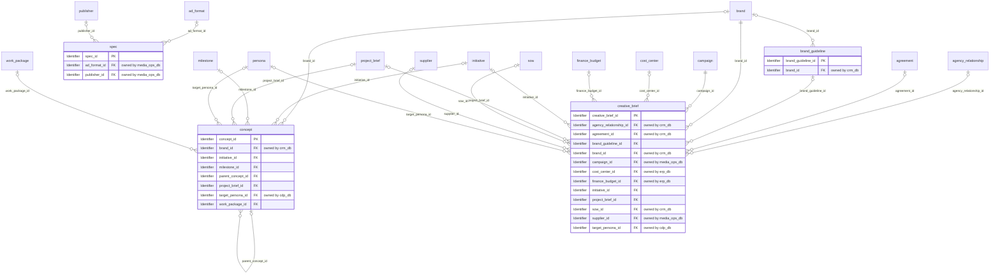

# Logical model: work_mgmt_db

Generated by advgen from the pinned Advertising MVM; do not edit by hand. Regenerate with `uv run advgen build`.

**Source system role:** Adobe Workfront + DAM. Agency projects, work breakdown, tasks, time entries, and the creative production lifecycle from brief to approved asset.

The logical model is technology-neutral: entities, business attributes with logical domains, optionality, keys and every business relationship, **including relationships to entities owned by other systems** (marked *owned by …*). How each relationship is physically implemented (enforced FK vs soft reference) is decided in the physical model.

## Contents

- [creative.brief_strategy](#creativebrief_strategy)
- [creative.production_delivery](#creativeproduction_delivery)
- [project.delivery_execution](#projectdelivery_execution)
- [project.project_planning](#projectproject_planning)
- [Code sets](#code-sets)
- [Normalization notes](#normalization-notes)

## creative.brief_strategy

| Entity | Kind | Definition |
|---|---|---|
| [brand_guideline](#brand_guideline) | reference | Reference master for client brand guidelines governing creative production — including approved color palettes (hex, Pantone, CMYK, RGB), typography (typefaces, weights, sizes), logo usage rules, imagery style, tone of… |
| [concept](#concept) | master | Represents a creative concept or big idea developed in response to a creative brief. |
| [creative_brief](#creative_brief) | master | Master record for the creative brief — the foundational document that initiates creative development. |
| [spec](#spec) | reference | Reference entity defining the technical and creative specifications for a deliverable format — including ad unit dimensions, file format, max file size, safe zones, bleed, color mode, frame rate, bit rate, audio specs,… |

### brand_guideline

Reference master for client brand guidelines governing creative production — including approved color palettes (hex, Pantone, CMYK, RGB), typography (typefaces, weights, sizes), logo usage rules, imagery style, tone of voice, do/don't examples, and brand compliance thresholds. Serves as the SSOT for brand compliance validation during creative review and production QA. Scope boundary: this entity owns the operational production ruleset (visual specs, typography rules, logo placement constraints) used by creative teams in day-to-day asset production. It does NOT own brand strategy, positioning, architecture, or competitive intelligence — those belong to the brand domain. Sourced from client brand portals and maintained by the creative services team.

**Primary identifier:** `brand_guideline_id`

| Attribute | Business name | Domain | Opt. | Key | Definition |
|---|---|---|---|---|---|
| `brand_guideline_id` | Creative Brand Guideline Identifier (ID) | Identifier | M | PK | Unique identifier for the creative brand guideline record. |
| `brand_id` | Client Brand Identifier (ID) | Identifier → brand (crm_db) | O | FK | Reference to the client brand that this guideline governs. |
| `approval_authority` | Approval Authority | Text | O |  | The person or role with authority to approve changes to this brand guideline (e.g., 'Chief Brand Officer', 'Client CMO'). |
| `compliance_threshold_score` | Compliance Threshold Score | Rate | O |  | Minimum compliance score (0-100) required for creative assets to pass brand compliance validation during review and production QA. |
| `compliance_validation_enabled` | Compliance Validation Enabled | Indicator | M |  | Flag indicating whether automated brand compliance validation is enabled for creative assets produced under this guideline. |
| `digital_asset_management_url` | Digital Asset Management (DAM) URL | URL | O |  | URL or reference to the location of the full brand guideline document in the Digital Asset Management system (e.g., Workfront DAM, Adobe Experience Manager). |
| `do_examples` | Do Examples | Text | O |  | Positive examples demonstrating correct application of brand guidelines. |
| `dont_examples` | Don't Examples | Text | O |  | Negative examples showing incorrect or prohibited uses of brand elements. |
| `effective_date` | Effective Date | Date | M |  | The date from which this brand guideline becomes active and enforceable for creative production. |
| `expiration_date` | Expiration Date | Date | O |  | The date on which this brand guideline is no longer valid or has been superseded. |
| `format_specifications` | Format Specifications | Text | O |  | Technical specifications for creative asset formats including file types, dimensions, resolution, color space, and compression standards for different channels (digital, print, OO… |
| `guideline_description` | Guideline Description | Text | O |  | Detailed description of the scope, purpose, and coverage of this brand guideline document. |
| `guideline_status` | Guideline Status | Code | M |  | Current lifecycle status of the brand guideline. |
| `guideline_version` | Guideline Version | Text | M |  | Version identifier for this brand guideline (e.g., 'v3.2', '2024.1'). |
| `imagery_style_guidelines` | Imagery Style Guidelines | Text | O |  | Guidelines governing photography and imagery style including subject matter, composition, lighting, color treatment, and mood. |
| `last_reviewed_date` | Last Reviewed Date | Date | O |  | The date when this brand guideline was last reviewed for accuracy and relevance. |
| `logo_clear_space_minimum` | Logo Clear Space Minimum | Text | O |  | Minimum clear space required around the logo, typically expressed as a multiple of a logo element (e.g., '2x height of logo mark'). |
| `logo_minimum_size` | Logo Minimum Size | Text | O |  | Minimum allowable size for logo reproduction across different media (print, digital, OOH), ensuring legibility and brand integrity. |
| `logo_usage_rules` | Logo Usage Rules | Text | O |  | Comprehensive rules for logo placement, sizing, clear space, minimum size, color variations, and prohibited uses. |
| `messaging_guidelines` | Messaging Guidelines | Text | O |  | Key messaging pillars, brand promises, value propositions, and approved language for brand communications. |
| `next_review_date` | Next Review Date | Date | O |  | The scheduled date for the next review of this brand guideline to ensure it remains current and aligned with brand strategy. |
| `primary_color_palette` | Primary Color Palette | Text | O |  | Approved primary brand colors in multiple formats (hex, Pantone, CMYK, RGB). |
| `primary_typeface` | Primary Typeface | Text | O |  | The primary approved typeface or font family for brand communications (e.g., 'Helvetica Neue', 'Gotham'). |
| `source_system` | Source System | Text | O |  | The system or platform from which this brand guideline was sourced (e.g., 'Client Brand Portal', 'Workfront DAM', 'Adobe Creative Cloud'). |
| `tone_of_voice` | Tone of Voice | Text | O |  | Defined brand voice and tone characteristics for written communications (e.g., 'friendly and approachable', 'authoritative and professional'). |
| `typography_rules` | Typography Rules | Text | O |  | Detailed rules governing typography usage including font weights, sizes, line spacing, letter spacing, and hierarchy. |
| `created_at` | Created Timestamp | Timestamp | M |  | Timestamp when the row was inserted. |
| `created_by` | Created By | Text | M |  | Application user (session setting app.actor) or database role that inserted the row. |
| `updated_at` | Modified Timestamp | Timestamp | M |  | Timestamp of the last update. |
| `updated_by` | Updated By | Text | M |  | Application user or database role that last updated the row. |

### concept

Represents a creative concept or big idea developed in response to a creative brief. Captures concept title, creative territory, strategic rationale, mood board references, headline, tagline, visual direction, and approval status. A single brief may spawn multiple competing concepts; this entity tracks each concept through internal review and client presentation stages. Integrates with Workfront creative project milestones.

**Primary identifier:** `concept_id`. **Business key(s):** `concept_code`

| Attribute | Business name | Domain | Opt. | Key | Definition |
|---|---|---|---|---|---|
| `concept_id` | Concept ID | Identifier | M | PK | Unique identifier for the creative concept. |
| `brand_id` | Client Brand Id (Foreign Key) | Identifier → brand (crm_db) | O | FK | Foreign key linking to client.brand. |
| `initiative_id` | Initiative Id (Foreign Key) | Identifier → initiative | O | FK | Foreign key linking to project.initiative. |
| `milestone_id` | Project Milestone Id (Foreign Key) | Identifier → milestone | O | FK | Foreign key linking to project.milestone. |
| `parent_concept_id` | Parent Concept ID | Identifier → concept | O | FK | Reference to the parent concept if this is a revision or variation. |
| `project_brief_id` | Project Brief Id (Foreign Key) | Identifier → project_brief | O | FK | Foreign key linking to project.project_brief. |
| `target_persona_id` | Target Persona Id (Foreign Key) | Identifier → persona (cdp_db) | O | FK | Foreign key linking to audience.persona. |
| `work_package_id` | Work Package Id (Foreign Key) | Identifier → work_package | O | FK | Foreign key linking to project.work_package. |
| `approval_date` | Approval Date | Date | O |  | The date when the concept received final approval to proceed to production. |
| `approval_status` | Approval Status | Code (approval_status) | O |  | Specific approval state indicating whether the concept has been approved by internal stakeholders and/or client. |
| `brand_compliance_flag` | Brand Compliance Flag | Indicator | M |  | Indicates whether the concept has been reviewed and confirmed to comply with brand guidelines and standards. |
| `channel_applicability` | Channel Applicability | Text | O |  | Description of which media channels and platforms this concept is designed for or can be adapted to (e.g., TV, digital, OOH, social, print). |
| `competitive_differentiation` | Competitive Differentiation | Text | O |  | Description of how this concept differentiates the brand from competitors. |
| `concept_code` | Concept Code | Business Code | M | UK | Unique business identifier or code assigned to the concept for tracking and reference across systems. |
| `concept_description` | Concept Description | Text | O |  | Detailed narrative description of the creative concept. |
| `concept_status` | Concept Status | Code (concept_status) | M |  | Current lifecycle status of the concept. |
| `creative_territory` | Creative Territory | Text | O |  | The overarching creative theme, space, or territory that this concept occupies. |
| `estimated_production_cost` | Estimated Production Cost | Amount | O |  | Estimated cost to produce and execute this concept if approved. |
| `headline` | Concept Headline | Text | O |  | The primary headline or main message of the concept. |
| `key_message` | Key Message | Text | O |  | The core message or takeaway that the concept aims to communicate to the target audience. |
| `legal_review_required` | Legal Review Required Flag | Indicator | M |  | Indicates whether this concept requires legal review before approval. |
| `legal_review_status` | Legal Review Status | Code | O |  | Status of legal review process for this concept. |
| `mood_board_reference` | Mood Board Reference | Business Code | O |  | Reference to mood board assets or inspiration materials that illustrate the visual and emotional tone of the concept. |
| `presentation_date` | Presentation Date | Date | O |  | The date when this concept was or will be presented to the client or internal stakeholders for review and feedback. |
| `production_complexity` | Production Complexity | Code | O |  | Assessment of the production complexity and resource requirements for this concept. |
| `rejection_reason` | Rejection Reason | Text | O |  | Explanation or feedback provided when a concept is rejected. |
| `strategic_rationale` | Strategic Rationale | Text | O |  | The strategic reasoning and business justification for this concept. |
| `tagline` | Concept Tagline | Text | O |  | The tagline or supporting message that reinforces the concept. |
| `target_audience` | Target Audience | Text | O |  | Description of the primary target audience this concept is designed to reach and resonate with. |
| `testing_recommendation` | Testing Recommendation | Text | O |  | Recommendation for whether and how this concept should be tested with target audiences before full production (e.g., focus groups, A/B testing, concept testing). |
| `title` | Concept Title | Name | M |  | The working title or name of the creative concept. |
| `tone_of_voice` | Tone of Voice | Text | O |  | The communication style and personality of the concept. |
| `version` | Concept Version | Quantity | O |  | Version number of this concept iteration. |
| `visual_direction` | Visual Direction | Text | O |  | Description of the visual style, aesthetic, and design direction for the concept. |
| `created_at` | Created Timestamp | Timestamp | M |  | Timestamp when the row was inserted. |
| `created_by` | Created By | Text | M |  | Application user (session setting app.actor) or database role that inserted the row. |
| `updated_at` | Modified Timestamp | Timestamp | M |  | Timestamp of the last update. |
| `updated_by` | Updated By | Text | M |  | Application user or database role that last updated the row. |

### creative_brief

Master record for the creative brief — the foundational document that initiates creative development. Captures client objectives, target audience, key messaging, tone of voice, deliverable formats, mandatories, budget envelope, and approval chain. Serves as the SSOT for all creative work initiated within a campaign or project. Originates from Workfront project intake and links to campaign strategy.

**Primary identifier:** `creative_brief_id`. **Business key(s):** `brief_number`

| Attribute | Business name | Domain | Opt. | Key | Definition |
|---|---|---|---|---|---|
| `creative_brief_id` | Creative Brief ID | Identifier | M | PK | Unique identifier for the creative brief record. |
| `agency_relationship_id` | Agency Relationship Id (Foreign Key) | Identifier → agency_relationship (crm_db) | O | FK | Foreign key linking to client.agency_relationship. |
| `agreement_id` | Agreement Id (Foreign Key) | Identifier → agreement (crm_db) | O | FK | Foreign key linking to contract.agreement. |
| `brand_guideline_id` | Brand Guideline Id (Foreign Key) | Identifier → brand_guideline | O | FK | Foreign key linking to creative.brand_guideline. |
| `brand_id` | Client Brand ID | Identifier → brand (crm_db) | M | FK | Reference to the specific client brand for which this creative is being developed. |
| `campaign_id` | Campaign ID | Identifier → campaign (media_ops_db) | M | FK | Reference to the parent campaign that this creative brief supports. |
| `cost_center_id` | Cost Center Id (Foreign Key) | Identifier → cost_center (erp_db) | O | FK | Foreign key linking to finance.cost_center. |
| `finance_budget_id` | Budget Id (Foreign Key) | Identifier → finance_budget (erp_db) | O | FK | Foreign key linking to finance.finance_budget. |
| `initiative_id` | Project ID | Identifier → initiative | O | FK | Reference to the Workfront project that initiated this creative brief. |
| `project_brief_id` | Project Brief Id (Foreign Key) | Identifier → project_brief | O | FK | Foreign key linking to project.project_brief. |
| `sow_id` | Sow Id (Foreign Key) | Identifier → sow (crm_db) | O | FK | Foreign key linking to contract.sow. |
| `supplier_id` | Supplier Id (Foreign Key) | Identifier → supplier (media_ops_db) | O | FK | Foreign key linking to vendor.supplier. |
| `target_persona_id` | Target Persona Id (Foreign Key) | Identifier → persona (cdp_db) | O | FK | Foreign key linking to audience.persona. |
| `approved_by_name` | Approved By Name | Name | O |  | Name of the individual who provided final approval for the creative brief. |
| `approved_date` | Brief Approved Date | Date | O |  | Date when the creative brief received final approval and was authorized to proceed to production. |
| `art_director_assigned` | Art Director Assigned | Text | O |  | Name of the art director assigned to develop visual concepts and design for this creative brief. |
| `brief_name` | Creative Brief Name | Name | M |  | Descriptive name or title of the creative brief, typically reflecting the campaign or project name. |
| `brief_number` | Creative Brief Number | Business Code | M | UK | Human-readable business identifier for the creative brief, typically following format CB-NNNNNN. |
| `brief_type` | Creative Brief Type | Code | O |  | Classification of the creative brief based on its strategic purpose and scope. |
| `business_objective` | Business Objective | Text | O |  | High-level business goal that this creative work is intended to achieve, such as brand awareness, lead generation, or product launch support. |
| `call_to_action` | Call to Action (CTA) | Text | O |  | Desired audience action or response that the creative should drive, such as visit website, call now, or download app. |
| `channel_distribution` | Channel Distribution | Text | O |  | Media channels and platforms where the creative assets will be deployed, such as television, digital display, social media, OOH (Out-of-Home), or print. |
| `competitive_context` | Competitive Context | Text | O |  | Analysis of competitive landscape and positioning considerations that should inform the creative approach. |
| `copywriter_assigned` | Copywriter Assigned | Text | O |  | Name of the copywriter assigned to develop written content for this creative brief. |
| `creative_brief_status` | Creative Brief Status | Code | M |  | Current lifecycle status of the creative brief in the approval and production workflow. |
| `creative_director_assigned` | Creative Director Assigned | Text | O |  | Name of the creative director assigned to oversee and approve the creative development for this brief. |
| `deliverable_formats` | Deliverable Formats | Text | O |  | List of required creative asset formats and specifications, such as video lengths, display ad dimensions, print sizes, or social media formats. |
| `due_date` | Creative Brief Due Date | Date | O |  | Target date by which the creative assets must be completed and delivered, driving production scheduling and resource allocation. |
| `key_message` | Key Message | Text | O |  | Primary message or value proposition that the creative must communicate to the target audience. |
| `legal_regulatory_requirements` | Legal and Regulatory Requirements | Text | O |  | Specific legal disclaimers, regulatory compliance requirements, or industry standards that must be adhered to in the creative execution. |
| `mandatories` | Mandatories | Text | O |  | Required elements that must be included in the creative execution, such as logos, legal disclaimers, regulatory statements, or specific product features. |
| `notes` | Creative Brief Notes | Text | O |  | Additional notes, comments, or context that provide supplementary information for the creative team. |
| `priority` | Creative Brief Priority | Code | O |  | Business priority level assigned to this creative brief, influencing resource allocation and scheduling. |
| `submitted_date` | Brief Submitted Date | Date | O |  | Date when the creative brief was formally submitted for review and approval. |
| `success_metrics` | Success Metrics | Text | O |  | Key Performance Indicators (KPI) and measurement criteria that will be used to evaluate the effectiveness of the creative execution. |
| `supporting_messages` | Supporting Messages | Text | O |  | Secondary messages or proof points that reinforce the key message and provide additional context. |
| `target_audience_description` | Target Audience Description | Text | O |  | Detailed description of the intended audience for the creative, including demographic, psychographic, and behavioral characteristics. |
| `tone_of_voice` | Tone of Voice | Text | O |  | Desired communication style and personality for the creative execution, such as professional, playful, authoritative, or empathetic. |
| `version_number` | Creative Brief Version Number | Quantity | O |  | Version number of the creative brief, incremented with each revision or update to track changes over time. |
| `created_at` | Record Created Timestamp | Timestamp | M |  | Timestamp when the row was inserted. |
| `created_by` | Created By | Text | M |  | Application user (session setting app.actor) or database role that inserted the row. |
| `updated_at` | Record Modified Timestamp | Timestamp | M |  | Timestamp of the last update. |
| `updated_by` | Updated By | Text | M |  | Application user or database role that last updated the row. |

### spec

Reference entity defining the technical and creative specifications for a deliverable format — including ad unit dimensions, file format, max file size, safe zones, bleed, color mode, frame rate, bit rate, audio specs, and platform-specific requirements (IAB standard units, Google CM360 specs, Meta ad specs, OOH print specs). Versioned to track spec changes as platforms update requirements (e.g., Meta quarterly spec updates, IAB new format releases). Acts as the specification template against which assets are validated for format compliance before trafficking. Maintained by the creative technology team with platform update monitoring.

**Primary identifier:** `spec_id`. **Business key(s):** `spec_code`

| Attribute | Business name | Domain | Opt. | Key | Definition |
|---|---|---|---|---|---|
| `spec_id` | Creative Specification ID | Identifier | M | PK | Unique identifier for the creative specification record. |
| `ad_format_id` | Ad Format Id (Foreign Key) | Identifier → ad_format (media_ops_db) | O | FK | Foreign key linking to media.ad_format. |
| `publisher_id` | Publisher Id (Foreign Key) | Identifier → publisher (media_ops_db) | O | FK | Foreign key linking to vendor.publisher. |
| `ad_unit_type` | Ad Unit Type | Text | O |  | The type of ad unit (e.g., Banner, Interstitial, Video, Native, Story, Carousel, Sponsored Post, Billboard, Transit Shelter). |
| `animation_loop_allowed` | Animation Loop Allowed | Indicator | M |  | Indicates whether animated creatives (GIF, HTML5) are allowed to loop continuously (True) or must play once (False). |
| `aspect_ratio` | Aspect Ratio | Text | O |  | The aspect ratio of the creative (e.g., 16:9, 9:16, 1:1, 4:5). |
| `audio_channels` | Audio Channels | Code | O |  | The required audio channel configuration (mono, stereo, surround). |
| `audio_codec` | Audio Codec | Text | O |  | The required audio codec for video or audio creatives (e.g., AAC, MP3, Vorbis). |
| `audio_sample_rate_hz` | Audio Sample Rate in Hertz (Hz) | Quantity | O |  | The required audio sample rate in Hertz (e.g., 44100, 48000). |
| `bit_rate_kbps` | Bit Rate in Kilobits Per Second (Kbps) | Quantity | O |  | The required or recommended bit rate for video or audio creatives in kilobits per second (Kbps). |
| `bleed_pixels` | Bleed in Pixels | Quantity | O |  | The bleed area in pixels extending beyond the trim edge for print creatives to ensure no white edges after cutting. |
| `brand_safety_level` | Brand Safety Level | Code | O |  | The brand safety level required for creatives using this specification (standard, moderate, strict). |
| `clickable_required` | Clickable Required | Indicator | M |  | Indicates whether the creative must include a clickable call-to-action or link (True) or can be non-interactive (False). |
| `color_mode` | Color Mode | Code | O |  | The required color mode for the creative (RGB for digital, CMYK for print, Grayscale, Pantone for brand-specific print). |
| `color_profile` | Color Profile | Text | O |  | The ICC color profile required for the creative (e.g., sRGB, Adobe RGB, CMYK US Web Coated SWOP v2). |
| `compliance_tags` | Compliance Tags | Text | O |  | Comma-separated list of compliance or regulatory tags applicable to this specification (e.g., 'GDPR', 'COPPA', 'Alcohol Restricted', 'Pharma Compliant'). |
| `effective_date` | Effective Date | Date | O |  | The date from which this specification version becomes effective and should be used for new creative production. |
| `expiration_date` | Expiration Date | Date | O |  | The date after which this specification version is no longer valid and should not be used for new creative production. |
| `file_format` | File Format | Code (file_format) | O |  | The required file format for the creative asset (e.g., JPG, PNG, GIF, MP4, MOV, WEBM, MP3, WAV, HTML5, PDF, EPS, AI, PSD). |
| `format_category` | Format Category | Code (format_category) | O |  | High-level category of the creative format (static image, animated image, video, audio, HTML5, rich media, native, interactive, print, physical). |
| `frame_rate_fps` | Frame Rate in Frames Per Second (FPS) | Quantity | O |  | The required or recommended frame rate for video creatives in frames per second (e.g., 24, 30, 60). |
| `height_pixels` | Height in Pixels | Quantity | O |  | The height dimension of the ad unit in pixels. |
| `iab_standard_unit` | Interactive Advertising Bureau (IAB) Standard Unit | Text | O |  | The IAB standard ad unit designation if this specification conforms to an IAB standard (e.g., 'Medium Rectangle', 'Leaderboard', 'Skyscraper'). |
| `max_animation_loops` | Maximum Animation Loops | Quantity | O |  | The maximum number of times an animated creative is allowed to loop. |
| `max_duration_seconds` | Maximum Duration in Seconds | Rate | O |  | The maximum duration for video or audio creatives in seconds. |
| `max_file_size_kb` | Maximum File Size in Kilobytes (KB) | Quantity | O |  | The maximum allowed file size for the creative asset in kilobytes (KB). |
| `min_duration_seconds` | Minimum Duration in Seconds | Rate | O |  | The minimum duration for video or audio creatives in seconds. |
| `notes` | Specification Notes | Text | O |  | Additional notes, guidelines, or special instructions for creative teams regarding this specification (e.g., platform-specific quirks, best practices, known issues). |
| `platform` | Platform | Code (platform) | O |  | The advertising platform or channel for which this specification applies (e.g., Google CM360, Meta, TikTok, LinkedIn, OOH Print, DOOH Digital, CTV, OTT). |
| `platform_spec_version` | Platform Specification Version | Text | O |  | The version of the platform-specific specification this record is based on (e.g., 'Meta Q1 2024', 'Google CM360 v3.2'). |
| `resolution_dpi` | Resolution in Dots Per Inch (DPI) | Quantity | O |  | The required resolution for print or high-resolution digital creatives in dots per inch (DPI). |
| `safe_zone_pixels` | Safe Zone in Pixels | Quantity | O |  | The safe zone margin in pixels where critical content (text, logos) must remain to avoid being cut off during display or printing. |
| `spec_code` | Specification Code | Business Code | M | UK | Unique business identifier code for the specification, used for system integration and asset validation workflows. |
| `spec_name` | Specification Name | Name | M |  | Human-readable name for the creative specification (e.g., 'Facebook Feed Image Standard', 'Google Display 300x250', 'Instagram Story Video'). |
| `spec_status` | Specification Status | Code | M |  | Current lifecycle status of the creative specification (active, deprecated, draft, archived, pending approval, retired). |
| `transparency_allowed` | Transparency Allowed | Indicator | M |  | Indicates whether the creative format supports transparency (alpha channel) in images (True) or requires opaque backgrounds (False). |
| `video_codec` | Video Codec | Text | O |  | The required video codec for video creatives (e.g., H.264, H.265, VP9). |
| `width_pixels` | Width in Pixels | Quantity | O |  | The width dimension of the ad unit in pixels. |
| `created_at` | Created Timestamp | Timestamp | M |  | Timestamp when the row was inserted. |
| `created_by` | Created By | Text | M |  | Application user (session setting app.actor) or database role that inserted the row. |
| `updated_at` | Modified Timestamp | Timestamp | M |  | Timestamp of the last update. |
| `updated_by` | Updated By | Text | M |  | Application user or database role that last updated the row. |

## creative.production_delivery

| Entity | Kind | Definition |
|---|---|---|
| [asset](#asset) | master | Core master entity representing a single creative asset in the Digital Asset Management system — including images, videos, audio files, copy documents, design files (PSD, AI, INDD), motion graphics, HTML5 rich media, an… |
| [asset_version](#asset_version) | transactional | Tracks the full version history of a creative asset — capturing each iteration produced during the creative development lifecycle. |
| [creative_deliverable](#creative_deliverable) | master | Represents a specific creative deliverable committed to a client or campaign — a named output (e.g., '30s TV spot :30', 'MPU 300x250 HTML5 banner', 'Full-page print ad') with defined format, channel, quantity, and deliv… |
| [production_job](#production_job) | transactional | Operational record representing a discrete creative production job — the unit of work assigned to an internal studio team, freelancer, or external production vendor to produce one or more creative deliverables. |
| [proof](#proof) | transactional | Captures each formal proofing round submitted for client or internal review via Workfront Proofing. |

```mermaid
erDiagram
    asset {
        Identifier asset_id PK
        Identifier advertiser_id FK "owned by crm_db"
        Identifier brand_id FK "owned by crm_db"
        Identifier creative_brief_id FK
        Identifier initiative_id FK
        Identifier parent_asset_creative_asset_id FK
        Identifier persona_id FK "owned by cdp_db"
        Identifier production_job_id FK
        Identifier segment_id FK "owned by cdp_db"
        Identifier spec_id FK
        Identifier supplier_id FK "owned by media_ops_db"
        Identifier task_id FK
        Identifier work_package_id FK
    }
    asset_version {
        Identifier asset_version_id PK
        Identifier asset_id FK
        Identifier creative_deliverable_id FK
        Identifier deliverable_tracker_id FK
        Identifier production_job_id FK
        Identifier spec_id FK
        Identifier task_id FK
    }
    creative_deliverable {
        Identifier creative_deliverable_id PK
        Identifier ad_format_id FK "owned by media_ops_db"
        Identifier advertiser_id FK "owned by crm_db"
        Identifier asset_id FK
        Identifier brand_id FK "owned by crm_db"
        Identifier campaign_id FK "owned by media_ops_db"
        Identifier contract_deliverable_id FK "owned by crm_db"
        Identifier contract_insertion_order_id FK "owned by crm_db"
        Identifier cost_center_id FK "owned by erp_db"
        Identifier creative_brief_id FK
        Identifier deliverable_tracker_id FK
        Identifier initiative_id FK
        Identifier media_placement_id FK "owned by media_ops_db"
        Identifier milestone_id FK
        Identifier persona_id FK "owned by cdp_db"
        Identifier plan_id FK "owned by media_ops_db"
        Identifier production_job_id FK
        Identifier project_budget_id FK
        Identifier rate_card_line_id FK "owned by crm_db"
        Identifier segment_id FK "owned by cdp_db"
        Identifier sla_id FK "owned by crm_db"
        Identifier sow_id FK "owned by crm_db"
        Identifier spec_id FK
        Identifier supplier_id FK "owned by media_ops_db"
        Identifier task_id FK
        Identifier work_package_id FK
    }
    production_job {
        Identifier production_job_id PK
        Identifier brand_id FK "owned by crm_db"
        Identifier campaign_id FK "owned by media_ops_db"
        Identifier concept_id FK
        Identifier cost_center_id FK "owned by erp_db"
        Identifier creative_brief_id FK
        Identifier delivery_project_milestone_id FK
        Identifier gl_account_id FK "owned by erp_db"
        Identifier plan_id FK "owned by media_ops_db"
        Identifier primary_production_initiative_id FK
        Identifier project_budget_id FK
        Identifier sla_id FK "owned by crm_db"
        Identifier sow_id FK "owned by crm_db"
        Identifier supplier_id FK "owned by media_ops_db"
        Identifier task_id FK
        Identifier vendor_rate_card_id FK "owned by media_ops_db"
        Identifier work_package_id FK
    }
    proof {
        Identifier proof_id PK
        Identifier asset_version_id FK
        Identifier campaign_id FK "owned by media_ops_db"
        Identifier creative_deliverable_id FK
        Identifier deliverable_tracker_id FK
        Identifier initiative_id FK
        Identifier milestone_id FK
        Identifier production_job_id FK
        Identifier sla_id FK "owned by crm_db"
        Identifier supplier_id FK "owned by media_ops_db"
        Identifier task_id FK
        Identifier work_package_id FK
    }
    advertiser |o--o{ asset : "advertiser_id"
    brand |o--o{ asset : "brand_id"
    creative_brief |o--o{ asset : "creative_brief_id"
    initiative |o--o{ asset : "initiative_id"
    asset |o--o{ asset : "parent_asset_creative_asset_id"
    persona |o--o{ asset : "persona_id"
    production_job |o--o{ asset : "production_job_id"
    segment |o--o{ asset : "segment_id"
    spec |o--o{ asset : "spec_id"
    supplier |o--o{ asset : "supplier_id"
    task |o--o{ asset : "task_id"
    work_package |o--o{ asset : "work_package_id"
    asset ||--o{ asset_version : "asset_id"
    creative_deliverable |o--o{ asset_version : "creative_deliverable_id"
    deliverable_tracker |o--o{ asset_version : "deliverable_tracker_id"
    production_job |o--o{ asset_version : "production_job_id"
    spec |o--o{ asset_version : "spec_id"
    task |o--o{ asset_version : "task_id"
    ad_format |o--o{ creative_deliverable : "ad_format_id"
    advertiser |o--o{ creative_deliverable : "advertiser_id"
    asset |o--o{ creative_deliverable : "asset_id"
    brand |o--o{ creative_deliverable : "brand_id"
    campaign |o--o{ creative_deliverable : "campaign_id"
    contract_deliverable |o--o{ creative_deliverable : "contract_deliverable_id"
    contract_insertion_order |o--o{ creative_deliverable : "contract_insertion_order_id"
    cost_center |o--o{ creative_deliverable : "cost_center_id"
    creative_brief |o--o{ creative_deliverable : "creative_brief_id"
    deliverable_tracker |o--o{ creative_deliverable : "deliverable_tracker_id"
    initiative |o--o{ creative_deliverable : "initiative_id"
    media_placement |o--o{ creative_deliverable : "media_placement_id"
    milestone |o--o{ creative_deliverable : "milestone_id"
    persona |o--o{ creative_deliverable : "persona_id"
    plan |o--o{ creative_deliverable : "plan_id"
    production_job |o--o{ creative_deliverable : "production_job_id"
    project_budget |o--o{ creative_deliverable : "project_budget_id"
    rate_card_line |o--o{ creative_deliverable : "rate_card_line_id"
    segment |o--o{ creative_deliverable : "segment_id"
    sla |o--o{ creative_deliverable : "sla_id"
    sow |o--o{ creative_deliverable : "sow_id"
    spec |o--o{ creative_deliverable : "spec_id"
    supplier |o--o{ creative_deliverable : "supplier_id"
    task |o--o{ creative_deliverable : "task_id"
    work_package |o--o{ creative_deliverable : "work_package_id"
    brand |o--o{ production_job : "brand_id"
    campaign |o--o{ production_job : "campaign_id"
    concept |o--o{ production_job : "concept_id"
    cost_center |o--o{ production_job : "cost_center_id"
    creative_brief |o--o{ production_job : "creative_brief_id"
    milestone |o--o{ production_job : "delivery_project_milestone_id"
    gl_account |o--o{ production_job : "gl_account_id"
    plan |o--o{ production_job : "plan_id"
    initiative |o--o{ production_job : "primary_production_initiative_id"
    project_budget |o--o{ production_job : "project_budget_id"
    sla |o--o{ production_job : "sla_id"
    sow |o--o{ production_job : "sow_id"
    supplier |o--o{ production_job : "supplier_id"
    task |o--o{ production_job : "task_id"
    vendor_rate_card |o--o{ production_job : "vendor_rate_card_id"
    work_package |o--o{ production_job : "work_package_id"
    asset_version ||--o{ proof : "asset_version_id"
    campaign |o--o{ proof : "campaign_id"
    creative_deliverable |o--o{ proof : "creative_deliverable_id"
    deliverable_tracker |o--o{ proof : "deliverable_tracker_id"
    initiative |o--o{ proof : "initiative_id"
    milestone |o--o{ proof : "milestone_id"
    production_job |o--o{ proof : "production_job_id"
    sla |o--o{ proof : "sla_id"
    supplier |o--o{ proof : "supplier_id"
    task |o--o{ proof : "task_id"
    work_package |o--o{ proof : "work_package_id"
```

### asset

Core master entity representing a single creative asset in the Digital Asset Management system — including images, videos, audio files, copy documents, design files (PSD, AI, INDD), motion graphics, HTML5 rich media, and 3D/AR assets. Tracks asset type, format, file size, resolution, duration, codec, color profile, aspect ratio, DAM asset ID (Workfront DAM/Adobe AEM), version lineage, brand compliance status, rights clearance status, lifecycle stage (WIP, in-review, approved, archived, expired), expiry date, and descriptive metadata tags (subject, mood, channel, campaign theme). This is the SSOT for all creative asset metadata and taxonomy across the agency, supporting search, retrieval, reuse discovery, and rights monitoring.

**Primary identifier:** `asset_id`. **Business key(s):** `dam_asset_ref`

| Attribute | Business name | Domain | Opt. | Key | Definition |
|---|---|---|---|---|---|
| `asset_id` | Creative Asset ID | Identifier | M | PK | Unique identifier for the creative asset in the Digital Asset Management (DAM) system. |
| `advertiser_id` | Advertiser Id | Identifier → advertiser (crm_db) | O | FK | FK to client.advertiser.advertiser_id — MUST-HAVE: Cannot determine asset ownership. |
| `brand_id` | Client Brand ID | Identifier → brand (crm_db) | O | FK | Reference to the client brand that owns or is represented by this asset. |
| `creative_brief_id` | Creative Brief Id (Foreign Key) | Identifier → creative_brief | O | FK | Foreign key linking to creative.creative_brief. |
| `initiative_id` | Initiative Id (Foreign Key) | Identifier → initiative | O | FK | Foreign key linking to project.initiative. |
| `parent_asset_creative_asset_id` | Parent Asset ID | Identifier → asset | O | FK | Reference to the parent or original asset from which this version was derived. |
| `persona_id` | Persona Id (Foreign Key) | Identifier → persona (cdp_db) | O | FK | Foreign key linking to audience.persona. |
| `production_job_id` | Production Job Id (Foreign Key) | Identifier → production_job | O | FK | Foreign key linking to creative.production_job. |
| `segment_id` | Target Segment Id (Foreign Key) | Identifier → segment (cdp_db) | O | FK | Foreign key linking to audience.segment. |
| `spec_id` | Creative Spec Id (Foreign Key) | Identifier → spec | O | FK | Foreign key linking to creative.spec. |
| `supplier_id` | Supplier Id (Foreign Key) | Identifier → supplier (media_ops_db) | O | FK | Foreign key linking to vendor.supplier. |
| `task_id` | Task Id (Foreign Key) | Identifier → task | O | FK | Foreign key linking to project.task. |
| `work_package_id` | Work Package Id (Foreign Key) | Identifier → work_package | O | FK | Foreign key linking to project.work_package. |
| `approved_timestamp` | Approved Timestamp | Timestamp | O |  | Date and time when the asset was approved for use. |
| `archived_timestamp` | Archived Timestamp | Timestamp | O |  | Date and time when the asset was archived or retired from active use. |
| `aspect_ratio` | Aspect Ratio | Text | O |  | Proportional relationship between width and height (e.g., 16:9, 4:3, 1:1, 9:16). |
| `asset_name` | Asset Name | Name | M |  | Human-readable name or title of the creative asset. |
| `asset_type` | Asset Type | Code (asset_type) | M |  | High-level classification of the creative asset format. |
| `brand_compliance_status` | Brand Compliance Status | Code | O |  | Indicates whether the asset adheres to brand guidelines and standards. |
| `campaign_theme` | Campaign Theme | Text | O |  | Overarching creative theme or concept associated with the asset (e.g., Summer Sale, Back to School, Holiday 2024). |
| `channel_suitability` | Channel Suitability | Text | O |  | Comma-separated list of media channels for which this asset is optimized or approved (e.g., TV, Digital, OOH, Social, CTV). |
| `codec` | Codec | Text | O |  | Video or audio codec used for encoding (e.g., H.264, H.265, AAC, MP3). |
| `color_profile` | Color Profile | Text | O |  | Color space or profile used in the asset (e.g., sRGB, Adobe RGB, CMYK). |
| `copyright_holder` | Copyright Holder | Text | O |  | Name of the individual or organization that holds copyright to the asset. |
| `creative_asset_description` | Asset Description | Text | O |  | Free-text description of the asset content, purpose, and usage notes. |
| `dam_asset_ref` | Digital Asset Management (DAM) Asset ID | Business Code | M | UK | External unique identifier from the source DAM system (Workfront DAM or Adobe AEM). |
| `duration_seconds` | Duration (Seconds) | Rate | O |  | Length of the asset in seconds. |
| `file_format` | File Format | Text | O |  | Specific file format or extension of the asset (e.g., PSD, AI, INDD, MP4, PNG, JPG, HTML5). |
| `file_size_bytes` | File Size (Bytes) | Quantity | O |  | Size of the asset file in bytes. |
| `file_storage_path` | File Storage Path | Text | O |  | Full path or URI to the asset file in the storage system (cloud storage, DAM repository, CDN). |
| `geographic_market` | Geographic Market | Text | O |  | Target geographic market or region for which the asset was created (e.g., USA, GBR, CAN). |
| `is_master_asset` | Is Master Asset | Indicator | M |  | Flag indicating whether this asset is the master or source-of-truth version from which other versions are derived. |
| `language_code` | Language Code | Business Code | O |  | ISO 639-1 two-letter language code indicating the primary language of the asset (e.g., EN, ES, FR). |
| `license_type` | License Type | Text | O |  | Type of license under which the asset is used (e.g., royalty-free, rights-managed, exclusive, non-exclusive). |
| `lifecycle_stage` | Lifecycle Stage | Code | O |  | Current stage in the creative asset lifecycle. |
| `mood_tags` | Mood Tags | Text | O |  | Comma-separated keywords describing the emotional tone or mood of the asset (e.g., energetic, calm, humorous, inspirational). |
| `resolution` | Resolution | Text | O |  | Pixel dimensions or resolution of the asset (e.g., 1920x1080, 300 DPI). |
| `rights_clearance_status` | Rights Clearance Status | Code | O |  | Status of legal rights and usage permissions for the asset (talent, music, stock imagery, etc.). |
| `rights_expiry_date` | Rights Expiry Date | Date | O |  | Date when usage rights for the asset expire. |
| `subject_tags` | Subject Tags | Text | O |  | Comma-separated descriptive keywords describing the subject matter or content of the asset (e.g., product, lifestyle, testimonial). |
| `thumbnail_url` | Thumbnail URL | URL | O |  | URL to a thumbnail or preview image of the asset. |
| `usage_count` | Usage Count | Quantity | O |  | Number of times this asset has been used in campaigns, ads, or other placements. |
| `version_number` | Version Number | Business Code | O |  | Version identifier for the asset (e.g., v1.0, v2.3, final). |
| `created_at` | Created Timestamp | Timestamp | M |  | Timestamp when the row was inserted. |
| `created_by` | Created By | Text | M |  | Application user (session setting app.actor) or database role that inserted the row. |
| `updated_at` | Modified Timestamp | Timestamp | M |  | Timestamp of the last update. |
| `updated_by` | Updated By | Text | M |  | Application user or database role that last updated the row. |

### asset_version

Tracks the full version history of a creative asset — capturing each iteration produced during the creative development lifecycle. Records version number, version label (e.g., v1, v2_client_feedback), file reference, change summary, author, Adobe CC document version ID, Workfront proof version ID, and promotion status (draft, in-review, approved, superseded). Enables rollback, audit, and compliance traceability for all creative deliverables.

**Primary identifier:** `asset_version_id`

| Attribute | Business name | Domain | Opt. | Key | Definition |
|---|---|---|---|---|---|
| `asset_version_id` | Asset Version Identifier (ID) | Identifier | M | PK | Unique identifier for the asset version record. |
| `asset_id` | Asset Identifier (ID) | Identifier → asset | M | FK | Reference to the parent creative asset for which this version was created. |
| `creative_deliverable_id` | Creative Deliverable Id (Foreign Key) | Identifier → creative_deliverable | O | FK | Foreign key linking to creative.creative_deliverable. |
| `deliverable_tracker_id` | Deliverable Tracker Id (Foreign Key) | Identifier → deliverable_tracker | O | FK | Foreign key linking to project.deliverable_tracker. |
| `production_job_id` | Production Job Id (Foreign Key) | Identifier → production_job | O | FK | Foreign key linking to creative.production_job. |
| `spec_id` | Creative Spec Id (Foreign Key) | Identifier → spec | O | FK | Foreign key linking to creative.spec. |
| `task_id` | Task Id (Foreign Key) | Identifier → task | O | FK | Foreign key linking to project.task. |
| `adobe_cc_document_version_ref` | Adobe Creative Cloud (CC) Document Version Identifier (ID) | Business Code | O |  | External version identifier from Adobe Creative Cloud system. |
| `approval_timestamp` | Approval Timestamp | Timestamp | O |  | Date and time when this version received formal approval. |
| `approved_by_name` | Approved By Name | Name | O |  | Name of the individual who approved this version for promotion or final delivery. |
| `archive_timestamp` | Archive Timestamp | Timestamp | O |  | Date and time when this version was archived. |
| `brand_compliance_status` | Brand Compliance Status | Code | O |  | Indicates whether this version adheres to brand guidelines and standards. |
| `change_summary` | Change Summary | Text | O |  | Brief description of changes made in this version compared to the previous iteration. |
| `checksum_hash` | Checksum Hash | Text | O |  | Cryptographic hash (e.g., MD5, SHA-256) of the file for integrity verification and duplicate detection. |
| `color_profile` | Color Profile | Text | O |  | Color space or profile used in this version (e.g., sRGB, Adobe RGB, CMYK). |
| `compliance_check_timestamp` | Compliance Check Timestamp | Timestamp | O |  | Date and time when brand compliance review was last performed on this version. |
| `duration_seconds` | Duration in Seconds | Rate | O |  | Duration of video or audio creative in seconds. |
| `file_format` | File Format | Code (file_format) | O |  | File format or extension of this version (e.g., PSD, AI, INDD, PDF, JPG, PNG, MP4, MOV). |
| `file_name` | File Name | Name | O |  | Original file name of this version as stored in the system. |
| `file_path` | File Path | Text | O |  | Storage location or URI reference to the physical file for this version in the Digital Asset Management (DAM) system or cloud storage. |
| `file_size_bytes` | File Size in Bytes | Quantity | O |  | Size of the version file in bytes. |
| `height_pixels` | Height in Pixels | Quantity | O |  | Height dimension of the creative asset in pixels. |
| `is_archived` | Is Archived Flag | Indicator | M |  | Indicates whether this version has been archived and moved to long-term storage. |
| `is_promoted` | Is Promoted Flag | Indicator | M |  | Indicates whether this version has been promoted to production or final delivery status. |
| `promotion_timestamp` | Promotion Timestamp | Timestamp | O |  | Date and time when this version was promoted to production or approved for final delivery. |
| `rejection_reason` | Rejection Reason | Text | O |  | Explanation or rationale for rejection if this version was not approved. |
| `resolution_dpi` | Resolution in Dots Per Inch (DPI) | Quantity | O |  | Resolution of the asset in dots per inch. |
| `version_label` | Version Label | Text | O |  | Human-readable version label or tag (e.g., v1, v2_client_feedback, v3_final, draft_A). |
| `version_number` | Version Number | Quantity | M |  | Sequential numeric version number indicating the iteration sequence (1, 2, 3, etc.). |
| `version_status` | Version Status | Code | M |  | Current lifecycle status of this version. |
| `width_pixels` | Width in Pixels | Quantity | O |  | Width dimension of the creative asset in pixels. |
| `workfront_proof_version_ref` | Workfront Proof Version Identifier (ID) | Business Code | O |  | External proof version identifier from Workfront proofing system. |
| `created_at` | Created Timestamp | Timestamp | M |  | Timestamp when the row was inserted. |
| `created_by` | Created By | Text | M |  | Application user (session setting app.actor) or database role that inserted the row. |
| `updated_at` | Modified Timestamp | Timestamp | M |  | Timestamp of the last update. |
| `updated_by` | Updated By | Text | M |  | Application user or database role that last updated the row. |

### creative_deliverable

Represents a specific creative deliverable committed to a client or campaign — a named output (e.g., '30s TV spot :30', 'MPU 300x250 HTML5 banner', 'Full-page print ad') with defined format, channel, quantity, and delivery deadline. Links the creative brief requirement to the production job and final approved asset. Tracks deliverable status (not-started, in-production, delivered, accepted) and client acceptance sign-off. Serves as the contractual unit of creative output.

**Primary identifier:** `creative_deliverable_id`. **Business key(s):** `deliverable_code`

| Attribute | Business name | Domain | Opt. | Key | Definition |
|---|---|---|---|---|---|
| `creative_deliverable_id` | Creative Deliverable ID | Identifier | M | PK | Unique identifier for the creative deliverable. |
| `ad_format_id` | Ad Format Id (Foreign Key) | Identifier → ad_format (media_ops_db) | O | FK | Foreign key linking to media.ad_format. |
| `advertiser_id` | Advertiser ID | Identifier → advertiser (crm_db) | O | FK | Reference to the advertiser client for whom this deliverable is being produced. |
| `asset_id` | Creative Asset Id (Foreign Key) | Identifier → asset | O | FK | Foreign key linking to creative.asset. |
| `brand_id` | Client Brand Id (Foreign Key) | Identifier → brand (crm_db) | O | FK | Foreign key linking to client.brand. |
| `campaign_id` | Campaign ID | Identifier → campaign (media_ops_db) | O | FK | Reference to the campaign this deliverable supports. |
| `contract_deliverable_id` | Contract Deliverable Id (Foreign Key) | Identifier → contract_deliverable (crm_db) | O | FK | Foreign key linking to contract.contract_deliverable. |
| `contract_insertion_order_id` | Contract Insertion Order Id (Foreign Key) | Identifier → contract_insertion_order (crm_db) | O | FK | Foreign key linking to contract.contract_insertion_order. |
| `cost_center_id` | Cost Center Id (Foreign Key) | Identifier → cost_center (erp_db) | O | FK | Foreign key linking to finance.cost_center. |
| `creative_brief_id` | Creative Brief ID | Identifier → creative_brief | O | FK | Reference to the creative brief that defines the requirements for this deliverable. |
| `deliverable_tracker_id` | Deliverable Tracker Id (Foreign Key) | Identifier → deliverable_tracker | O | FK | Foreign key linking to project.deliverable_tracker. |
| `initiative_id` | Initiative Id (Foreign Key) | Identifier → initiative | O | FK | Foreign key linking to project.initiative. |
| `media_placement_id` | Media Placement Id (Foreign Key) | Identifier → media_placement (media_ops_db) | O | FK | Foreign key linking to media.media_placement. |
| `milestone_id` | Project Milestone Id (Foreign Key) | Identifier → milestone | O | FK | Foreign key linking to project.milestone. |
| `persona_id` | Persona Id (Foreign Key) | Identifier → persona (cdp_db) | O | FK | Foreign key linking to audience.persona. |
| `plan_id` | Media Plan Id (Foreign Key) | Identifier → plan (media_ops_db) | O | FK | Foreign key linking to media.plan. |
| `production_job_id` | Production Job Id (Foreign Key) | Identifier → production_job | O | FK | Foreign key linking to creative.production_job. |
| `project_budget_id` | Project Budget Id (Foreign Key) | Identifier → project_budget | O | FK | Foreign key linking to project.project_budget. |
| `rate_card_line_id` | Rate Card Line Id (Foreign Key) | Identifier → rate_card_line (crm_db) | O | FK | Foreign key linking to contract.rate_card_line. |
| `segment_id` | Target Segment Id (Foreign Key) | Identifier → segment (cdp_db) | O | FK | Foreign key linking to audience.segment. |
| `sla_id` | Sla Id (Foreign Key) | Identifier → sla (crm_db) | O | FK | Foreign key linking to contract.sla. |
| `sow_id` | Sow Id (Foreign Key) | Identifier → sow (crm_db) | O | FK | Foreign key linking to contract.sow. |
| `spec_id` | Creative Spec Id (Foreign Key) | Identifier → spec | O | FK | Foreign key linking to creative.spec. |
| `supplier_id` | Supplier Id (Foreign Key) | Identifier → supplier (media_ops_db) | O | FK | Foreign key linking to vendor.supplier. |
| `task_id` | Task Id (Foreign Key) | Identifier → task | O | FK | Foreign key linking to project.task. |
| `work_package_id` | Work Package Id (Foreign Key) | Identifier → work_package | O | FK | Foreign key linking to project.work_package. |
| `accepted_date` | Accepted Date | Date | O |  | Date when the client formally accepted the deliverable and signed off on completion. |
| `actual_cost` | Actual Cost | Amount | O |  | Actual total production cost incurred for this deliverable, used for financial reconciliation and profitability analysis. |
| `actual_hours` | Actual Hours | Decimal | O |  | Actual number of labor hours spent producing this deliverable, tracked for billing and performance analysis. |
| `assigned_copywriter` | Assigned Copywriter | Text | O |  | Name of the copywriter assigned to develop copy and messaging for this deliverable. |
| `assigned_creative_team` | Assigned Creative Team | Text | O |  | Name or identifier of the creative team or studio responsible for producing this deliverable. |
| `brand_compliance_status` | Brand Compliance Status | Code | O |  | Indicates whether the deliverable meets brand guideline requirements and has passed brand compliance review. |
| `channel` | Channel | Code (channel) | O |  | Media channel where the deliverable will be deployed. |
| `currency_code` | Currency Code | Currency Code | O |  | Three-letter ISO 4217 currency code for cost and billing amounts (e.g., USD, EUR, GBP). |
| `deliverable_code` | Deliverable Code | Business Code | M | UK | Unique business identifier or tracking code for the deliverable used across systems (e.g., 'SUMR-2024-TV-30S-001'). |
| `deliverable_name` | Deliverable Name | Name | M |  | Human-readable name of the creative deliverable (e.g., '30s TV Spot - Summer Campaign', 'MPU 300x250 HTML5 Banner'). |
| `deliverable_status` | Deliverable Status | Code (deliverable_status) | M |  | Current lifecycle status of the creative deliverable in the production and approval workflow. |
| `deliverable_type` | Deliverable Type | Code (deliverable_type) | O |  | Category of creative deliverable based on media format and channel. |
| `delivered_date` | Delivered Date | Date | O |  | Date when the deliverable was delivered to the client or uploaded to the delivery platform. |
| `delivery_method` | Delivery Method | Code | O |  | Method by which the deliverable was or will be delivered to the client or trafficking system. |
| `dimensions` | Dimensions | Text | O |  | Physical or pixel dimensions of the deliverable (e.g., '300x250', '1920x1080', '8.5x11 inches'). |
| `due_date` | Due Date | Date | O |  | Contractual deadline by which the deliverable must be completed and delivered to the client. |
| `duration_seconds` | Duration (Seconds) | Quantity | O |  | Duration of the creative deliverable in seconds, applicable to video and audio formats (e.g., 15, 30, 60). |
| `estimated_cost` | Estimated Cost | Amount | O |  | Estimated total production cost for this deliverable including labor, materials, and third-party services. |
| `estimated_hours` | Estimated Hours | Decimal | O |  | Estimated number of labor hours required to complete this deliverable, used for resource planning and costing. |
| `file_format` | File Format | Code (file_format) | O |  | File format of the final deliverable asset (e.g., MP4, HTML5, PDF, JPEG). |
| `file_size_mb` | File Size (Megabytes) | Decimal | O |  | Size of the final deliverable file in megabytes, used for storage planning and delivery validation. |
| `legal_approval_required` | Legal Approval Required | Indicator | M |  | Flag indicating whether this deliverable requires legal review and approval before delivery (e.g., for claims, disclaimers, regulatory compliance). |
| `legal_approval_status` | Legal Approval Status | Code | O |  | Current status of legal review and approval for this deliverable. |
| `notes` | Notes | Text | O |  | Free-text field for additional notes, special instructions, or context about the deliverable. |
| `priority` | Priority | Code | O |  | Business priority level assigned to this deliverable for resource allocation and scheduling. |
| `production_start_date` | Production Start Date | Date | O |  | Date when production work on this deliverable began. |
| `quantity_required` | Quantity Required | Quantity | O |  | Number of units or versions of this deliverable required (e.g., 3 language versions, 5 size variations). |
| `requested_date` | Requested Date | Date | O |  | Date when the deliverable was originally requested by the client or account team. |
| `revision_count` | Revision Count | Quantity | O |  | Number of revision cycles this deliverable has undergone since initial submission. |
| `version_number` | Version Number | Business Code | O |  | Version identifier for the deliverable to track iterations and revisions (e.g., 'v1.0', 'v2.3', 'Final'). |
| `created_at` | Created Timestamp | Timestamp | M |  | Timestamp when the row was inserted. |
| `created_by` | Created By | Text | M |  | Application user (session setting app.actor) or database role that inserted the row. |
| `updated_at` | Modified Timestamp | Timestamp | M |  | Timestamp of the last update. |
| `updated_by` | Updated By | Text | M |  | Application user or database role that last updated the row. |

### production_job

Operational record representing a discrete creative production job — the unit of work assigned to an internal studio team, freelancer, or external production vendor to produce one or more creative deliverables. Tracks job type (print, digital, video, audio, OOH, DOOH, CTV, social, experiential), job status (briefed, in-production, internal-review, QA, client-review, delivered), assigned studio or production house, estimated and actual production hours, cost estimate vs actual cost, delivery deadline, and priority level. Links to creative brief requirements and spawns creative assets upon completion. Sourced from Workfront project tasks and integrates with SAP PS for cost tracking.

**Primary identifier:** `production_job_id`. **Business key(s):** `job_number`

| Attribute | Business name | Domain | Opt. | Key | Definition |
|---|---|---|---|---|---|
| `production_job_id` | Production Job Identifier (ID) | Identifier | M | PK | Unique identifier for the production job. |
| `brand_id` | Client Brand Id (Foreign Key) | Identifier → brand (crm_db) | O | FK | Foreign key linking to client.brand. |
| `campaign_id` | Campaign Identifier (ID) | Identifier → campaign (media_ops_db) | O | FK | Reference to the campaign this production job supports. |
| `concept_id` | Concept Id (Foreign Key) | Identifier → concept | O | FK | Foreign key linking to creative.concept. |
| `cost_center_id` | Cost Center Id (Foreign Key) | Identifier → cost_center (erp_db) | O | FK | Foreign key linking to finance.cost_center. |
| `creative_brief_id` | Creative Brief Identifier (ID) | Identifier → creative_brief | O | FK | Reference to the creative brief that initiated this production job. |
| `delivery_project_milestone_id` | Delivery Project Milestone Id (Foreign Key) | Identifier → milestone | O | FK | Foreign key linking to project.milestone. |
| `gl_account_id` | Gl Account Id (Foreign Key) | Identifier → gl_account (erp_db) | O | FK | Foreign key linking to finance.gl_account. |
| `plan_id` | Media Plan Id (Foreign Key) | Identifier → plan (media_ops_db) | O | FK | Foreign key linking to media.plan. |
| `primary_production_initiative_id` | Initiative Id (Foreign Key) | Identifier → initiative | O | FK | Foreign key linking to project.initiative. |
| `project_budget_id` | Project Budget Id (Foreign Key) | Identifier → project_budget | O | FK | Foreign key linking to project.project_budget. |
| `sla_id` | Sla Id (Foreign Key) | Identifier → sla (crm_db) | O | FK | Foreign key linking to contract.sla. |
| `sow_id` | Sow Id (Foreign Key) | Identifier → sow (crm_db) | O | FK | Foreign key linking to contract.sow. |
| `supplier_id` | Supplier Id (Foreign Key) | Identifier → supplier (media_ops_db) | O | FK | Foreign key linking to vendor.supplier. |
| `task_id` | Task Id (Foreign Key) | Identifier → task | O | FK | Foreign key linking to project.task. |
| `vendor_rate_card_id` | Vendor Rate Card Id (Foreign Key) | Identifier → vendor_rate_card (media_ops_db) | O | FK | Foreign key linking to vendor.vendor_rate_card. |
| `work_package_id` | Work Package Id (Foreign Key) | Identifier → work_package | O | FK | Foreign key linking to project.work_package. |
| `actual_cost` | Actual Production Cost | Amount | O |  | Actual total cost incurred for this production job, reconciled from time tracking, vendor invoices, and expense reports. |
| `actual_hours` | Actual Production Hours | Decimal | O |  | Actual total production hours spent on this job, tracked for cost reconciliation and future estimation accuracy. |
| `assigned_studio` | Assigned Studio or Production House | Text | O |  | Name of the internal studio team, freelancer, or external production vendor assigned to execute this job. |
| `brand_compliance_required` | Brand Compliance Required Flag | Indicator | M |  | Indicates whether this production job requires formal brand guideline compliance review and approval. |
| `brand_compliance_status` | Brand Compliance Status | Code | O |  | Status of brand compliance review for this job. |
| `client_approval_date` | Client Approval Date | Date | O |  | Date when the client formally approved the final creative deliverables for this job. |
| `client_feedback` | Client Feedback | Text | O |  | Feedback and comments received from the client during review cycles, captured for revision guidance and future reference. |
| `currency_code` | Currency Code (ISO 4217) | Currency Code | O |  | Three-letter ISO 4217 currency code for all monetary amounts in this production job (e.g., USD, EUR, GBP). |
| `deliverable_count` | Deliverable Count | Quantity | O |  | Total number of distinct creative assets or deliverables produced as part of this production job. |
| `delivery_deadline` | Delivery Deadline Date | Date | O |  | Target date by which final creative assets must be delivered to the client or campaign team. |
| `estimated_cost` | Estimated Production Cost | Amount | O |  | Estimated total cost to complete this production job, including labor, vendor fees, and production expenses. |
| `estimated_hours` | Estimated Production Hours | Decimal | O |  | Estimated total production hours required to complete this job, used for resource planning and capacity management. |
| `final_delivery_date` | Final Delivery Date | Date | O |  | Date when final approved creative assets were delivered to the client or campaign team. |
| `format_specifications` | Format Specifications | Text | O |  | Technical format requirements for the deliverables (e.g., dimensions, file types, color space, resolution, duration). |
| `internal_notes` | Internal Production Notes | Text | O |  | Internal notes and comments from the production team, not shared with the client. |
| `is_billable` | Billable Job Flag | Indicator | M |  | Indicates whether this production job is billable to the client or is internal/non-billable work. |
| `job_description` | Production Job Description | Text | O |  | Detailed description of the production job scope, objectives, and deliverables as defined in the creative brief or project plan. |
| `job_name` | Production Job Name | Name | M |  | Human-readable name or title of the production job, typically describing the deliverable or campaign element. |
| `job_number` | Production Job Number | Business Code | M | UK | Externally-known unique job number assigned by the production management system (e.g., Workfront). |
| `job_status` | Production Job Status | Code (job_status) | M |  | Current lifecycle status of the production job. |
| `job_type` | Production Job Type | Code (job_type) | O |  | Category of creative production work. |
| `legal_review_required` | Legal Review Required Flag | Indicator | M |  | Indicates whether this production job requires legal or regulatory compliance review (e.g., for claims, disclosures, or regulated industries). |
| `legal_review_status` | Legal Review Status | Code | O |  | Status of legal compliance review for this job. |
| `priority_level` | Production Priority Level | Code | O |  | Business priority assigned to this production job, determining resource allocation and scheduling urgency. |
| `production_completion_date` | Production Completion Date | Date | O |  | Date when production work was completed and job moved to review or delivery status. |
| `production_start_date` | Production Start Date | Date | O |  | Date when active production work began on this job. |
| `revision_count` | Revision Count | Quantity | O |  | Total number of revision rounds requested by internal reviewers or client during the production lifecycle. |
| `sap_wbs_element` | SAP Work Breakdown Structure (WBS) Element | Text | O |  | SAP Project Systems WBS element code used for cost tracking and financial reconciliation of this production job. |
| `created_at` | Record Created Timestamp | Timestamp | M |  | Timestamp when the row was inserted. |
| `created_by` | Record Created By User | Text | M |  | Application user (session setting app.actor) or database role that inserted the row. |
| `updated_at` | Record Modified Timestamp | Timestamp | M |  | Timestamp of the last update. |
| `updated_by` | Record Modified By User | Text | M |  | Application user or database role that last updated the row. |

### proof

Captures each formal proofing round submitted for client or internal review via Workfront Proofing. Records proof type (concept, copy, layout, final art, legal, accessibility), proof stage (internal, client round 1/2/3, final), reviewer assignments, due date, submission timestamp, overall proof decision (approved, approved-with-changes, rejected), and decision timestamp. Distinct from asset_version in that a proof is a formal review event with stakeholder decisions and SLA tracking, not merely a file iteration. Supports agency SLA compliance reporting on review turnaround times.

**Primary identifier:** `proof_id`. **Business key(s):** `proof_number`

| Attribute | Business name | Domain | Opt. | Key | Definition |
|---|---|---|---|---|---|
| `proof_id` | Proof Identifier (ID) | Identifier | M | PK | Unique identifier for the proof record. |
| `asset_version_id` | Asset Version Identifier (ID) | Identifier → asset_version | M | FK | Reference to the specific asset version being proofed in this review cycle. |
| `campaign_id` | Campaign Identifier (ID) | Identifier → campaign (media_ops_db) | O | FK | Reference to the campaign this proof is associated with, enabling campaign-level proof tracking and SLA reporting. |
| `creative_deliverable_id` | Creative Deliverable Id (Foreign Key) | Identifier → creative_deliverable | O | FK | Foreign key linking to creative.creative_deliverable. |
| `deliverable_tracker_id` | Deliverable Tracker Id (Foreign Key) | Identifier → deliverable_tracker | O | FK | Foreign key linking to project.deliverable_tracker. |
| `initiative_id` | Initiative Id (Foreign Key) | Identifier → initiative | O | FK | Foreign key linking to project.initiative. |
| `milestone_id` | Project Milestone Id (Foreign Key) | Identifier → milestone | O | FK | Foreign key linking to project.milestone. |
| `production_job_id` | Production Job Id (Foreign Key) | Identifier → production_job | O | FK | Foreign key linking to creative.production_job. |
| `sla_id` | Sla Id (Foreign Key) | Identifier → sla (crm_db) | O | FK | Foreign key linking to contract.sla. |
| `supplier_id` | Supplier Id (Foreign Key) | Identifier → supplier (media_ops_db) | O | FK | Foreign key linking to vendor.supplier. |
| `task_id` | Task Id (Foreign Key) | Identifier → task | O | FK | Foreign key linking to project.task. |
| `work_package_id` | Work Package Id (Foreign Key) | Identifier → work_package | O | FK | Foreign key linking to project.work_package. |
| `approval_count` | Approval Count | Quantity | O |  | Number of reviewers who approved the proof (either approved or approved with changes). |
| `automated_check_flag` | Automated Check Flag | Indicator | M |  | Indicates whether automated compliance checks (legal, accessibility, brand guidelines) were run on this proof. |
| `automated_check_result` | Automated Check Result | Code | O |  | Result of automated compliance checks if performed. |
| `comment_count` | Comment Count | Quantity | O |  | Total number of comments and annotations submitted by all reviewers on this proof. |
| `decision_timestamp` | Decision Timestamp | Timestamp | O |  | Date and time when the overall proof decision was finalized. |
| `due_date` | Due Date | Date | O |  | Target date by which all reviewers must complete their review and provide decisions. |
| `escalation_flag` | Escalation Flag | Indicator | M |  | Indicates whether this proof was escalated to senior stakeholders due to missed SLA, critical feedback, or client dissatisfaction. |
| `escalation_reason` | Escalation Reason | Text | O |  | Free-text explanation of why the proof was escalated (e.g., 'Client rejected 3 consecutive rounds', 'SLA missed by 48 hours'). |
| `instructions` | Proof Instructions | Text | O |  | Free-text instructions or context provided to reviewers about what to focus on in this proof (e.g., 'Please review headline copy for brand voice compliance'). |
| `overall_decision` | Overall Decision | Code | O |  | Consolidated decision outcome across all assigned reviewers. |
| `proof_name` | Proof Name | Name | M |  | Descriptive name of the proof, typically derived from the asset name and proof round (e.g., 'Q1 Campaign Hero Banner - Client Round 2'). |
| `proof_number` | Proof Number | Business Code | M | UK | Human-readable business identifier for the proof, typically auto-generated in format PRF-YYYYMMDD or similar. |
| `proof_status` | Proof Status | Code (proof_status) | M |  | Current lifecycle status of the proof. |
| `proof_type` | Proof Type | Code (proof_type) | O |  | Type of proof being submitted for review. |
| `rejection_count` | Rejection Count | Quantity | O |  | Number of reviewers who rejected the proof. |
| `reviewer_count` | Reviewer Count | Quantity | O |  | Total number of reviewers assigned to this proof. |
| `round_number` | Round Number | Quantity | O |  | Sequential round number for this proof within the asset version lifecycle (1 = first proof, 2 = second proof after revisions, etc.). |
| `sla_met_flag` | Service Level Agreement (SLA) Met Flag | Indicator | M |  | Boolean indicator of whether the proof review was completed within the SLA target hours. |
| `stage` | Proof Stage | Code | O |  | Stage of the proofing workflow. |
| `submission_timestamp` | Submission Timestamp | Timestamp | O |  | Date and time when the proof was formally submitted to reviewers. |
| `turnaround_time_hours` | Turnaround Time (Hours) | Decimal | O |  | Calculated elapsed time in hours between submission_timestamp and decision_timestamp. |
| `url` | Proof Uniform Resource Locator (URL) | URL | O |  | Direct URL link to the proof in the Workfront Proofing system for reviewer access and audit trail. |
| `created_at` | Created Timestamp | Timestamp | M |  | Timestamp when the row was inserted. |
| `created_by` | Created By | Text | M |  | Application user (session setting app.actor) or database role that inserted the row. |
| `updated_at` | Modified Timestamp | Timestamp | M |  | Timestamp of the last update. |
| `updated_by` | Updated By | Text | M |  | Application user or database role that last updated the row. |

## project.delivery_execution

| Entity | Kind | Definition |
|---|---|---|
| [assignment](#assignment) | transactional | Operational record linking a specific worker or team member to a task or work package within a project. |
| [deliverable_tracker](#deliverable_tracker) | transactional | Operational tracking record for each project deliverable — monitoring production progress from brief through final delivery. |
| [task](#task) | transactional | Atomic unit of work assigned to an individual or team within a work package. |
| [time_entry](#time_entry) | transactional | Individual time entry record submitted by agency staff against a specific project task or work package — the granular time-tracking record at the project level. |

```mermaid
erDiagram
    assignment {
        Identifier assignment_id PK
        Identifier contract_rate_card_id FK "owned by crm_db"
        Identifier initiative_id FK
        Identifier rate_card_line_id FK "owned by crm_db"
        Identifier reassigned_from_project_assignment_id FK
        Identifier resource_plan_id FK
        Identifier sow_id FK "owned by crm_db"
        Identifier task_id FK
        Identifier work_package_id FK
    }
    deliverable_tracker {
        Identifier deliverable_tracker_id PK
        Identifier campaign_id FK "owned by media_ops_db"
        Identifier contract_deliverable_id FK "owned by crm_db"
        Identifier initiative_id FK
        Identifier milestone_id FK
        Identifier plan_id FK "owned by media_ops_db"
        Identifier project_brief_id FK
        Identifier revision_of_deliverable_tracker_id FK
        Identifier supplier_id FK "owned by media_ops_db"
        Identifier task_id FK
        Identifier trafficking_instruction_id FK "owned by media_ops_db"
        Identifier work_package_id FK
    }
    task {
        Identifier task_id PK
        Identifier cost_center_id FK "owned by erp_db"
        Identifier initiative_id FK
        Identifier parent_task_id FK
        Identifier primary_predecessor_task_id FK
        Identifier work_package_id FK
    }
    time_entry {
        Identifier time_entry_id PK
        Identifier adjusted_time_entry_id FK
        Identifier assignment_id FK
        Identifier contract_rate_card_id FK "owned by crm_db"
        Identifier cost_center_id FK "owned by erp_db"
        Identifier finance_budget_id FK "owned by erp_db"
        Identifier gl_account_id FK "owned by erp_db"
        Identifier initiative_id FK
        Identifier rate_card_line_id FK "owned by crm_db"
        Identifier sow_id FK "owned by crm_db"
        Identifier task_id FK
        Identifier work_package_id FK
    }
    contract_rate_card |o--o{ assignment : "contract_rate_card_id"
    initiative ||--o{ assignment : "initiative_id"
    rate_card_line |o--o{ assignment : "rate_card_line_id"
    assignment |o--o{ assignment : "reassigned_from_project_assignment_id"
    resource_plan |o--o{ assignment : "resource_plan_id"
    sow |o--o{ assignment : "sow_id"
    task ||--o{ assignment : "task_id"
    work_package |o--o{ assignment : "work_package_id"
    campaign |o--o{ deliverable_tracker : "campaign_id"
    contract_deliverable |o--o{ deliverable_tracker : "contract_deliverable_id"
    initiative ||--o{ deliverable_tracker : "initiative_id"
    milestone |o--o{ deliverable_tracker : "milestone_id"
    plan |o--o{ deliverable_tracker : "plan_id"
    project_brief |o--o{ deliverable_tracker : "project_brief_id"
    deliverable_tracker |o--o{ deliverable_tracker : "revision_of_deliverable_tracker_id"
    supplier |o--o{ deliverable_tracker : "supplier_id"
    task |o--o{ deliverable_tracker : "task_id"
    trafficking_instruction |o--o{ deliverable_tracker : "trafficking_instruction_id"
    work_package |o--o{ deliverable_tracker : "work_package_id"
    cost_center |o--o{ task : "cost_center_id"
    initiative |o--o{ task : "initiative_id"
    task |o--o{ task : "parent_task_id"
    task |o--o{ task : "primary_predecessor_task_id"
    work_package ||--o{ task : "work_package_id"
    time_entry |o--o{ time_entry : "adjusted_time_entry_id"
    assignment |o--o{ time_entry : "assignment_id"
    contract_rate_card |o--o{ time_entry : "contract_rate_card_id"
    cost_center |o--o{ time_entry : "cost_center_id"
    finance_budget |o--o{ time_entry : "finance_budget_id"
    gl_account |o--o{ time_entry : "gl_account_id"
    initiative |o--o{ time_entry : "initiative_id"
    rate_card_line |o--o{ time_entry : "rate_card_line_id"
    sow |o--o{ time_entry : "sow_id"
    task ||--o{ time_entry : "task_id"
    work_package |o--o{ time_entry : "work_package_id"
```

### assignment

Operational record linking a specific worker or team member to a task or work package within a project. Captures assignee worker reference, task or work package reference, assignment role (lead, contributor, reviewer, approver), planned hours, actual hours logged, assignment start date, assignment end date, allocation percentage, billable flag, billing rate applied, assignment status (active, completed, reassigned), and reassignment reason. Bridges project execution with talent workforce data and enables utilization tracking at the task level.

**Primary identifier:** `assignment_id`

| Attribute | Business name | Domain | Opt. | Key | Definition |
|---|---|---|---|---|---|
| `assignment_id` | Assignment Identifier (ID) | Identifier | M | PK | Unique identifier for the assignment record. |
| `contract_rate_card_id` | Contract Rate Card Id (Foreign Key) | Identifier → contract_rate_card (crm_db) | O | FK | Foreign key linking to contract.contract_rate_card. |
| `initiative_id` | Project Identifier (ID) | Identifier → initiative | M | FK | Reference to the parent project to which this assignment belongs. |
| `rate_card_line_id` | Rate Card Line Id (Foreign Key) | Identifier → rate_card_line (crm_db) | O | FK | Foreign key linking to contract.rate_card_line. |
| `reassigned_from_project_assignment_id` | Reassigned From Project Assignment Id | Identifier → assignment | O | FK | Self-referencing FK on project_assignment (reassigned_from_project_assignment_id) |
| `resource_plan_id` | Resource Plan Id (Foreign Key) | Identifier → resource_plan | O | FK | Foreign key linking to project.resource_plan. |
| `sow_id` | Sow Id (Foreign Key) | Identifier → sow (crm_db) | O | FK | Foreign key linking to contract.sow. |
| `task_id` | Task Identifier (ID) | Identifier → task | M | FK | Reference to the specific task or work package within the project that this assignment addresses. |
| `work_package_id` | Work Package Id (Foreign Key) | Identifier → work_package | O | FK | Foreign key linking to project.work_package. |
| `actual_hours` | Actual Hours | Decimal | O |  | The actual number of hours logged by the worker against the assigned task. |
| `allocation_percentage` | Allocation Percentage | Percentage | O |  | The percentage of the worker's capacity allocated to this assignment, expressed as a decimal (e.g., 50.00 for 50% allocation). |
| `assigned_timestamp` | Assigned Timestamp | Timestamp | O |  | The date and time when the assignment was created or assigned to the worker. |
| `assignment_role` | Assignment Role | Code | O |  | The role or capacity in which the worker is assigned to the task (e.g., lead, contributor, reviewer, approver, observer, consultant). |
| `assignment_status` | Assignment Status | Code | M |  | Current lifecycle status of the assignment indicating whether it is active, completed, reassigned, on hold, or cancelled. |
| `billable_flag` | Billable Flag | Indicator | M |  | Indicates whether the hours worked on this assignment are billable to the client (True) or non-billable (False). |
| `billing_rate` | Billing Rate | Rate | O |  | The hourly billing rate applied to this assignment for client invoicing purposes. |
| `completed_timestamp` | Completed Timestamp | Timestamp | O |  | The date and time when the assignment was marked as completed by the worker or project manager. |
| `cost_rate` | Cost Rate | Rate | O |  | The internal cost rate per hour for the worker on this assignment, used for profitability analysis. |
| `currency_code` | Currency Code | Currency Code | O |  | Three-letter ISO 4217 currency code for billing and cost rates (e.g., USD, EUR, GBP). |
| `end_date` | Assignment End Date | Date | O |  | The date on which the worker is scheduled to complete work on the assigned task. |
| `notes` | Assignment Notes | Text | O |  | Additional notes or instructions related to the assignment, such as special requirements or context for the worker. |
| `overtime_eligible_flag` | Overtime Eligible Flag | Indicator | M |  | Indicates whether the worker is eligible for overtime compensation on this assignment (True) or not (False). |
| `planned_hours` | Planned Hours | Decimal | O |  | The estimated number of hours allocated for the worker to complete the assigned task. |
| `priority` | Assignment Priority | Code | O |  | The priority level of this assignment relative to other assignments for the worker (critical, high, medium, low). |
| `reassigned_timestamp` | Reassigned Timestamp | Timestamp | O |  | The date and time when the assignment was reassigned to a different worker, if applicable. |
| `reassignment_reason` | Reassignment Reason | Text | O |  | Free-text explanation for why the assignment was reassigned to a different worker, if applicable. |
| `skill_required` | Skill Required | Text | O |  | The primary skill or competency required for this assignment (e.g., copywriting, art direction, media planning, data analysis). |
| `start_date` | Assignment Start Date | Date | O |  | The date on which the worker is scheduled to begin work on the assigned task. |
| `utilization_category` | Utilization Category | Code | O |  | Classification of the assignment for workforce utilization reporting (e.g., client billable, internal project, training, administrative, bench). |
| `work_location` | Work Location | Code | O |  | Indicates whether the assignment is to be performed on-site at the client or agency location, remotely, or in a hybrid arrangement. |
| `created_at` | Created Timestamp | Timestamp | M |  | Timestamp when the row was inserted. |
| `created_by` | Created By | Text | M |  | Application user (session setting app.actor) or database role that inserted the row. |
| `updated_at` | Modified Timestamp | Timestamp | M |  | Timestamp of the last update. |
| `updated_by` | Updated By | Text | M |  | Application user or database role that last updated the row. |

### deliverable_tracker

Operational tracking record for each project deliverable — monitoring production progress from brief through final delivery. Captures deliverable name, deliverable type (creative asset, media plan, strategy deck, report, campaign setup, trafficking sheet, etc.), associated work package, planned delivery date, actual delivery date, delivery status (not started, in production, in review, approved, delivered, rejected), review round count, client approval status, format specifications, file reference, and delivery channel (email, portal, FTP, DAM). Distinct from contract.deliverable (contractual commitment) — this is the operational production tracking record.

**Primary identifier:** `deliverable_tracker_id`

| Attribute | Business name | Domain | Opt. | Key | Definition |
|---|---|---|---|---|---|
| `deliverable_tracker_id` | Deliverable Tracker ID | Identifier | M | PK | Unique identifier for the deliverable tracking record. |
| `campaign_id` | Campaign ID | Identifier → campaign (media_ops_db) | O | FK | Reference to the campaign this deliverable supports, if applicable. |
| `contract_deliverable_id` | Contract Deliverable ID | Identifier → contract_deliverable (crm_db) | O | FK | Reference to the contractual deliverable commitment in the Statement of Work (SOW) or Insertion Order (IO). |
| `initiative_id` | Project ID | Identifier → initiative | M | FK | Reference to the parent project under which this deliverable is being produced. |
| `milestone_id` | Project Milestone Id (Foreign Key) | Identifier → milestone | O | FK | Foreign key linking to project.milestone. |
| `plan_id` | Media Plan Id (Foreign Key) | Identifier → plan (media_ops_db) | O | FK | Foreign key linking to media.plan. |
| `project_brief_id` | Project Brief Id (Foreign Key) | Identifier → project_brief | O | FK | Foreign key linking to project.project_brief. |
| `revision_of_deliverable_tracker_id` | Revision Of Deliverable Tracker Id | Identifier → deliverable_tracker | O | FK | Self-referencing FK on deliverable_tracker (revision_of_deliverable_tracker_id) |
| `supplier_id` | Supplier Id (Foreign Key) | Identifier → supplier (media_ops_db) | O | FK | Foreign key linking to vendor.supplier. |
| `task_id` | Task Id (Foreign Key) | Identifier → task | O | FK | Foreign key linking to project.task. |
| `trafficking_instruction_id` | Trafficking Instruction Id (Foreign Key) | Identifier → trafficking_instruction (media_ops_db) | O | FK | Foreign key linking to media.trafficking_instruction. |
| `work_package_id` | Work Package ID | Identifier → work_package | O | FK | Reference to the work package or work breakdown structure element that this deliverable belongs to. |
| `actual_delivery_date` | Actual Delivery Date | Date | O |  | Actual date on which the deliverable was delivered. |
| `actual_hours` | Actual Hours | Decimal | O |  | Actual effort in hours logged against this deliverable. |
| `approved_timestamp` | Approved Timestamp | Timestamp | O |  | Timestamp when the deliverable received final client approval. |
| `client_approval_status` | Client Approval Status | Code | O |  | Current approval state from the client perspective. |
| `compliance_check_status` | Compliance Check Status | Code | O |  | Status of regulatory and brand compliance review. |
| `deliverable_name` | Deliverable Name | Name | M |  | Business name or title of the deliverable being tracked (e.g., 'Q4 Brand Campaign Video', 'Media Plan Deck', 'Trafficking Sheet'). |
| `deliverable_status` | Deliverable Status | Code (deliverable_status) | M |  | Current lifecycle status of the deliverable in the production workflow. |
| `deliverable_type` | Deliverable Type | Code (deliverable_type) | O |  | Classification of the deliverable by format and purpose. |
| `delivered_timestamp` | Delivered Timestamp | Timestamp | O |  | Precise timestamp when the deliverable was marked as delivered. |
| `delivery_channel` | Delivery Channel | Code (delivery_channel) | O |  | Method or platform through which the deliverable was or will be transmitted to the recipient (e.g., email, client portal, FTP, DAM system). |
| `delivery_notes` | Delivery Notes | Text | O |  | Free-text notes accompanying the deliverable delivery. |
| `estimated_hours` | Estimated Hours | Decimal | O |  | Planned effort in hours required to complete this deliverable. |
| `file_reference` | File Reference | Business Code | O |  | File path, URL, or Digital Asset Management (DAM) system reference pointing to the deliverable asset location. |
| `format_specification` | Format Specification | Text | O |  | Technical format requirements for the deliverable (e.g., 'MP4 1920x1080 30fps', 'PDF print-ready CMYK', 'HTML5 300x250'). |
| `internal_approval_status` | Internal Approval Status | Code | O |  | Internal agency approval status before client submission. |
| `is_billable` | Is Billable | Indicator | M |  | Indicates whether this deliverable is billable to the client or is part of non-billable agency overhead or pro-bono work. |
| `planned_delivery_date` | Planned Delivery Date | Date | O |  | Target date by which the deliverable is scheduled to be completed and delivered to the client or internal stakeholder. |
| `priority` | Deliverable Priority | Code | O |  | Business priority level assigned to this deliverable. |
| `rejection_reason` | Rejection Reason | Text | O |  | Explanation provided when a deliverable is rejected by client or internal reviewer. |
| `review_round_count` | Review Round Count | Quantity | O |  | Number of review cycles the deliverable has undergone. |
| `source_system_deliverable_code` | Source System Deliverable ID | Business Code | O |  | Original identifier from the source project management or work management system (e.g., Workfront task ID, Monday.com item ID). |
| `source_system_name` | Source System Name | Name | O |  | Name of the operational system from which this deliverable tracking record originated (e.g., 'Workfront', 'Monday.com', 'Asana'). |
| `version_number` | Version Number | Business Code | O |  | Version identifier for the deliverable (e.g., 'v1.0', 'v2.3', 'Final'). |
| `created_at` | Created Timestamp | Timestamp | M |  | Timestamp when the row was inserted. |
| `created_by` | Created By | Text | M |  | Application user (session setting app.actor) or database role that inserted the row. |
| `updated_at` | Modified Timestamp | Timestamp | M |  | Timestamp of the last update. |
| `updated_by` | Updated By | Text | M |  | Application user or database role that last updated the row. |

### task

Atomic unit of work assigned to an individual or team within a work package. Captures task name, description, task type (creative production, copy writing, media trafficking, client review, QA, approval, etc.), assigned worker reference, assigned team, planned start date, planned end date, actual start date, actual end date, estimated hours, logged hours, completion percentage, priority, status (not started, in progress, blocked, complete), dependency type, predecessor task reference, and source system task ID from Workfront or Monday.com. The operational heartbeat of project execution tracking.

**Primary identifier:** `task_id`

| Attribute | Business name | Domain | Opt. | Key | Definition |
|---|---|---|---|---|---|
| `task_id` | Task Identifier (ID) | Identifier | M | PK | Unique identifier for the task. |
| `cost_center_id` | Cost Center Id (Foreign Key) | Identifier → cost_center (erp_db) | O | FK | Foreign key linking to finance.cost_center. |
| `initiative_id` | Project Identifier (ID) | Identifier → initiative | O | FK | Reference to the project this task belongs to. |
| `parent_task_id` | Parent Task Id | Identifier → task | O | FK | Self-referencing FK on task (parent_task_id) |
| `primary_predecessor_task_id` | Predecessor Task Identifier (ID) | Identifier → task | O | FK | Reference to the task that must be completed or started before this task can proceed, based on the dependency type. |
| `work_package_id` | Work Package Identifier (ID) | Identifier → work_package | M | FK | Reference to the parent work package that contains this task. |
| `actual_end_date` | Actual End Date | Date | O |  | The actual date when this task was completed. |
| `actual_start_date` | Actual Start Date | Date | O |  | The actual date when work on this task began. |
| `approval_status` | Approval Status | Code | O |  | The current approval status of the task deliverable (not submitted, pending, approved, rejected, changes requested). |
| `blocked_reason` | Blocked Reason | Text | O |  | Description of the reason why this task is blocked or cannot proceed. |
| `completed_timestamp` | Completed Timestamp | Timestamp | O |  | The date and time when this task was marked as complete. |
| `completion_percentage` | Completion Percentage | Percentage | O |  | The percentage of work completed for this task, expressed as a value between 0 and 100. |
| `deliverable_type` | Deliverable Type | Text | O |  | The type of deliverable or output expected from this task (e.g., creative asset, media plan, trafficking sheet, approval document). |
| `dependency_type` | Dependency Type | Code | O |  | The type of dependency relationship this task has with its predecessor (finish-to-start, start-to-start, finish-to-finish, start-to-finish, or none). |
| `estimated_hours` | Estimated Hours | Decimal | O |  | The estimated number of hours required to complete this task. |
| `is_billable` | Is Billable Flag | Indicator | M |  | Boolean flag indicating whether the hours logged on this task are billable to the client. |
| `is_milestone` | Is Milestone Flag | Indicator | M |  | Boolean flag indicating whether this task represents a project milestone. |
| `logged_hours` | Logged Hours | Decimal | O |  | The actual number of hours logged or worked on this task. |
| `notes` | Task Notes | Text | O |  | Additional notes, comments, or instructions related to this task. |
| `planned_end_date` | Planned End Date | Date | O |  | The scheduled date when this task is planned to be completed. |
| `planned_start_date` | Planned Start Date | Date | O |  | The scheduled date when work on this task is planned to begin. |
| `priority` | Task Priority | Code | O |  | The priority level assigned to this task indicating its relative importance and urgency. |
| `source_system_name` | Source System Name | Code | O |  | The name of the operational system of record from which this task was sourced (e.g., Workfront, Monday.com). |
| `source_system_task_code` | Source System Task Identifier (ID) | Business Code | O |  | The unique identifier for this task in the source system (Workfront or Monday.com). |
| `task_description` | Task Description | Text | O |  | Detailed description of the work to be performed in this task. |
| `task_name` | Task Name | Name | M |  | The name or title of the task. |
| `task_status` | Task Status | Code | M |  | Current lifecycle status of the task (not started, in progress, blocked, complete, cancelled, on hold). |
| `task_type` | Task Type | Code | O |  | The category or type of work this task represents (e.g., creative production, copywriting, media trafficking, client review, quality assurance, approval). |
| `created_at` | Created Timestamp | Timestamp | M |  | Timestamp when the row was inserted. |
| `created_by` | Created By | Text | M |  | Application user (session setting app.actor) or database role that inserted the row. |
| `updated_at` | Modified Timestamp | Timestamp | M |  | Timestamp of the last update. |
| `updated_by` | Updated By | Text | M |  | Application user or database role that last updated the row. |

### time_entry

Individual time entry record submitted by agency staff against a specific project task or work package — the granular time-tracking record at the project level. Captures worker reference, project reference, work package reference, task reference, entry date, hours logged, activity type (creative development, strategy, client management, production, media planning, QA, admin), billable flag, billing rate, billable amount, approval status (submitted, approved, rejected), approver, and source system (Workfront/Monday.com timelog ID). Distinct from talent.timesheet (the aggregated pay-period timesheet header) — this is the line-level project time allocation record.

**Primary identifier:** `time_entry_id`

| Attribute | Business name | Domain | Opt. | Key | Definition |
|---|---|---|---|---|---|
| `time_entry_id` | Time Entry Identifier (ID) | Identifier | M | PK | Unique identifier for the time entry record. |
| `adjusted_time_entry_id` | Adjusted Time Entry Id | Identifier → time_entry | O | FK | Self-referencing FK on time_entry (adjusted_time_entry_id) |
| `assignment_id` | Project Assignment Id (Foreign Key) | Identifier → assignment | O | FK | Foreign key linking to project.assignment. |
| `contract_rate_card_id` | Contract Rate Card Id (Foreign Key) | Identifier → contract_rate_card (crm_db) | O | FK | Foreign key linking to contract.contract_rate_card. |
| `cost_center_id` | Cost Center Id (Foreign Key) | Identifier → cost_center (erp_db) | O | FK | Foreign key linking to finance.cost_center. |
| `finance_budget_id` | Finance Budget Id (Foreign Key) | Identifier → finance_budget (erp_db) | O | FK | Foreign key linking to finance.finance_budget. |
| `gl_account_id` | Gl Account Id (Foreign Key) | Identifier → gl_account (erp_db) | O | FK | Foreign key linking to finance.gl_account. |
| `initiative_id` | Project Identifier (ID) | Identifier → initiative | O | FK | Reference to the project against which this time was logged. |
| `rate_card_line_id` | Rate Card Line Id (Foreign Key) | Identifier → rate_card_line (crm_db) | O | FK | Foreign key linking to contract.rate_card_line. |
| `sow_id` | Sow Id (Foreign Key) | Identifier → sow (crm_db) | O | FK | Foreign key linking to contract.sow. |
| `task_id` | Task Identifier (ID) | Identifier → task | M | FK | Reference to the specific task or deliverable against which time was logged. |
| `work_package_id` | Work Package Identifier (ID) | Identifier → work_package | O | FK | Reference to the work package within the project. |
| `activity_type` | Activity Type | Code (activity_type) | O |  | The type of work activity performed during this time entry. |
| `approval_status` | Approval Status | Code | M |  | Current approval state of the time entry. |
| `approval_timestamp` | Approval Timestamp | Timestamp | O |  | The date and time when the time entry was approved or rejected by the approver. |
| `billable_amount` | Billable Amount | Amount | O |  | The total billable amount for this time entry, calculated as hours_logged multiplied by billing_rate. |
| `billing_rate` | Billing Rate | Rate | O |  | The hourly billing rate applied to this time entry for client invoicing. |
| `cost_amount` | Cost Amount | Amount | O |  | The total internal cost for this time entry, calculated as hours_logged multiplied by cost_rate. |
| `cost_rate` | Cost Rate | Rate | O |  | The internal cost rate per hour for this worker. |
| `currency_code` | Currency Code | Currency Code | O |  | Three-letter ISO 4217 currency code for the billable amount (e.g., USD, EUR, GBP). |
| `entry_date` | Time Entry Date | Date | M |  | The calendar date on which the work was performed. |
| `hours_logged` | Hours Logged | Decimal | M |  | The number of hours worked on this task for the entry date. |
| `is_billable` | Billable Flag | Indicator | M |  | Indicates whether this time entry is billable to the client. |
| `is_locked` | Locked Flag | Indicator | M |  | Indicates whether this time entry is locked and cannot be edited. |
| `is_overtime` | Overtime Flag | Indicator | M |  | Indicates whether this time entry represents overtime hours. |
| `location` | Work Location | Code | O |  | The physical or virtual location where the work was performed. |
| `notes` | Time Entry Notes | Text | O |  | Optional free-text notes or comments provided by the worker describing the work performed. |
| `rejection_reason` | Rejection Reason | Text | O |  | Free-text explanation provided by the approver when rejecting a time entry. |
| `source_system_code` | Source System Identifier (ID) | Business Code | O |  | The unique identifier for this time entry in the source system (Workfront or Monday.com). |
| `source_system_name` | Source System Name | Code | O |  | The name of the system from which this time entry was ingested. |
| `submitted_timestamp` | Submitted Timestamp | Timestamp | O |  | The date and time when the worker submitted this time entry for approval. |
| `created_at` | Created Timestamp | Timestamp | M |  | Timestamp when the row was inserted. |
| `created_by` | Created By | Text | M |  | Application user (session setting app.actor) or database role that inserted the row. |
| `updated_at` | Modified Timestamp | Timestamp | M |  | Timestamp of the last update. |
| `updated_by` | Updated By | Text | M |  | Application user or database role that last updated the row. |

## project.project_planning

| Entity | Kind | Definition |
|---|---|---|
| [initiative](#initiative) | master | Master record for an agency project or engagement — the authoritative SSOT for project identity, scope, and lifecycle within the agency. |
| [milestone](#milestone) | master | Significant scheduled checkpoint or deliverable gate within a project lifecycle. |
| [project_brief](#project_brief) | master | Internal project initiation brief that translates a client brief or SOW into an actionable agency project plan. |
| [project_budget](#project_budget) | master | Project-level budget record defining the approved financial envelope for a project, distinct from finance.budget (which operates at cost center and campaign level). |
| [resource_plan](#resource_plan) | master | Forward-looking resource demand plan for a project, capturing the planned allocation of agency talent and capacity across the project timeline. |
| [work_package](#work_package) | master | Work Breakdown Structure (WBS) node representing a discrete, manageable unit of work within a project. |

```mermaid
erDiagram
    initiative {
        Identifier initiative_id PK
        Identifier advertiser_id FK "owned by crm_db"
        Identifier agency_relationship_id FK "owned by crm_db"
        Identifier agreement_id FK "owned by crm_db"
        Identifier attribution_model_id FK "owned by adserver_db"
        Identifier brand_id FK "owned by crm_db"
        Identifier campaign_id FK "owned by media_ops_db"
        Identifier cost_center_id FK "owned by erp_db"
        Identifier parent_initiative_id FK
        Identifier sow_id FK "owned by crm_db"
        Identifier supplier_id FK "owned by media_ops_db"
    }
    milestone {
        Identifier milestone_id PK
        Identifier amendment_id FK "owned by crm_db"
        Identifier initiative_id FK
        Identifier replanned_from_project_milestone_id FK
        Identifier sla_id FK "owned by crm_db"
        Identifier supplier_id FK "owned by media_ops_db"
        Identifier work_package_id FK
    }
    project_brief {
        Identifier project_brief_id PK
        Identifier advertiser_id FK "owned by crm_db"
        Identifier brand_id FK "owned by crm_db"
        Identifier campaign_id FK "owned by media_ops_db"
        Identifier client_brief_id FK "owned by crm_db"
        Identifier initiative_id FK
        Identifier segment_id FK "owned by cdp_db"
        Identifier sow_id FK "owned by crm_db"
        Identifier superseded_project_brief_id FK
        Identifier target_persona_id FK "owned by cdp_db"
    }
    project_budget {
        Identifier project_budget_id PK
        Identifier amendment_id FK "owned by crm_db"
        Identifier brand_id FK "owned by crm_db"
        Identifier contract_insertion_order_id FK "owned by crm_db"
        Identifier cost_center_id FK "owned by erp_db"
        Identifier finance_budget_id FK "owned by erp_db"
        Identifier gl_account_id FK "owned by erp_db"
        Identifier initiative_id FK
        Identifier plan_id FK "owned by media_ops_db"
        Identifier revised_from_project_budget_id FK
        Identifier sow_id FK "owned by crm_db"
        Identifier supplier_id FK "owned by media_ops_db"
        Identifier vendor_rate_card_id FK "owned by media_ops_db"
        Identifier work_package_id FK
    }
    resource_plan {
        Identifier resource_plan_id PK
        Identifier contract_rate_card_id FK "owned by crm_db"
        Identifier initiative_id FK
        Identifier revised_from_resource_plan_id FK
        Identifier work_package_id FK
    }
    work_package {
        Identifier work_package_id PK
        Identifier cost_center_id FK "owned by erp_db"
        Identifier initiative_id FK
        Identifier parent_work_package_id FK
        Identifier segment_id FK "owned by cdp_db"
        Identifier sow_id FK "owned by crm_db"
        Identifier supplier_id FK "owned by media_ops_db"
    }
    advertiser |o--o{ initiative : "advertiser_id"
    agency_relationship |o--o{ initiative : "agency_relationship_id"
    agreement |o--o{ initiative : "agreement_id"
    attribution_model |o--o{ initiative : "attribution_model_id"
    brand |o--o{ initiative : "brand_id"
    campaign |o--o{ initiative : "campaign_id"
    cost_center |o--o{ initiative : "cost_center_id"
    initiative |o--o{ initiative : "parent_initiative_id"
    sow |o--o{ initiative : "sow_id"
    supplier |o--o{ initiative : "supplier_id"
    amendment |o--o{ milestone : "amendment_id"
    initiative ||--o{ milestone : "initiative_id"
    milestone |o--o{ milestone : "replanned_from_project_milestone_id"
    sla |o--o{ milestone : "sla_id"
    supplier |o--o{ milestone : "supplier_id"
    work_package ||--o{ milestone : "work_package_id"
    advertiser |o--o{ project_brief : "advertiser_id"
    brand |o--o{ project_brief : "brand_id"
    campaign ||--o{ project_brief : "campaign_id"
    client_brief |o--o{ project_brief : "client_brief_id"
    initiative |o--o{ project_brief : "initiative_id"
    segment |o--o{ project_brief : "segment_id"
    sow |o--o{ project_brief : "sow_id"
    project_brief |o--o{ project_brief : "superseded_project_brief_id"
    persona |o--o{ project_brief : "target_persona_id"
    amendment |o--o{ project_budget : "amendment_id"
    brand |o--o{ project_budget : "brand_id"
    contract_insertion_order |o--o{ project_budget : "contract_insertion_order_id"
    cost_center |o--o{ project_budget : "cost_center_id"
    finance_budget |o--o{ project_budget : "finance_budget_id"
    gl_account |o--o{ project_budget : "gl_account_id"
    initiative ||--o{ project_budget : "initiative_id"
    plan |o--o{ project_budget : "plan_id"
    project_budget |o--o{ project_budget : "revised_from_project_budget_id"
    sow |o--o{ project_budget : "sow_id"
    supplier |o--o{ project_budget : "supplier_id"
    vendor_rate_card |o--o{ project_budget : "vendor_rate_card_id"
    work_package |o--o{ project_budget : "work_package_id"
    contract_rate_card |o--o{ resource_plan : "contract_rate_card_id"
    initiative |o--o{ resource_plan : "initiative_id"
    resource_plan |o--o{ resource_plan : "revised_from_resource_plan_id"
    work_package |o--o{ resource_plan : "work_package_id"
    cost_center |o--o{ work_package : "cost_center_id"
    initiative ||--o{ work_package : "initiative_id"
    work_package |o--o{ work_package : "parent_work_package_id"
    segment |o--o{ work_package : "segment_id"
    sow |o--o{ work_package : "sow_id"
    supplier |o--o{ work_package : "supplier_id"
```

### initiative

Master record for an agency project or engagement — the authoritative SSOT for project identity, scope, and lifecycle within the agency. Captures project name, type (campaign production, brand strategy, media planning, PR activation, etc.), status (briefing, planning, in-flight, on-hold, completed, cancelled), priority, start and end dates, planned vs. actual duration, client account reference, associated campaign reference, owning department, project manager, delivery methodology (agile, waterfall, hybrid), source system (Workfront/Monday.com) project ID, and overall health indicator. Serves as the top-level container for all work breakdown structures, tasks, milestones, and resource assignments.

**Primary identifier:** `initiative_id`. **Business key(s):** `project_code`

| Attribute | Business name | Domain | Opt. | Key | Definition |
|---|---|---|---|---|---|
| `initiative_id` | Initiative ID | Identifier | M | PK | Unique identifier for the agency project or engagement. |
| `advertiser_id` | Advertiser ID | Identifier → advertiser (crm_db) | O | FK | Reference to the client advertiser account for whom this project is being executed. |
| `agency_relationship_id` | Agency Relationship Id (Foreign Key) | Identifier → agency_relationship (crm_db) | O | FK | Foreign key linking to client.agency_relationship. |
| `agreement_id` | Agreement Id (Foreign Key) | Identifier → agreement (crm_db) | O | FK | Foreign key linking to contract.agreement. |
| `attribution_model_id` | Attribution Model Id (Foreign Key) | Identifier → attribution_model (adserver_db) | O | FK | Foreign key linking to performance.attribution_model. |
| `brand_id` | Client Brand Id (Foreign Key) | Identifier → brand (crm_db) | O | FK | Foreign key linking to client.brand. |
| `campaign_id` | Campaign ID | Identifier → campaign (media_ops_db) | O | FK | Reference to the associated marketing campaign if this project is part of a broader campaign initiative. |
| `cost_center_id` | Cost Center Id (Foreign Key) | Identifier → cost_center (erp_db) | O | FK | Foreign key linking to finance.cost_center. |
| `parent_initiative_id` | Parent Initiative Id | Identifier → initiative | O | FK | Self-referencing FK on initiative (parent_initiative_id) |
| `sow_id` | Sow Id (Foreign Key) | Identifier → sow (crm_db) | O | FK | Foreign key linking to contract.sow. |
| `supplier_id` | Supplier Id (Foreign Key) | Identifier → supplier (media_ops_db) | O | FK | Foreign key linking to vendor.supplier. |
| `actual_cost` | Actual Project Cost | Amount | O |  | Total actual cost incurred to date for labor, materials, and external expenses. |
| `actual_duration_days` | Actual Duration (Days) | Quantity | O |  | Actual elapsed duration of the project in calendar days. |
| `billing_type` | Billing Type | Code | O |  | Commercial model under which the project is billed to the client. |
| `budget_amount` | Project Budget Amount | Amount | O |  | Total approved budget allocated for this project in the agency's reporting currency. |
| `budget_currency_code` | Budget Currency Code | Currency Code | O |  | Three-letter ISO 4217 currency code for the project budget (e.g., USD, GBP, EUR). |
| `cancellation_date` | Cancellation Date | Date | O |  | Date when the project was formally cancelled. |
| `cancellation_reason` | Cancellation Reason | Text | O |  | Explanation for why the project was cancelled (e.g., client budget cuts, scope changes, strategic pivot). |
| `client_satisfaction_score` | Client Satisfaction Score | Rate | O |  | Client-reported satisfaction rating for the project, typically on a scale of 1.00 to 5.00. |
| `completion_date` | Completion Date | Date | O |  | Actual date when all project deliverables were completed and accepted by the client. |
| `deliverables_summary` | Deliverables Summary | Text | O |  | High-level summary of key deliverables expected from this project (e.g., creative assets, media plans, campaign reports). |
| `delivery_methodology` | Delivery Methodology | Code | O |  | Project management methodology applied for planning and execution (e.g., agile sprints, waterfall phases, hybrid approach). |
| `end_date` | Project End Date | Date | O |  | Planned or actual date when project work is scheduled to complete or was completed. |
| `health_indicator` | Project Health Indicator | Code | O |  | Overall health status of the project based on schedule, budget, scope, and quality metrics. |
| `initiative_name` | Project Name | Name | M |  | Human-readable name of the project or engagement, used for identification and reporting. |
| `initiative_status` | Project Status | Code | M |  | Current lifecycle status of the project indicating its stage in the execution workflow. |
| `is_billable` | Is Billable Flag | Indicator | M |  | Indicates whether this project is billable to the client (true) or internal/non-billable (false). |
| `is_confidential` | Is Confidential Flag | Indicator | M |  | Indicates whether this project is subject to confidentiality or non-disclosure agreements requiring restricted access. |
| `kickoff_date` | Kickoff Date | Date | O |  | Date of the formal project kickoff meeting with the client and internal team. |
| `notes` | Project Notes | Text | O |  | Free-form notes capturing additional context, special instructions, or important observations about the project. |
| `owning_department` | Owning Department | Code (owning_department) | O |  | Primary agency department responsible for delivering this project. |
| `planned_duration_days` | Planned Duration (Days) | Quantity | O |  | Originally estimated duration of the project in calendar days from start to end. |
| `priority` | Project Priority | Code | O |  | Business priority level assigned to the project for resource allocation and scheduling decisions. |
| `project_code` | Project Code | Business Code | M | UK | Externally-known unique alphanumeric code assigned to the project for client communication and billing. |
| `project_type` | Project Type | Code (project_type) | O |  | Classification of the project based on the primary service offering or deliverable type. |
| `risk_level` | Risk Level | Code | O |  | Overall risk assessment for the project based on complexity, dependencies, client volatility, and resource constraints. |
| `scope_description` | Scope Description | Text | O |  | Detailed narrative describing the project scope, objectives, deliverables, and boundaries. |
| `source_system_code` | Source System Project ID | Business Code | O |  | Unique project identifier from the originating system of record (Workfront, Monday.com, or other project management platform). |
| `source_system_name` | Source System Name | Code | O |  | Name of the project management system from which this project record was ingested. |
| `start_date` | Project Start Date | Date | O |  | Planned or actual date when project work officially begins. |
| `created_at` | Record Created Timestamp | Timestamp | M |  | Timestamp when the row was inserted. |
| `created_by` | Created By | Text | M |  | Application user (session setting app.actor) or database role that inserted the row. |
| `updated_at` | Record Modified Timestamp | Timestamp | M |  | Timestamp of the last update. |
| `updated_by` | Updated By | Text | M |  | Application user or database role that last updated the row. |

### milestone

Significant scheduled checkpoint or deliverable gate within a project lifecycle. Captures milestone name, description, milestone type (kickoff, creative review, client approval, campaign launch, post-campaign report, billing trigger, contractual gate), planned date, actual date, status (upcoming, achieved, missed, deferred), owner, associated work package, linked SOW contractual milestone reference, and variance in days between planned and actual achievement. Used for client reporting, billing triggers, and executive project health dashboards.

**Primary identifier:** `milestone_id`

| Attribute | Business name | Domain | Opt. | Key | Definition |
|---|---|---|---|---|---|
| `milestone_id` | Project Milestone Identifier (ID) | Identifier | M | PK | Unique identifier for the project milestone. |
| `amendment_id` | Amendment Id (Foreign Key) | Identifier → amendment (crm_db) | O | FK | Foreign key linking to contract.amendment. |
| `initiative_id` | Project Identifier (ID) | Identifier → initiative | M | FK | Reference to the parent project to which this milestone belongs. |
| `replanned_from_project_milestone_id` | Replanned From Project Milestone Id | Identifier → milestone | O | FK | Self-referencing FK on project_milestone (replanned_from_project_milestone_id) |
| `sla_id` | Sla Id (Foreign Key) | Identifier → sla (crm_db) | O | FK | Foreign key linking to contract.sla. |
| `supplier_id` | Supplier Id (Foreign Key) | Identifier → supplier (media_ops_db) | O | FK | Foreign key linking to vendor.supplier. |
| `work_package_id` | Work Package Identifier (ID) | Identifier → work_package | M | FK | Reference to the associated work package or phase within the project structure. |
| `acceptance_criteria` | Acceptance Criteria | Text | O |  | Specific, measurable criteria that must be met for the milestone to be considered successfully achieved and approved by stakeholders. |
| `actual_date` | Actual Milestone Date | Date | O |  | Actual date the milestone was achieved or completed. |
| `approved_timestamp` | Milestone Approved Timestamp | Timestamp | O |  | Timestamp when the milestone completion was formally approved by the designated approver. |
| `baseline_date` | Baseline Milestone Date | Date | O |  | Baseline date captured at project approval or contract signature, used for variance analysis and performance measurement against original commitment. |
| `completion_percentage` | Milestone Completion Percentage | Percentage | O |  | Percentage of work completed toward achieving this milestone, expressed as a decimal (0.00 to 100.00). |
| `deliverable_description` | Deliverable Description | Text | O |  | Detailed description of the tangible deliverable or output associated with this milestone (e.g., 'Final creative assets in all formats', 'Campaign performance dashboard', 'Client… |
| `dependency_count` | Dependency Count | Quantity | O |  | Number of predecessor tasks or milestones that must be completed before this milestone can be achieved. |
| `forecast_date` | Forecast Milestone Date | Date | O |  | Current forecasted date for milestone completion based on project progress and risk assessment. |
| `is_billing_trigger` | Is Billing Trigger Flag | Indicator | M |  | Boolean flag indicating whether achievement of this milestone triggers invoice generation or payment milestone per the client contract. |
| `is_contractual_gate` | Is Contractual Gate Flag | Indicator | M |  | Boolean flag indicating whether this milestone is a contractually binding checkpoint defined in the SOW, requiring formal client sign-off before proceeding. |
| `is_critical_path` | Is Critical Path Flag | Indicator | M |  | Boolean flag indicating whether this milestone lies on the project critical path. |
| `milestone_description` | Milestone Description | Text | O |  | Detailed description of the milestone deliverable, acceptance criteria, and business significance. |
| `milestone_name` | Milestone Name | Name | M |  | Business-friendly name of the milestone (e.g., 'Creative Concept Approval', 'Campaign Launch', 'Post-Campaign Report Delivery'). |
| `milestone_type` | Milestone Type | Code (milestone_type) | O |  | Classification of the milestone by its business function: kickoff (project initiation), creative_review (internal creative approval), client_approval (client sign-off gate), campa… |
| `notes` | Milestone Notes | Text | O |  | Free-text field for additional context, issues, decisions, or stakeholder feedback related to the milestone. |
| `planned_date` | Planned Milestone Date | Date | O |  | Originally scheduled date for milestone achievement as defined in the project plan or SOW. |
| `project_milestone_status` | Milestone Status | Code | M |  | Current lifecycle status of the milestone: upcoming (not yet started), in_progress (work underway toward milestone), achieved (successfully completed on or before planned date), m… |
| `risk_level` | Milestone Risk Level | Code | O |  | Current risk assessment for on-time milestone achievement: low (on track, no issues), medium (minor concerns, monitoring required), high (significant risk of delay), critical (del… |
| `sow_milestone_reference` | Statement of Work (SOW) Milestone Reference | Business Code | O |  | External reference code linking this milestone to a contractual milestone defined in the client Statement of Work (SOW). |
| `variance_days` | Milestone Variance in Days | Quantity | O |  | Calculated variance in days between planned date and actual date. |
| `created_at` | Record Created Timestamp | Timestamp | M |  | Timestamp when the row was inserted. |
| `created_by` | Created By | Text | M |  | Application user (session setting app.actor) or database role that inserted the row. |
| `updated_at` | Record Modified Timestamp | Timestamp | M |  | Timestamp of the last update. |
| `updated_by` | Updated By | Text | M |  | Application user or database role that last updated the row. |

### project_brief

Internal project initiation brief that translates a client brief or SOW into an actionable agency project plan. Captures brief title, project type, originating client brief reference, associated campaign reference, strategic objectives, target audience summary, key deliverables list, channel mix, budget envelope, timeline constraints, success criteria, key stakeholders, creative direction notes, and brief status (draft, approved, in-execution). Distinct from client.client_brief (client-submitted) and creative.creative_brief (creative-specific) — this is the project management layer brief governing overall project execution.

**Primary identifier:** `project_brief_id`

| Attribute | Business name | Domain | Opt. | Key | Definition |
|---|---|---|---|---|---|
| `project_brief_id` | Project Brief Identifier (ID) | Identifier | M | PK | Unique identifier for the project brief record. |
| `advertiser_id` | Advertiser Identifier (ID) | Identifier → advertiser (crm_db) | O | FK | Reference to the client advertiser for whom this project is being executed. |
| `brand_id` | Client Brand Id (Foreign Key) | Identifier → brand (crm_db) | O | FK | Foreign key linking to client.brand. |
| `campaign_id` | Campaign Identifier (ID) | Identifier → campaign (media_ops_db) | M | FK | Reference to the associated campaign that this project brief supports. |
| `client_brief_id` | Client Brief Identifier (ID) | Identifier → client_brief (crm_db) | O | FK | Reference to the originating client brief that this project brief translates into an actionable plan. |
| `initiative_id` | Initiative Id (Foreign Key) | Identifier → initiative | O | FK | Foreign key linking to project.initiative. |
| `segment_id` | Target Segment Id (Foreign Key) | Identifier → segment (cdp_db) | O | FK | Foreign key linking to audience.segment. |
| `sow_id` | Sow Id (Foreign Key) | Identifier → sow (crm_db) | O | FK | Foreign key linking to contract.sow. |
| `superseded_project_brief_id` | Superseded Project Brief Id | Identifier → project_brief | O | FK | Self-referencing FK on project_brief (superseded_project_brief_id) |
| `target_persona_id` | Target Persona Id (Foreign Key) | Identifier → persona (cdp_db) | O | FK | Foreign key linking to audience.persona. |
| `approved_by` | Approved By | Text | O |  | Name or identifier of the individual who approved the project brief for execution. |
| `approved_date` | Approval Date | Date | O |  | Date when the project brief was formally approved for execution. |
| `brand_safety_notes` | Brand Safety Notes | Text | O |  | Brand safety considerations, content adjacency guidelines, and risk mitigation measures for media placement. |
| `brief_status` | Project Brief Status | Code | M |  | Current lifecycle status of the project brief indicating its stage in the approval and execution workflow. |
| `budget_currency_code` | Budget Currency Code | Currency Code | O |  | Three-letter ISO 4217 currency code for the budget envelope amount. |
| `budget_envelope_amount` | Budget Envelope Amount | Amount | O |  | Total budget allocation or envelope amount approved for this project execution. |
| `channel_mix` | Channel Mix | Text | O |  | Description of the media and marketing channels to be utilized in this project (e.g., digital, TV, OOH, social, CTV). |
| `completion_timestamp` | Completion Timestamp | Timestamp | O |  | Timestamp when the project was marked as completed. |
| `compliance_requirements` | Compliance Requirements | Text | O |  | Regulatory, legal, and compliance requirements applicable to this project (e.g., GDPR, CCPA, FTC guidelines, ASA standards). |
| `creative_direction_notes` | Creative Direction Notes | Text | O |  | High-level creative direction, brand guidelines, tone, messaging themes, and creative considerations for the project. |
| `execution_start_timestamp` | Execution Start Timestamp | Timestamp | O |  | Timestamp when project execution officially began following brief approval. |
| `is_active` | Is Active Flag | Indicator | M |  | Boolean flag indicating whether the project brief is currently active and in use. |
| `key_deliverables` | Key Deliverables List | Text | O |  | Comprehensive list of key deliverables, outputs, and work products expected from this project. |
| `key_stakeholders` | Key Stakeholders | Text | O |  | List of key stakeholders, decision-makers, and approvers involved in this project from both agency and client sides. |
| `measurement_framework` | Measurement Framework | Text | O |  | Description of the measurement and analytics framework to be used for tracking project performance and outcomes. |
| `planned_end_date` | Planned End Date | Date | O |  | Planned completion date for project execution as defined in the project brief. |
| `planned_start_date` | Planned Start Date | Date | O |  | Planned start date for project execution as defined in the project brief. |
| `priority_level` | Priority Level | Code | O |  | Priority classification of the project brief indicating urgency and resource allocation priority. |
| `project_type` | Project Type | Code | O |  | Classification of the project type indicating the nature of work to be performed. |
| `risk_considerations` | Risk Considerations | Text | O |  | Identified risks, dependencies, and mitigation strategies relevant to project execution. |
| `scope_description` | Scope Description | Text | O |  | Detailed description of the project scope, including in-scope and out-of-scope activities. |
| `strategic_objectives` | Strategic Objectives | Text | O |  | High-level strategic goals and business objectives that this project aims to achieve for the client. |
| `submitted_timestamp` | Submitted Timestamp | Timestamp | O |  | Timestamp when the project brief was submitted for approval. |
| `success_criteria` | Success Criteria | Text | O |  | Defined success criteria and key performance indicators (KPIs) that will be used to measure project success. |
| `target_audience_summary` | Target Audience Summary | Text | O |  | Summary description of the target audience demographics, psychographics, and behavioral characteristics for this project. |
| `timeline_constraints` | Timeline Constraints | Text | O |  | Description of any timeline constraints, critical milestones, or deadline dependencies that impact project scheduling. |
| `title` | Project Brief Title | Name | M |  | The descriptive title of the project brief that summarizes the project scope. |
| `created_at` | Created Timestamp | Timestamp | M |  | Timestamp when the row was inserted. |
| `created_by` | Created By | Text | M |  | Application user (session setting app.actor) or database role that inserted the row. |
| `updated_at` | Modified Timestamp | Timestamp | M |  | Timestamp of the last update. |
| `updated_by` | Updated By | Text | M |  | Application user or database role that last updated the row. |

### project_budget

Project-level budget record defining the approved financial envelope for a project, distinct from finance.budget (which operates at cost center and campaign level). Captures project reference, budget version, budget type (original approved, revised, client-approved), total approved budget, budget by phase or work package, contingency reserve, management reserve, currency, approval date, approver, budget status (draft, approved, locked, over-budget), total committed spend, total actual spend, and remaining budget. Enables project financial control and client billing reconciliation.

**Primary identifier:** `project_budget_id`

| Attribute | Business name | Domain | Opt. | Key | Definition |
|---|---|---|---|---|---|
| `project_budget_id` | Project Budget Identifier (ID) | Identifier | M | PK | Unique identifier for the project budget record. |
| `amendment_id` | Amendment Id (Foreign Key) | Identifier → amendment (crm_db) | O | FK | Foreign key linking to contract.amendment. |
| `brand_id` | Client Brand Id (Foreign Key) | Identifier → brand (crm_db) | O | FK | Foreign key linking to client.brand. |
| `contract_insertion_order_id` | Contract Insertion Order Id (Foreign Key) | Identifier → contract_insertion_order (crm_db) | O | FK | Foreign key linking to contract.contract_insertion_order. |
| `cost_center_id` | Cost Center Id (Foreign Key) | Identifier → cost_center (erp_db) | O | FK | Foreign key linking to finance.cost_center. |
| `finance_budget_id` | Finance Budget Id (Foreign Key) | Identifier → finance_budget (erp_db) | O | FK | Foreign key linking to finance.finance_budget. |
| `gl_account_id` | Gl Account Id (Foreign Key) | Identifier → gl_account (erp_db) | O | FK | Foreign key linking to finance.gl_account. |
| `initiative_id` | Project Identifier (ID) | Identifier → initiative | M | FK | Reference to the parent project for which this budget is defined. |
| `plan_id` | Media Plan Id (Foreign Key) | Identifier → plan (media_ops_db) | O | FK | Foreign key linking to media.plan. |
| `revised_from_project_budget_id` | Revised From Project Budget Id | Identifier → project_budget | O | FK | Self-referencing FK on project_budget (revised_from_project_budget_id) |
| `sow_id` | Sow Id (Foreign Key) | Identifier → sow (crm_db) | O | FK | Foreign key linking to contract.sow. |
| `supplier_id` | Supplier Id (Foreign Key) | Identifier → supplier (media_ops_db) | O | FK | Foreign key linking to vendor.supplier. |
| `vendor_rate_card_id` | Vendor Rate Card Id (Foreign Key) | Identifier → vendor_rate_card (media_ops_db) | O | FK | Foreign key linking to vendor.vendor_rate_card. |
| `work_package_id` | Work Package Id (Foreign Key) | Identifier → work_package | O | FK | Foreign key linking to project.work_package. |
| `approval_date` | Budget Approval Date | Date | O |  | Date on which this budget version was formally approved by the authorized approver or governance body. |
| `approved_timestamp` | Approved Timestamp | Timestamp | O |  | Timestamp when this budget version was formally approved. |
| `baseline_budget_flag` | Baseline Budget Flag | Indicator | M |  | Boolean flag indicating whether this budget version represents the original approved baseline for the project. |
| `budget_status` | Budget Status | Code | M |  | Current lifecycle status of the budget: draft (in preparation), submitted (pending approval), approved (active), locked (no further changes), over-budget (exceeded threshold), or… |
| `budget_type` | Budget Type | Code | O |  | Classification of the budget record: original approved (baseline), revised (internal adjustment), client-approved (client sign-off), internal forecast (planning estimate), or cont… |
| `client_approval_date` | Client Approval Date | Date | O |  | Date on which the client formally approved this budget version. |
| `client_approved_flag` | Client Approved Flag | Indicator | M |  | Boolean flag indicating whether this budget version has been formally approved by the client. |
| `contingency_reserve` | Contingency Reserve | Decimal | O |  | Budget reserve allocated for identified risks and known-unknowns. |
| `creative_production_budget` | Creative Production Budget | Amount | O |  | Portion of the total budget allocated to creative development and production activities, including design, video production, photography, and Digital Asset Management (DAM). |
| `currency_code` | Currency Code | Currency Code | M |  | Three-letter ISO 4217 currency code for all monetary amounts in this budget (e.g., USD, EUR, GBP). |
| `effective_end_date` | Effective End Date | Date | O |  | Date on which this budget version ceases to be effective. |
| `effective_start_date` | Effective Start Date | Date | O |  | Date from which this budget version becomes effective and active for financial tracking and control. |
| `fiscal_quarter` | Fiscal Quarter | Code | O |  | Fiscal quarter to which this project budget primarily applies (Q1, Q2, Q3, Q4). |
| `fiscal_year` | Fiscal Year | Text | O |  | Fiscal year to which this project budget applies (e.g., 2024, 2025). |
| `labor_budget` | Labor Budget | Amount | O |  | Portion of the total budget allocated to labor costs, including salaries, contractor fees, and Full-Time Equivalent (FTE) resources. |
| `locked_timestamp` | Locked Timestamp | Timestamp | O |  | Timestamp when this budget version was locked to prevent further modifications. |
| `management_reserve` | Management Reserve | Decimal | O |  | Budget reserve allocated for unknown-unknowns and unplanned scope changes. |
| `media_budget` | Media Budget | Amount | O |  | Portion of the total budget allocated to media buying and placement costs across all channels (digital, broadcast, print, Out-of-Home (OOH), etc.). |
| `notes` | Budget Notes | Text | O |  | Free-text field for additional notes, assumptions, constraints, or context related to this budget version. |
| `remaining_budget` | Remaining Budget | Amount | O |  | Calculated remaining budget available for allocation. |
| `revision_reason` | Budget Revision Reason | Text | O |  | Textual explanation of why this budget version was revised from the previous version. |
| `source_system_budget_code` | Source System Budget Identifier (ID) | Business Code | O |  | Original budget identifier from the source system (e.g., Workfront project budget ID, SAP Project Systems (PS) budget ID). |
| `source_system_name` | Source System Name | Name | O |  | Name of the operational system from which this budget record originated (e.g., Workfront, SAP S/4HANA PS, Mediaocean Prisma). |
| `technology_budget` | Technology Budget | Amount | O |  | Portion of the total budget allocated to technology costs, including ad serving platforms, Demand-Side Platform (DSP), Data Management Platform (DMP), analytics tools, and Applica… |
| `third_party_vendor_budget` | Third-Party Vendor Budget | Amount | O |  | Portion of the total budget allocated to external vendor services, including research firms, data providers, freelancers, and specialized consultants. |
| `total_actual_spend` | Total Actual Spend | Amount | O |  | Cumulative amount of budget that has been actually spent (invoiced and paid or accrued) against this project budget. |
| `total_approved_budget` | Total Approved Budget | Amount | M |  | The total financial envelope approved for this project budget version. |
| `total_committed_spend` | Total Committed Spend | Amount | O |  | Cumulative amount of budget that has been committed through Purchase Orders (PO), Insertion Orders (IO), contracts, or other binding commitments, but not yet invoiced or paid. |
| `utilization_percentage` | Budget Utilization Percentage | Percentage | O |  | Percentage of the total approved budget that has been utilized (committed or spent). |
| `version` | Budget Version | Text | O |  | Version identifier for this budget iteration (e.g., v1.0, v2.1, 2024-Q1-Rev3). |
| `created_at` | Created Timestamp | Timestamp | M |  | Timestamp when the row was inserted. |
| `created_by` | Created By | Text | M |  | Application user (session setting app.actor) or database role that inserted the row. |
| `updated_at` | Modified Timestamp | Timestamp | M |  | Timestamp of the last update. |
| `updated_by` | Updated By | Text | M |  | Application user or database role that last updated the row. |

### resource_plan

Forward-looking resource demand plan for a project, capturing the planned allocation of agency talent and capacity across the project timeline. Stores project reference, planning period (week, sprint, month), role or discipline required, planned FTE count, planned hours, skill requirements, seniority level, department, cost rate applied, total planned cost, and plan version. Distinct from talent.resource_allocation (which records confirmed individual assignments) — this is the demand-side capacity plan used for staffing decisions and capacity forecasting at the project level.

**Primary identifier:** `resource_plan_id`

| Attribute | Business name | Domain | Opt. | Key | Definition |
|---|---|---|---|---|---|
| `resource_plan_id` | Resource Plan ID | Identifier | M | PK | Unique identifier for the resource plan record. |
| `contract_rate_card_id` | Contract Rate Card Id (Foreign Key) | Identifier → contract_rate_card (crm_db) | O | FK | Foreign key linking to contract.contract_rate_card. |
| `initiative_id` | Project ID | Identifier → initiative | O | FK | Reference to the project for which this resource plan is created. |
| `revised_from_resource_plan_id` | Revised From Resource Plan Id | Identifier → resource_plan | O | FK | Self-referencing FK on resource_plan (revised_from_resource_plan_id) |
| `work_package_id` | Work Package Id (Foreign Key) | Identifier → work_package | O | FK | Foreign key linking to project.work_package. |
| `allocation_priority` | Allocation Priority | Code | O |  | The priority level for securing this resource allocation (critical, high, medium, low), used for capacity planning and resource conflict resolution. |
| `approval_date` | Approval Date | Date | O |  | The date when this resource plan was approved by the project manager or resource manager. |
| `approved_by` | Approved By | Text | O |  | The name or identifier of the person who approved this resource plan. |
| `billable_flag` | Billable Flag | Indicator | M |  | Indicates whether the planned hours for this resource are billable to the client (True) or non-billable/internal (False). |
| `cost_rate` | Cost Rate | Rate | O |  | The internal cost rate applied per hour or per FTE for this role, used for capacity planning and project costing. |
| `cost_rate_currency` | Cost Rate Currency | Currency Code | O |  | The three-letter ISO 4217 currency code for the cost rate (e.g., USD, EUR, GBP). |
| `department_code` | Department Code | Business Code | O |  | The code representing the department or cost center responsible for this resource allocation. |
| `department_name` | Department Name | Name | O |  | The name of the department or cost center responsible for this resource allocation. |
| `discipline` | Discipline | Code (discipline) | O |  | The broad functional discipline or department to which the role belongs (creative, strategy, media, account management, production, analytics, technology, operations). |
| `location_preference` | Location Preference | Code | O |  | The preferred work location for this resource allocation (onsite, remote, hybrid, or any). |
| `notes` | Notes | Text | O |  | Free-text notes or comments about this resource plan, including special requirements, constraints, or assumptions. |
| `office_location` | Office Location | Text | O |  | The specific office or geographic location from which the resource is expected to work (e.g., New York, London, Remote). |
| `plan_status` | Plan Status | Code | M |  | The current lifecycle status of the resource plan (draft, submitted for approval, approved, active, superseded by newer version, or cancelled). |
| `plan_version` | Plan Version | Text | O |  | Version identifier for the resource plan, enabling tracking of plan iterations and revisions over time (e.g., v1.0, v2.1, draft, final). |
| `planned_fte` | Planned Full-Time Equivalent (FTE) | Decimal | O |  | The planned Full-Time Equivalent (FTE) allocation for this role during the planning period. |
| `planned_hours` | Planned Hours | Decimal | O |  | The total number of hours planned for this role during the planning period. |
| `planning_period_end_date` | Planning Period End Date | Date | O |  | The end date of the planning period for which resources are being planned. |
| `planning_period_start_date` | Planning Period Start Date | Date | O |  | The start date of the planning period for which resources are being planned. |
| `planning_period_type` | Planning Period Type | Code | O |  | The time granularity used for resource planning (week, sprint, month, quarter, or project phase). |
| `role_code` | Role Code | Business Code | O |  | The standardized code representing the role or discipline required for this resource plan (e.g., ACD for Art Creative Director, CPY for Copywriter, STR for Strategist). |
| `role_name` | Role Name | Name | O |  | The human-readable name of the role or discipline required (e.g., Art Director, Copywriter, Media Planner, Account Executive). |
| `seniority_level` | Seniority Level | Code | O |  | The seniority or experience level required for the role (junior, mid-level, senior, lead, principal, director). |
| `skill_requirements` | Skill Requirements | Text | O |  | Specific skills, competencies, or certifications required for the role (e.g., Adobe Creative Suite, Google Ads Certification, Salesforce CRM, Spanish language fluency). |
| `total_planned_cost` | Total Planned Cost | Amount | O |  | The total planned cost for this resource allocation, calculated as planned hours multiplied by cost rate. |
| `created_at` | Created Timestamp | Timestamp | M |  | Timestamp when the row was inserted. |
| `created_by` | Created By | Text | M |  | Application user (session setting app.actor) or database role that inserted the row. |
| `updated_at` | Modified Timestamp | Timestamp | M |  | Timestamp of the last update. |
| `updated_by` | Modified By | Text | M |  | Application user or database role that last updated the row. |

### work_package

Work Breakdown Structure (WBS) node representing a discrete, manageable unit of work within a project. Captures WBS code, package name, description, parent package reference (enabling hierarchical decomposition), level in the WBS hierarchy, owning discipline or department (creative, media, strategy, production, PR), planned effort hours, actual effort hours, planned cost, actual cost, status, and completion percentage. Enables multi-level decomposition of project scope into deliverable-oriented components aligned to Workfront/Monday.com task groups.

**Primary identifier:** `work_package_id`

| Attribute | Business name | Domain | Opt. | Key | Definition |
|---|---|---|---|---|---|
| `work_package_id` | Work Package Identifier (ID) | Identifier | M | PK | Unique identifier for the work package within the Work Breakdown Structure (WBS). |
| `cost_center_id` | Cost Center Id (Foreign Key) | Identifier → cost_center (erp_db) | O | FK | Foreign key linking to finance.cost_center. |
| `initiative_id` | Project Identifier (ID) | Identifier → initiative | M | FK | Reference to the parent project or campaign engagement that this work package belongs to. |
| `parent_work_package_id` | Parent Work Package Identifier (ID) | Identifier → work_package | O | FK | Reference to the parent work package in the hierarchical WBS structure. |
| `segment_id` | Audience Segment Id (Foreign Key) | Identifier → segment (cdp_db) | O | FK | Foreign key linking to audience.segment. |
| `sow_id` | Sow Id (Foreign Key) | Identifier → sow (crm_db) | O | FK | Foreign key linking to contract.sow. |
| `supplier_id` | Supplier Id (Foreign Key) | Identifier → supplier (media_ops_db) | O | FK | Foreign key linking to vendor.supplier. |
| `actual_cost` | Actual Cost | Amount | O |  | Actual cost incurred for this work package to date. |
| `actual_effort_hours` | Actual Effort Hours | Decimal | O |  | Actual labor hours expended on this work package to date. |
| `actual_end_date` | Actual End Date | Date | O |  | Actual date when work on this package was completed. |
| `actual_start_date` | Actual Start Date | Date | O |  | Actual date when work on this package commenced. |
| `approval_status` | Approval Status | Code | O |  | Current approval state of the work package deliverable. |
| `approved_by` | Approved By | Text | O |  | Name or identifier of the person who approved this work package. |
| `approved_date` | Approval Date | Date | O |  | Date when this work package was formally approved. |
| `completion_percentage` | Completion Percentage | Percentage | O |  | Percentage of work completed for this package (0.00 to 100.00). |
| `currency_code` | Currency Code | Currency Code | O |  | Three-letter ISO 4217 currency code for planned and actual cost amounts (e.g., USD, EUR, GBP). |
| `deliverable_type` | Deliverable Type | Code (deliverable_type) | O |  | Classification of the primary deliverable produced by this work package (e.g., 'Creative Brief', 'Media Plan', 'Campaign Report', 'Video Asset'). |
| `discipline` | Owning Discipline | Code (discipline) | O |  | Primary agency discipline or department responsible for executing this work package (e.g., creative, media, strategy, production, PR). |
| `is_billable` | Is Billable Flag | Indicator | M |  | Indicates whether this work package is billable to the client (true) or non-billable internal work (false). |
| `is_critical_path` | Is Critical Path Flag | Indicator | M |  | Indicates whether this work package is on the project critical path. |
| `notes` | Work Package Notes | Text | O |  | Free-form text field for additional context, instructions, risks, or issues related to this work package. |
| `planned_cost` | Planned Cost | Amount | O |  | Budgeted cost for this work package including labor, materials, and other direct costs. |
| `planned_effort_hours` | Planned Effort Hours | Decimal | O |  | Estimated total labor hours required to complete this work package. |
| `planned_end_date` | Planned End Date | Date | O |  | Scheduled date when work on this package is planned to be completed. |
| `planned_start_date` | Planned Start Date | Date | O |  | Scheduled date when work on this package is planned to begin. |
| `priority` | Work Package Priority | Code | O |  | Business priority level assigned to this work package for resource allocation and scheduling decisions. |
| `wbs_code` | Work Breakdown Structure (WBS) Code | Business Code | M |  | Hierarchical alphanumeric code representing the work package position in the WBS (e.g., 1.2.3.1). |
| `wbs_level` | Work Breakdown Structure (WBS) Level | Quantity | O |  | Numeric depth of this work package in the WBS hierarchy (1 = top level, 2 = second level, etc.). |
| `work_package_description` | Work Package Description | Text | O |  | Detailed narrative describing the scope, deliverables, and objectives of this work package. |
| `work_package_name` | Work Package Name | Name | M |  | Short, descriptive name of the work package that clearly identifies the deliverable or work scope (e.g., 'Creative Concept Development', 'Media Buy Execution'). |
| `work_package_status` | Work Package Status | Code | M |  | Current lifecycle status of the work package indicating progress and execution state. |
| `work_package_type` | Work Package Type | Code | O |  | Classification of the work package within the WBS structure (deliverable-oriented, milestone, phase, task group, or control account). |
| `created_at` | Created Timestamp | Timestamp | M |  | Timestamp when the row was inserted. |
| `created_by` | Created By | Text | M |  | Application user (session setting app.actor) or database role that inserted the row. |
| `updated_at` | Modified Timestamp | Timestamp | M |  | Timestamp of the last update. |
| `updated_by` | Updated By | Text | M |  | Application user or database role that last updated the row. |

## Code sets

Enumerated domains promoted to reference entities (one per column name in this system):

| Code set | Values | Used by |
|---|---|---|
| `approval_status` | not_submitted, pending_internal, pending_client, approved_internal, approved_client, rejected, conditional | concept.approval_status |
| `concept_status` | draft, in_review, pending_approval, approved, rejected, on_hold, archived | concept.concept_status |
| `file_format` | jpg, png, gif, mp4, mov, webm, mp3, wav, html5, pdf, eps, ai, psd, other, indd, avi | spec.file_format, asset_version.file_format, creative_deliverable.file_format |
| `format_category` | static_image, animated_image, video, audio, html5, rich_media, native, interactive, print, physical | spec.format_category |
| `platform` | google_cm360, meta, tiktok, linkedin, twitter, snapchat, pinterest, amazon_dsp, the_trade_desk, dv360, youtube, ooh_print, dooh_digital, ctv, ott, email, display_network, native, audio, other | spec.platform |
| `asset_type` | image, video, audio, copy_document, design_file, motion_graphics, html5_rich_media, 3d_ar_asset | asset.asset_type |
| `channel` | tv, ctv, ott, radio, print, ooh, dooh, display, social, search, email, website | creative_deliverable.channel |
| `deliverable_status` | not_started, in_production, in_review, revisions_requested, approved, delivered, accepted, rejected, on_hold, cancelled | creative_deliverable.deliverable_status, deliverable_tracker.deliverable_status |
| `deliverable_type` | video, display_banner, social_media_post, print_ad, audio_spot, ooh_creative, dooh_creative, email_creative, landing_page, creative_asset, media_plan, strategy_deck, report, campaign_setup, trafficking_sheet, presentation, research_report, analytics_dashboard, social_content, video_asset, print_collateral, other, creative_brief, campaign_report, digital_banner, presentation_deck, strategy_document, press_release | creative_deliverable.deliverable_type, deliverable_tracker.deliverable_type, work_package.deliverable_type |
| `job_status` | briefed, in-production, internal-review, qa, client-review, revisions, approved, delivered, cancelled | production_job.job_status |
| `job_type` | print, digital, video, audio, ooh, dooh, ctv, social, experiential, motion-graphics | production_job.job_type |
| `proof_status` | draft, submitted, in_review, approved, approved_with_changes, rejected, cancelled | proof.proof_status |
| `proof_type` | concept, copy, layout, final_art, legal, accessibility, brand_compliance | proof.proof_type |
| `delivery_channel` | email, client_portal, ftp, dam, cloud_storage, physical_delivery, api, other | deliverable_tracker.delivery_channel |
| `activity_type` | creative_development, strategy, client_management, production, media_planning, quality_assurance, account_services, research, copywriting, design, video_editing, project_management, administrative | time_entry.activity_type |
| `owning_department` | creative, media, strategy, digital, pr, production, account_services | initiative.owning_department |
| `project_type` | campaign_production, brand_strategy, media_planning, creative_development, pr_activation, digital_marketing, content_creation, market_research, event_management, retainer_services | initiative.project_type |
| `milestone_type` | kickoff, creative_review, client_approval, campaign_launch, post_campaign_report, billing_trigger, contractual_gate | milestone.milestone_type |
| `discipline` | creative, strategy, media, account, production, analytics, technology, operations, account_management, public_relations, digital, content, design | resource_plan.discipline, work_package.discipline |

## Normalization notes

- Enumerated values are separate code-set entities rather than free text (19 code sets); other bounded value lists stay as attribute domains (CHECK in the physical model).
- Each entity has a single surrogate identifier; business keys are kept as alternate keys.
- The MVM's attribute depth is preserved deliberately: it is denormalised for analytics (e.g. names copied from related entities, pre-computed rates). These attributes are kept for lineage with the lakehouse and documented in the data dictionary; they are candidates for removal in a stricter 3NF iteration.
- Recursive relationships (hierarchies, revisions): `concept.parent_concept_id`, `asset.parent_asset_creative_asset_id`, `assignment.reassigned_from_project_assignment_id`, `deliverable_tracker.revision_of_deliverable_tracker_id`, `task.parent_task_id`, `task.primary_predecessor_task_id`, `time_entry.adjusted_time_entry_id`, `initiative.parent_initiative_id`, `milestone.replanned_from_project_milestone_id`, `project_brief.superseded_project_brief_id`, `project_budget.revised_from_project_budget_id`, `resource_plan.revised_from_resource_plan_id`, `work_package.parent_work_package_id`.
- Relationships to other systems: outbound {'crm_db': 43, 'cdp_db': 9, 'media_ops_db': 28, 'erp_db': 14, 'adserver_db': 1}; inbound {'media_ops_db': 26, 'adserver_db': 12, 'erp_db': 15, 'cdp_db': 6, 'crm_db': 4}.
