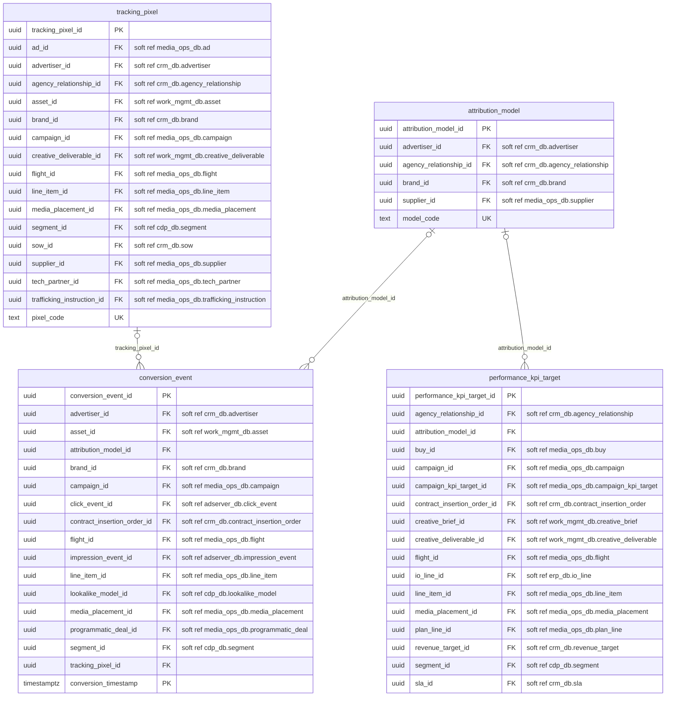

# adserver_db: physical ERD

Generated by advgen from the pinned Advertising MVM; do not edit by hand. Regenerate with `uv run advgen build`.

**System:** Google CM360 / The Trade Desk (ad serving and measurement). **Instance:** `pg-adserver` (port 5437).

Diagrams show key columns only: **PK**, **FK** (enforced), **UK** and soft references (labelled `soft ref`, unenforced cross-system or partitioned-target references). Lookup FKs to `ref.*` are omitted for legibility; see the data dictionary.

## performance.attribution_measurement

## performance.delivery_tracking

```mermaid
erDiagram
    click_event {
        uuid click_event_id PK
        uuid ad_id FK "soft ref media_ops_db.ad"
        uuid asset_id FK "soft ref work_mgmt_db.asset"
        uuid campaign_id FK "soft ref media_ops_db.campaign"
        uuid contract_insertion_order_id FK "soft ref crm_db.contract_insertion_order"
        uuid flight_id FK "soft ref media_ops_db.flight"
        uuid impression_event_id FK "soft ref adserver_db.impression_event"
        uuid line_item_id FK "soft ref media_ops_db.line_item"
        uuid media_placement_id FK "soft ref media_ops_db.media_placement"
        uuid publisher_id FK "soft ref media_ops_db.publisher"
        uuid segment_id FK "soft ref cdp_db.segment"
        uuid tracking_pixel_id FK
        timestamptz click_timestamp PK
    }
    delivery_pacing {
        uuid delivery_pacing_id PK
        uuid activation_id FK "soft ref cdp_db.activation"
        uuid buy_id FK "soft ref media_ops_db.buy"
        uuid campaign_id FK "soft ref media_ops_db.campaign"
        uuid deliverable_tracker_id FK "soft ref work_mgmt_db.deliverable_tracker"
        uuid flight_id FK "soft ref media_ops_db.flight"
        uuid io_line_id FK "soft ref erp_db.io_line"
        uuid line_item_id FK "soft ref media_ops_db.line_item"
        uuid media_insertion_order_id FK "soft ref media_ops_db.media_insertion_order"
        uuid media_placement_id FK "soft ref media_ops_db.media_placement"
        uuid pacing_rule_id FK "soft ref media_ops_db.pacing_rule"
        uuid plan_line_id FK "soft ref media_ops_db.plan_line"
        uuid programmatic_deal_id FK "soft ref media_ops_db.programmatic_deal"
        uuid segment_id FK "soft ref cdp_db.segment"
        uuid sla_id FK "soft ref crm_db.sla"
        uuid trafficking_order_id FK "soft ref media_ops_db.trafficking_order"
        timestamptz measurement_timestamp PK
    }
    impression_event {
        uuid impression_event_id PK
        uuid activation_id FK "soft ref cdp_db.activation"
        uuid ad_id FK "soft ref media_ops_db.ad"
        uuid advertiser_id FK "soft ref crm_db.advertiser"
        uuid asset_id FK "soft ref work_mgmt_db.asset"
        uuid brand_id FK "soft ref crm_db.brand"
        uuid campaign_id FK "soft ref media_ops_db.campaign"
        uuid contract_insertion_order_id FK "soft ref crm_db.contract_insertion_order"
        uuid flight_id FK "soft ref media_ops_db.flight"
        uuid line_item_id FK "soft ref media_ops_db.line_item"
        uuid lookalike_model_id FK "soft ref cdp_db.lookalike_model"
        uuid media_placement_id FK "soft ref media_ops_db.media_placement"
        uuid programmatic_deal_id FK "soft ref media_ops_db.programmatic_deal"
        uuid publisher_id FK "soft ref media_ops_db.publisher"
        uuid segment_id FK "soft ref cdp_db.segment"
        uuid suppression_list_id FK "soft ref cdp_db.suppression_list"
        uuid trafficking_instruction_id FK "soft ref media_ops_db.trafficking_instruction"
        uuid trafficking_order_id FK "soft ref media_ops_db.trafficking_order"
        timestamptz impression_timestamp PK
    }
    video_completion_event {
        uuid video_completion_event_id PK
        uuid ad_id FK "soft ref media_ops_db.ad"
        uuid asset_id FK "soft ref work_mgmt_db.asset"
        uuid buy_id FK "soft ref media_ops_db.buy"
        uuid campaign_id FK "soft ref media_ops_db.campaign"
        uuid flight_id FK "soft ref media_ops_db.flight"
        uuid impression_event_id FK "soft ref adserver_db.impression_event"
        uuid line_item_id FK "soft ref media_ops_db.line_item"
        uuid media_placement_id FK "soft ref media_ops_db.media_placement"
        uuid programmatic_deal_id FK "soft ref media_ops_db.programmatic_deal"
        uuid publisher_id FK "soft ref media_ops_db.publisher"
        uuid spec_id FK "soft ref work_mgmt_db.spec"
        timestamptz event_timestamp PK
    }
    viewability_measurement {
        uuid viewability_measurement_id PK
        uuid asset_id FK "soft ref work_mgmt_db.asset"
        uuid buy_id FK "soft ref media_ops_db.buy"
        uuid campaign_id FK "soft ref media_ops_db.campaign"
        uuid flight_id FK "soft ref media_ops_db.flight"
        uuid impression_event_id FK "soft ref adserver_db.impression_event"
        uuid line_item_id FK "soft ref media_ops_db.line_item"
        uuid media_placement_id FK "soft ref media_ops_db.media_placement"
        uuid programmatic_deal_id FK "soft ref media_ops_db.programmatic_deal"
        uuid publisher_id FK "soft ref media_ops_db.publisher"
        uuid sla_id FK "soft ref crm_db.sla"
        uuid spec_id FK "soft ref work_mgmt_db.spec"
        uuid supplier_id FK "soft ref media_ops_db.supplier"
        timestamptz measurement_timestamp PK
    }
    tracking_pixel |o--o{ click_event : "tracking_pixel_id"
```

## Soft references (112)

| From | To | Nullable | Reason |
|---|---|---|---|
| `performance.attribution_model.advertiser_id` | `crm_db.client.advertiser` | yes | cross system |
| `performance.attribution_model.agency_relationship_id` | `crm_db.client.agency_relationship` | yes | cross system |
| `performance.attribution_model.brand_id` | `crm_db.client.brand` | yes | cross system |
| `performance.attribution_model.supplier_id` | `media_ops_db.vendor.supplier` | yes | cross system |
| `performance.conversion_event.advertiser_id` | `crm_db.client.advertiser` | yes | cross system |
| `performance.conversion_event.asset_id` | `work_mgmt_db.creative.asset` | yes | cross system |
| `performance.conversion_event.brand_id` | `crm_db.client.brand` | yes | cross system |
| `performance.conversion_event.campaign_id` | `media_ops_db.campaign.campaign` | yes | cross system |
| `performance.conversion_event.click_event_id` | `adserver_db.performance.click_event` | yes | partitioned target |
| `performance.conversion_event.contract_insertion_order_id` | `crm_db.contract.contract_insertion_order` | yes | cross system |
| `performance.conversion_event.flight_id` | `media_ops_db.campaign.flight` | yes | cross system |
| `performance.conversion_event.impression_event_id` | `adserver_db.performance.impression_event` | yes | partitioned target |
| `performance.conversion_event.line_item_id` | `media_ops_db.campaign.line_item` | yes | cross system |
| `performance.conversion_event.lookalike_model_id` | `cdp_db.audience.lookalike_model` | yes | cross system |
| `performance.conversion_event.media_placement_id` | `media_ops_db.media.media_placement` | yes | cross system |
| `performance.conversion_event.programmatic_deal_id` | `media_ops_db.media.programmatic_deal` | yes | cross system |
| `performance.conversion_event.segment_id` | `cdp_db.audience.segment` | yes | cross system |
| `performance.performance_kpi_target.agency_relationship_id` | `crm_db.client.agency_relationship` | yes | cross system |
| `performance.performance_kpi_target.buy_id` | `media_ops_db.media.buy` | yes | cross system |
| `performance.performance_kpi_target.campaign_id` | `media_ops_db.campaign.campaign` | yes | cross system |
| `performance.performance_kpi_target.campaign_kpi_target_id` | `media_ops_db.campaign.campaign_kpi_target` | yes | cross system |
| `performance.performance_kpi_target.contract_insertion_order_id` | `crm_db.contract.contract_insertion_order` | yes | cross system |
| `performance.performance_kpi_target.creative_brief_id` | `work_mgmt_db.creative.creative_brief` | yes | cross system |
| `performance.performance_kpi_target.creative_deliverable_id` | `work_mgmt_db.creative.creative_deliverable` | yes | cross system |
| `performance.performance_kpi_target.flight_id` | `media_ops_db.campaign.flight` | yes | cross system |
| `performance.performance_kpi_target.io_line_id` | `erp_db.vendor.io_line` | yes | cross system |
| `performance.performance_kpi_target.line_item_id` | `media_ops_db.campaign.line_item` | yes | cross system |
| `performance.performance_kpi_target.media_placement_id` | `media_ops_db.media.media_placement` | yes | cross system |
| `performance.performance_kpi_target.plan_line_id` | `media_ops_db.media.plan_line` | yes | cross system |
| `performance.performance_kpi_target.revenue_target_id` | `crm_db.client.revenue_target` | yes | cross system |
| `performance.performance_kpi_target.segment_id` | `cdp_db.audience.segment` | yes | cross system |
| `performance.performance_kpi_target.sla_id` | `crm_db.contract.sla` | yes | cross system |
| `performance.tracking_pixel.ad_id` | `media_ops_db.campaign.ad` | yes | cross system |
| `performance.tracking_pixel.advertiser_id` | `crm_db.client.advertiser` | yes | cross system |
| `performance.tracking_pixel.agency_relationship_id` | `crm_db.client.agency_relationship` | yes | cross system |
| `performance.tracking_pixel.asset_id` | `work_mgmt_db.creative.asset` | yes | cross system |
| `performance.tracking_pixel.brand_id` | `crm_db.client.brand` | yes | cross system |
| `performance.tracking_pixel.campaign_id` | `media_ops_db.campaign.campaign` | yes | cross system |
| `performance.tracking_pixel.creative_deliverable_id` | `work_mgmt_db.creative.creative_deliverable` | yes | cross system |
| `performance.tracking_pixel.flight_id` | `media_ops_db.campaign.flight` | yes | cross system |
| `performance.tracking_pixel.line_item_id` | `media_ops_db.campaign.line_item` | yes | cross system |
| `performance.tracking_pixel.media_placement_id` | `media_ops_db.media.media_placement` | yes | cross system |
| `performance.tracking_pixel.segment_id` | `cdp_db.audience.segment` | yes | cross system |
| `performance.tracking_pixel.sow_id` | `crm_db.contract.sow` | yes | cross system |
| `performance.tracking_pixel.supplier_id` | `media_ops_db.vendor.supplier` | yes | cross system |
| `performance.tracking_pixel.tech_partner_id` | `media_ops_db.vendor.tech_partner` | yes | cross system |
| `performance.tracking_pixel.trafficking_instruction_id` | `media_ops_db.media.trafficking_instruction` | yes | cross system |
| `performance.click_event.ad_id` | `media_ops_db.campaign.ad` | yes | cross system |
| `performance.click_event.asset_id` | `work_mgmt_db.creative.asset` | yes | cross system |
| `performance.click_event.campaign_id` | `media_ops_db.campaign.campaign` | yes | cross system |
| `performance.click_event.contract_insertion_order_id` | `crm_db.contract.contract_insertion_order` | yes | cross system |
| `performance.click_event.flight_id` | `media_ops_db.campaign.flight` | yes | cross system |
| `performance.click_event.impression_event_id` | `adserver_db.performance.impression_event` | no | partitioned target |
| `performance.click_event.line_item_id` | `media_ops_db.campaign.line_item` | yes | cross system |
| `performance.click_event.media_placement_id` | `media_ops_db.media.media_placement` | yes | cross system |
| `performance.click_event.publisher_id` | `media_ops_db.vendor.publisher` | yes | cross system |
| `performance.click_event.segment_id` | `cdp_db.audience.segment` | yes | cross system |
| `performance.delivery_pacing.activation_id` | `cdp_db.audience.activation` | yes | cross system |
| `performance.delivery_pacing.buy_id` | `media_ops_db.media.buy` | yes | cross system |
| `performance.delivery_pacing.campaign_id` | `media_ops_db.campaign.campaign` | no | cross system |
| `performance.delivery_pacing.deliverable_tracker_id` | `work_mgmt_db.project.deliverable_tracker` | yes | cross system |
| `performance.delivery_pacing.flight_id` | `media_ops_db.campaign.flight` | yes | cross system |
| `performance.delivery_pacing.io_line_id` | `erp_db.vendor.io_line` | yes | cross system |
| `performance.delivery_pacing.line_item_id` | `media_ops_db.campaign.line_item` | no | cross system |
| `performance.delivery_pacing.media_insertion_order_id` | `media_ops_db.media.media_insertion_order` | yes | cross system |
| `performance.delivery_pacing.media_placement_id` | `media_ops_db.media.media_placement` | yes | cross system |
| `performance.delivery_pacing.pacing_rule_id` | `media_ops_db.campaign.pacing_rule` | yes | cross system |
| `performance.delivery_pacing.plan_line_id` | `media_ops_db.media.plan_line` | yes | cross system |
| `performance.delivery_pacing.programmatic_deal_id` | `media_ops_db.media.programmatic_deal` | yes | cross system |
| `performance.delivery_pacing.segment_id` | `cdp_db.audience.segment` | yes | cross system |
| `performance.delivery_pacing.sla_id` | `crm_db.contract.sla` | yes | cross system |
| `performance.delivery_pacing.trafficking_order_id` | `media_ops_db.campaign.trafficking_order` | yes | cross system |
| `performance.impression_event.activation_id` | `cdp_db.audience.activation` | yes | cross system |
| `performance.impression_event.ad_id` | `media_ops_db.campaign.ad` | yes | cross system |
| `performance.impression_event.advertiser_id` | `crm_db.client.advertiser` | yes | cross system |
| `performance.impression_event.asset_id` | `work_mgmt_db.creative.asset` | yes | cross system |
| `performance.impression_event.brand_id` | `crm_db.client.brand` | yes | cross system |
| `performance.impression_event.campaign_id` | `media_ops_db.campaign.campaign` | no | cross system |
| `performance.impression_event.contract_insertion_order_id` | `crm_db.contract.contract_insertion_order` | yes | cross system |
| `performance.impression_event.flight_id` | `media_ops_db.campaign.flight` | yes | cross system |
| `performance.impression_event.line_item_id` | `media_ops_db.campaign.line_item` | yes | cross system |
| `performance.impression_event.lookalike_model_id` | `cdp_db.audience.lookalike_model` | yes | cross system |
| `performance.impression_event.media_placement_id` | `media_ops_db.media.media_placement` | no | cross system |
| `performance.impression_event.programmatic_deal_id` | `media_ops_db.media.programmatic_deal` | yes | cross system |
| `performance.impression_event.publisher_id` | `media_ops_db.vendor.publisher` | yes | cross system |
| `performance.impression_event.segment_id` | `cdp_db.audience.segment` | yes | cross system |
| `performance.impression_event.suppression_list_id` | `cdp_db.audience.suppression_list` | yes | cross system |
| `performance.impression_event.trafficking_instruction_id` | `media_ops_db.media.trafficking_instruction` | yes | cross system |
| `performance.impression_event.trafficking_order_id` | `media_ops_db.campaign.trafficking_order` | yes | cross system |
| `performance.video_completion_event.ad_id` | `media_ops_db.campaign.ad` | yes | cross system |
| `performance.video_completion_event.asset_id` | `work_mgmt_db.creative.asset` | yes | cross system |
| `performance.video_completion_event.buy_id` | `media_ops_db.media.buy` | yes | cross system |
| `performance.video_completion_event.campaign_id` | `media_ops_db.campaign.campaign` | yes | cross system |
| `performance.video_completion_event.flight_id` | `media_ops_db.campaign.flight` | yes | cross system |
| `performance.video_completion_event.impression_event_id` | `adserver_db.performance.impression_event` | yes | partitioned target |
| `performance.video_completion_event.line_item_id` | `media_ops_db.campaign.line_item` | yes | cross system |
| `performance.video_completion_event.media_placement_id` | `media_ops_db.media.media_placement` | yes | cross system |
| `performance.video_completion_event.programmatic_deal_id` | `media_ops_db.media.programmatic_deal` | yes | cross system |
| `performance.video_completion_event.publisher_id` | `media_ops_db.vendor.publisher` | yes | cross system |
| `performance.video_completion_event.spec_id` | `work_mgmt_db.creative.spec` | yes | cross system |
| `performance.viewability_measurement.asset_id` | `work_mgmt_db.creative.asset` | yes | cross system |
| `performance.viewability_measurement.buy_id` | `media_ops_db.media.buy` | yes | cross system |
| `performance.viewability_measurement.campaign_id` | `media_ops_db.campaign.campaign` | yes | cross system |
| `performance.viewability_measurement.flight_id` | `media_ops_db.campaign.flight` | yes | cross system |
| `performance.viewability_measurement.impression_event_id` | `adserver_db.performance.impression_event` | yes | partitioned target |
| `performance.viewability_measurement.line_item_id` | `media_ops_db.campaign.line_item` | yes | cross system |
| `performance.viewability_measurement.media_placement_id` | `media_ops_db.media.media_placement` | yes | cross system |
| `performance.viewability_measurement.programmatic_deal_id` | `media_ops_db.media.programmatic_deal` | yes | cross system |
| `performance.viewability_measurement.publisher_id` | `media_ops_db.vendor.publisher` | yes | cross system |
| `performance.viewability_measurement.sla_id` | `crm_db.contract.sla` | yes | cross system |
| `performance.viewability_measurement.spec_id` | `work_mgmt_db.creative.spec` | yes | cross system |
| `performance.viewability_measurement.supplier_id` | `media_ops_db.vendor.supplier` | yes | cross system |
