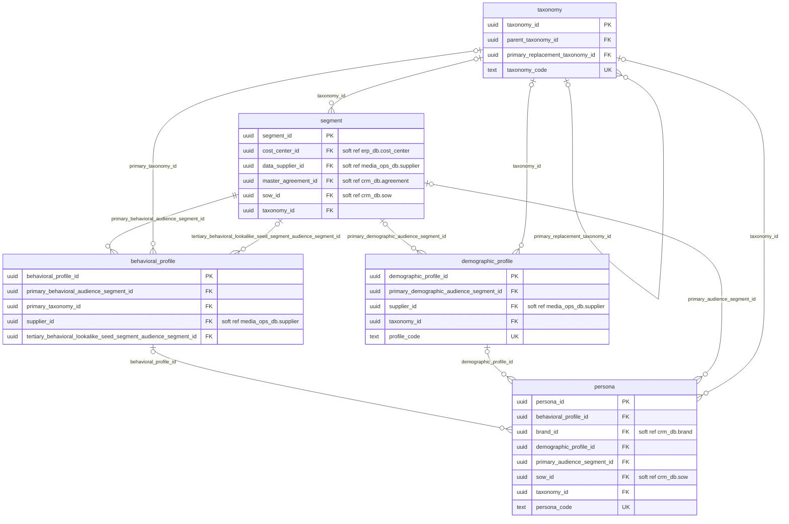
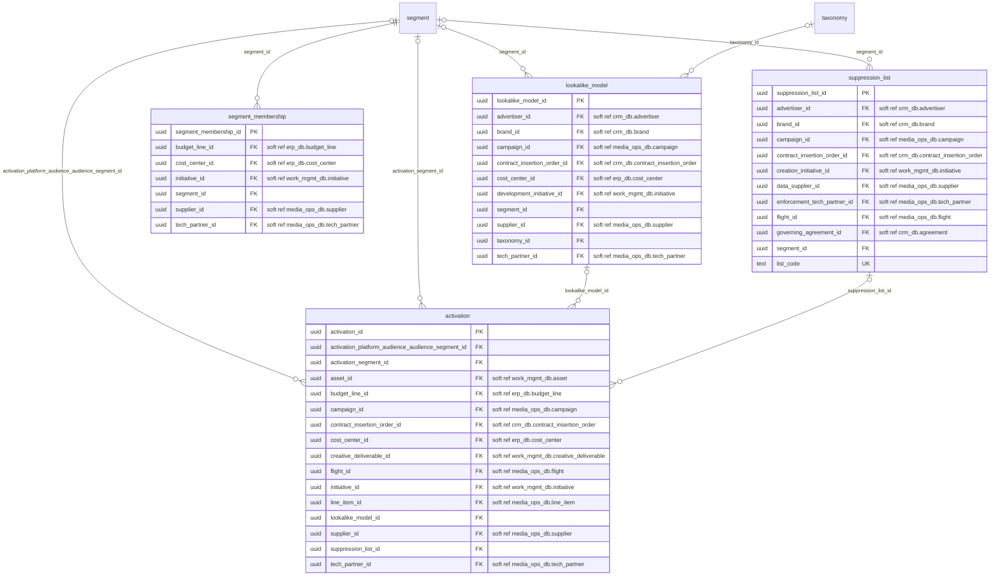

# cdp_db: physical ERD

Generated by advgen from the pinned Advertising MVM; do not edit by hand. Regenerate with `uv run advgen build`.

**System:** Customer Data Platform / DMP. **Instance:** `pg-cdp` (port 5438).

Diagrams show key columns only: **PK**, **FK** (enforced), **UK** and soft references (labelled `soft ref`, unenforced cross-system or partitioned-target references). Lookup FKs to `ref.*` are omitted for legibility; see the data dictionary.

## audience.audience_segmentation

## audience.targeting_activation

## Soft references (41)

| From | To | Nullable | Reason |
|---|---|---|---|
| `audience.behavioral_profile.supplier_id` | `media_ops_db.vendor.supplier` | yes | cross system |
| `audience.demographic_profile.supplier_id` | `media_ops_db.vendor.supplier` | yes | cross system |
| `audience.persona.brand_id` | `crm_db.client.brand` | yes | cross system |
| `audience.persona.sow_id` | `crm_db.contract.sow` | yes | cross system |
| `audience.segment.cost_center_id` | `erp_db.finance.cost_center` | yes | cross system |
| `audience.segment.data_supplier_id` | `media_ops_db.vendor.supplier` | yes | cross system |
| `audience.segment.master_agreement_id` | `crm_db.contract.agreement` | yes | cross system |
| `audience.segment.sow_id` | `crm_db.contract.sow` | yes | cross system |
| `audience.activation.asset_id` | `work_mgmt_db.creative.asset` | yes | cross system |
| `audience.activation.budget_line_id` | `erp_db.finance.budget_line` | yes | cross system |
| `audience.activation.campaign_id` | `media_ops_db.campaign.campaign` | yes | cross system |
| `audience.activation.contract_insertion_order_id` | `crm_db.contract.contract_insertion_order` | yes | cross system |
| `audience.activation.cost_center_id` | `erp_db.finance.cost_center` | yes | cross system |
| `audience.activation.creative_deliverable_id` | `work_mgmt_db.creative.creative_deliverable` | yes | cross system |
| `audience.activation.flight_id` | `media_ops_db.campaign.flight` | yes | cross system |
| `audience.activation.initiative_id` | `work_mgmt_db.project.initiative` | yes | cross system |
| `audience.activation.line_item_id` | `media_ops_db.campaign.line_item` | yes | cross system |
| `audience.activation.supplier_id` | `media_ops_db.vendor.supplier` | yes | cross system |
| `audience.activation.tech_partner_id` | `media_ops_db.vendor.tech_partner` | yes | cross system |
| `audience.lookalike_model.advertiser_id` | `crm_db.client.advertiser` | yes | cross system |
| `audience.lookalike_model.brand_id` | `crm_db.client.brand` | yes | cross system |
| `audience.lookalike_model.campaign_id` | `media_ops_db.campaign.campaign` | yes | cross system |
| `audience.lookalike_model.contract_insertion_order_id` | `crm_db.contract.contract_insertion_order` | yes | cross system |
| `audience.lookalike_model.cost_center_id` | `erp_db.finance.cost_center` | yes | cross system |
| `audience.lookalike_model.development_initiative_id` | `work_mgmt_db.project.initiative` | yes | cross system |
| `audience.lookalike_model.supplier_id` | `media_ops_db.vendor.supplier` | yes | cross system |
| `audience.lookalike_model.tech_partner_id` | `media_ops_db.vendor.tech_partner` | yes | cross system |
| `audience.segment_membership.budget_line_id` | `erp_db.finance.budget_line` | yes | cross system |
| `audience.segment_membership.cost_center_id` | `erp_db.finance.cost_center` | yes | cross system |
| `audience.segment_membership.initiative_id` | `work_mgmt_db.project.initiative` | yes | cross system |
| `audience.segment_membership.supplier_id` | `media_ops_db.vendor.supplier` | yes | cross system |
| `audience.segment_membership.tech_partner_id` | `media_ops_db.vendor.tech_partner` | yes | cross system |
| `audience.suppression_list.advertiser_id` | `crm_db.client.advertiser` | yes | cross system |
| `audience.suppression_list.brand_id` | `crm_db.client.brand` | yes | cross system |
| `audience.suppression_list.campaign_id` | `media_ops_db.campaign.campaign` | yes | cross system |
| `audience.suppression_list.contract_insertion_order_id` | `crm_db.contract.contract_insertion_order` | yes | cross system |
| `audience.suppression_list.creation_initiative_id` | `work_mgmt_db.project.initiative` | yes | cross system |
| `audience.suppression_list.data_supplier_id` | `media_ops_db.vendor.supplier` | yes | cross system |
| `audience.suppression_list.enforcement_tech_partner_id` | `media_ops_db.vendor.tech_partner` | yes | cross system |
| `audience.suppression_list.flight_id` | `media_ops_db.campaign.flight` | yes | cross system |
| `audience.suppression_list.governing_agreement_id` | `crm_db.contract.agreement` | yes | cross system |
