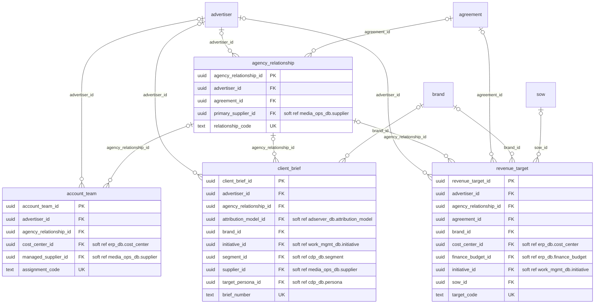
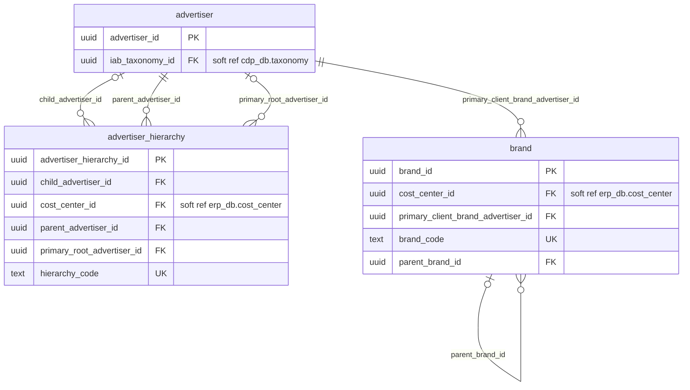
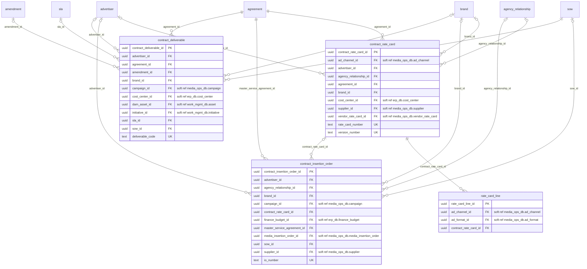
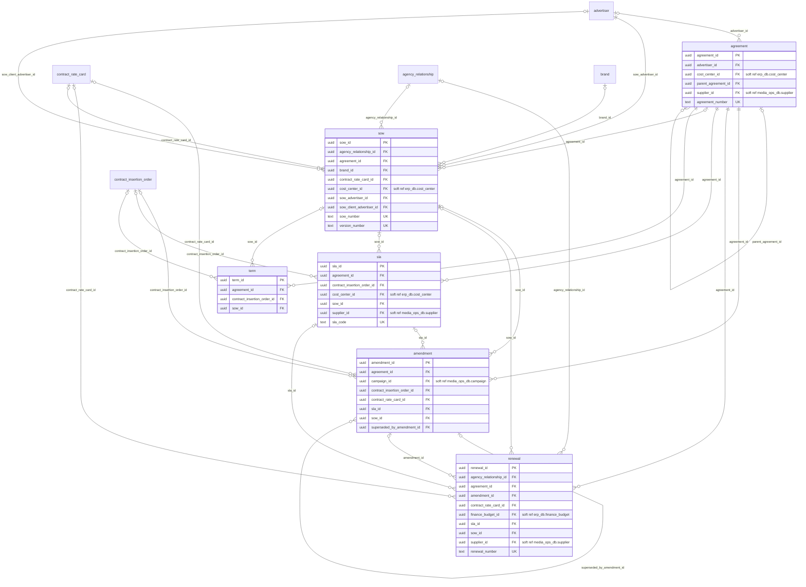

# crm_db: physical ERD

Generated by advgen from the pinned Advertising MVM; do not edit by hand. Regenerate with `uv run advgen build`.

**System:** Salesforce Sales Cloud (CRM). **Instance:** `pg-crm` (port 5433).

Diagrams show key columns only: **PK**, **FK** (enforced), **UK** and soft references (labelled `soft ref`, unenforced cross-system or partitioned-target references). Lookup FKs to `ref.*` are omitted for legibility; see the data dictionary.

## client.account_management

## client.advertiser_identity

## contract.commercial_pricing

## contract.contract_foundations

## Soft references (36)

| From | To | Nullable | Reason |
|---|---|---|---|
| `client.account_team.cost_center_id` | `erp_db.finance.cost_center` | yes | cross system |
| `client.account_team.managed_supplier_id` | `media_ops_db.vendor.supplier` | yes | cross system |
| `client.agency_relationship.primary_supplier_id` | `media_ops_db.vendor.supplier` | yes | cross system |
| `client.client_brief.attribution_model_id` | `adserver_db.performance.attribution_model` | yes | cross system |
| `client.client_brief.initiative_id` | `work_mgmt_db.project.initiative` | yes | cross system |
| `client.client_brief.segment_id` | `cdp_db.audience.segment` | yes | cross system |
| `client.client_brief.supplier_id` | `media_ops_db.vendor.supplier` | yes | cross system |
| `client.client_brief.target_persona_id` | `cdp_db.audience.persona` | yes | cross system |
| `client.revenue_target.cost_center_id` | `erp_db.finance.cost_center` | yes | cross system |
| `client.revenue_target.finance_budget_id` | `erp_db.finance.finance_budget` | yes | cross system |
| `client.revenue_target.initiative_id` | `work_mgmt_db.project.initiative` | yes | cross system |
| `client.advertiser.iab_taxonomy_id` | `cdp_db.audience.taxonomy` | yes | cross system |
| `client.advertiser_hierarchy.cost_center_id` | `erp_db.finance.cost_center` | yes | cross system |
| `client.brand.cost_center_id` | `erp_db.finance.cost_center` | yes | cross system |
| `contract.contract_deliverable.campaign_id` | `media_ops_db.campaign.campaign` | yes | cross system |
| `contract.contract_deliverable.cost_center_id` | `erp_db.finance.cost_center` | yes | cross system |
| `contract.contract_deliverable.dam_asset_id` | `work_mgmt_db.creative.asset` | yes | cross system |
| `contract.contract_deliverable.initiative_id` | `work_mgmt_db.project.initiative` | yes | cross system |
| `contract.contract_insertion_order.campaign_id` | `media_ops_db.campaign.campaign` | no | cross system |
| `contract.contract_insertion_order.finance_budget_id` | `erp_db.finance.finance_budget` | yes | cross system |
| `contract.contract_insertion_order.media_insertion_order_id` | `media_ops_db.media.media_insertion_order` | yes | cross system |
| `contract.contract_insertion_order.supplier_id` | `media_ops_db.vendor.supplier` | yes | cross system |
| `contract.contract_rate_card.ad_channel_id` | `media_ops_db.media.ad_channel` | yes | cross system |
| `contract.contract_rate_card.cost_center_id` | `erp_db.finance.cost_center` | yes | cross system |
| `contract.contract_rate_card.supplier_id` | `media_ops_db.vendor.supplier` | yes | cross system |
| `contract.contract_rate_card.vendor_rate_card_id` | `media_ops_db.vendor.vendor_rate_card` | yes | cross system |
| `contract.rate_card_line.ad_channel_id` | `media_ops_db.media.ad_channel` | yes | cross system |
| `contract.rate_card_line.ad_format_id` | `media_ops_db.media.ad_format` | yes | cross system |
| `contract.agreement.cost_center_id` | `erp_db.finance.cost_center` | yes | cross system |
| `contract.agreement.supplier_id` | `media_ops_db.vendor.supplier` | yes | cross system |
| `contract.amendment.campaign_id` | `media_ops_db.campaign.campaign` | yes | cross system |
| `contract.renewal.finance_budget_id` | `erp_db.finance.finance_budget` | yes | cross system |
| `contract.renewal.supplier_id` | `media_ops_db.vendor.supplier` | yes | cross system |
| `contract.sla.cost_center_id` | `erp_db.finance.cost_center` | yes | cross system |
| `contract.sla.supplier_id` | `media_ops_db.vendor.supplier` | yes | cross system |
| `contract.sow.cost_center_id` | `erp_db.finance.cost_center` | yes | cross system |
