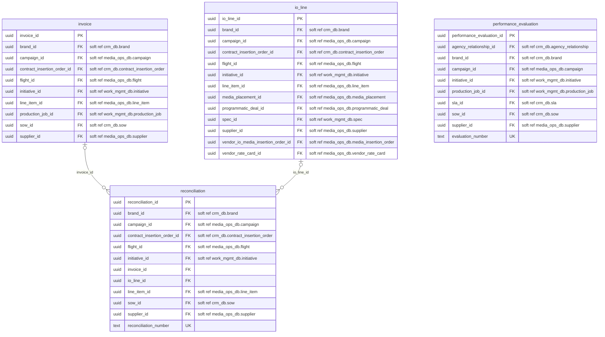
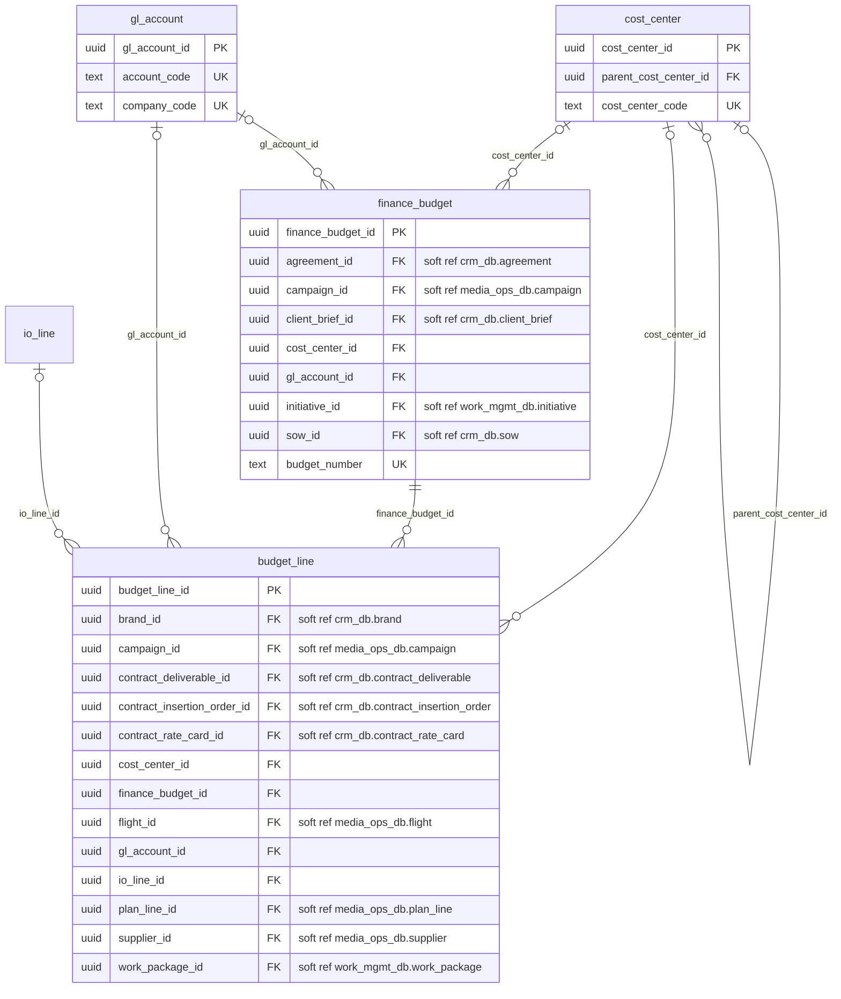
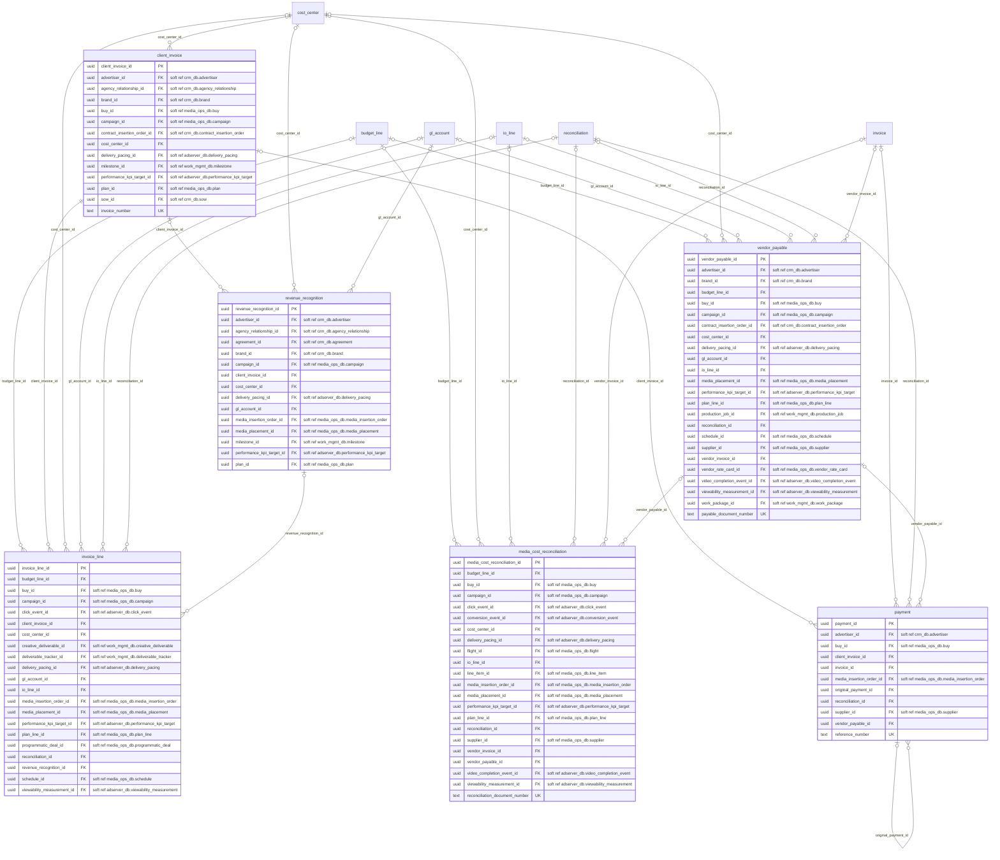

# erp_db: physical ERD

Generated by advgen from the pinned Advertising MVM; do not edit by hand. Regenerate with `uv run advgen build`.

**System:** SAP S/4HANA (FI/CO, AP/AR). **Instance:** `pg-erp` (port 5434).

Diagrams show key columns only: **PK**, **FK** (enforced), **UK** and soft references (labelled `soft ref`, unenforced cross-system or partitioned-target references). Lookup FKs to `ref.*` are omitted for legibility; see the data dictionary.

## vendor.billing_reconciliation

## finance.budget_control

## finance.revenue_billing

## Soft references (120)

| From | To | Nullable | Reason |
|---|---|---|---|
| `vendor.invoice.brand_id` | `crm_db.client.brand` | yes | cross system |
| `vendor.invoice.campaign_id` | `media_ops_db.campaign.campaign` | yes | cross system |
| `vendor.invoice.contract_insertion_order_id` | `crm_db.contract.contract_insertion_order` | yes | cross system |
| `vendor.invoice.flight_id` | `media_ops_db.campaign.flight` | yes | cross system |
| `vendor.invoice.initiative_id` | `work_mgmt_db.project.initiative` | yes | cross system |
| `vendor.invoice.line_item_id` | `media_ops_db.campaign.line_item` | yes | cross system |
| `vendor.invoice.production_job_id` | `work_mgmt_db.creative.production_job` | yes | cross system |
| `vendor.invoice.sow_id` | `crm_db.contract.sow` | yes | cross system |
| `vendor.invoice.supplier_id` | `media_ops_db.vendor.supplier` | yes | cross system |
| `vendor.io_line.brand_id` | `crm_db.client.brand` | yes | cross system |
| `vendor.io_line.campaign_id` | `media_ops_db.campaign.campaign` | yes | cross system |
| `vendor.io_line.contract_insertion_order_id` | `crm_db.contract.contract_insertion_order` | yes | cross system |
| `vendor.io_line.flight_id` | `media_ops_db.campaign.flight` | yes | cross system |
| `vendor.io_line.initiative_id` | `work_mgmt_db.project.initiative` | yes | cross system |
| `vendor.io_line.line_item_id` | `media_ops_db.campaign.line_item` | yes | cross system |
| `vendor.io_line.media_placement_id` | `media_ops_db.media.media_placement` | yes | cross system |
| `vendor.io_line.programmatic_deal_id` | `media_ops_db.media.programmatic_deal` | yes | cross system |
| `vendor.io_line.spec_id` | `work_mgmt_db.creative.spec` | yes | cross system |
| `vendor.io_line.supplier_id` | `media_ops_db.vendor.supplier` | yes | cross system |
| `vendor.io_line.vendor_io_media_insertion_order_id` | `media_ops_db.media.media_insertion_order` | no | cross system |
| `vendor.io_line.vendor_rate_card_id` | `media_ops_db.vendor.vendor_rate_card` | yes | cross system |
| `vendor.performance_evaluation.agency_relationship_id` | `crm_db.client.agency_relationship` | yes | cross system |
| `vendor.performance_evaluation.brand_id` | `crm_db.client.brand` | yes | cross system |
| `vendor.performance_evaluation.campaign_id` | `media_ops_db.campaign.campaign` | yes | cross system |
| `vendor.performance_evaluation.initiative_id` | `work_mgmt_db.project.initiative` | yes | cross system |
| `vendor.performance_evaluation.production_job_id` | `work_mgmt_db.creative.production_job` | yes | cross system |
| `vendor.performance_evaluation.sla_id` | `crm_db.contract.sla` | yes | cross system |
| `vendor.performance_evaluation.sow_id` | `crm_db.contract.sow` | yes | cross system |
| `vendor.performance_evaluation.supplier_id` | `media_ops_db.vendor.supplier` | yes | cross system |
| `vendor.reconciliation.brand_id` | `crm_db.client.brand` | yes | cross system |
| `vendor.reconciliation.campaign_id` | `media_ops_db.campaign.campaign` | yes | cross system |
| `vendor.reconciliation.contract_insertion_order_id` | `crm_db.contract.contract_insertion_order` | yes | cross system |
| `vendor.reconciliation.flight_id` | `media_ops_db.campaign.flight` | yes | cross system |
| `vendor.reconciliation.initiative_id` | `work_mgmt_db.project.initiative` | yes | cross system |
| `vendor.reconciliation.line_item_id` | `media_ops_db.campaign.line_item` | yes | cross system |
| `vendor.reconciliation.sow_id` | `crm_db.contract.sow` | yes | cross system |
| `vendor.reconciliation.supplier_id` | `media_ops_db.vendor.supplier` | yes | cross system |
| `finance.budget_line.brand_id` | `crm_db.client.brand` | yes | cross system |
| `finance.budget_line.campaign_id` | `media_ops_db.campaign.campaign` | yes | cross system |
| `finance.budget_line.contract_deliverable_id` | `crm_db.contract.contract_deliverable` | yes | cross system |
| `finance.budget_line.contract_insertion_order_id` | `crm_db.contract.contract_insertion_order` | yes | cross system |
| `finance.budget_line.contract_rate_card_id` | `crm_db.contract.contract_rate_card` | yes | cross system |
| `finance.budget_line.flight_id` | `media_ops_db.campaign.flight` | yes | cross system |
| `finance.budget_line.plan_line_id` | `media_ops_db.media.plan_line` | yes | cross system |
| `finance.budget_line.supplier_id` | `media_ops_db.vendor.supplier` | yes | cross system |
| `finance.budget_line.work_package_id` | `work_mgmt_db.project.work_package` | yes | cross system |
| `finance.finance_budget.agreement_id` | `crm_db.contract.agreement` | yes | cross system |
| `finance.finance_budget.campaign_id` | `media_ops_db.campaign.campaign` | yes | cross system |
| `finance.finance_budget.client_brief_id` | `crm_db.client.client_brief` | yes | cross system |
| `finance.finance_budget.initiative_id` | `work_mgmt_db.project.initiative` | yes | cross system |
| `finance.finance_budget.sow_id` | `crm_db.contract.sow` | yes | cross system |
| `finance.client_invoice.advertiser_id` | `crm_db.client.advertiser` | yes | cross system |
| `finance.client_invoice.agency_relationship_id` | `crm_db.client.agency_relationship` | yes | cross system |
| `finance.client_invoice.brand_id` | `crm_db.client.brand` | yes | cross system |
| `finance.client_invoice.buy_id` | `media_ops_db.media.buy` | yes | cross system |
| `finance.client_invoice.campaign_id` | `media_ops_db.campaign.campaign` | yes | cross system |
| `finance.client_invoice.contract_insertion_order_id` | `crm_db.contract.contract_insertion_order` | yes | cross system |
| `finance.client_invoice.delivery_pacing_id` | `adserver_db.performance.delivery_pacing` | yes | cross system |
| `finance.client_invoice.milestone_id` | `work_mgmt_db.project.milestone` | yes | cross system |
| `finance.client_invoice.performance_kpi_target_id` | `adserver_db.performance.performance_kpi_target` | yes | cross system |
| `finance.client_invoice.plan_id` | `media_ops_db.media.plan` | yes | cross system |
| `finance.client_invoice.sow_id` | `crm_db.contract.sow` | yes | cross system |
| `finance.invoice_line.buy_id` | `media_ops_db.media.buy` | yes | cross system |
| `finance.invoice_line.campaign_id` | `media_ops_db.campaign.campaign` | yes | cross system |
| `finance.invoice_line.click_event_id` | `adserver_db.performance.click_event` | yes | cross system |
| `finance.invoice_line.creative_deliverable_id` | `work_mgmt_db.creative.creative_deliverable` | yes | cross system |
| `finance.invoice_line.deliverable_tracker_id` | `work_mgmt_db.project.deliverable_tracker` | yes | cross system |
| `finance.invoice_line.delivery_pacing_id` | `adserver_db.performance.delivery_pacing` | yes | cross system |
| `finance.invoice_line.media_insertion_order_id` | `media_ops_db.media.media_insertion_order` | yes | cross system |
| `finance.invoice_line.media_placement_id` | `media_ops_db.media.media_placement` | yes | cross system |
| `finance.invoice_line.performance_kpi_target_id` | `adserver_db.performance.performance_kpi_target` | yes | cross system |
| `finance.invoice_line.plan_line_id` | `media_ops_db.media.plan_line` | yes | cross system |
| `finance.invoice_line.programmatic_deal_id` | `media_ops_db.media.programmatic_deal` | yes | cross system |
| `finance.invoice_line.schedule_id` | `media_ops_db.media.schedule` | yes | cross system |
| `finance.invoice_line.viewability_measurement_id` | `adserver_db.performance.viewability_measurement` | yes | cross system |
| `finance.media_cost_reconciliation.buy_id` | `media_ops_db.media.buy` | yes | cross system |
| `finance.media_cost_reconciliation.campaign_id` | `media_ops_db.campaign.campaign` | yes | cross system |
| `finance.media_cost_reconciliation.click_event_id` | `adserver_db.performance.click_event` | yes | cross system |
| `finance.media_cost_reconciliation.conversion_event_id` | `adserver_db.performance.conversion_event` | yes | cross system |
| `finance.media_cost_reconciliation.delivery_pacing_id` | `adserver_db.performance.delivery_pacing` | yes | cross system |
| `finance.media_cost_reconciliation.flight_id` | `media_ops_db.campaign.flight` | yes | cross system |
| `finance.media_cost_reconciliation.line_item_id` | `media_ops_db.campaign.line_item` | yes | cross system |
| `finance.media_cost_reconciliation.media_insertion_order_id` | `media_ops_db.media.media_insertion_order` | yes | cross system |
| `finance.media_cost_reconciliation.media_placement_id` | `media_ops_db.media.media_placement` | yes | cross system |
| `finance.media_cost_reconciliation.performance_kpi_target_id` | `adserver_db.performance.performance_kpi_target` | yes | cross system |
| `finance.media_cost_reconciliation.plan_line_id` | `media_ops_db.media.plan_line` | yes | cross system |
| `finance.media_cost_reconciliation.supplier_id` | `media_ops_db.vendor.supplier` | yes | cross system |
| `finance.media_cost_reconciliation.video_completion_event_id` | `adserver_db.performance.video_completion_event` | yes | cross system |
| `finance.media_cost_reconciliation.viewability_measurement_id` | `adserver_db.performance.viewability_measurement` | yes | cross system |
| `finance.payment.advertiser_id` | `crm_db.client.advertiser` | yes | cross system |
| `finance.payment.buy_id` | `media_ops_db.media.buy` | yes | cross system |
| `finance.payment.media_insertion_order_id` | `media_ops_db.media.media_insertion_order` | yes | cross system |
| `finance.payment.supplier_id` | `media_ops_db.vendor.supplier` | yes | cross system |
| `finance.revenue_recognition.advertiser_id` | `crm_db.client.advertiser` | yes | cross system |
| `finance.revenue_recognition.agency_relationship_id` | `crm_db.client.agency_relationship` | yes | cross system |
| `finance.revenue_recognition.agreement_id` | `crm_db.contract.agreement` | yes | cross system |
| `finance.revenue_recognition.brand_id` | `crm_db.client.brand` | yes | cross system |
| `finance.revenue_recognition.campaign_id` | `media_ops_db.campaign.campaign` | yes | cross system |
| `finance.revenue_recognition.delivery_pacing_id` | `adserver_db.performance.delivery_pacing` | yes | cross system |
| `finance.revenue_recognition.media_insertion_order_id` | `media_ops_db.media.media_insertion_order` | yes | cross system |
| `finance.revenue_recognition.media_placement_id` | `media_ops_db.media.media_placement` | yes | cross system |
| `finance.revenue_recognition.milestone_id` | `work_mgmt_db.project.milestone` | yes | cross system |
| `finance.revenue_recognition.performance_kpi_target_id` | `adserver_db.performance.performance_kpi_target` | yes | cross system |
| `finance.revenue_recognition.plan_id` | `media_ops_db.media.plan` | yes | cross system |
| `finance.vendor_payable.advertiser_id` | `crm_db.client.advertiser` | yes | cross system |
| `finance.vendor_payable.brand_id` | `crm_db.client.brand` | yes | cross system |
| `finance.vendor_payable.buy_id` | `media_ops_db.media.buy` | yes | cross system |
| `finance.vendor_payable.campaign_id` | `media_ops_db.campaign.campaign` | yes | cross system |
| `finance.vendor_payable.contract_insertion_order_id` | `crm_db.contract.contract_insertion_order` | yes | cross system |
| `finance.vendor_payable.delivery_pacing_id` | `adserver_db.performance.delivery_pacing` | yes | cross system |
| `finance.vendor_payable.media_placement_id` | `media_ops_db.media.media_placement` | yes | cross system |
| `finance.vendor_payable.performance_kpi_target_id` | `adserver_db.performance.performance_kpi_target` | yes | cross system |
| `finance.vendor_payable.plan_line_id` | `media_ops_db.media.plan_line` | yes | cross system |
| `finance.vendor_payable.production_job_id` | `work_mgmt_db.creative.production_job` | yes | cross system |
| `finance.vendor_payable.schedule_id` | `media_ops_db.media.schedule` | yes | cross system |
| `finance.vendor_payable.supplier_id` | `media_ops_db.vendor.supplier` | yes | cross system |
| `finance.vendor_payable.vendor_rate_card_id` | `media_ops_db.vendor.vendor_rate_card` | yes | cross system |
| `finance.vendor_payable.video_completion_event_id` | `adserver_db.performance.video_completion_event` | yes | cross system |
| `finance.vendor_payable.viewability_measurement_id` | `adserver_db.performance.viewability_measurement` | yes | cross system |
| `finance.vendor_payable.work_package_id` | `work_mgmt_db.project.work_package` | yes | cross system |
