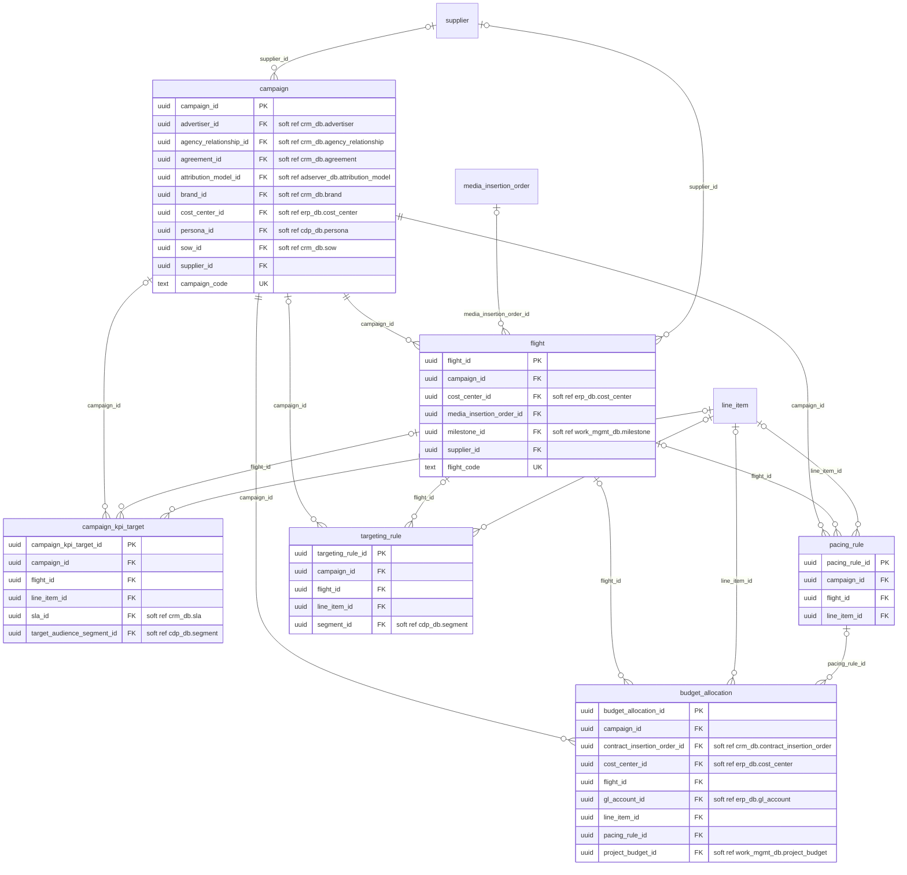
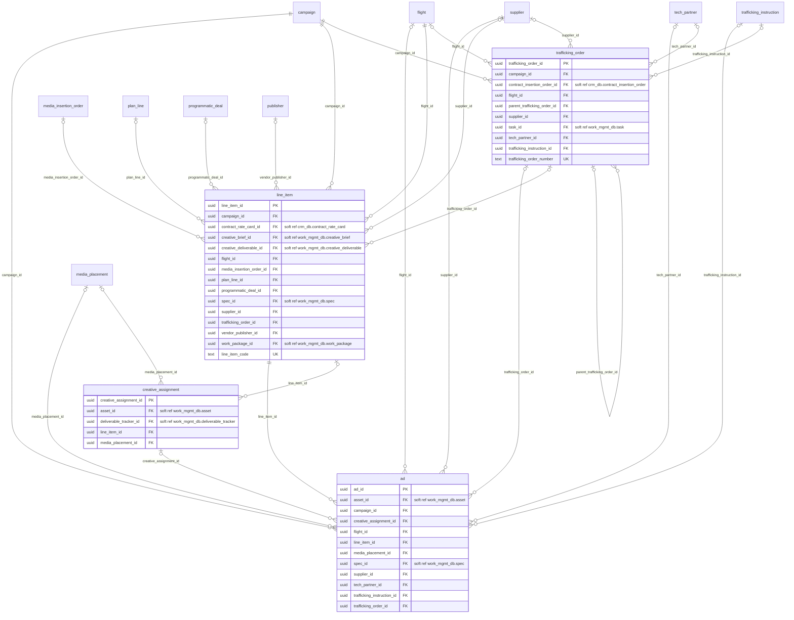
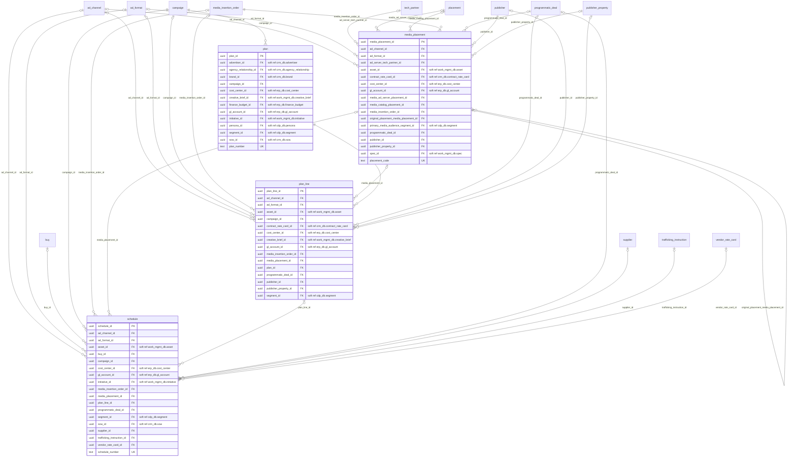
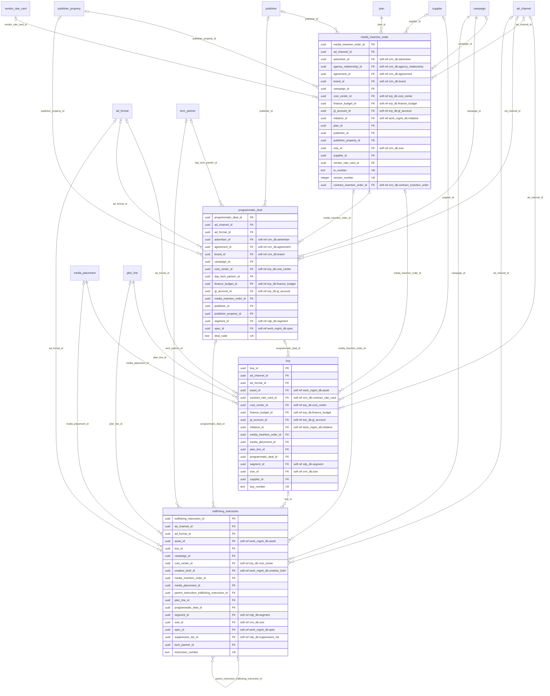
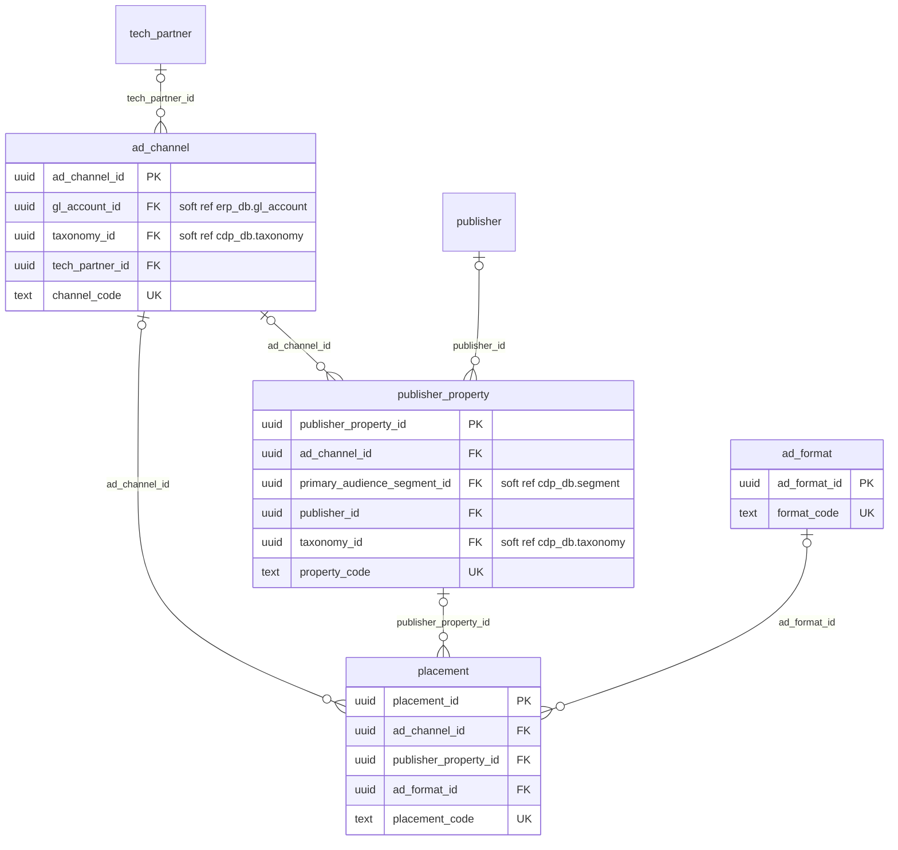
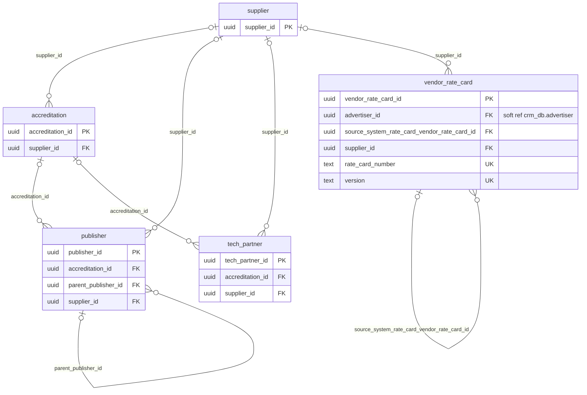

# media_ops_db: physical ERD

Generated by advgen from the pinned Advertising MVM; do not edit by hand. Regenerate with `uv run advgen build`.

**System:** Mediaocean Prisma (media planning and buying). **Instance:** `pg-media-ops` (port 5435).

Diagrams show key columns only: **PK**, **FK** (enforced), **UK** and soft references (labelled `soft ref`, unenforced cross-system or partitioned-target references). Lookup FKs to `ref.*` are omitted for legibility; see the data dictionary.

## campaign.campaign_planning

## campaign.media_execution

## media.campaign_planning

## media.media_buying

## media.placement_inventory

## vendor.vendor_registry

## Soft references (95)

| From | To | Nullable | Reason |
|---|---|---|---|
| `campaign.budget_allocation.contract_insertion_order_id` | `crm_db.contract.contract_insertion_order` | yes | cross system |
| `campaign.budget_allocation.cost_center_id` | `erp_db.finance.cost_center` | yes | cross system |
| `campaign.budget_allocation.gl_account_id` | `erp_db.finance.gl_account` | yes | cross system |
| `campaign.budget_allocation.project_budget_id` | `work_mgmt_db.project.project_budget` | yes | cross system |
| `campaign.campaign.advertiser_id` | `crm_db.client.advertiser` | yes | cross system |
| `campaign.campaign.agency_relationship_id` | `crm_db.client.agency_relationship` | yes | cross system |
| `campaign.campaign.agreement_id` | `crm_db.contract.agreement` | yes | cross system |
| `campaign.campaign.attribution_model_id` | `adserver_db.performance.attribution_model` | yes | cross system |
| `campaign.campaign.brand_id` | `crm_db.client.brand` | yes | cross system |
| `campaign.campaign.cost_center_id` | `erp_db.finance.cost_center` | yes | cross system |
| `campaign.campaign.persona_id` | `cdp_db.audience.persona` | yes | cross system |
| `campaign.campaign.sow_id` | `crm_db.contract.sow` | yes | cross system |
| `campaign.campaign_kpi_target.sla_id` | `crm_db.contract.sla` | yes | cross system |
| `campaign.campaign_kpi_target.target_audience_segment_id` | `cdp_db.audience.segment` | yes | cross system |
| `campaign.flight.cost_center_id` | `erp_db.finance.cost_center` | yes | cross system |
| `campaign.flight.milestone_id` | `work_mgmt_db.project.milestone` | yes | cross system |
| `campaign.targeting_rule.segment_id` | `cdp_db.audience.segment` | yes | cross system |
| `campaign.ad.asset_id` | `work_mgmt_db.creative.asset` | yes | cross system |
| `campaign.ad.spec_id` | `work_mgmt_db.creative.spec` | yes | cross system |
| `campaign.creative_assignment.asset_id` | `work_mgmt_db.creative.asset` | yes | cross system |
| `campaign.creative_assignment.deliverable_tracker_id` | `work_mgmt_db.project.deliverable_tracker` | yes | cross system |
| `campaign.line_item.contract_rate_card_id` | `crm_db.contract.contract_rate_card` | yes | cross system |
| `campaign.line_item.creative_brief_id` | `work_mgmt_db.creative.creative_brief` | yes | cross system |
| `campaign.line_item.creative_deliverable_id` | `work_mgmt_db.creative.creative_deliverable` | yes | cross system |
| `campaign.line_item.spec_id` | `work_mgmt_db.creative.spec` | yes | cross system |
| `campaign.line_item.work_package_id` | `work_mgmt_db.project.work_package` | yes | cross system |
| `campaign.trafficking_order.contract_insertion_order_id` | `crm_db.contract.contract_insertion_order` | yes | cross system |
| `campaign.trafficking_order.task_id` | `work_mgmt_db.project.task` | yes | cross system |
| `media.media_placement.asset_id` | `work_mgmt_db.creative.asset` | yes | cross system |
| `media.media_placement.contract_rate_card_id` | `crm_db.contract.contract_rate_card` | yes | cross system |
| `media.media_placement.cost_center_id` | `erp_db.finance.cost_center` | yes | cross system |
| `media.media_placement.gl_account_id` | `erp_db.finance.gl_account` | yes | cross system |
| `media.media_placement.primary_media_audience_segment_id` | `cdp_db.audience.segment` | yes | cross system |
| `media.media_placement.spec_id` | `work_mgmt_db.creative.spec` | yes | cross system |
| `media.plan.advertiser_id` | `crm_db.client.advertiser` | yes | cross system |
| `media.plan.agency_relationship_id` | `crm_db.client.agency_relationship` | yes | cross system |
| `media.plan.brand_id` | `crm_db.client.brand` | yes | cross system |
| `media.plan.cost_center_id` | `erp_db.finance.cost_center` | yes | cross system |
| `media.plan.creative_brief_id` | `work_mgmt_db.creative.creative_brief` | yes | cross system |
| `media.plan.finance_budget_id` | `erp_db.finance.finance_budget` | yes | cross system |
| `media.plan.gl_account_id` | `erp_db.finance.gl_account` | yes | cross system |
| `media.plan.initiative_id` | `work_mgmt_db.project.initiative` | yes | cross system |
| `media.plan.persona_id` | `cdp_db.audience.persona` | yes | cross system |
| `media.plan.segment_id` | `cdp_db.audience.segment` | yes | cross system |
| `media.plan.sow_id` | `crm_db.contract.sow` | yes | cross system |
| `media.plan_line.asset_id` | `work_mgmt_db.creative.asset` | yes | cross system |
| `media.plan_line.contract_rate_card_id` | `crm_db.contract.contract_rate_card` | yes | cross system |
| `media.plan_line.cost_center_id` | `erp_db.finance.cost_center` | yes | cross system |
| `media.plan_line.creative_brief_id` | `work_mgmt_db.creative.creative_brief` | yes | cross system |
| `media.plan_line.gl_account_id` | `erp_db.finance.gl_account` | yes | cross system |
| `media.plan_line.segment_id` | `cdp_db.audience.segment` | yes | cross system |
| `media.schedule.asset_id` | `work_mgmt_db.creative.asset` | yes | cross system |
| `media.schedule.cost_center_id` | `erp_db.finance.cost_center` | yes | cross system |
| `media.schedule.gl_account_id` | `erp_db.finance.gl_account` | yes | cross system |
| `media.schedule.initiative_id` | `work_mgmt_db.project.initiative` | yes | cross system |
| `media.schedule.segment_id` | `cdp_db.audience.segment` | yes | cross system |
| `media.schedule.sow_id` | `crm_db.contract.sow` | yes | cross system |
| `media.buy.asset_id` | `work_mgmt_db.creative.asset` | yes | cross system |
| `media.buy.contract_rate_card_id` | `crm_db.contract.contract_rate_card` | yes | cross system |
| `media.buy.cost_center_id` | `erp_db.finance.cost_center` | yes | cross system |
| `media.buy.finance_budget_id` | `erp_db.finance.finance_budget` | yes | cross system |
| `media.buy.gl_account_id` | `erp_db.finance.gl_account` | yes | cross system |
| `media.buy.initiative_id` | `work_mgmt_db.project.initiative` | yes | cross system |
| `media.buy.segment_id` | `cdp_db.audience.segment` | yes | cross system |
| `media.buy.sow_id` | `crm_db.contract.sow` | yes | cross system |
| `media.media_insertion_order.advertiser_id` | `crm_db.client.advertiser` | yes | cross system |
| `media.media_insertion_order.agency_relationship_id` | `crm_db.client.agency_relationship` | yes | cross system |
| `media.media_insertion_order.agreement_id` | `crm_db.contract.agreement` | yes | cross system |
| `media.media_insertion_order.brand_id` | `crm_db.client.brand` | yes | cross system |
| `media.media_insertion_order.cost_center_id` | `erp_db.finance.cost_center` | yes | cross system |
| `media.media_insertion_order.finance_budget_id` | `erp_db.finance.finance_budget` | yes | cross system |
| `media.media_insertion_order.gl_account_id` | `erp_db.finance.gl_account` | yes | cross system |
| `media.media_insertion_order.initiative_id` | `work_mgmt_db.project.initiative` | yes | cross system |
| `media.media_insertion_order.sow_id` | `crm_db.contract.sow` | yes | cross system |
| `media.media_insertion_order.contract_insertion_order_id` | `crm_db.contract.contract_insertion_order` | yes | cross system |
| `media.programmatic_deal.advertiser_id` | `crm_db.client.advertiser` | yes | cross system |
| `media.programmatic_deal.agreement_id` | `crm_db.contract.agreement` | yes | cross system |
| `media.programmatic_deal.brand_id` | `crm_db.client.brand` | yes | cross system |
| `media.programmatic_deal.cost_center_id` | `erp_db.finance.cost_center` | yes | cross system |
| `media.programmatic_deal.finance_budget_id` | `erp_db.finance.finance_budget` | yes | cross system |
| `media.programmatic_deal.gl_account_id` | `erp_db.finance.gl_account` | yes | cross system |
| `media.programmatic_deal.segment_id` | `cdp_db.audience.segment` | yes | cross system |
| `media.programmatic_deal.spec_id` | `work_mgmt_db.creative.spec` | yes | cross system |
| `media.trafficking_instruction.asset_id` | `work_mgmt_db.creative.asset` | yes | cross system |
| `media.trafficking_instruction.cost_center_id` | `erp_db.finance.cost_center` | yes | cross system |
| `media.trafficking_instruction.creative_brief_id` | `work_mgmt_db.creative.creative_brief` | yes | cross system |
| `media.trafficking_instruction.segment_id` | `cdp_db.audience.segment` | yes | cross system |
| `media.trafficking_instruction.sow_id` | `crm_db.contract.sow` | yes | cross system |
| `media.trafficking_instruction.spec_id` | `work_mgmt_db.creative.spec` | yes | cross system |
| `media.trafficking_instruction.suppression_list_id` | `cdp_db.audience.suppression_list` | yes | cross system |
| `media.ad_channel.gl_account_id` | `erp_db.finance.gl_account` | yes | cross system |
| `media.ad_channel.taxonomy_id` | `cdp_db.audience.taxonomy` | yes | cross system |
| `media.publisher_property.primary_audience_segment_id` | `cdp_db.audience.segment` | yes | cross system |
| `media.publisher_property.taxonomy_id` | `cdp_db.audience.taxonomy` | yes | cross system |
| `vendor.vendor_rate_card.advertiser_id` | `crm_db.client.advertiser` | yes | cross system |
