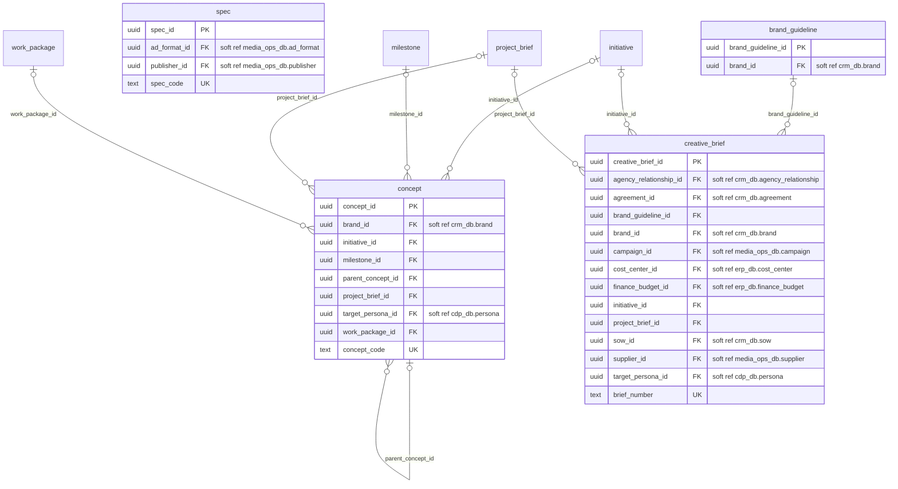
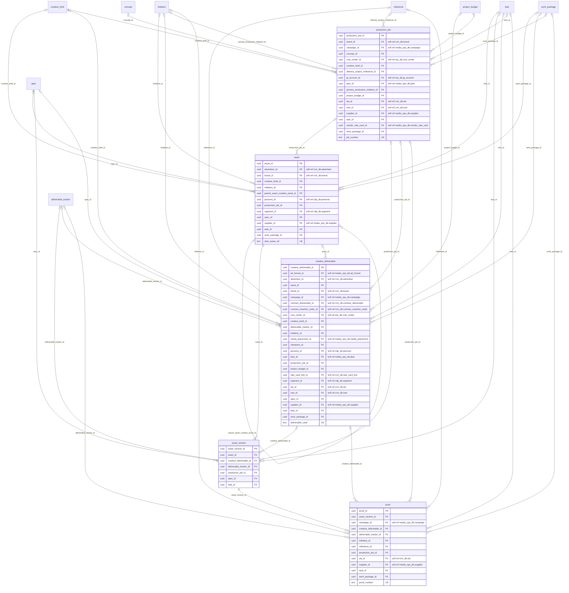
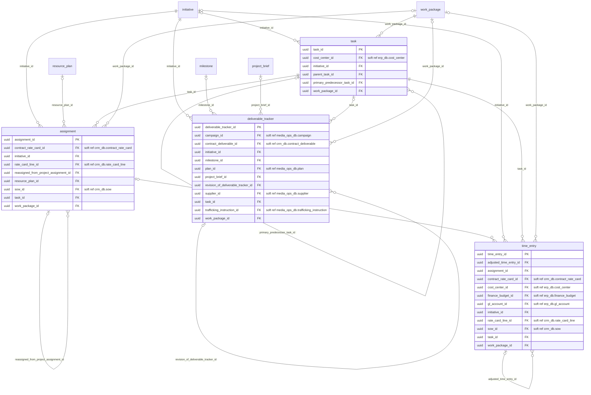
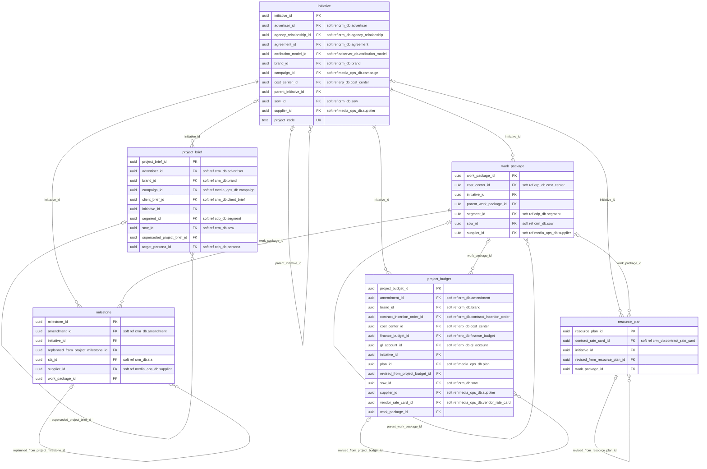

# work_mgmt_db: physical ERD

Generated by advgen from the pinned Advertising MVM; do not edit by hand. Regenerate with `uv run advgen build`.

**System:** Adobe Workfront + DAM. **Instance:** `pg-work-mgmt` (port 5436).

Diagrams show key columns only: **PK**, **FK** (enforced), **UK** and soft references (labelled `soft ref`, unenforced cross-system or partitioned-target references). Lookup FKs to `ref.*` are omitted for legibility; see the data dictionary.

## creative.brief_strategy

## creative.production_delivery

## project.delivery_execution

## project.project_planning

## Soft references (95)

| From | To | Nullable | Reason |
|---|---|---|---|
| `creative.brand_guideline.brand_id` | `crm_db.client.brand` | yes | cross system |
| `creative.concept.brand_id` | `crm_db.client.brand` | yes | cross system |
| `creative.concept.target_persona_id` | `cdp_db.audience.persona` | yes | cross system |
| `creative.creative_brief.agency_relationship_id` | `crm_db.client.agency_relationship` | yes | cross system |
| `creative.creative_brief.agreement_id` | `crm_db.contract.agreement` | yes | cross system |
| `creative.creative_brief.brand_id` | `crm_db.client.brand` | no | cross system |
| `creative.creative_brief.campaign_id` | `media_ops_db.campaign.campaign` | no | cross system |
| `creative.creative_brief.cost_center_id` | `erp_db.finance.cost_center` | yes | cross system |
| `creative.creative_brief.finance_budget_id` | `erp_db.finance.finance_budget` | yes | cross system |
| `creative.creative_brief.sow_id` | `crm_db.contract.sow` | yes | cross system |
| `creative.creative_brief.supplier_id` | `media_ops_db.vendor.supplier` | yes | cross system |
| `creative.creative_brief.target_persona_id` | `cdp_db.audience.persona` | yes | cross system |
| `creative.spec.ad_format_id` | `media_ops_db.media.ad_format` | yes | cross system |
| `creative.spec.publisher_id` | `media_ops_db.vendor.publisher` | yes | cross system |
| `creative.asset.advertiser_id` | `crm_db.client.advertiser` | yes | cross system |
| `creative.asset.brand_id` | `crm_db.client.brand` | yes | cross system |
| `creative.asset.persona_id` | `cdp_db.audience.persona` | yes | cross system |
| `creative.asset.segment_id` | `cdp_db.audience.segment` | yes | cross system |
| `creative.asset.supplier_id` | `media_ops_db.vendor.supplier` | yes | cross system |
| `creative.creative_deliverable.ad_format_id` | `media_ops_db.media.ad_format` | yes | cross system |
| `creative.creative_deliverable.advertiser_id` | `crm_db.client.advertiser` | yes | cross system |
| `creative.creative_deliverable.brand_id` | `crm_db.client.brand` | yes | cross system |
| `creative.creative_deliverable.campaign_id` | `media_ops_db.campaign.campaign` | yes | cross system |
| `creative.creative_deliverable.contract_deliverable_id` | `crm_db.contract.contract_deliverable` | yes | cross system |
| `creative.creative_deliverable.contract_insertion_order_id` | `crm_db.contract.contract_insertion_order` | yes | cross system |
| `creative.creative_deliverable.cost_center_id` | `erp_db.finance.cost_center` | yes | cross system |
| `creative.creative_deliverable.media_placement_id` | `media_ops_db.media.media_placement` | yes | cross system |
| `creative.creative_deliverable.persona_id` | `cdp_db.audience.persona` | yes | cross system |
| `creative.creative_deliverable.plan_id` | `media_ops_db.media.plan` | yes | cross system |
| `creative.creative_deliverable.rate_card_line_id` | `crm_db.contract.rate_card_line` | yes | cross system |
| `creative.creative_deliverable.segment_id` | `cdp_db.audience.segment` | yes | cross system |
| `creative.creative_deliverable.sla_id` | `crm_db.contract.sla` | yes | cross system |
| `creative.creative_deliverable.sow_id` | `crm_db.contract.sow` | yes | cross system |
| `creative.creative_deliverable.supplier_id` | `media_ops_db.vendor.supplier` | yes | cross system |
| `creative.production_job.brand_id` | `crm_db.client.brand` | yes | cross system |
| `creative.production_job.campaign_id` | `media_ops_db.campaign.campaign` | yes | cross system |
| `creative.production_job.cost_center_id` | `erp_db.finance.cost_center` | yes | cross system |
| `creative.production_job.gl_account_id` | `erp_db.finance.gl_account` | yes | cross system |
| `creative.production_job.plan_id` | `media_ops_db.media.plan` | yes | cross system |
| `creative.production_job.sla_id` | `crm_db.contract.sla` | yes | cross system |
| `creative.production_job.sow_id` | `crm_db.contract.sow` | yes | cross system |
| `creative.production_job.supplier_id` | `media_ops_db.vendor.supplier` | yes | cross system |
| `creative.production_job.vendor_rate_card_id` | `media_ops_db.vendor.vendor_rate_card` | yes | cross system |
| `creative.proof.campaign_id` | `media_ops_db.campaign.campaign` | yes | cross system |
| `creative.proof.sla_id` | `crm_db.contract.sla` | yes | cross system |
| `creative.proof.supplier_id` | `media_ops_db.vendor.supplier` | yes | cross system |
| `project.assignment.contract_rate_card_id` | `crm_db.contract.contract_rate_card` | yes | cross system |
| `project.assignment.rate_card_line_id` | `crm_db.contract.rate_card_line` | yes | cross system |
| `project.assignment.sow_id` | `crm_db.contract.sow` | yes | cross system |
| `project.deliverable_tracker.campaign_id` | `media_ops_db.campaign.campaign` | yes | cross system |
| `project.deliverable_tracker.contract_deliverable_id` | `crm_db.contract.contract_deliverable` | yes | cross system |
| `project.deliverable_tracker.plan_id` | `media_ops_db.media.plan` | yes | cross system |
| `project.deliverable_tracker.supplier_id` | `media_ops_db.vendor.supplier` | yes | cross system |
| `project.deliverable_tracker.trafficking_instruction_id` | `media_ops_db.media.trafficking_instruction` | yes | cross system |
| `project.task.cost_center_id` | `erp_db.finance.cost_center` | yes | cross system |
| `project.time_entry.contract_rate_card_id` | `crm_db.contract.contract_rate_card` | yes | cross system |
| `project.time_entry.cost_center_id` | `erp_db.finance.cost_center` | yes | cross system |
| `project.time_entry.finance_budget_id` | `erp_db.finance.finance_budget` | yes | cross system |
| `project.time_entry.gl_account_id` | `erp_db.finance.gl_account` | yes | cross system |
| `project.time_entry.rate_card_line_id` | `crm_db.contract.rate_card_line` | yes | cross system |
| `project.time_entry.sow_id` | `crm_db.contract.sow` | yes | cross system |
| `project.initiative.advertiser_id` | `crm_db.client.advertiser` | yes | cross system |
| `project.initiative.agency_relationship_id` | `crm_db.client.agency_relationship` | yes | cross system |
| `project.initiative.agreement_id` | `crm_db.contract.agreement` | yes | cross system |
| `project.initiative.attribution_model_id` | `adserver_db.performance.attribution_model` | yes | cross system |
| `project.initiative.brand_id` | `crm_db.client.brand` | yes | cross system |
| `project.initiative.campaign_id` | `media_ops_db.campaign.campaign` | yes | cross system |
| `project.initiative.cost_center_id` | `erp_db.finance.cost_center` | yes | cross system |
| `project.initiative.sow_id` | `crm_db.contract.sow` | yes | cross system |
| `project.initiative.supplier_id` | `media_ops_db.vendor.supplier` | yes | cross system |
| `project.milestone.amendment_id` | `crm_db.contract.amendment` | yes | cross system |
| `project.milestone.sla_id` | `crm_db.contract.sla` | yes | cross system |
| `project.milestone.supplier_id` | `media_ops_db.vendor.supplier` | yes | cross system |
| `project.project_brief.advertiser_id` | `crm_db.client.advertiser` | yes | cross system |
| `project.project_brief.brand_id` | `crm_db.client.brand` | yes | cross system |
| `project.project_brief.campaign_id` | `media_ops_db.campaign.campaign` | no | cross system |
| `project.project_brief.client_brief_id` | `crm_db.client.client_brief` | yes | cross system |
| `project.project_brief.segment_id` | `cdp_db.audience.segment` | yes | cross system |
| `project.project_brief.sow_id` | `crm_db.contract.sow` | yes | cross system |
| `project.project_brief.target_persona_id` | `cdp_db.audience.persona` | yes | cross system |
| `project.project_budget.amendment_id` | `crm_db.contract.amendment` | yes | cross system |
| `project.project_budget.brand_id` | `crm_db.client.brand` | yes | cross system |
| `project.project_budget.contract_insertion_order_id` | `crm_db.contract.contract_insertion_order` | yes | cross system |
| `project.project_budget.cost_center_id` | `erp_db.finance.cost_center` | yes | cross system |
| `project.project_budget.finance_budget_id` | `erp_db.finance.finance_budget` | yes | cross system |
| `project.project_budget.gl_account_id` | `erp_db.finance.gl_account` | yes | cross system |
| `project.project_budget.plan_id` | `media_ops_db.media.plan` | yes | cross system |
| `project.project_budget.sow_id` | `crm_db.contract.sow` | yes | cross system |
| `project.project_budget.supplier_id` | `media_ops_db.vendor.supplier` | yes | cross system |
| `project.project_budget.vendor_rate_card_id` | `media_ops_db.vendor.vendor_rate_card` | yes | cross system |
| `project.resource_plan.contract_rate_card_id` | `crm_db.contract.contract_rate_card` | yes | cross system |
| `project.work_package.cost_center_id` | `erp_db.finance.cost_center` | yes | cross system |
| `project.work_package.segment_id` | `cdp_db.audience.segment` | yes | cross system |
| `project.work_package.sow_id` | `crm_db.contract.sow` | yes | cross system |
| `project.work_package.supplier_id` | `media_ops_db.vendor.supplier` | yes | cross system |
